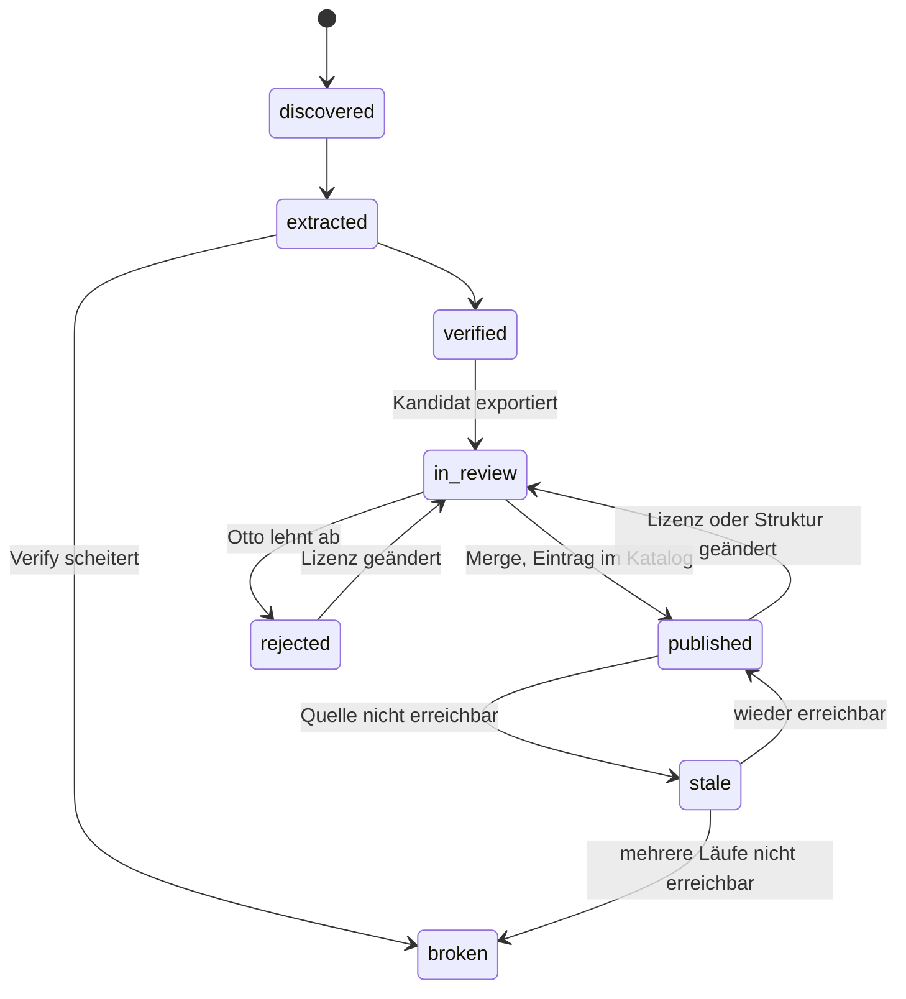

# ADR 0025 — Harvest-Pipeline

- **Status:** **Entwurf**, offen für Ottos Antworten (§11).
- **Datum:** 2026-11-06
- **Aufgabe:** M5-03 laut `docs/plans/m5/m5-discovery-und-suche.md` §5a (Entscheidungsvorlage B, §4). Die Nummer 0025 ist dort fest vergeben.
- **Autonomiestufe:** C. Kein Produktivcode.
  - Geändert sind nur dieses ADR und eine Zeile im Entscheidungslog.
  - Unverändert bleiben `backend/`, `frontend/`, `scripts/`, Registry, Fixtures, Backlog, M5-Plan, `.importlinter`, `.github/`, `.claude/` und `CLAUDE.md`.
- **Vorab fest:**
  - Reihenfolge: zuerst Quellen von Hand, dann die Pipeline (Plan §5 Antwort 1).
  - Zunächst nur Raster (Antwort 2).
  - Discovery-Umfang: feste Liste bekannter Quellen plus STAC Index, dazu CKAN/DCAT-AP für GovData, data.gv.at und opendata.swiss; offene Suche erst in Paket 7b (Antwort 5).
  - Nur frei und ohne Schlüssel; anonymes Token zählt, kostenloses Konto nicht (Plan §2 Punkte 3 und 6).
  - Lizenz-Einstufung und Freigabe immer durch Otto (`CLAUDE.md`, B11).
  - Der YAML-Lader dieser Aufgabe trägt `legal_status`, das Präfix `proto-` und die Startprüfung aus `adr/0024` (§10, F10) sowie `access.account` aus `adr/0027` (§6.1, F8).
- **Grundlage:**
  - `ENTSCHEIDUNGEN_2026-09-18.md` §1, §3, §4, §5.
  - `KLAERUNGEN.md` B8, B9, B10, B11, B12, B13.
  - `projektuebersicht.md` §2 (Prinzipien 1, 2, 5, 11, 12, 15), §5 (Onboarding-Checkliste).
  - `projektplan.md` §4 M5 (Abnahme), §1.2.
  - `architekturplan.md` 3.1, 3.2, 4.1–4.5, 5.1, 5.2, 10, 11.
  - `adr/0009` (Einmal-Befehl `materialize`), `adr/0011` (Adapter-Interface), `adr/0022` (`data_region`), `adr/0023` (§7.4 Kataloge, §8.3, §11), `adr/0024` (Prototyp-Quellen), `adr/0027` (Quellen mit Konto).
- **Betroffen (erst mit einer Entscheidung):** `catalog/datasets.py` und die sechs Importstellen von `REGISTRY`, `catalog/registry.py`, `discovery`, `gateway` (Kopfzeile `User-Agent`), `backend/Dockerfile`, Compose-Dienst `harvester`, neue Migrationen, `architekturplan.md` 4.3, 4.4, 5.1, Projektplan M5 (Abnahme).

---

## Methode und Belegstufen

Belegstufen wie in `adr/0022` und `adr/0023`:

- **M:** in dieser Sitzung gemessen; Verfahren unten.
- **P:** am Primärdokument selbst gelesen. Im Repo mit Pfad.
- **P\*:** Primärdokument über das Abrufwerkzeug eines Hilfsagenten gelesen, sinngemäß.
- **S:** Suchtreffer, Zusammenfassung oder Vorwissen, Wortlaut nicht geprüft.
- **A:** eigene Ableitung, ein Argument und kein Beleg.

**Messung vom 06.11.2026 [M]:**

- Nur Kataloge, nur Metadaten. Kein Asset, keine Datei, keine Fläche.
- Mit `curl` aus der Sitzung, wie Weg B in `adr/0023` §9.3. `gateway` verbindet sich ohne den HTTPS-Proxy der Sitzung mit der geprüften Adresse (`scripts/m5-01-sources/probe.py`, Kopf) und taugt hier deshalb nicht zum Messen. Ein Messskript liegt deshalb nicht bei.
- Je Endpunkt: ein `GET`; Status, Größe, ob `ETag` bzw. `Last-Modified` da ist, `Cache-Control`. Dann dasselbe mit `If-None-Match` bzw. `If-Modified-Since`. Dann ein zweites `GET`, um zu sehen, ob der Körper bytegleich ist.
- Bei CKAN zusätzlich `package_search` mit `rows=0` (nur die Zahl), mit `fq=metadata_modified:[NOW-7DAYS TO *]` und mit Facetten `res_format`, `groups`.
- Werte von `ETag`, Item-IDs und genaue Adressen von Dateien stehen nicht in diesem Dokument. Die Katalogadressen sind öffentlich und stehen in `adr/0023`.
- Nicht erreichbar aus der Sitzung: `www.data.gv.at` (Verbindung abgelehnt). Nicht gemessen: der ATOM-Feed des BEV (dessen `ETag` und `304` sind in `adr/0023` §4.2 schon gemessen).

---

## 0. Kurzfassung

1. **Der Dienst `harvester` ist heute eine leere Hülle** [P]: Er startet, meldet `/health` und tut nichts. Echte Discovery gibt es nur als Einmal-Befehl `materialize` für Items einer Bucket-Quelle, mit ETag, `304` und Lauf-Tabelle (§2).
2. **Bedingte Anfragen gibt es nicht überall** [M] (§3):
   - `304` auf `If-None-Match`: Collection-Seiten der FSDI, Collections von Earth Search, die Katalogliste des STAC Index, BEV und WorldCover (`adr/0023`).
   - Kein `ETag`, kein `Last-Modified`: die Collection-Liste der FSDI (514 Collections auf 6 Seiten, `no-store`), `package_search` bei GovData und opendata.swiss, `/v1/datasets` bei GeoSphere.
   - `metadata_modified` taugt bei CKAN nicht als Änderungszeichen: In den letzten 7 Tagen trugen bei GovData 82 811 von 161 380 Datensätzen ein neues Datum, bei opendata.swiss 7 352 von 16 211.
   - **Folge:** Die Abnahme „ein erneuter Lauf kostet nur bedingte Requests“ ist so nicht erreichbar. Vorschlag F7: bedingt, wo die Quelle es kann; sonst eine Liste ohne Folgearbeit, entschieden über den Inhalts-Hash.
3. **Empfehlung** (§8):
   - **Zustand in Postgres, Vorschläge in Git.** Die Pipeline läuft im Modul `discovery` als Befehle, die der Prozess `harvester` später nur zeitlich anstößt. Rohantworten, Inhalts-Hash und Zustand je Fund liegen in eigenen Tabellen.
   - **Ein Vorschlag ist ein Kandidat, kein Registry-Eintrag.** Aus einer geernteten Collection lassen sich Capabilities, Darstellung und die drei Eigenheiten nicht ableiten (B10, Plan §2 Punkt 7). Der Harvester schreibt deshalb Kandidatendateien. Was davon in den Katalog kommt, entscheidet Otto im PR.
   - **Neue Stufe „gelistet“** für Katalogeinträge mit Link (B11 Stufe 1, `adr/0027` W0): ein kleiner Eintrag mit Lizenz, Ausdehnung, Link und `access.account`, ohne Anzeige und ohne Processing.
   - **PR ohne Secret der Plattform:** Ein Befehl legt die Kandidaten auf einem Branch ab; den Draft-PR öffnet Otto oder eine Sitzung mit eigenem Zugang (F3).
   - **YAML-Lader:** Einträge unter `backend/catalog/`, ein Lader an einer Stelle, Prototyp-Verzeichnis nie im Image, Pflichtfelder `legal_status` und `access.account` ohne Vorgabe (§7).
4. **Mehrere Stände je Kachel** (swissALTI3D, BEV): Die Pipeline entscheidet die Regel nicht; die bleibt bei M5-08 (Plan F2). Sie betrifft sie an zwei Stellen: Dedupe darf Stände nicht zu Spiegeln zusammenlegen, und ein ATOM-Feed mit Stichtagen ergibt einen Kandidaten mit Ständen, nicht sechs (§9).
5. **Neu gemessen:** opendata.swiss lehnt den `User-Agent` von `curl` mit `403` ab und antwortet einem eigenen mit `200` [M]. `gateway` setzt heute keinen eigenen `User-Agent` [P]. Er wird Pflicht für den Harvester (§6.2).

---

## 1. Kontext und Frage

M5 soll den „Datacrawler“ bauen (Projektplan §4 M5). `adr/0023` hat die Quellen gesichtet und drei von Hand gewählt; dieses ADR legt fest, wie die Plattform Quellen danach selbst findet, prüft und zur Freigabe vorlegt.

**Fragen:**

1. Was kann der vorhandene `harvester`, und was davon trägt?
2. Wie sieht die Pipeline aus: Stufen, Zustand, Rohspeicherung, Inhalts-Hash, Kosten eines zweiten Laufs?
3. Wie kommen Vorschläge in den Git-Review, und was ist ein Vorschlag?
4. Wie sieht der YAML-Lader aus (B13 Stufe 2), mit `legal_status`, `proto-` und `access.account`?
5. Betreffen mehrere Stände je Kachel die Pipeline?

**Nicht Teil dieses ADR:** die Hybrid-Suche und das Bewertungs-Set (`adr/0026`), die Regel für mehrere Stände selbst (M5-08), Discovery-Stufen 2 und 3 (Paket 7, `architekturplan.md` 4.2), eine Review-Oberfläche (4.4: erst, wenn das Volumen es verlangt).

## 2. Befund am Code

| Stelle | Heute | Folge |
|---|---|---|
| `discovery/main.py:1–25` | Prozess `harvester`: FastAPI mit `/health`, sonst nichts („M1 stub“) [P] | Keine Logik zu erhalten; der Prozess ist frei |
| `docker-compose.yml:348–366` | Dienst `harvester` hängt an Postgres und am Objektspeicher (nur `depends_on`), ohne Schlüssel [P]; `tests/compose/test_compose_objectstore_wiring.py:41` prüft, dass er keinen bekommt | Objektspeicher wird nicht gebraucht (§4.3); die Abhängigkeit kann weg |
| `discovery/materialize.py` | Einmal-Befehl: Items einer Bucket-Quelle nach pgstac, eine Transaktion, `--force` [P] | Muster für jeden Pipeline-Schritt: Lauf gegen offene Verbindung und offenes `gateway`, CLI nur als Hülle |
| `catalog/migrations/004_materialize_runs.sql` | Lauf-Tabelle: je Lauf eine Zeile mit `source_version` (ETag), `loaded`/`unchanged` [P] | Vorbild für `earthx_harvest_run`; der Lauf liest seine letzte Version selbst |
| `adapters/cop_dem_bucket.py:244–311` | Bedingte Anfrage mit `if-none-match`; ohne ETag bricht der Lauf ab [P] | Bedingte Anfragen liegen heute im Adapter, nicht im `gateway` |
| `adapters/spec.py` | `AdapterSpec` je Protokoll mit `search`, `fetch`, `materialize`, Coverage [P] | Discovery von Collections ist eine **neue** Fähigkeit; sie gehört nach `adr/0011` in dieselbe Tabelle |
| `gateway/client.py:92–115`, `policy.py:61–75` | Allowlist je Aufrufer, 6 Verbindungen je Host, 3 Versuche bei `429/502/503/504`, `Retry-After` bis 10 s, Antwort bis 8 MB, keine Weiterleitung außerhalb der Liste [P] | Trägt den Harvester; es fehlen `User-Agent`, Abstand je Host, `robots.txt`, Unterbrecher je Host (§6.2) |
| `gateway` (Suche nach `User-Agent`) | kein eigener Kopf; nur `adapters/nominatim.py:384` setzt einen, aus `EARTHX_GEOCODER_USER_AGENT` mit Vorgabe aus der Repo-Adresse (`api/dependencies.py:45`) [P] | Vorbild für den Harvester |
| `catalog/datasets.py:789` | `REGISTRY` als Modulkonstante aus zwei Einträgen und `RETIRED` [P]; importiert in `catalog/load.py`, `api/main.py`, `api/tiler.py`, `discovery/materialize.py`, `runner/cli.py`, `runner/recipe_file.py` | Der Lader ersetzt sechs Importe durch eine Funktion (`adr/0024` §3) |
| `catalog/registry.py:306–312` | `AccessInfo` mit `token_free_checked_at: date` (Pflicht) [P] | Für `free_account` muss das Datum leer sein können (`adr/0027` §6.1) |
| `catalog/registry.py:726–737` | `HealthInfo` nur mit `status`; „ein echtes Prüfdatum kommt mit M5 auf einem eigenen Feld“ [P] | Prüfdatum gehört nicht in YAML (§6.6) |
| `catalog/pgstac.py:139–150` | `load_registry` schreibt alle Einträge und entfernt föderierte Collections, die fehlen [P] | Bleibt der Weg nach pgstac; neue Stufe „gelistet“ kommt dazu |
| `backend/Dockerfile:52` | `COPY earthx ./earthx`; Build-Kontext ist `./backend` [P] | YAML muss unter `backend/` liegen, um ins Image zu kommen |
| `backend/requirements.lock` | `pyyaml==6.0.3` und `pydantic==2.13.5` schon gesperrt [P] | Kein neues Paket nötig |

## 3. Messung an den Katalogen [M]

| Endpunkt | Größe | `ETag` | bedingt | `Cache-Control` | zweiter Abruf bytegleich |
|---|---|---|---|---|---|
| FSDI `/collections?limit=100` | 284 KB je Seite, 514 Collections auf 6 Seiten | nein | — | `no-store, private` | ja |
| FSDI `/collections/ch.swisstopo.swissalti3d` | 2 KB | ja, stark | `304` | `max-age=600, public` | ja |
| Earth Search `/v1/collections` | 82 KB | ja, schwach | `304` | — | ja |
| STAC Index `/api/catalogs` | 83 KB, 153 Einträge (65 APIs, 88 statisch) | ja, schwach | `304` | — | ja |
| GovData `package_search?rows=10` | 181 KB | nein | — | `max-age=3600` | ja |
| opendata.swiss `package_search?rows=10` | — | nein | — | `max-age=0, must-revalidate` | — |
| GeoSphere `/v1/datasets` | 14 KB | nein | — | — | ja |

**Weitere Befunde [M]:**

- **Lizenz an der FSDI:** 99 der ersten 100 Collections tragen `license: proprietary`, eine `CC-BY`. Die Lizenz steht also nicht maschinenlesbar im STAC-Feld; die Einstufung braucht den Link auf die Bedingungen (wie `adr/0023` §7.4).
- **Umfang CKAN:** GovData 161 380 Datensätze, opendata.swiss 16 211.
- **Änderungsdatum:** `metadata_modified` in den letzten 7 Tagen bei GovData 82 811 (51 %), bei opendata.swiss 7 352 (45 %). Ob sich der Inhalt geändert hat oder nur das Datum beim Weiterernten aus Länderportalen, ist nicht gemessen. Für die Pipeline zählt: Das Datum allein spart wenig [A].
- **Raster in CKAN:** `res_format` ist teils EU-Vokabular, teils Freitext. GovData: TIFF 731, GEOTIFF 274, NETCDF 864, JPEG2000 2, HDF 3 (EU-URIs), `GeoTIFF` als Freitext 1. opendata.swiss: TIFF 371, GeoTIFF 13, NetCDF 0. Ein Rasterfilter braucht je Katalog eine eigene Liste von Formatwerten.
- **`User-Agent`:** opendata.swiss antwortet `curl` mit `403`, einem eigenen `User-Agent` mit Projektadresse mit `200`, ebenso dem Standard von `httpx`.

## 3a. Stand der Technik

Recherche eines Hilfsagenten am 06.11.2026. Die Doku-Seiten von CKAN, GitHub, IETF und OAI waren aus der Sitzung gesperrt; gelesen wurde deshalb der Quelltext der Doku bzw. des Dienstes auf GitHub (Quellen in §12).

- **ckanext-harvest** ist das Vorbild für Sammeln, Holen und Einspielen [P\*]:
  - Stufen `gather`, `fetch` und `import`.
  - Je Fund ein Objekt mit `guid`, Rohinhalt und Zustand (`WAITING`, `FETCH`, `IMPORT`, `COMPLETE`, `ERROR`).
  - Ein Merker `current` zeigt den zuletzt eingespielten Stand.
  - Der CKAN-Harvester dort erkennt Änderungen nur am Datum `metadata_modified`, ohne Inhalts-Hash. Er fragt mit `fq=metadata_modified:[<seit> TO *]`, eine Stunde Überlappung und `rows=100`.
- **ckanext-dcat** [P\*]:
  - Der RDF-Harvester spielt jeden Datensatz bei jedem Lauf neu ein.
  - Gelöschte Datensätze erkennt er als Menge: bekannte IDs minus gefundene IDs.
  - Die DCAT-Endpunkte `/catalog.{ttl,xml,jsonld}` kennen `modified_since` und blättern mit Hydra-Links, 100 Datensätze je Seite.
  - Ob GovData, opendata.swiss und data.gv.at sie anbieten, ist nicht belegt.
- **CKAN-API** [P\*, Quelltext]:
  - `package_search` liefert höchstens 1 000 Zeilen je Seite (`ckan.search.rows_max`).
  - Die API setzt selbst kein `ETag` und kein `Last-Modified`. Das passt zu §3.
  - Ein Abruf ab einem Datum findet keine gelöschten Datensätze; dafür braucht es von Zeit zu Zeit die volle Liste der IDs.
- **Folgerung [A]:**
  - Datum als Vorfilter, Inhalts-Hash als Entscheidung.
  - Löschungen über einen vollen ID-Abgleich in größerem Abstand (Vorschlag: wöchentlich).
  - Das ist genau, was ckanext-harvest fehlt und was §3 nahelegt.
- **STAC Collection Search** ist eine Extension im Stand „Candidate“ [P\*]. Sie kennt `bbox`, `datetime`, `q` und `filter` und sagt nichts zu `ETag`. Die FSDI braucht sie nicht, weil 514 Collections in 6 Seiten passen [M].
- **STAC Index:** `/api/catalogs` ist nicht dokumentiert [S]. Die Antwort trägt ein `ETag` [M]. Das ist ein Register (Stufe 0), keine zugesagte Schnittstelle; bricht es, fällt nur die Stufe 0 aus.
- **STAC Atlas** ist ein Studienprojekt der Universität Münster mit eigenem Crawler über den STAC Index, ohne dokumentierten öffentlichen Dienst [P\*]. Es taugt als Vergleich, nicht als Quelle.
- **INSPIRE-ATOM:**
  - Aufbau: Ein Dienst-Feed verweist auf Datensatz-Feeds; deren Einträge tragen die Dateien. `<updated>` ist in Feed und Eintrag Pflicht [S].
  - Wie Stände eines Datensatzes darin stehen, ist nicht belegt (§9).
- **`robots.txt` (RFC 9309):** nach Sekundärquellen [S]:
  - `4xx` auf `robots.txt` heißt alles erlaubt; `5xx` oder nicht erreichbar heißt nichts erlaubt.
  - Die Datei höchstens 24 h cachen.
- **Vergleich [S]:** GeoNetwork (CSW, OAI-PMH, THREDDS, geplant, UUID-basiert) und pycsw (CSW-T Harvest, Neuernten per cron) ernten Metadaten nach demselben Muster. Keines prüft Zugang und Format der Assets wie Verify hier.

## 4. Kriterien

| # | Kriterium |
|---|---|
| K1 | **Rücksicht auf die Quellen:** bedingte Anfragen, wo möglich; Abstand je Host; eigener `User-Agent`; `robots.txt` (`architekturplan.md` 4.3) |
| K2 | **Eine Wahrheit** (B13 Punkt 3): kuratierte Einträge nur in Git, pgstac daraus befüllt; kein zweiter gepflegter Bestand in der Datenbank |
| K3 | **Kein Eintrag ohne Otto:** Der Harvester setzt nie `legal_status`, Lizenzstufe oder Capabilities (`adr/0024` R1, B10, B11) |
| K4 | **Sicherheit:** Jede Adresse aus einem fremden Katalog ist nicht vertrauenswürdig (Prinzip 15, `architekturplan.md` 11); alles über `gateway`; keine Secrets der Plattform, wo es ohne geht |
| K5 | **Idempotent und inkrementell:** ein zweiter Lauf ohne Änderung erzeugt keine Arbeit und keinen PR |
| K6 | **Wenig Aufwand** für 1–3 Personen; PRs unter dem Richtwert; Schritte einzeln testbar mit Fixtures |
| K7 | **Prüfbar ohne Netz:** alle Stufen gegen `tests/fixtures`, CI erreicht keine Quelle |

## 5. Pipeline

### 5.1 Stufen (nach `architekturplan.md` 4.3)

| Stufe | Was der Harvester tut | Ergebnis |
|---|---|---|
| **Seed** | liest die Quellenliste aus Git (§5.2) | je Quelle Protokoll, Adresse, Hosts, Filter, Takt |
| **Fetch** | holt Listen und Einträge über `gateway`, bedingt wo möglich | Rohantwort mit `ETag`/`Last-Modified` und SHA-256 |
| **Extract** | Rohformat → Zwischenform, ein Extraktor je Protokoll (STAC, CKAN, GeoSphere, ATOM) | Datensätze mit Schlüssel je Quelle |
| **Normalize** | Zwischenform → STAC-Collection; Unbekanntes bleibt in der Rohantwort | normierte Collection, eigener Hash |
| **Validate** | STAC-Form, eigene Pflichtfelder: Beschreibung, Lizenzangabe oder Link, Zitierangabe | gültig / mit Mängeln |
| **Verify** | anonymer `HEAD` und `Range` auf höchstens 3 Assets je Datensatz (§6.3) | Zugang, Format, Hosts, Vorschlag `access.account` |
| **Enrich** | Footprint aus der Ausdehnung, `data_region` nur bei AWS-Hosts (`adr/0022`), Vorschlag SPDX aus einer Tabelle | Vorschlagsfelder |
| **Dedupe** | DOI, dann kanonische Adresse, dann Titel und Herausgeber (unscharf) | ein Kandidat, mehrere Distributionen (§6.4) |
| **Review** | Kandidatendatei, Draft-PR (§6.5) | `in_review` |
| **Publish** | Merge durch Otto; `catalog-load` beim Start | `published` |

Jede Stufe ist über den Hash ihrer Eingabe geschlüsselt (`architekturplan.md` 4.3). Bleibt der Hash der Rohantwort gleich, endet der Fund nach Fetch. Ändert sich nur die Normalisierung (neuer Code), wird aus der gespeicherten Rohantwort neu abgeleitet, ohne neu zu holen.

### 5.2 Seed: Quellen sind Konfiguration

Eine YAML-Datei je Quelle unter `backend/catalog/sources/` (Vorschlag), im Review wie Einträge:

- `source_id`, `protocol` (`stac-api`, `ckan`, `stac-index`, `geosphere`, `inspire-atom`), `endpoint`, `hosts`;
- Filter je Protokoll, z. B. CKAN `fq` mit den Formatwerten aus §3, STAC eine Liste von Collection-Präfixen;
- `max_requests_per_run`, `min_interval_s` je Host, Takt (`daily`, `weekly`);
- `maturity` der Quelle (wie in der Registry).

**Erste Seed-Liste** (aus `adr/0023` §7.4 und Antwort 5): FSDI STAC, Earth Search v1, GeoSphere `/v1/datasets`, BEV ATOM, STAC Index (nur als Register, Stufe 0: liefert Kataloge, keine Datensätze), GovData, opendata.swiss, data.gv.at (aus der Sitzung nicht erreichbar, Messung bei Otto). AWS Open Data Registry, EODC und CEOS FedEO bleiben für später. Die Liste selbst ist F6.

### 5.3 Zustand und Rohspeicherung

Neue Tabellen in `public`, wie 002–015 (`catalog/migrations/README.md`):

| Tabelle | Inhalt |
|---|---|
| `earthx_harvest_run` | je Lauf und Quelle: Beginn, Ende, Status, Anfragen gesamt, davon `304`, Bytes, Funde neu/geändert/unverändert/weg, Fehler |
| `earthx_raw_record` | je Fund (Quelle + Schlüssel): letzte Rohantwort (gzip, höchstens 1 MB), SHA-256, `ETag`, `Last-Modified`, geholt am |
| `earthx_record_state` | Zustand je Fund, Hash der Normalform, Ergebnis von Verify, Kandidat-ID, „zuletzt erfolgreich geprüft“ |
| `earthx_state_transition` | Protokoll der Übergänge (von, nach, wann, Lauf) |

- **Rohdaten im Sinne von Prinzip 1 sind das nicht:** Es sind kleine Metadaten-Antworten (`architekturplan.md` 4.3). Pixel holt der Harvester nie; Verify liest höchstens 16 KB je Asset und speichert davon nichts außer dem erkannten Format.
- **Kein Objektspeicher** für Rohantworten: Sie sind klein, und `harvester` bekommt so keinen Schlüssel (`test_compose_objectstore_wiring.py:41`) [A].
- **Nur der letzte Stand** der Rohantwort bleibt; die Geschichte steckt im Übergangsprotokoll und in Git.

### 5.4 Zustandsautomat

- `published` erkennt der Harvester ohne GitHub: Die ID steht in der geladenen Registry bzw. in der Liste der gelisteten Einträge.
- `rejected` steht in Git, in `backend/catalog/rejected.yaml` mit Schlüssel, Hash der Lizenzangabe und Grund. Sonst schlüge der Harvester denselben Fund jede Nacht neu vor [A].
- Ein geänderter Fund in `published` öffnet nur dann einen neuen Vorschlag, wenn sich Lizenzangabe, Assets oder Hosts ändern (Review-Pflicht nach 4.3); Titel und Beschreibung allein nicht (F5).

## 6. Einzelfragen

### 6.1 Was ist ein Vorschlag?

Ein `DatasetConfig` hat über 25 Pflichtfelder ohne Vorgabe, darunter Capabilities, `viewer`, `default_render`, `band_units`, `search_filters`, `index_presets` (`registry.py:1025`) [P]. Aus einer geernteten Collection folgt davon fast nichts; Plan §2 Punkt 7 verlangt, dass das Onboarding die Eigenheiten ausdrücklich festlegt.

| | Option | Bewertung |
|---|---|---|
| V1 | **Kandidat:** eigene, kleine Datei mit dem Geernteten (Titel, Beschreibung, Anbieter, Lizenzangabe roh und SPDX-Vorschlag, Ausdehnung, Links, DOI, Distributionen, Verify-Ergebnis, Vorschlag `access.account`, `data_region`) und leeren Entscheidungsfeldern | trennt Fund und Entscheidung; lädt nie in eine Registry (K3) |
| V2 | Vollständiger Registry-Eintrag mit Platzhaltern | widerspricht B10; ein Eintrag ohne `legal_status` lädt nicht (`adr/0024` R1, `adr/0027` §6.1) |
| V3 | Nur ein Bericht (Markdown) je Lauf | lesbar, aber nicht maschinell weiterverwendbar |

**Empfehlung V1.** Aus einem freigegebenen Kandidaten wird entweder ein **gelisteter Eintrag** (§6.1a) oder, als eigene Onboarding-Aufgabe, ein voller Eintrag.

### 6.1a Neue Stufe „gelistet“ (B11 Stufe 1)

Tausende Collections ernten (`architekturplan.md` 5.2) geht nur, wenn ein Katalogeintrag ohne Anzeige und Processing nicht die ganze Handarbeit eines vollen Eintrags braucht. `adr/0027` F2 verlangt solche Einträge in M5 ohnehin für Konto-Quellen (W0).

- **Form:** gemeinsamer Kopf mit dem vollen Eintrag (ID, Titel, Beschreibung, Schlagworte, DOI/Zitat, Ausdehnung, `license` mit `tier = catalog`, `legal_status`, `access` mit `account`, `source` mit Link, `data_region`, `maturity`). Kein `format`, keine Capabilities, kein `viewer`.
- **Wirkung:** erscheint in `/stac/collections` und in der Suche; kein Kachel-, Such- oder Processing-Weg. `tiler`, `processing` und `runner` kennen nur volle Einträge [A].
- **Prüfung beim Laden:** `tier` ist `catalog`; Link auf die Quelle vorhanden; sonst wie bei vollen Einträgen.
- Das ist ein **zweiter Eintragstyp**. `adr/0024` K4 wollte keinen für Prototyp-Quellen; hier geht es um eine andere Stufe nach B11, nicht um einen Sonderweg. Derselbe Lader, dieselben Kopfprüfungen [A]. Frage F2.

### 6.2 Fetch: Rücksicht und `gateway`

- **`User-Agent`:** `Policy` bekommt einen Pflichtwert `user_agent`; `gateway` setzt ihn auf jede Anfrage, ein Aufrufer überschreibt ihn nicht. Vorgabe wie beim Geocoder: Projektname und Repo-Adresse, keine Mail-Adresse einer Person (`api/dependencies.py:45`). Begründung: §3, opendata.swiss.
- **Abstand je Host:** neben den 6 Verbindungen ein Mindestabstand je Host aus der Seed-Datei (Vorschlag 1 s; GeoSphere hat 240 Anfragen je Stunde laut `adr/0023` §8.1 [P]).
- **`robots.txt`:** einmal je Lauf und Host lesen, über `gateway`, und `Disallow` für den eigenen `User-Agent` beachten (`architekturplan.md` 4.3). `5xx` oder nicht erreichbar heißt: der Host ruht in diesem Lauf (RFC 9309, §3a). Gilt für Kataloge; Assets bei Verify fragt der Harvester nur mit `HEAD`/`Range` an.
- **Bedingte Anfragen:** `If-None-Match` mit gespeichertem starkem oder schwachem `ETag`, sonst `If-Modified-Since`. Ein `304` ist im Harvester ein Ergebnis, kein Fehler; heute wirft `gateway` erst ab `400` (`client.py:204`), `304` kommt also schon durch [P].
- **Unterbrecher je Host:** nach 3 Fehlern in Folge ruht die Quelle für den Rest des Laufs; ihre Funde gehen nach `stale`, nicht nach `broken` (§5.4).
- **Seiten ohne `ETag`** (FSDI-Liste, CKAN, GeoSphere): ganz holen, Hash bilden, bei gleichem Hash keine Folgearbeit. Kosten eines Laufs ohne Änderung [M, Größen aus §3]: FSDI 6 Seiten, rund 1,4 MB; GeoSphere 14 KB; GovData mit Rasterfilter rund 2 000 Datensätze, je nach Seitengröße 2–20 Anfragen [A].
- **CKAN inkrementell:** `metadata_modified` als Vorfilter mit einer Stunde Überlappung wie ckanext-harvest (§3a); nach §3 spart es bei GovData und opendata.swiss rund die Hälfte. Entscheidend bleibt der Hash [A].
- **Gelöschte Funde:** Ein Abruf ab einem Datum sieht sie nicht (§3a). Wöchentlich ein voller Abgleich der IDs je Quelle; was fehlt, geht nach `stale`, beim zweiten Fehlen nach `broken` bzw. bei Kandidaten nach `rejected` mit Grund „bei der Quelle entfernt“.

### 6.3 Verify

- **Was:** je Datensatz höchstens 3 Assets; `HEAD`, dann `GET` mit `Range: bytes=0-16383`. Ergebnis: `200`/`206` → `access.account = none`; `401`/`403` → Vorschlag `free_account` statt Verwerfen (`adr/0027` §6.1); `Accept-Ranges`, Format aus den ersten Bytes (TIFF mit `LAYOUT=COG`, NetCDF/HDF5-Signatur, `zarr.json`), CORS mit `Origin`-Kopf.
- **Allowlist:** Die Hosts der Assets kennt der Harvester vorher nicht. Vorschlag: Eine Policy je Datensatz aus Katalog-Host und den Asset-Hosts **dieses** Datensatzes, nur für `HEAD` und `Range`, höchstens 50 neue Hosts je Lauf. `gateway` prüft weiter Schema, private Adressen und jede Weiterleitung; eine Weiterleitung auf einen Host außerhalb ist Ergebnis „nicht geprüft“, nicht Anlass, die Liste zu erweitern [A].
- **Ohne GDAL:** nur Köpfe und Bytes, wie `architekturplan.md` 4.5 für Health-Checks vorschlägt; ein präpariertes Raster erreicht keinen Treiber (§11 dort).
- **Nie Prototyp:** Ein Fund mit unklarer Lizenz wird Kandidat mit dem Hinweis „Lizenz unklar“; `legal_status` bleibt leer (`adr/0024` R1).

### 6.4 Dedupe und Distributionen

- **Schlüssel:** DOI, dann kanonische Adresse (Schema, Host klein, ohne Abfrage und Fragment), dann Titel und Herausgeber unscharf. Treffer über die dritte Stufe werden nur vorgeschlagen, nie zusammengelegt.
- **Ergebnis:** ein Kandidat mit mehreren Distributionen in `earthx:distributions` (`architekturplan.md` 5.1); Vorzug nach Format (Zarr > COG > Legacy) und Region (`adr/0022`).
- **Erwartete Fälle [A]:** Daten der FSDI erscheinen auch in opendata.swiss; Länderdaten auch in GovData; Copernicus-Daten in mehreren STAC-APIs.
- **Stände sind keine Distributionen** (§9): gleiche Kachel, anderer Inhalt.

### 6.5 Weg in den Git-Review

| | Option | Secret | Bewertung |
|---|---|---|---|
| P1 | **Export-Befehl:** `discovery propose` schreibt die Kandidaten nach `backend/catalog/candidates/<quelle>/` in einen lokalen Checkout und committet auf einen neuen Branch. Push und Draft-PR mit Ottos eigenem Zugang oder aus einer Cloud-Sitzung | keines der Plattform | Mensch im Schritt; in M5 genügt das bei wenigen Läufen je Woche |
| P2 | Der Prozess `harvester` öffnet den PR selbst über die GitHub-API | Token mit Schreibrecht auf das Repo im Betrieb | voll automatisch; ein Secret, das nur Otto anlegen darf (Projektplan 1.1) |
| P3 | Geplanter Workflow in GitHub Actions mit dem eingebauten Token | keines neu | Zustand nicht in Postgres; Lauf auf GitHub-Rechnern; Änderung an `.github/`. Ereignisse des eingebauten Tokens starten in der Regel keine weiteren Workflows, die CI liefe am PR also nicht von selbst; Ausnahmen sind `workflow_dispatch` und `repository_dispatch` [P\*]. Die Einstellung „Allow GitHub Actions to create and approve pull requests“ ist bei einem Repo eines persönlichen Kontos ab Werk aus [P\*] |

**Empfehlung P1** für M5, P2 oder P3 als Frage mit M6. Ein Lauf ohne neue oder geänderte Kandidaten erzeugt keinen Branch (K5).

### 6.6 Health-Checks und „zuletzt erfolgreich geprüft“

Plan §3 legt die Health-Checks nach diesem ADR in Fassung 3. Hier nur, was die Pipeline dafür festlegt:

- Ein eigener, häufigerer Schritt je veröffentlichtem Datensatz (`architekturplan.md` 4.5): Katalog erreichbar, ein Asset per `Range`, Vergleich von `ETag`. Gleiche Tabellen und dasselbe `gateway` wie der Harvester.
- **Das Prüfdatum steht nicht in YAML.** Ein Feld, das sich täglich ändert, erzeugte täglich einen PR. Es liegt in `earthx_record_state` bzw. einer Tabelle `earthx_health_check`; `api` fügt es beim Ausliefern der Collection als eigenes Feld unter `earthx:health` an (`registry.py:726–737` sieht genau das vor) [A].
- Ein Lizenz- oder Strukturwechsel öffnet einen Vorschlag (§5.4), nie eine stille Änderung.

## 7. YAML-Lader (B13 Stufe 2)

### 7.1 Ablage

| Verzeichnis | Inhalt | im Image | geladen |
|---|---|---|---|
| `backend/catalog/datasets/` | volle Einträge, eine Datei je Datensatz | ja | immer |
| `backend/catalog/listed/` | gelistete Einträge (§6.1a) | ja | immer |
| `backend/catalog/retired.yaml` | `RETIRED` (`adr/0017`) | ja | immer |
| `backend/catalog/sources/` | Seed (§5.2) | ja | nur `discovery` |
| `backend/catalog/candidates/` | Vorschläge (§6.1) | **nein** | nie |
| `backend/catalog/rejected.yaml` | Abgelehntes (§5.4) | ja | nur `discovery` |
| `backend/catalog/prototype/` | Prototyp-Einträge (`adr/0024` R4) | **nie** | nur nach R5 |

- `backend/catalog/` statt `catalog/` an der Wurzel, weil der Build-Kontext `./backend` ist (`Dockerfile:52`) [P]. Das Image kopiert die freigegebenen Verzeichnisse einzeln, nie `candidates/` und nie `prototype/`; ein Test prüft den Text des `Dockerfile` (`adr/0024` Test 4).
- Der Ort im Image kommt aus einer Konstante des Pakets, nicht aus einer Umgebungsvariable; nur das Prototyp-Verzeichnis kommt aus `EARTHX_PROTOTYPE_SOURCES`.

### 7.2 Lader

- **Eine Stelle:** `catalog.datasets.registry()` baut die `DatasetRegistry` einmal je Prozess und gibt sie zurück; die sechs Importe von `REGISTRY` rufen die Funktion. Tests reichen eine eigene Registry hinein, wie heute.
- **Dieselben Objekte:** YAML → `DatasetConfig` mit allen `__post_init__`-Prüfungen von heute. Felder heißen wie die Dataclass-Felder; ein unbekanntes Feld ist ein Ladefehler, ein fehlendes auch (B10).
- **Streng lesen:** `yaml.safe_load`; Text, wo die Dataclass Text erwartet. Ein YAML-1.1-Wert wie `no` oder ein unquotiertes Datum wird nicht still umgedeutet (Typprüfung, Vorschlag pydantic `TypeAdapter` im Strict-Modus über die vorhandenen Dataclasses, ohne zweites Schema) [A].
- **Umzug bitgleich:** Die beiden Einträge von heute werden YAML; ein Test vergleicht die Collection aus `collection.to_stac_collection` vor und nach dem Umzug. Die Begründungen aus den Kommentaren gehen als YAML-Kommentare mit.

### 7.3 Neue Pflichtfelder

| Feld | Werte | Prüfung beim Laden | Quelle |
|---|---|---|---|
| `legal_status` | `cleared` · `unclear` | ohne Vorgabe; `unclear` ⇔ ID mit `proto-`; bei `unclear` ein Satz `legal_note` | `adr/0024` R3 |
| `access.account` | `none` · `anonymous_token` · `free_account` · `requester_pays` | ohne Vorgabe; `free_account`/`requester_pays` ⇒ `tier = catalog`, solange `account_paths` leer; `requester_pays` ⇒ `account_paths` leer; `none`/`anonymous_token` ⇒ `account_paths` leer und kein `account_provider` | `adr/0027` §6.1 |
| `access.account_provider` | Name oder leer | siehe oben | `adr/0027` §6.1 |
| `access.account_paths` | Teilmenge von `W2a`, `W2b`, `W3`, `W4` | in M5 immer leer | `adr/0027` §6.1 |
| `access.token_free_checked_at` | Datum oder leer | leer genau bei `free_account` und `requester_pays` | `adr/0027` §6.1 |

Beide Felder auch bei gelisteten Einträgen. In der Collection als `earthx:legal_status`, `earthx:legal_note` und in `earthx:access` (`architekturplan.md` 5.1, Zeilen bei Annahme).

### 7.4 Startprüfung (`adr/0024` R5)

- Prototyp-Einträge nur, wenn `EARTHX_PROTOTYPE_SOURCES` auf ein Verzeichnis zeigt **und** `EARTHX_PROFILE=local` **und** `CI` nicht gesetzt ist.
- Pfad gesetzt, aber Profil nicht `local` oder `CI` gesetzt: Startfehler, kein stilles Weglassen.
- `runner` lädt Prototyp-Einträge nie, auch mit gesetztem Schalter.
- `EARTHX_PROFILE` ist neu (`adr/0024` §6a); erlaubt sind `local`, `ci`, `cloud`.
- Der Harvester legt nie eine Datei unter `prototype/` an.

## 8. Optionen und Empfehlung

| Option | Kern | K1 | K2 | K3 | K4 | K6 |
|---|---|---|---|---|---|---|
| **1** (empfohlen) | Befehle in `discovery`, Zustand in Postgres, Kandidaten in Git über P1; Prozess `harvester` stößt die Befehle nur zeitlich an | ✓ | ✓ | ✓ | ✓ kein Secret | ✓ |
| 2 | wie 1, aber der Prozess öffnet PRs selbst (P2) | ✓ | ✓ | ✓ | ~ Secret im Betrieb | ~ |
| 3 | alles in GitHub Actions (P3), Zustand als Datei im Repo oder Cache | ✓ | ~ Zustand in Git | ✓ | ✓ | ~ PR ohne CI |
| 4 | Zustand und Review nur in der Datenbank mit eigener Oberfläche | ✓ | ✗ zweite Wahrheit | ✓ | ✓ | ✗ |

**Empfehlung: Option 1.** Gründe [A]:

- Sie erfüllt `architekturplan.md` 4.4 (Git-Review) ohne neues Secret und ohne Änderung an `.github/`.
- Befehle zuerst: Jede Stufe ist ein Lauf gegen offene Verbindung und offenes `gateway`, wie `materialize` heute; Tests brauchen kein Netz. Der Prozess `harvester` ist danach nur ein Takt mit Postgres-Advisory-Lock, damit nie zwei Läufe dieselbe Quelle holen.
- Was automatisch weiter muss (P2/P3), lässt sich mit M6 entscheiden, wenn ein Betrieb existiert.

**Schnitt der Umsetzung (Vorschlag für Fassung 3, je unter dem Richtwert):**

1. YAML-Lader mit Umzug der zwei Einträge, `legal_status`, `access.account`, Startprüfung, Dockerfile (Stufe B; Voraussetzung für `adr/0024`).
2. Gelistete Einträge (§6.1a), wenn F2 = 1.
3. `gateway`: `user_agent`, Abstand je Host, `robots.txt`.
4. Tabellen, Fetch und Extract für STAC-API und CKAN, Lauf-Befehl.
5. Verify, Enrich, Dedupe, Kandidaten und `discovery propose`.
6. Extraktoren GeoSphere und INSPIRE-ATOM; STAC Index als Register.
7. Prozess `harvester` als Takt; Health-Checks (Fassung 3, nach Annahme).

## 9. Mehrere Stände je Kachel (offen aus `adr/0023`)

**Frage:** Betrifft die offene Regel für swissALTI3D (an einem Ort Items von 2019 und 2025) und BEV (sechs Stichtage je 55 Kacheln) die Pipeline?

**Befund:** Die Pipeline erntet **Collections**, nicht Items (`architekturplan.md` 5.2). Die Stände leben auf Item-Ebene: föderiert gesucht oder mit `materialize` geladen. Die Regel selbst (z. B. „je Ort der neueste Stand, ältere wählbar“) bleibt eine Registry-Eigenschaft aus M5-08 (Plan F2 = 1) [P].

**Wo sie die Pipeline trotzdem berührt [A]:**

1. **Dedupe:** Ein Stand ist ein anderer Inhalt am selben Ort, kein Spiegel. Distributionen fasst Dedupe nur bei gleichem Inhalt zusammen (gleiche DOI oder gleiche kanonische Adresse); Stände bleiben getrennt. Die Schlüssel in §6.4 tun das schon; ein Test mit zwei Ständen derselben Kachel hält es fest.
2. **ATOM:** Liefert ein INSPIRE-Feed je Stichtag einen eigenen Eintrag, erzeugte ein naiver Extraktor sechs Kandidaten für einen Datensatz. Der ATOM-Extraktor fasst Einträge mit gleichem Datensatz-Bezeichner und verschiedenem Stichtag zu **einem** Kandidaten mit einer Liste von Ständen zusammen. Wie der BEV-Feed das genau ausdrückt, ist an der Quelle zu prüfen. Es ist hier nicht gemessen, und die INSPIRE-Leitfäden regeln Stände nach §3a nicht ausdrücklich. `adr/0023` §4.2 sagt nur: sechs Stichtage, je alle 55 Kacheln.
3. **Item-Ebene:** Wird `materialize` später vom Harvester angestoßen, lädt es weiter alle Stände; welcher angezeigt wird, entscheidet die Regel aus M5-08 beim Lesen, nicht der Harvester.

**Folge:** Keine eigene Frage in diesem ADR. Die Regel bleibt bei M5-08; dieses ADR verlangt nur, dass Dedupe und ATOM-Extraktor Stände nicht zusammenlegen bzw. nicht vervielfachen.

## 10. Risiken und Grenzen

- **Volumen:** Schon die Rasterfilter ergeben bei GovData rund 2 000 und bei opendata.swiss rund 400 Funde [M]. Ein PR mit hunderten Kandidaten ist nicht prüfbar. Vorschlag: höchstens 20 Kandidaten je PR, nach Quelle getrennt; der Rest wartet im Zustand `verified` (F4) [A].
- **Lizenz als Freitext:** FSDI meldet fast überall `proprietary` [M], CKAN Lizenz-URIs oder Freitext. Der SPDX-Vorschlag ist nur Vorschlag; `license-checker` hilft im PR, entscheidet nicht.
- **Verify fragt fremde Hosts an:** Auch `HEAD` auf eine Adresse aus einem fremden Katalog ist eine Anfrage an einen Host, den niemand geprüft hat. Grenzen: nur öffentliche Adressen (`gateway`), nur `HEAD`/`Range`, wenige Assets, Zahl der Hosts je Lauf begrenzt (§6.3).
- **`www.data.gv.at`** war aus der Sitzung nicht erreichbar; ob es CKAN v3 ohne Schlüssel anbietet, ist nur S (`adr/0023` §7.4).
- **Stufe C:** Die Größen in §6.2 und §10 sind Messungen eines Tages; die Grenzen (20 je PR, 50 Hosts, 1 s) sind Vorschläge.

## 11. Fragen an Otto

**F1 — Grundsatz der Pipeline?**
1. Option 1: Befehle in `discovery`, Zustand in Postgres, Kandidaten in Git, PR mit deinem Zugang oder aus einer Sitzung (P1) **(Empfehlung)**
2. Option 2: der Harvester öffnet PRs selbst (Token im Betrieb)
3. Option 3: alles in GitHub Actions

**F2 — Neue Stufe „gelistet“ für Katalogeinträge mit Link (§6.1a)?**
1. Ja, kleiner Eintrag mit Kopf, Lizenz, Link und `access.account`, ohne Anzeige und Processing; nötig auch für Konto-Quellen (`adr/0027` W0) **(Empfehlung)**
2. Nein, nur volle Einträge; Kandidaten warten bis zum Onboarding
3. Gelistete Einträge nur in pgstac, nicht in Git

**F3 — Vorschlag = Kandidatendatei (§6.1)?**
1. Ja, eigene kleine Datei unter `backend/catalog/candidates/`, nie geladen **(Empfehlung)**
2. Voller Registry-Eintrag mit Platzhaltern
3. Nur ein Bericht je Lauf

**F4 — Größe eines Review-PR?**
1. Höchstens 20 Kandidaten je PR, je Quelle getrennt **(Empfehlung)**
2. Ein PR je Lauf, egal wie groß
3. Ein PR je Kandidat

**F5 — Wann wird ein veröffentlichter Datensatz neu vorgelegt?**
1. Nur bei geänderter Lizenzangabe, Assets oder Hosts **(Empfehlung)**
2. Bei jeder Änderung der Rohantwort
3. Nie automatisch, nur Hinweis im Lauf-Bericht

**F6 — Erste Seed-Liste (§5.2)?**
1. FSDI STAC, Earth Search, GeoSphere, BEV ATOM, STAC Index als Register, GovData, opendata.swiss, data.gv.at mit Rasterfilter **(Empfehlung)**
2. Erst nur die STAC-Quellen (FSDI, Earth Search, STAC Index), CKAN danach
3. Andere Liste (bitte nennen)

**F7 — Abnahme „erneuter Lauf kostet nur bedingte Requests“ (Projektplan M5, §3)?**
1. Umformulieren: bedingte Anfragen, wo die Quelle `ETag` oder `Last-Modified` liefert; sonst ein Abruf der Liste ohne Folgearbeit, entschieden über den Inhalts-Hash; je Quelle im Lauf-Bericht ausgewiesen **(Empfehlung)**
2. So lassen; Quellen ohne `ETag` gelten als Ausnahme
3. Quellen ohne `ETag` nur wöchentlich ernten

**F8 — Ablage der YAML-Einträge (§7.1)?**
1. `backend/catalog/` mit `datasets/`, `listed/`, `sources/`, `candidates/`, `prototype/`; Image ohne `candidates/` und `prototype/` **(Empfehlung)**
2. `catalog/` an der Repo-Wurzel, Build-Kontext erweitern
3. Einträge im Paket `earthx/` lassen, nur das Format wechseln

**F9 — `User-Agent` des Harvesters (§6.2)?**
1. Projektname und Repo-Adresse, Pflicht in `gateway` für alle Aufrufer, ohne Mail-Adresse **(Empfehlung)**
2. Nur für den Harvester, Rest wie heute
3. Mit einer eigenen Kontaktadresse (du nennst sie, nicht im Repo)

## 12. Quellen

- Code des Repos, Stand `main` nach #297 (06.11.2026), Pfade im Text [P].
- `architekturplan.md` 4.3–4.5, 5.1, 5.2; `adr/0023` §4.2, §7.4, §8.1, §8.3; `adr/0024` §6, §6a, §10; `adr/0027` §6.1 [P].
- Messung an FSDI, Earth Search, STAC Index, GovData, opendata.swiss, GeoSphere am 06.11.2026, Verfahren unter „Methode“ [M].

Abgerufen am 06.11.2026 durch einen Hilfsagenten; Stand jeweils `main`/`master`:

- CKAN, `package_search` und weitere Aktionen: https://github.com/ckan/ckan/blob/master/ckan/logic/action/get.py; API-Antworten ohne `ETag`: https://github.com/ckan/ckan/blob/master/ckan/views/api.py [P\*]
- ckanext-harvest, Stufen und Modell: https://github.com/ckan/ckanext-harvest/blob/master/README.rst, https://github.com/ckan/ckanext-harvest/blob/master/ckanext/harvest/model/__init__.py, CKAN-Harvester: https://github.com/ckan/ckanext-harvest/blob/master/ckanext/harvest/harvesters/ckanharvester.py [P\*]
- ckanext-dcat, RDF-Harvester und Endpunkte: https://github.com/ckan/ckanext-dcat/blob/master/ckanext/dcat/harvesters/rdf.py, https://github.com/ckan/ckanext-dcat/blob/master/docs/endpoints.md [P\*]
- STAC API Collection Search: https://github.com/stac-api-extensions/collection-search/blob/main/README.md [P\*]
- STAC Atlas: https://github.com/SpatioCore/STAC-Atlas [P\*]; STAC Index `/api/catalogs`: https://github.com/opengeos/stac-index-catalogs [S]
- GitHub, Token und ausgelöste Workflows: https://github.com/github/docs/blob/main/content/actions/concepts/security/github_token.md; Einstellung für PRs aus Actions: https://github.com/github/docs/blob/main/content/repositories/managing-your-repositorys-settings-and-features/enabling-features-for-your-repository/managing-github-actions-settings-for-a-repository.md [P\*]
- RFC 9309 nach Sekundärquelle: https://developers.google.com/search/blog/2019/07/rep-id [S]
- INSPIRE-ATOM, Aufbau: https://services.cuzk.gov.cz/doc/inspire-atom-download.pdf [S]
- GeoNetwork: https://docs.geonetwork-opensource.org/4.2/user-guide/harvesting/harvesting-oaipmh/ [S]; pycsw: https://docs.pycsw.org/en/latest/transactions.html [S]
