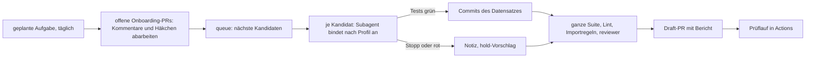

# ADR 0031 — Automatisches Onboarding

- **Status:** **Entwurf**, Fragen F1–F15 offen (§14).
- **Datum:** 2026-11-10 (Entwurf, Draft-PR [#321](https://github.com/oscipal/earthX/pull/321))
- **Aufgabe:** M5-29, Auftrag von Otto vom 10.11.2026. Die Nummer 0031 war beim Start frei (auf `main` endet die Reihe mit 0030; die offenen PRs #319 und #320 legen kein ADR an).
- **Autonomiestufe:** C. Kein Produktivcode.
  - Geändert sind nur dieses ADR und eine Zeile im Entscheidungslog.
  - Unverändert bleiben `backend/`, `frontend/`, `scripts/`, Registry, Fixtures, Backlog, M5-Plan, `.importlinter`, `.github/`, `.claude/`, `CODEOWNERS` und `CLAUDE.md`.
- **Ziel (Otto, 10.11.2026):** Neue Datensätze kommen ohne Startsatz laufend dazu, 5 bis 10 voll angebundene je Tag (Anzeige und Processing). Gesammelt als **ein PR je Tag** gegen `main`, nicht einer je Datensatz. Otto prüft nur noch und merged.
- **Vorab fest:**
  - Lizenzfreigabe immer durch Otto (`KLAERUNGEN` B11; `adr/0025` §6.7: die Regel bereitet vor, der Merge bestätigt).
  - Ausgehende Requests nur über `gateway` (B8); keine Secrets.
  - `CLAUDE.md`, `.github/`, `.claude/`, `CODEOWNERS` nur mit Ottos ausdrücklicher Erlaubnis. Dieses ADR entwirft Änderungen dort nur (§6, §11).
  - Nie ohne Otto: neue Formate, Reader oder Adapter, Prototyp-Quellen (`adr/0024`), Konto-Quellen (`adr/0027`), Lizenz ohne passende Regel, neue Hosts (Auftrag Punkt 6).
- **Grundlage:**
  - `ENTSCHEIDUNGEN_2026-09-18.md` §1, §4, §5; `KLAERUNGEN.md` B8–B13.
  - `projektuebersicht.md` §5 (Onboarding-Checkliste); `projektplan.md` §1.1, §1.2, §3.2, §3.5, §6, §7.
  - `adr/0002` (Testaufteilung, T-D), `adr/0017` (Ausscheiden), `adr/0023` §7.2, §8.3, `adr/0024` R1–R10, `adr/0025` (Harvest-Pipeline), `adr/0026` F7, `adr/0027` §6.1, R-Z, `adr/0029`, `adr/0030`.
  - M5-Plan Fassung 3 (`docs/plans/m5/m5-discovery-und-suche.md`), §6.2, §6.5, §10.
- **Betroffen (erst mit einer Entscheidung):** `discovery` (Warteschlange, Kandidaten mit Probe), Registry (Profile, Prüfung der Abweichungen), Tests (allgemeine Prüfungen je Eintrag, Fixtures aus Daten), `.github/workflows/` (Prüflauf, allgemeiner Live-Smoke), `CLAUDE.md` (Arbeitsweise für Onboarding-PRs), ein Lauf-Dokument unter `docs/`, eine geplante Aufgabe in Ottos Konto.

---

## Methode und Belegstufen

Belegstufen wie in `adr/0025` und `adr/0030`:

- **M:** in dieser Sitzung gemessen; Verfahren im Text.
- **P:** am Primärdokument selbst gelesen. Im Repo mit Pfad.
- **S:** Suchtreffer, Zusammenfassung oder Vorwissen, Wortlaut nicht geprüft.
- **A:** eigene Ableitung, ein Argument und kein Beleg.

**Gemessen am 10.11.2026 [M]:**

- **Aufwand bisheriger Onboardings** aus `git diff --stat`:
  - ESA WorldCover 2020/2021 (M5-07, zwei Einträge, Commit `dd11b4d`): 15 Dateien, +1 632 Zeilen, davon 1 176 in zwei erzeugten Prozess-Fixtures des Frontends.
  - swissALTI3D (M5-08c, offener PR #320): 22 Dateien, +1 603 Zeilen, davon 745 erzeugt. Darin Änderungen an sieben gemeinsamen Testdateien, am Adapter und an `.github/workflows/live-smoke.yml`.
  - Live-Smoke für WorldCover (Commit `98a21d2`): eine eigene Datei mit 81 Zeilen und eine Zeile in `live-smoke.yml`.
  - Einträge unter `backend/catalog/datasets/`: 196–270 Zeilen, Sentinel-2 mit Presets 560.
- **stactools-packages** über die Such-API von GitHub (`search/repositories`, `org:stactools-packages`): 76 Repositories. Letzter Push bei 57 davon vor 2024, bei 14 seit 2025 (`pushed_at`; zählt jeden Push, auch automatische). `LICENSE` von `template`, `esa-worldcover` und `cop-dem` gelesen: Apache 2.0. `constants.py` von `esa-worldcover` gelesen.
- **FSDI** (`data.geo.admin.ch`): eine Seite `/collections?limit=100` mit `curl` und eigenem `User-Agent`: 100 Collections, keine mit `item_assets`, 99 mit `license: proprietary`. Die ersten 40 IDs sind überwiegend thematische Karten (Verkehr, Raumplanung). Weitere Seiten nicht geholt.
- **Keine Datenpixel, keine Assets.**

---

## 0. Kurzfassung

1. **Heute ist ein voller Datensatz eine Aufgabe der Stufe B** mit Plan, eigenem Adapter- oder Reader-Anteil und Änderungen an gemeinsamen Testdateien und an `.github/` [M]. So gehen 5–10 je Tag nicht, aus drei Gründen:
   - Jeder neue Datensatz ändert gemeinsame Dateien. Einen einzelnen aus dem Sammel-PR zu nehmen, ist dann Handarbeit.
   - Jeder neue Live-Smoke ändert `.github/`. Das darf die Automatik nicht.
   - Die Warteschlange gibt es noch nicht. Harvest und Kandidaten kommen mit M5-19 und M5-20, und der Harvest läuft in M5 nur lokal bei Otto (`adr/0025` Ergänzung 1).
2. **Empfohlener Ablauf (§5):**
   - Eine geplante Claude-Code-Session läuft täglich.
   - Sie nimmt die nächsten Kandidaten aus einer abgeleiteten Warteschlange (§4) und bindet je Kandidat nach einem **Profil** an (§7): eigene YAML, eigene Fixture-Beschreibung, eigene Commits, **keine gemeinsame Datei**.
   - Sie öffnet einen Draft-PR mit Bericht: neu, übersprungen mit Grund, offene Fragen, Abweichungen vom Profil.
   - Netz braucht die Session nicht: Der Kandidat bringt eine Probe der Metadaten mit (§4.4).
3. **Prüfung mit echten Daten (§6):** ein Workflow am Sammel-PR in GitHub Actions. Je neuem Eintrag: erreichbar, Items in eine Wegwerf-Datenbank, eine Kachel, ein kleiner Job, eine Tabelle. Nicht Pflicht für den Merge. Einmalige Änderung an `.github/`, dazu ein allgemeiner Live-Smoke, damit kein Datensatz mehr `.github/` ändert.
4. **Zwei Wege (§8):** gelistete Einträge in Menge, wo Format, Adapter, Konto oder Lizenzstufe den vollen Weg nicht tragen; volle Einträge nur bei Profil, vorhandenem Adapter, Format und Lizenzstufe Anzeige oder Processing.
5. **Abbruchregeln (§9):** In zwölf Fällen hält die Automatik den Kandidaten an und schreibt eine Notiz. Sie baut nie Code außerhalb von Eintrag, Fixture und Test.
6. **Engpass ist das Angebot, nicht die Session (§5.5):** Voll anbindbar sind nur Kandidaten, deren Quelle einen vorhandenen Adapter hat (heute die STAC-Dialekte `earth-search-v1` und `fsdi-stac-v1`) und deren Format gelesen wird. Wie viele das sind, zeigt erst der erste Harvest-Lauf. Eine Session schafft geschätzt 5 Datensätze in 3–4 h [A].
7. **Vorarbeiten (§12):** neun Aufgaben, davon sechs vor dem ersten Lauf. Zwei brauchen Ottos Erlaubnis für `.github/`, eine für `CLAUDE.md`.

---

## 1. Kontext und Frage

`adr/0025` legt fest, wie die Plattform Quellen findet und als Kandidaten zur Freigabe vorlegt. Aus einem freigegebenen Kandidaten wird dort ein gelisteter Eintrag oder, „als eigene Onboarding-Aufgabe, ein voller Eintrag“ (§6.1). Diese Aufgabe startet heute Otto mit einem Startsatz. Dieses ADR entwirft, wie das ohne Startsatz in der Menge von 5–10 je Tag geht.

**Fragen (Auftrag, Punkte 1–7):**

1. Warteschlange: Was heißt „freigegeben“, wo liegt die Liste, wer setzt die Reihenfolge?
2. Ablauf: geplante Session, Branch, Commits, Sammel-PR mit Bericht; Review-Punkte und Herausnehmen; Menge je Session.
3. Prüfung mit echten Daten über GitHub Actions; Kosten; Rücksicht auf die Quellen.
4. Profile je Art von Datensatz; taugen stactools-packages als Vorlage?
5. Zwei Wege: gelistet in Menge, voll nach Priorität.
6. Abbruchregeln.
7. Qualität und Rücknahme; Pflichttests je Datensatz.

**Nicht Teil dieses ADR:** der Bau des Harvest (M5-19 bis M5-21), Health-Checks (M5-24), neue Adapter, Reader oder Operatoren, ein automatischer Harvest (in `adr/0025` §6.5 für M6 vertagt).

## 2. Befund

| Stelle | Heute | Folge für die Automatik |
|---|---|---|
| Kandidaten und `discovery propose` | noch nicht gebaut (M5-20) [P] | Ohne sie gibt es keine Warteschlange |
| Harvest-Lauf | in M5 nur lokal bei Otto; Cloud-Sitzungen ernten nicht (`adr/0025` §8, Ergänzung 1) [P] | Der Zufluss hängt an Ottos lokalem Lauf |
| Netz der Cloud-Sitzung | `gateway` erreicht die Quellen aus der Sitzung nicht; `curl` nur zu freigegebenen Hosts (`adr/0002` T-D Nachtrag, `docs/cloud-umgebung.md` §6) [P] | Die Session arbeitet ohne Netz; Messen und Prüfen anderswo |
| GitHub Actions | erreicht die Quellen; `live-smoke.yml` läuft täglich, ein Job je Quelle, Testdateien einzeln genannt [P] | Prüfort für echte Daten; heute ändert jeder Datensatz `.github/` |
| Einträge | YAML je Datensatz, jedes Feld ausdrücklich, ohne Vorgabe (B10, M5-13) [P] | Profile dürfen B10 nicht aushebeln (§7.1) |
| Adapter | zwei STAC-Dialekte (`earth-search-v1`, `fsdi-stac-v1`) und zwei Bucket-Adapter je Datensatz (`cop-dem-bucket`, `esa-worldcover-bucket`) (`backend/earthx/adapters/`) [P] | Voll anbindbar ist nur, was einen Dialekt trifft (§8) |
| Formate | COG und Zarr; NetCDF kommt mit M5-11 (`adr/0029`) [P] | JPEG2000, GRIB, HDF4, ZIP, ASCII-Gitter: nur gelistet |
| Tests je Datensatz | gemeinsame Dateien werden je Datensatz geändert (`tests/catalog/entries.py`, `synthetic_chain.py`, `test_onboarding_processing.py`, `test_asset_bands.py`), dazu ein Python-Modul mit synthetischem Raster je Datensatz (`mini_worldcover.py`, `mini_lv95.py`) [M] | Ein Datensatz lässt sich nicht mit einem Commit herausnehmen |
| Prozess-Fixtures des Frontends | je Datensatz eine erzeugte Datei, 588–745 Zeilen (`scripts/write-process-fixtures.py`) [M] | erzeugt, zählt nicht zum Richtwert |
| `CLAUDE.md` | ein Branch und ein Draft-PR je Aufgabe; Richtwert unter etwa 400 Zeilen; „PRs nicht selbst beobachten und keine Check-ins planen“ [P] | Sammel-PR, Review-Schleife und Zeilenzahl brauchen eine Regel (§11) |
| Projektplan §6 | „Harvest-Vorschläge zu Review-PRs aufbereiten inkl. Lizenz-Vorschlag — Routine, Sonnet, M5“; Routinen können nicht nachfragen [P] | Die Routine ist vorgesehen; ihr Prompt muss vollständig sein |

## 3. Kriterien

| # | Kriterium |
|---|---|
| K1 | **Otto entscheidet Recht und Freigabe** (B11, `adr/0024` R1): keine Lizenzstufe, kein `legal_status`, kein neuer Host ohne ihn |
| K2 | **Prüfaufwand für Otto klein:** der PR zeigt Abweichungen und Messwerte, nicht 200 Zeilen YAML je Datensatz |
| K3 | **Ein Datensatz ist herausnehmbar** mit einem Commit, ohne Konflikt mit den anderen |
| K4 | **Regeln bleiben:** `gateway`, keine Secrets, Modulgrenzen, `.github/` und `CLAUDE.md` nur mit Erlaubnis, B10 |
| K5 | **Rücksicht auf die Quellen** (`adr/0025` §6.2): eigener `User-Agent`, Abstand je Host, `robots.txt`, wenige Anfragen |
| K6 | **Kosten:** Actions-Minuten, Kontingent der Sessions, Ottos Zeit |
| K7 | **Fehler fallen auf**, vor dem Merge (Tests, Prüflauf) und danach (Smoke, Health), und lassen sich zurücknehmen |

## 4. Warteschlange

### 4.1 Was heißt „freigegeben“?

| | Option | Bewertung |
|---|---|---|
| Q1 | **Kandidat auf `main`** mit ausgefülltem Lizenzblock und `legal_status: cleared`, entweder nach einer Lizenzregel (`adr/0025` §6.7, `license_rule` gesetzt) oder von Otto von Hand. Der Merge des Kandidaten-PR ist die Freigabe | trennt Recht (Kandidaten-PR) und Technik (Onboarding-PR); jeder Schritt hat einen Merge durch Otto; passt wörtlich zu §6.7 |
| Q2 | Regeltreffer genügt; die Session nimmt auch Kandidaten aus noch offenen Kandidaten-PRs, Ottos Merge des Onboarding-PR bestätigt Lizenz und Technik zusammen | ein Schritt weniger; aber Kandidaten liegen dann außerhalb von `main`, und ein Merge bestätigt zwei Dinge auf einmal |
| Q3 | Otto schreibt eine Liste mit IDs | volle Kontrolle; widerspricht „ohne Startsatz“ |

**Empfehlung Q1 (F1).** Der Kandidaten-PR wird damit ein reiner Lizenz-PR: Mit Regeln sind die meisten Kandidaten vorbewertet (`adr/0025` §5.2), Otto bestätigt sie im Block.

### 4.2 Wo liegt die Liste?

Keine zweite gepflegte Liste (K2 von `adr/0025`, „eine Wahrheit“). Die Warteschlange wird **abgeleitet**:

- **Eingang:** alle Kandidaten unter `backend/catalog/candidates/` auf `main`, die nach §4.1 freigegeben sind.
- **Abzug:** Kandidaten, deren ID schon in `datasets/` oder `listed/` steht, die in `rejected.yaml` stehen oder die ein offener Onboarding-PR schon trägt (Branch-Präfix, §5.1).
- **Steuerung durch Otto:** eine kleine Datei `backend/catalog/onboarding.yaml`, im Review wie Einträge, nie im Image:
  - `pin`: Kandidaten, die vor allen anderen kommen, in dieser Reihenfolge;
  - `hold`: Kandidaten, die warten, mit Grund (auch von der Automatik vorgeschlagen, §9);
  - `way`: Weg erzwingen (`full` oder `listed`) gegen die Regel aus §8;
  - `hosts_confirmed`: Hosts, die Otto bestätigt hat (§9, F11).
- **Ein Skript statt eines Modells** (Projektplan §3.1 Punkt 4): `python -m earthx.discovery.queue` liest nur Dateien, rechnet die Reihenfolge und gibt sie aus. Ohne Netz, mit Fixtures testbar. Die Session ruft es auf und urteilt nicht über die Reihenfolge.

### 4.3 Wer setzt die Reihenfolge?

| | Option | Bewertung |
|---|---|---|
| R1 | **Regel im Skript, Otto übersteuert mit `pin`/`hold`** | ohne Startsatz; nachvollziehbar; Otto greift nur ein, wenn er will |
| R2 | Reihenfolge der Freigabe (FIFO) | einfach; bündelt eine Reihe eines Herausgebers hintereinander |
| R3 | Otto setzt jede Position | widerspricht dem Ziel |

**Empfehlung R1 (F2).** Vorschlag für die Regel, in dieser Rangfolge [A]:

1. `pin` aus `onboarding.yaml`.
2. Weg „voll“ vor „gelistet“ (der volle Weg ist knapp, §5.5).
3. Profil mit mindestens zwei vorhandenen Einträgen vor Profil mit einem (§7.2).
4. Kategorien im Wechsel (`optical`, `radar`, `elevation`, `land_cover`, `weather_climate`), damit ein Tag nicht aus zehn Orthofotos eines Landes besteht.
5. DACH-Behörde und Satellit gleichrangig (M5-Plan §2 Punkte 1 und 2); innerhalb davon älteste Freigabe zuerst.

### 4.4 Probe im Kandidaten

Die Session erreicht die Quellen nicht (§2). Damit sie trotzdem einen Eintrag füllen kann, legt `discovery propose` für Kandidaten des vollen Wegs eine **Probe** neben die Kandidatendatei:

- die normalisierte Collection und 1–3 Items, nur Metadaten, zusammen höchstens 50 KB;
- das Ergebnis von Verify (`adr/0025` §6.3): Status, `Accept-Ranges`, Format aus den ersten 16 KB; bei TIFF dazu Datentyp, Zahl der Bänder, Kachelung, Overviews, CRS und Nodata aus dem Kopf;
- nichts davon kommt ins Image (`candidates/` ist ausgeschlossen, `adr/0025` §7.1).

Das ist eine Ergänzung zu M5-20 (§12, V1). Die Probe ist Metadaten einer freigegebenen Quelle, keine Pixel. Für Fixtures gilt weiter: nur synthetisch (§10.2).

## 5. Ablauf

### 5.1 Ein Lauf

1. **Auslöser:** eine geplante Aufgabe in Ottos Konto (Claude Code, Zeitplan), täglich zu einer Zeit außerhalb der vollen Stunde. Ihr Prompt ist ein Satz, der auf ein Lauf-Dokument unter `docs/` zeigt (§12, V7). Kein Prompt unter `.claude/`, damit dafür keine Erlaubnis nötig ist. Anlegen kann die Aufgabe nur Otto (`CLAUDE.md`: keine Check-ins planen).
2. **Rückstau-Regel:** Sind schon zwei Onboarding-PRs offen, bindet der Lauf nichts Neues an. Er arbeitet nur Review-Punkte ab (§5.3) und endet.
3. **Branch:** von `main`, je Lauf einer, Name `onboarding/<datum>`, Englisch wie alle Branches.
4. **Je Kandidat:**
   - ein Subagent `implementer` mit eigenem Kontext; er liest Kandidat, Probe und Profil und schreibt nur die Dateien des Datensatzes (§5.2);
   - gezielte Tests der neuen ID; erst wenn sie grün sind, committet die Hauptsession;
   - nach zwei roten Versuchen: nichts committen, Arbeitsstand verwerfen, Notiz mit Grund, `hold`-Vorschlag.
5. **Am Ende:** ganze Suite (in der Session 290–350 s, `plans/querschnitt/nm4-23-backend-tests-schneller.md` §2 [P]), `ruff`, `lint-imports`, Typprüfung des Frontends bei geänderten Prozess-Fixtures, `reviewer` über den ganzen Diff.
6. **PR:** Draft gegen `main`, Titel `Onboarding <datum>: <n> datasets`, Bericht nach §5.4. `main` wird vor dem Öffnen geholt; liegt ein Konflikt in einer gemeinsamen Datei vor, ist das ein Fehler der Vorarbeit V3 und wird gemeldet, nicht gelöst.

### 5.2 Commits je Datensatz

Ziel K3: Ein Datensatz besteht nur aus **eigenen Dateien**.

| Datei | Inhalt | Zeilen [M/A] |
|---|---|---|
| `backend/catalog/datasets/<id>.yaml` | voller Eintrag, alle Felder ausgeschrieben (B10), `profile: <art>` und `deviations:` mit Grund je Abweichung (§7.1) | 180–220 |
| `backend/tests/fixtures/synthetic/<id>.yaml` | Beschreibung des synthetischen Rasters: Datentyp, Bänder, CRS, Nodata, Skalierung, Kachelgröße; das Raster entsteht beim Test | 20–40 |
| `frontend/src/fixtures/processes/<id>.json` | erzeugt mit `scripts/write-process-fixtures.py` | 600–750, erzeugt |
| keine gemeinsame Datei | die Prüfungen laufen allgemein über alle Einträge (V3) | 0 |

**Commits:** zwei je Datensatz: (1) „Add <id> to the registry“ mit YAML und Fixture-Beschreibung, (2) „Generate the process fixture for <id>“. Ein Datensatz zieht so mit einem `git revert` beider Commits oder einem Löschen seiner Dateien heraus.

**Merge-Art:** Merge-Commit oder Rebase, kein Squash; sonst verschwinden die Commits je Datensatz, und eine spätere Rücknahme betrifft den ganzen Tag (F14).

### 5.3 Review-Punkte und Herausnehmen

- **Häkchen in der Tabelle** (Bericht, §5.4): je Datensatz „☐ remove“. Am Handy setzbar, ohne Kommentar [A].
- **Review-Kommentare** an Zeilen der YAML wie heute.
- **Wer arbeitet sie ab?** Der nächste geplante Lauf, **bevor** er Neues anbindet (Schritt A in §5.1):
  - je Kommentar ein Commit auf dem Branch des offenen PR, Antwort am Kommentar;
  - je Häkchen ein Commit „Remove <id> from this batch“, der die Dateien des Datensatzes löscht; Grund aus dem Kommentar, sonst „removed by Otto“, als `hold` in `onboarding.yaml` oder, wenn Otto „ablehnen“ schreibt, als Eintrag in `rejected.yaml`;
  - nie Force-Push, nie Merge.
- **Konflikt mit `CLAUDE.md`:** „PRs nicht selbst beobachten und keine Check-ins planen; Otto meldet sich.“ Der Lauf beobachtet nicht, er liest beim nächsten geplanten Start. Das ist trotzdem eine Ausnahme und braucht einen Satz in `CLAUDE.md` (F4, §11).
- Will Otto schneller als einen Tag, schreibt er wie heute in eine Session.

### 5.4 Bericht im PR

Gliederung, alles auf Englisch außer den Fragen an Otto (Kommunikation Deutsch, `CLAUDE.md`):

1. **Kopf:** Lauf, Zahl neu, übersprungen, offen; Verweis auf den Prüflauf.
2. **Tabelle neu:** ID, Titel, Profil, Weg, Lizenz mit Regel (`license_rule`), Attribution im Wortlaut (bestätigt Otto vor dem Merge, M5-Plan §6.5), Hosts, Prüflauf-Ergebnis, „☐ remove“.
3. **Abweichungen vom Profil** je Datensatz, jede mit Grund und Beleg (Feld der Probe). Nur das liest Otto im Detail (K2).
4. **Übersprungen** mit Grund (Abbruchregel aus §9, rote Tests mit Kurzfassung).
5. **Fragen F1 … Fn** nummeriert, mit Empfehlung, am Handy beantwortbar.
6. **Prüfungen:** Suite, Lint, Importregeln, `reviewer`.

Keine AOI, keine Item-IDs, keine `href` im Bericht (M5-Plan §10).

### 5.5 Wie viele schafft eine Session?

**Grundlage:**

- Die bisherigen Onboardings enthielten Adapter-, Reader- und Infrastrukturarbeit: 860 handgeschriebene Zeilen bei swissALTI3D, rund 230 je Eintrag bei WorldCover ohne Erzeugtes [M]. Das fällt beim Profilweg weg.
- Was je Datensatz bleibt (§5.2): eine YAML aus Profil und Probe, eine Fixture-Beschreibung, gezielte Tests, ein erzeugtes Fixture [A].
- Gezielte Tests je ID unter einer Minute, die ganze Suite einmal je Lauf 5–6 min [P, NM4-23].

**Schätzung [A]:**

| | je Datensatz | 5 Datensätze | 10 Datensätze |
|---|---|---|---|
| Arbeit des Subagenten | 20–40 min | 2–3,5 h | 3,5–7 h |
| Abschluss (Suite, Lint, Review, Bericht) | — | 30–45 min | 45–60 min |
| Kontext der Hauptsession | rund 5 000 Tokens Zusammenfassung | klein | klein |

- **Empfehlung:** Start mit höchstens 5 vollen Datensätzen je Lauf; nach zwei Wochen mit Messung (Zeit, Nacharbeit, Ottos Prüfzeit) auf 10 (F3).
- **Ottos Zeit:** geschätzt 5 min je Datensatz, wenn der Bericht nur Abweichungen zeigt, also 25–50 min je Tag [A]. Das ist der eigentliche Taktgeber neben dem Kontingent (Projektplan §3.5: Sessions teilen sich Ottos Limits).
- **Angebot:** Voll anbindbar ist nur, was einen vorhandenen Adapter, ein gelesenes Format und ein Profil trifft (§8). Earth Search v1 listet neun Collections (`adr/0023` §6.2) [P]: drei führt die Registry schon (`sentinel-2-c1-l2a`, `sentinel-1-grd`, `cop-dem-glo-30`), Landsat ist Requester Pays, `sentinel-2-l2a` und `sentinel-2-pre-c1-l2a` sind ältere Fassungen. Offen bleiben `sentinel-2-l1c` (Bucket laut §6.2 Requester Pays, ein Fall für Verify), `cop-dem-glo-90` und `naip` [A]. Bei der FSDI ist die erste Seite überwiegend thematisch, ohne `item_assets` [M]; welcher Anteil der 514 Collections Raster als COG liefert, zeigt erst Verify. **Folge [A]:** Ohne weitere Adapter oder einen allgemeinen STAC-Dialekt (V9) dürfte der volle Weg nach einigen Wochen leer laufen. Der gelistete Weg läuft weiter.

### 5.6 Modelle

Nach Projektplan §3.2: Hauptsession Opus mit mittlerem Effort (Reihenfolge ausführen, Bericht, Abweichungen bewerten); `implementer` (Sonnet) je Datensatz; `reviewer` (Opus) einmal je PR; `license-checker` nur für Notizen, nie für Einträge. **Fable nie** in einer geplanten Aufgabe (§3.2 dort). F13.

## 6. Prüfung mit echten Daten

### 6.1 Wo

| | Option | Bewertung |
|---|---|---|
| W1 | **Workflow `onboarding-check.yml` am Sammel-PR** in GitHub Actions | erreicht die Quellen über `gateway` wie `live-smoke` [P]; kein Secret; einmalige Änderung an `.github/` |
| W2 | Otto prüft lokal | widerspricht dem Ziel |
| W3 | Cloud-Session mit freigegebenen Hosts | `gateway` verbindet die geprüfte Adresse, der Proxy der Sitzung lehnt das ab (`adr/0002` T-D Nachtrag) [P]; jeder neue Host bräuchte eine Freigabe der Umgebung |

**Empfehlung W1.** Nur Entwurf; gebaut wird er mit Ottos Erlaubnis für `.github/` (V5).

### 6.2 Auslöser und Sicherheit

- **`pull_request`** (`opened`, `synchronize`) mit Pfadfilter `backend/catalog/datasets/**`, dazu `workflow_dispatch` mit PR-Nummer für einen neuen Versuch.
- **Nur Branches dieses Repos:** `if: github.event.pull_request.head.repo.full_name == github.repository`. Ein PR aus einem Fork bekommt keinen Lauf mit Netz zu fremden Hosts [A].
- **Nie `pull_request_target`:** Code aus dem PR liefe mit Schreibrechten [S].
- **Kein Pflicht-Check:** Ein PR darf nie rot werden, weil eine Quelle hustet (`adr/0002` T-D) [P]. Der Lauf ist Auskunft für Otto, nicht Tor.
- **`permissions: contents: read`**, kein Secret. Das Ergebnis steht in der Zusammenfassung des Jobs (`$GITHUB_STEP_SUMMARY`) und als Artefakt (JSON). Die Session überträgt die Tabelle beim nächsten Lauf in den PR-Text. Ein Kommentar direkt am PR bräuchte Schreibrecht neben Code aus dem PR; der sichere Weg dafür ist ein zweiter Workflow über `workflow_run` [S]. Das ist mehr Aufwand und Option in F9.
- **Löst ein PR der Session den Workflow aus?** Ereignisse des eingebauten `GITHUB_TOKEN` starten keine Workflows (`adr/0025` §6.5) [P\*]. Die Session öffnet PRs über die GitHub-App; deren Ereignisse lösen Workflows aus [S]. Vor dem Bau an einem Probe-PR prüfen.
- **Ergebnis je Eintrag zwischenspeichern:** Schlüssel ist der Hash der YAML. Ein Commit, der nur einen Datensatz ändert, prüft nur diesen neu (K5).

### 6.3 Was je neuem Eintrag läuft

Ein Job, Einträge nacheinander (gibt den Abstand je Host von selbst und spart Einrichtungszeit). Dienst Postgres wie in `ci.yml`, Migrationen von pgstac und `earthx`, `catalog-load` mit der Registry des PR.

| Schritt | Wie | Grenze |
|---|---|---|
| 1. Erreichbar | `GET` der Collection bzw. des Endpunkts über `gateway` | 1 Anfrage, 10 s |
| 2. Items | `item_holding: materialized`: `materialize` mit neuer Begrenzung auf eine Seite bzw. höchstens 50 Items (V5, Produktivcode); `federated`: eine Suchseite über den Adapter | höchstens 10 Anfragen |
| 3. Kachel | eine Kachel über den `tiler` im Prozess, Zoom `max(min_zoom, z)`, wo eine Kachel in den Footprint des ersten Items fällt; Prüfung: `200`, nicht leer, nicht nur Nodata | Range-Reads über `gateway`, höchstens 16 MB |
| 4. Job | `runner` mit einem Rezept aus dem Profil (§7.2, „Prüfschritt“) über etwa 1 km² im ersten Item; Prüfung: COG geschrieben, gültige Pixel > 0, Statistik vorhanden | höchstens 64 MB gelesen, 5 min |
| 5. Tabelle | eine Zeile je Eintrag | — |

- **Die AOI** entsteht zur Laufzeit aus dem Footprint und steht nirgends: nicht im Code, nicht im Log, nicht in der Tabelle (`CLAUDE.md`, M5-Plan §10).
- **Tabelle:** ID · erreichbar (Status, ms) · Items (Zahl, s) · Kachel (Status, ms, Anteil gültig) · Job (Status, s, MB gelesen) · Anfragen und Bytes je Host · Hinweis. Ohne Item-IDs und `href`.
- **Ein roter Schritt** beendet nur den Eintrag, nicht den Lauf.

### 6.4 Rücksicht auf die Quellen (`adr/0025` §6.2)

- **`User-Agent`** aus `EARTHX_USER_AGENT`, Pflicht seit M5-18 [P]; `robots.txt` und Abstand je Host (1 s) setzt `gateway` seit M5-18 [P].
- **Je Eintrag höchstens rund 15 Metadaten-Anfragen und 80 MB** (§6.3); je Lauf höchstens 10 Einträge, sonst bricht der Lauf mit „zu viele“ ab.
- **Kein Lauf je Push:** Zwischenspeicher nach Hash (§6.2); `concurrency` je PR mit Abbruch des älteren Laufs.
- **Ein Unterbrecher je Host** wie im Harvest: nach drei Fehlern in Folge ruht der Host für den Rest des Laufs.

### 6.5 Kosten

- **Minuten [A]:** Einrichtung 3–4 min (Python aus der Lock-Datei mit Cache, Postgres, Migrationen), je Eintrag 1–3 min. 5 Einträge rund 10–20 min, 10 rund 15–35 min je Lauf; mit einer Wiederholung je Tag rund 0,5–1 h. Im Monat rund 15–30 h.
- **Preis [S]:** Für öffentliche Repositories sind Standard-Runner von GitHub Actions kostenlos; das Repo ist öffentlich (`ENTSCHEIDUNGEN` §4) [P]. Würde es privat, verbrauchte allein der Prüflauf mehr als das Freikontingent eines kostenlosen Kontos (2 000 min je Monat [S]). Das wäre dann ein kostenpflichtiger Dienst, nie ohne Otto (Projektplan §1.1).
- **Gleichzeitige Jobs:** ein Job je Lauf; kein Einfluss auf die CI.

### 6.6 Allgemeiner Live-Smoke

Heute nennt `live-smoke.yml` jede Testdatei einzeln, und jeder neue Datensatz bekommt eine eigene Datei und eine Zeile in `.github/` [P, M]. Die Automatik darf `.github/` nicht ändern.

- **Vorschlag:** einmal eine allgemeine Datei `backend/tests_live/test_registry_smoke.py`, die jeden Eintrag mit drei Anfragen prüft (Katalog, ein Item, ein `Range`), und ein Job, der das ganze Verzeichnis sammelt. Danach kommt kein Datensatz mehr mit `.github/` in Berührung.
- **Rücksicht bei Menge:** ab 100 Einträgen je Tag nur ein Siebtel, rotierend nach ID; jeder Eintrag einmal je Woche [A].
- **Checkliste Punkt 10, Fassung v1.1** („vom T-D-Smoke abgedeckt“, Marker in `tests_live`) [P] ist damit für jeden Eintrag erfüllt.
- Bis M5-24 ist das die einzige Prüfung nach dem Merge, die ohne Otto läuft (§10.1).

## 7. Profile

### 7.1 Form

| | Option | Bewertung |
|---|---|---|
| PR1 | **Vorlage mit Abweichungsliste:** Profile unter `backend/catalog/profiles/<art>.yaml`. Die Session kopiert das Profil in den Eintrag und schreibt alle Felder aus. Der Eintrag nennt `profile: <art>` und `deviations: [{field, reason}]`. Ein Test prüft: Jedes Feld außerhalb der Datensatz-Felder (Titel, Ausdehnung, Bänder …) gleicht dem Profil oder steht in `deviations` | B10 bleibt: jedes Feld steht im Eintrag; eine Änderung am Profil ändert keinen Eintrag still, sondern macht den Test rot, bis jeder Eintrag nachgezogen oder als Abweichung geführt ist |
| PR2 | **Vererbung im Lader:** Der Eintrag nennt `profile: dem` und nur, was anders ist | kleine Dateien, kleiner Diff; aber ein Feld gilt dann ohne Nennung im Eintrag. Das hebt B10 („jeder Datensatz schaltet jede Fähigkeit ausdrücklich frei“) auf und braucht einen Nachtrag in `KLAERUNGEN`; eine Änderung am Profil wirkt still auf viele Datensätze |
| PR3 | Keine Profile, Vorlage ist der ähnlichste Eintrag | kein Bau; jede Abweichung muss Otto selbst finden (K2 verletzt) |

**Empfehlung PR1 (F7).** Der PR-Diff bleibt groß (§11, F6); was Otto liest, ist die Abweichungsliste im Bericht.

**Datensatz-Felder** (kommen immer aus der Probe, nie aus dem Profil): `dataset_id`, `title`, `description`, `keywords`, `providers`, `gsd`, `doi`, `citation`, Ausdehnungen, `license` (aus der Regel), `access`, `source`, `coverage.typical_footprint_km`, Bänder und Einheiten, `mask.classes`. Alles andere ist Profil-Feld.

### 7.2 Arten

Ein Profil entsteht erst, wenn es **mindestens einen** angebundenen Eintrag gibt, aus dem es abgeleitet ist; die Automatik nutzt es erst ab **zwei**, damit es nicht aus einem Einzelfall verallgemeinert [A]. Eigenheiten nach `adr/0030` (Operatoren, Quick processing) und M5-Plan §2 Punkt 7 (Processing, Suche, Schnellrechnung).

| Profil | Vorbild heute | Processing (Capabilities) | Suche | Quick processing | Darstellung | Prüfschritt (§6.3) | nutzbar ab |
|---|---|---|---|---|---|---|---|
| `elevation` | `cop-dem-glo-30`, `swissalti3d` (PR #320) | `terrain` (nach M5-10), `band_math`, `value_masking`, `normalization`, `reprojection`, `interpolation`; kein `masking` | keine Filter | `step_presets` Hillshade, Slope (nach M5-14, M5-10) | Graustufen bzw. `terrain`, `m` | `normalize` | jetzt (zwei Vorbilder) |
| `optical-reflectance` | `sentinel-2-c1-l2a` | alle außer `quad_pol`; `masking` nur mit Wolkenklassen | `eo:cloud_cover`, wenn die Quelle filtert (`adr/0021`) | Index-Presets nur aus vorhandenen Bändern nach `eo:common_name` (NDVI braucht `red`, `nir`) | Echtfarben, Falschfarbe IR | `band_math` NDVI oder erstes Band | nach dem zweiten Eintrag |
| `orthophoto` | — (DOP der Länder, swissimage) | `band_math` nur mit NIR; `value_masking`; kein `normalization` bei 8 bit | keine | NDVI nur mit NIR | RGB ohne Stretch | `mask_values` | nach dem ersten Eintrag von Hand |
| `land-cover` | `esa-worldcover-2020`, `-2021` | `masking`, `value_masking`, `reprojection`; `band_math`, `interpolation`, `normalization` aus | keine | keine; Klassenanteile (M5-16) | Farbtabelle, `nearest` | `mask` einer Klasse | jetzt |
| `sar-backscatter` | `sentinel-1-grd` | nach `adr/0018` F3 und `adr/0030` §5.2: `sar_backscatter`, `sar_quantity` je Band, Hinweise | Bahn, Polarisation | „VV dB“, „VH dB“, „Dual-pol RGB“ (DS-05) | `first_present` je Polarisation | `sar_db` (nach DS-05a) | nicht vor einem zweiten SAR-Datensatz |
| `meteo-grid` | MeteoSchweiz (M5-11) | B0: `band_math`, `value_masking`, `normalization`, `reprojection` | Zeitschritt | keine (`adr/0030` §5.6) | Colormap je Größe, Einheit | `value_masking` | nach M5-11 und einem zweiten Eintrag |
| `continuous-product` | Global Coherence (Kandidat, `adr/0030` F6) | B0; keine Presets | keine | keine | `viridis`, fester Bereich aus Metadaten | `normalize` | nach dem ersten Eintrag von Hand |

- **Was ein Profil nie setzt:** Lizenz, `legal_status`, `access.account`, Hosts, `data_region` (kommt aus Enrich, `adr/0022`), `item_states` (Regel je Quelle, `adr/0023` §8.3).
- **Ein Kandidat ohne passendes Profil** ist ein Stopp (§9, Fall 1).

### 7.3 Taugen stactools-packages als Vorlage?

**Befund [M]:**

- 76 Repositories in der Organisation `stactools-packages`; je eins erzeugt Collection und Items für **einen** Datensatz aus dessen Dateien.
- 57 der 76 hatten den letzten Push vor 2024. Seit 2025 gab es Pushes bei 14, darunter `sentinel1`, `sentinel2`, `sentinel3`, `modis`, `goes`, `noaa-hrrr`, `ecmwf-forecast`, `glad-global-forest-change`, `global-mangrove-watch` und `template`. Ein Push heißt nicht, dass das Paket gepflegt ist.
- Lizenz: Apache 2.0 (drei geprüft). Die Erkennung von GitHub meldet bei den meisten `NOASSERTION`, weil der Text eine Kopfzeile vor der Lizenz hat.
- Inhalt am Beispiel `esa-worldcover/constants.py`: Bänder mit Datentyp, Nodata und Auflösung, Klassen der `classification`-Extension mit Farbe, Anbieter, Plattformen.
- **Abweichung im Detail:** Klasse 60 heißt dort „Bare / sparse vegetation“, in der Datei der Quelle „Bare/sparse vegetation“ (unser Eintrag folgt der Datei). Die Pakete sind also Sekundärquelle.
- **DACH-Behörden:** kein Paket für swisstopo, BEV, DWD, MeteoSchweiz oder Länder. Relevant sind globale Produkte: `cop-dem`, `esa-worldcover`, `esa-cci-lc`, `jrc-gsw`, `alos-dem`, `palsar`, `soilgrids`, `worldclim`, `corine`, `modis`, `landsat`, `sentinel1`, `sentinel2`, `sentinel3`.

| | Option | Bewertung |
|---|---|---|
| S1 | **Nur als Referenz:** Gibt es ein Paket zum Kandidaten, liest die Session dessen Konstanten (Bänder, Klassen, Skalierung, Anbieter) und nennt Abweichungen zur Probe mit Commit-Hash im Bericht. Kein Code wird kopiert | kein neues Paket; prüft die Probe gegen eine zweite Quelle; Primärquelle bleibt die Quelle selbst |
| S2 | Als Abhängigkeit in `discovery` für Quellen ohne STAC (Buckets) | jede Bibliothek zieht `stactools`, `pystac`, `rasterio` in eigenen Versionen; neue Abhängigkeiten nur mit Otto (`adr/0014` K9); die Bucket-Adapter der Plattform tun das schon je Datensatz |
| S3 | Nicht nutzen | verschenkt eine gute Gegenprobe |

**Empfehlung S1 (F8).** Als Vorlage für Collections und Items taugen sie nicht: Sie decken die DACH-Quellen nicht ab, viele sind nicht gepflegt, und die Plattform holt Collections und Items aus der Quelle selbst. Als Gegenprobe für globale Produkte taugen sie.

## 8. Zwei Wege

| Bedingung | Weg |
|---|---|
| Lizenzstufe `catalog` (z. B. ND, `adr/0023` §7.2) | gelistet |
| `access.account` ist `free_account` oder `requester_pays` | **Stopp mit Notiz** (§9); gelistet nur, wenn Otto `way: listed` setzt (F11) |
| Format nicht gelesen (nicht COG, Zarr; NetCDF erst nach M5-11) | gelistet, Notiz „Format“ |
| Quelle ohne vorhandenen Adapter bzw. Dialekt | gelistet, Notiz „Adapter“ |
| kein Profil mit zwei Vorbildern | gelistet, Notiz „Profil“ |
| Teil einer Reihe (gleicher Herausgeber, gleicher Titelanfang, `adr/0025` §5.2) | gelistet, Notiz „Reihe“, bis Otto eine Regel will |
| sonst: Stufe Anzeige oder Processing, `account: none`, Format gelesen, Adapter vorhanden, Profil vorhanden, Verify grün | **voll** |

- Otto übersteuert mit `way` in `onboarding.yaml`.
- **Gelistet heißt nicht für immer:** Kommt ein Adapter oder Format dazu, rechnet `queue` den Weg neu, und der gelistete Eintrag wird voll. Die ID bleibt gleich; `listed/<id>.yaml` wird `datasets/<id>.yaml`.
- **Gelistete im selben PR?** Empfehlung (F10): ja, als eigener Abschnitt, höchstens 20 je PR (`adr/0025` F4); sie sind klein (Kopf, Lizenz, Link, `access`) und brauchen keinen Prüflauf außer „erreichbar“.

## 9. Abbruchregeln

Die Automatik hält in diesen Fällen den Kandidaten an, schreibt eine Notiz in den Bericht und schlägt `hold` mit Grund vor. Sie baut nie Code außerhalb von Eintrag, Fixture-Beschreibung und erzeugtem Fixture.

| # | Fall | Was die Automatik tut |
|---|---|---|
| 1 | Kein Profil passt, oder eine Abweichung braucht ein neues Registry-Feld oder eine neue Capability | Notiz mit dem fehlenden Feld |
| 2 | Neues Format, neuer Reader, neuer Adapter oder Dialekt | Notiz; gelistet, wenn §8 es zulässt |
| 3 | Neuer Operator oder Preset außerhalb des Profils | Notiz, Verweis auf `adr/0030` |
| 4 | Prototyp-Quelle: Lizenz unklar (`adr/0024` R1, R2) | nichts anlegen, nie unter `prototype/` |
| 5 | Konto-Quelle (`adr/0027`): `free_account`, `requester_pays`, `anonymous_token` | Notiz; gelistet nur mit `way: listed` von Otto |
| 6 | Lizenz ohne passende Regel oder Lizenzblock leer | Notiz; `license-checker` darf einen Regelvorschlag in die Notiz schreiben |
| 7 | Neuer Host, der in keinem Eintrag steht (`source.endpoint`, `asset_hosts`) und nicht in `hosts_confirmed` | Notiz mit Host und Betreiber; erst nach Ottos Bestätigung (F11) |
| 8 | Mehrere Stände je Kachel ohne Regel in der Probe (`item_states`, M5-08) | Frage an Otto |
| 9 | Verify oder Probe unvollständig (kein `206`, kein Format, kein CRS) | Notiz |
| 10 | Tests nach zwei Versuchen rot | Arbeitsstand verwerfen, Notiz mit Kurzfassung |
| 11 | Eine Änderung an einer gemeinsamen Datei wäre nötig (Test, Adapter, Lader, `gateway`, `.importlinter`) | Notiz; das ist eine Vorarbeit, keine Onboarding-Arbeit |
| 12 | Neue Python- oder npm-Abhängigkeit | Notiz |

Und immer: keine Änderung an `.github/`, `.claude/`, `CLAUDE.md`, `CODEOWNERS`, Sicherheitsregeln oder Importgrenzen; kein Merge, kein Force-Push; Fable nie.

## 10. Qualität und Rücknahme

### 10.1 Wie ein fehlerhafter Datensatz auffällt

| Zeitpunkt | Prüfung | Wer sieht es |
|---|---|---|
| vor dem Commit | gezielte Tests der ID (§10.2) | Session; rot heißt nicht committen |
| vor dem Merge | ganze Suite, `reviewer`, Prüflauf mit echten Daten (§6) | Otto im Bericht |
| täglich nach dem Merge | allgemeiner Live-Smoke (§6.6) | rot in Actions; Triage-Routine nach Projektplan §6 schreibt ein Issue mit Diagnose (Quelle weg, Struktur geändert, eigener Fehler) |
| laufend (ab M5-24) | Health-Check je Eintrag: Katalog, ein `Range`, `ETag` (`architekturplan.md` 4.5, `adr/0025` §6.6) | „Last checked“ in der Oberfläche; in M5 nur aus Ottos lokalem Lauf |
| beim nächsten Harvest | geänderte Lizenz, Assets oder Hosts legen den Eintrag erneut vor (`adr/0025` F5) | neuer Kandidaten-PR |
| durch Nutzer | Fehlermeldung (Projektplan §6.1) | Bug-Report-Pipeline |

### 10.2 Pflichttests je Datensatz

Alle allgemein über die Registry, je Eintrag parametrisiert (V3). Ein neuer Datensatz bringt nur seine Fixture-Beschreibung mit, keine Testdatei.

| Checkliste `projektuebersicht.md` §5 | Test |
|---|---|
| 1 Beschreibung | Beschreibung englisch, nicht leer; Schlagworte deutsch und englisch (`adr/0026` F7) |
| 2 Coverage | Anbieter zugeordnet; die Vollständigkeitsprobe antwortet auf der Fixture mit `vollstaendig`, `gekappt` oder `stichprobe` |
| 3 DOI oder Zitat | eins von beiden gesetzt; DOI als `https://doi.org/…` |
| 4 Lizenz | Flags und Stufe passen nach B11; `license_rule` verweist auf eine Regel, deren Ergebnis dem Block gleicht; `legal_status: cleared` |
| 5 Format | Format wird gelesen |
| 6 Anonymer Zugriff | `access.account: none`; Datum aus Verify; Beleg im Prüflauf (kein Offline-Test möglich) |
| 7 Klasse und Capabilities | Lader (B10); **Profiltreue**: jedes Profil-Feld gleich oder in `deviations` mit Grund |
| 8 Standard-Visualisierung | eine Kachel auf dem synthetischen Raster: `200`, nicht leer |
| 9 Processing End-to-End | der Prüfschritt des Profils läuft gegen die Fixture als Job, bei T1-Operatoren auch als Kachel (Fassung v2) |
| 10 Zuletzt geprüft | vom allgemeinen Live-Smoke abgedeckt (Fassung v1.1) |

**Fehlerfälle und zweckfremde Nutzung** (`CLAUDE.md`), je Eintrag aus den Capabilities abgeleitet:

- Jeder Operator, dessen Capability `false` ist, wird abgelehnt (z. B. `band_math` auf `land-cover`).
- Ein Ausdruck mit einem Band, das der Datensatz nicht hat, wird abgelehnt.
- `datetime` bei `time_range: false` steht in `ignored_filters` (`architekturplan.md` 5.1).
- Eine Kachel außerhalb der Ausdehnung liefert die leere Antwort, keinen Fehler `500`.
- `interpolation: false` lehnt `bilinear` ab.

**Fixtures:** nur synthetisch, aus der Fixture-Beschreibung beim Test erzeugt (Datentyp, Bänder, CRS, Nodata, Skalierung aus der Probe). Keine Pixel der Quelle (`CLAUDE.md`, `ENTSCHEIDUNGEN` §4).

### 10.3 Rücknahme

| | Option | Bewertung |
|---|---|---|
| X1 | **Auf Ottos Wort:** Vor dem ersten öffentlichen Deployment ein PR mit `git revert` der Commits des Datensatzes. Danach Ausscheiden nach `adr/0017` (Eintrag in `retired.yaml` mit Grund, Rezepte und Permalinks antworten `410`). Die Session schreibt den PR, wenn Otto im Issue oder in `onboarding.yaml` (`withdraw: <id>`) darum bittet | nichts verschwindet still; ein Commit-Paar je Datensatz macht das Revert sauber (§5.2) |
| X2 | Automatisch nach N roten Tagen im Live-Smoke | verliert Datensätze wegen einer Wartung der Quelle; widerspricht „rot heißt Diagnose, nicht Löschen“ |
| X3 | Nur Markierung (`health.status`) | Datensatz bleibt sichtbar defekt |

**Empfehlung X1 (F14).** Zusätzlich: Ein roter Smoke oder Health-Check ändert nie selbst die Registry; er erzeugt ein Issue (Triage-Routine) bzw. einen Status in der Datenbank (`adr/0025` §6.6).

## 11. Widersprüche zu bestehenden Regeln

| Regel | Widerspruch | Vorschlag |
|---|---|---|
| `CLAUDE.md`: Richtwert unter etwa 400 geänderten Zeilen ohne generierte Dateien | 5 Datensätze sind rund 1 000–1 300 Zeilen YAML und Fixture-Beschreibung | Ausnahme für Onboarding-PRs: Der Richtwert gilt für alles außerhalb der Dateien der Datensätze; Otto liest die Abweichungsliste (F6) |
| `CLAUDE.md`: „PRs nicht selbst beobachten und keine Check-ins planen“ | Der nächste Lauf arbeitet Review-Punkte offener Onboarding-PRs ab | Satz in `CLAUDE.md`: Onboarding-Läufe lesen beim Start ihre offenen PRs (F4) |
| Projektplan §1.2: neuer Datensatz bisher Stufe B | Täglicher Lauf ohne Plan-Zwischenschritt | Onboarding nach Profil ist Stufe A mit Bericht; alles nach §9 bleibt B oder C (F12) |
| Checkliste Punkt 10, Fassung v1.1 | verlangt eine Datei je Datensatz in `tests_live` mit Zeile in `.github/` | allgemeiner Live-Smoke (§6.6, F15) |
| M5-Plan §6.5: „Laden von Items und Harvest-Läufe macht Otto lokal“ | Der Prüflauf lädt Items in Actions | gilt für die Plattform-Datenbank; der Prüflauf nutzt eine Wegwerf-Datenbank im Job, die mit dem Job endet. Nachtrag mit F9 |

Alle Änderungen an `CLAUDE.md` und `.github/` macht eine eigene Aufgabe mit Ottos ausdrücklicher Erlaubnis (§12).

## 12. Vorarbeiten (Schnitt, Vorschlag)

Je unter dem Richtwert. Reihenfolge nach Abhängigkeit; keine davon ist Teil dieses PR, und Backlog wie M5-Plan bleiben unverändert.

| | Inhalt | Stufe | Hängt ab von |
|---|---|---|---|
| **V1** | Probe im Kandidaten (§4.4) als Ergänzung zu M5-20 | B (in M5-20) | M5-19 |
| **V2** | Profile unter `backend/catalog/profiles/` für `elevation` und `land-cover`, Feld `profile`/`deviations`, Profiltreue-Test (§7.1) | B | M5-08 gemergt |
| **V3** | Allgemeine Prüfungen je Eintrag statt Änderungen an gemeinsamen Dateien; synthetische Raster aus Fixture-Beschreibungen; bestehende `mini_*`-Module darauf umstellen (§10.2) | B | V2 |
| **V4** | Allgemeiner Live-Smoke (§6.6); **braucht Erlaubnis für `.github/`** | B | V3 |
| **V5** | Prüflauf `onboarding-check.yml` und Begrenzung von `materialize` (§6); **braucht Erlaubnis für `.github/`** | B | V3 |
| **V6** | `onboarding.yaml` und `python -m earthx.discovery.queue` (§4) | B | M5-20 |
| **V7** | Lauf-Dokument unter `docs/` (Prompt der geplanten Aufgabe), Nachträge in `CLAUDE.md` (§11); **braucht Erlaubnis für `CLAUDE.md`**; danach legt Otto die geplante Aufgabe an | A | V1–V6 |
| **V8** | Weitere Profile (`optical-reflectance`, `orthophoto`, `meteo-grid`, `continuous-product`), je nach dem zweiten Vorbild | A je Profil | V2 |
| **V9** | Allgemeiner STAC-Dialekt aus den Konformitätsklassen einer API (`adr/0011` F6), damit neue STAC-Quellen keinen eigenen Dialekt brauchen (§5.5) | C, dann B | — |

**Erster Lauf frühestens nach V1–V7.** Bis dahin lassen sich Profile und allgemeine Tests (V2, V3) schon an den vorhandenen Einträgen bauen und prüfen.

## 13. Risiken und Grenzen

- **Zufluss:** Der Harvest läuft in M5 nur lokal bei Otto. Bleibt er aus, läuft die Warteschlange leer, und der Lauf meldet „nichts zu tun“. Ein automatischer Harvest ist `adr/0025` §6.5 (P2/P3) und für M6 vertagt.
- **Angebot:** §5.5. Ohne V9 oder neue Adapter bleibt der volle Weg schmal.
- **Fehler in Menge:** Ein Fehler im Profil steckt in allen Einträgen danach. Gegenmittel: Profiltreue-Test (eine Profiländerung wird in jedem Eintrag sichtbar), Prüflauf je Eintrag, Start mit 5 je Tag.
- **Review-Ermüdung:** Bei täglichen PRs liest Otto weniger genau [A]. Gegenmittel: Bericht nur mit Abweichungen und Messwerten; Rückstau-Regel (höchstens zwei offene PRs).
- **Lizenz im Block:** Mit Regeln bestätigt Otto viele Lizenzen auf einmal. Die Regel ist genau (Herausgeber und Lizenz-URI wörtlich, `adr/0025` §6.7); die Attribution steht trotzdem je Datensatz im Bericht.
- **Annahmen ungeprüft:** ob PRs der GitHub-App den Prüflauf auslösen (§6.2), die Minuten (§6.5), die Zeit je Datensatz (§5.5). Alle drei misst die erste Woche.
- **Stufe C:** Die Zahlen in §5.5 und §6.5 sind Schätzungen [A].

## 14. Fragen an Otto

Kurz beantwortbar mit „F1: 1, F2: 1, …“ oder „alle 1“.

**F1 — Was heißt „freigegeben“ (§4.1)?**
1. Kandidat auf `main` mit Lizenzblock aus Regel oder von dir, `legal_status: cleared`; der Merge des Kandidaten-PR ist die Freigabe **(Empfehlung)**
2. Regeltreffer genügt; dein Merge des Onboarding-PR bestätigt Lizenz und Technik zusammen
3. Du schreibst eine Liste mit IDs

**F2 — Reihenfolge (§4.3)?**
1. Regel im Skript `queue` (voll vor gelistet, Profil mit zwei Vorbildern zuerst, Kategorien im Wechsel, älteste Freigabe zuerst); du übersteuerst mit `pin`/`hold` in `onboarding.yaml` **(Empfehlung)**
2. Reihenfolge der Freigabe (FIFO)
3. Du setzt jede Position

**F3 — Takt und Menge (§5.1, §5.5)?**
1. Ein Lauf je Tag; zuerst höchstens 5 volle Datensätze, nach zwei Wochen mit Messung 10; höchstens zwei offene Onboarding-PRs **(Empfehlung)**
2. Sofort bis 10 je Lauf
3. Zwei Läufe je Tag mit je 5

**F4 — Review-Punkte (§5.3)?**
1. Der nächste geplante Lauf arbeitet zuerst Kommentare und Häkchen der offenen Onboarding-PRs ab; dafür ein Satz in `CLAUDE.md` **(Empfehlung)**
2. Die Session abonniert die PR-Aktivität und reagiert sofort
3. Du startest dafür von Hand eine Session

**F5 — Einen Datensatz herausnehmen (§5.3)?**
1. Häkchen „remove“ in der Tabelle oder Kommentar; der Lauf löscht die Dateien in einem Commit und trägt `hold` bzw. bei „ablehnen“ `rejected.yaml` ein **(Empfehlung)**
2. Du löschst die Dateien selbst
3. Nur per Kommentar

**F6 — Größe des Sammel-PR (§11)?**
1. Ausnahme vom Richtwert für Onboarding-PRs: Er gilt für alles außerhalb der Dateien der Datensätze; du liest die Abweichungsliste **(Empfehlung)**
2. Profile per Vererbung (F7 Option 2), damit die Dateien klein bleiben
3. Höchstens zwei Datensätze je PR

**F7 — Form der Profile (§7.1)?**
1. Vorlage mit Abweichungsliste; jede YAML voll ausgeschrieben (B10 bleibt), Profiltreue-Test **(Empfehlung)**
2. Vererbung im Lader (Nachtrag zu B10 nötig)
3. Keine Profile

**F8 — stactools-packages (§7.3)?**
1. Nur als Referenz zur Gegenprobe globaler Produkte, mit Commit-Hash im Bericht; keine Abhängigkeit, kein kopierter Code **(Empfehlung)**
2. Als Abhängigkeit in `discovery` für Quellen ohne STAC
3. Nicht nutzen

**F9 — Prüflauf mit echten Daten (§6)?**
1. Workflow am PR (`pull_request` mit Pfadfilter, nur Branches dieses Repos, kein Pflicht-Check, nur Leserecht); Ergebnis als Job-Zusammenfassung, die Session überträgt die Tabelle in den PR-Text **(Empfehlung)**
2. Wie 1, aber zusätzlich ein Kommentar am PR über einen zweiten Workflow (`workflow_run`)
3. Nur von Hand (`workflow_dispatch`)

**F10 — Gelistete Einträge (§8)?**
1. Im selben Tages-PR als eigener Abschnitt, höchstens 20 **(Empfehlung)**
2. Eigener PR einmal je Woche
3. `discovery propose` schreibt sie gleich als gelistete Einträge, ohne Onboarding-Lauf

**F11 — Abbruchregeln (§9)?**
1. Wie §9; neue Hosts bestätigst du mit einer Zeile `hosts_confirmed` in `onboarding.yaml`, der nächste Lauf nimmt den Datensatz dann; Konto-Quellen nur mit `way: listed` von dir **(Empfehlung)**
2. Wie 1, aber neue Hosts im PR markiert, dein Merge ist die Bestätigung
3. Wie 1, aber Konto-Quellen automatisch als gelistet (W0)

**F12 — Autonomiestufe (§11)?**
1. Onboarding nach Profil ist Stufe A mit Bericht; alles nach §9 bleibt B oder C **(Empfehlung)**
2. Jeder Tages-PR ist Stufe B (Plan zuerst, dann Umsetzung)
3. Stufe A auch für Abweichungen ohne neues Feld

**F13 — Modelle der geplanten Aufgabe (§5.6)?**
1. Hauptsession Opus (mittel), `implementer` Sonnet je Datensatz, `reviewer` Opus einmal je PR **(Empfehlung)**
2. Alles Sonnet, `reviewer` Opus
3. Alles Opus

**F14 — Rücknahme (§10.3)?**
1. Nur auf dein Wort: vor dem Deployment Revert-PR der Commits des Datensatzes, danach Ausscheiden nach `adr/0017`; Merge-Commit statt Squash, damit die Commits einzeln bleiben **(Empfehlung)**
2. Automatisch nach mehreren roten Tagen
3. Nur Markierung über den Health-Status

**F15 — Live-Smoke nach dem Merge (§6.6)?**
1. Ein allgemeiner Smoke über alle Einträge (drei Anfragen je Eintrag), ab 100 Einträgen je Tag ein Siebtel; einmalige Änderung an `.github/` **(Empfehlung)**
2. Je Datensatz eigene Datei wie heute (jeder Datensatz ändert `.github/`)
3. Nur Health-Checks aus M5-24

## 15. Folgen (erst mit Ottos Antworten)

- Vorarbeiten V1–V9 als Aufgaben (§12); Eintrag in Backlog bzw. M5-Plan durch die nächste Doku-Aufgabe oder Otto, nicht in diesem PR.
- Nachträge: `adr/0025` §6.1 (Probe im Kandidaten), `projektuebersicht.md` §5 Punkt 10 (allgemeiner Smoke), `projektplan.md` §6 (Zeile „Harvest-Vorschläge …“ wird „Onboarding-Lauf“), `CLAUDE.md` (Onboarding-PRs, Review-Schleife), `KLAERUNGEN` B10 nur bei F7 = 2.
- Entscheidungslog: eine Zeile je Antwort.

## 16. Quellen

**Im Repo [P]:**

- `CLAUDE.md`; `docs/ENTSCHEIDUNGEN_2026-09-18.md`; `docs/KLAERUNGEN.md` B8–B13; `docs/projektuebersicht.md` §5; `docs/projektplan.md` §1, §3, §6, §7; `docs/architekturplan.md` 4.5, 5.1; `docs/cloud-umgebung.md` §6.
- `adr/0002` T-D; `adr/0017`; `adr/0018` F3; `adr/0021`; `adr/0022`; `adr/0023` §6.2, §7.2, §8.3; `adr/0024` R1–R10; `adr/0025` §2, §5–§8, §10–§12; `adr/0026` F7; `adr/0027` §6.1; `adr/0029`; `adr/0030` §3, §5, §8.
- `docs/plans/m5/m5-discovery-und-suche.md` (Fassung 3); `docs/plans/querschnitt/nm4-23-backend-tests-schneller.md` §2.
- Code: `.github/workflows/ci.yml`, `.github/workflows/live-smoke.yml`, `backend/catalog/datasets/*.yaml`, `backend/earthx/adapters/`, `backend/earthx/catalog/registry.py`, `backend/tests/catalog/entries.py`, `backend/tests/catalog/test_onboarding_endtoend.py`, `backend/tests/test_live_smoke_dry_run.py`, `scripts/write-process-fixtures.py`.
- Diffs: Commits `dd11b4d`, `98a21d2`; offener PR #320 (Branch `claude/loving-gates-be6dq4`).

**Gemessen am 10.11.2026 [M]:**

- GitHub-Such-API, Repositories der Organisation `stactools-packages`.
- https://github.com/stactools-packages/template, https://github.com/stactools-packages/esa-worldcover, https://github.com/stactools-packages/cop-dem: `LICENSE` auf `main`; `esa-worldcover`: `src/stactools/esa_worldcover/constants.py`.
- `https://data.geo.admin.ch/api/stac/v1/collections?limit=100`, eine Seite.

**Vorwissen [S], vor dem Bau zu prüfen:**

- GitHub Actions: kostenlose Standard-Runner für öffentliche Repositories, Freikontingent privater Repositories; Ereignisse von GitHub-Apps lösen Workflows aus, die des `GITHUB_TOKEN` nicht; Risiken von `pull_request_target`; `workflow_run` für Kommentare aus Fork-PRs. Doku: https://docs.github.com/en/actions
