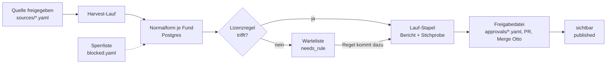

# ADR 0033 — Freigabe gelisteter Einträge

- **Status:** **Angenommen** von Otto am 2026-11-14: F1–F11 jeweils Option 1 (Empfehlung), mit zwei Abweichungen bzw. Ergänzungen (§16):
  - F12: keine eigene Doku-Aufgabe; die Nachträge aus §14 macht M5-40 als ersten Commit;
  - die Freigabedatei eines Laufs kommt, wo möglich, in denselben täglichen Sammel-PR wie das automatische Onboarding (`adr/0031`), damit nicht zwei PRs am Tag nötig sind (§8.4).
- **Datum:** 2026-11-14 (Entwurf, Draft-PR [#352](https://github.com/oscipal/earthX/pull/352)); 2026-11-14 angenommen.
- **Nachträge 2026-11-23** (Doku-Runde, Entscheidungen Ottos zu M5-19 und M5-20 vom 19. bis 23.11.2026): §5 (Link, Zugang, Ausdehnung, Nicht-Geodaten), §6.2 (Klassen und Freigabe für alle Herausgeber), §7 (weitere Wartegründe), §11 (geänderte Einstufung, A18).
- **Nachträge 2026-11-24** (M5-67, Entscheidung Otto vom 24.11.2026, Plan `plans/m5/m5-67-harvest-automatisch.md`): F1 neu = 2 (Lauf-Freigabe nach festen Regeln, nachgelagerte Stichprobe), §8.5 (neu), §11.
- **Aufgabe:** M5-39, Auftrag von Otto vom 14.11.2026 (Folgeaufgabe aus `plans/m5/m5-35-skalierbarkeit.md` §10, Bedingung zu F4). Die Nummer 0033 ist vom Auftrag vorgegeben; auf `main` endet die Reihe mit 0032.
- **Autonomiestufe:** C. Kein Produktivcode.
  - Geändert sind nur dieses ADR und eine Zeile im Entscheidungslog.
  - Unverändert bleiben `backend/`, `frontend/`, `scripts/`, Registry, Fixtures, Backlog, M5-Plan, `.importlinter`, `.github/`, `.claude/`, `CODEOWNERS` und `CLAUDE.md`. Die Nachträge in `adr/0025` und `adr/0031` sind in §14 benannt, nicht ausgeführt; sie kommen als erster Commit von M5-40 (F12).
- **Vorgaben Otto (14.11.2026):**
  - Ziel sind **alle Geodaten der Anbieter**, gelistet im Data catalogue: alle Datentypen (auch Tabellen, Vektor, Dokumente, Dienste) und auch Daten ohne direkten Download (Bestellung, Konto, kostenpflichtig, auf Anfrage).
  - Jeder Eintrag mit Link zur Quelle, Art des Zugangs, Lizenz, räumlicher und zeitlicher Ausdehnung (Filter nach AOI, Region, Zeit).
  - Zielgröße **10⁶ gelistete Einträge**, gespeichert in **Postgres** statt als YAML in Git (M5-35 F3 = 1, F4 = 1).
  - Die Freigabe durch Otto bleibt, die Lizenz immer durch Otto (`adr/0025` P1, `KLAERUNGEN` B11), aber **nicht mehr als PR je Eintrag**.
- **Grundlage:**
  - `ENTSCHEIDUNGEN_2026-09-18.md` §1, §4; `KLAERUNGEN.md` B8, B10, B11, B13.
  - `projektuebersicht.md` Prinzipien 2, 12, 13, 15, 16; §5 (Onboarding-Checkliste).
  - `architekturplan.md` 4.3, 4.4, 5.1, 10.
  - `plans/m5/m5-35-skalierbarkeit.md` §6.1 (B5), §8a (F3, F4 mit Ottos Bedingung), §10.
  - `adr/0017` (Ausscheiden), `adr/0024` R1–R11, `adr/0025` (P1, §5, §6.1a, §6.7, §7.1), `adr/0027` §6.1 (W0, `access.account`), `adr/0031` (§4, §8, §10.3).
- **Betroffen (erst mit einer Entscheidung):** `adr/0025`, `adr/0031`, `adr/0027` §6.1, `KLAERUNGEN` B13, `architekturplan.md` 4.4 und 10, `projektuebersicht.md` Prinzip 13, Aufgaben M5-40, M5-17, M5-19, M5-20, M5-24.

---

## Methode und Belegstufen

Belegstufen wie in `adr/0025` und `adr/0031`:

- **M:** in dieser Sitzung gemessen; Verfahren unten.
- **P:** am Primärdokument selbst gelesen. Im Repo mit Pfad.
- **S:** Suchtreffer, Zusammenfassung oder Vorwissen, Wortlaut nicht geprüft.
- **A:** eigene Ableitung, ein Argument und kein Beleg.

**Gemessen am 14.11.2026 [M]:**

- **GovData** (CKAN `package_search`, nur Metadaten): sieben Anfragen mit `curl` und einem allgemeinen `User-Agent`, je mit Pause. Zählabfragen mit `rows=0` und Facetten `license_id`, `publisher_name`; Zählung mit `fq=extras_spatial:[* TO *]`; zwei Seiten zu je 1 000 Datensätzen mit räumlicher Angabe (Versatz 0 und 60 000, Standard-Reihenfolge der API, **keine Zufallsstichprobe**). Ausgewertet nur Zahlen; die Seiten sind gelöscht. Keine Titel, Personen oder Adressen in diesem Dokument.
- **pgstac 0.9.12** im lokalen Postgres der Sitzung: 2 000 bzw. 100 000 synthetische Collections über `pgstac.create_collection` in einer Transaktion, danach `collection_search` mit `bbox`, `offset` und `q`; Zeiten mit `\timing`, ohne eigene Indizes, dann `ROLLBACK`. Ein Lauf je Abfrage, keine Wiederholung; die Zeiten sind Größenordnungen.

---

## 0. Kurzfassung

**Entscheidung (Otto, 14.11.2026):** F1–F11 jeweils Option 1. F12: Die Nachträge aus §14 macht M5-40 als ersten Commit, ohne eigene Doku-Aufgabe. Ergänzung: Die Freigabedatei eines Laufs kommt, wo möglich, in den täglichen Sammel-PR des automatischen Onboardings (§8.4). Die Punkte unten sind der Stand der Vorlage, ergänzt um diese Antworten.

1. **Was nicht trägt [A]:** Mit 10⁶ Einträgen und höchstens 20 Kandidaten je PR (`adr/0025` F4) wären es 50 000 PRs. Auch ein Sammel-PR je Lauf mit allen Einträgen als Datei ist für einen Menschen nicht lesbar. Ottos Prüfaufwand muss mit der Zahl der **Lizenzen und Herausgeber** wachsen, nicht mit der Zahl der Einträge.
2. **Gemessen [M]:** GovData führt 165 427 Datensätze, davon 68 017 mit räumlicher Angabe, von 2 444 Herausgebern. In einer Stichprobe von 2 000 Geodatensätzen stehen 24 verschiedene Lizenzangaben, aber 300 Paare aus Herausgeber und Lizenz; die 100 häufigsten Paare decken 87 % ab (§2.2). pgstac legt für Collections keine Partitionen an, sucht bei 10⁵ Collections ohne eigene Indizes aber in 160–740 ms (§2.3).
3. **Empfehlung: Freigabe in drei Ebenen, alle Entscheidungen in Git, alle Inhalte in Postgres (§4):**
   - **Quelle:** Otto gibt einen Katalog mit Filter frei (Seed-Datei, wie heute).
   - **Lizenzregel:** Otto stuft jede Lizenz **einmal** ein (Lizenzkatalog) und gibt sie je Quelle für eine Liste **genau benannter Herausgeber** frei (§6). Die Regel bleibt „Herausgeber + Lizenz-URI → Stufe“; nur ihre Form wird kompakt.
   - **Lauf:** Ein Lauf-Bericht mit Statistik und einer Stichprobe von 30 Einträgen; Otto prüft die Stichprobe und gibt den Lauf mit einer kleinen Datei per PR frei (§8). Erst dann werden die neuen Einträge sichtbar.
4. **Ohne Regel** wartet ein Eintrag unsichtbar in Postgres; der Bericht zeigt die Warteliste nach Paaren mit den meisten Einträgen zuerst, `license-checker` schlägt Regeln vor (§7).
5. **Entfernen braucht keine Freigabe, Hinzufügen und Lizenz schon.** Rücknahme über eine Sperrliste in Git und einen Grabstein in Postgres (Inhalt gelöscht, ID und Grund bleiben, `410`); Aktualisierungen beschreibender Felder fließen ohne Freigabe, Wechsel von Lizenz, Herausgeber, Zugangsart oder Host verbergen den Eintrag bis zur nächsten Freigabe (§9, §11).
6. **Prototyp-Quellen:** Gelistete Einträge sind nie Prototyp; eine unklare Lizenz heißt Warteliste (§12).
7. **Schnitt (§13):** M5-40 baut Ablage, Lesepfad, Sperrliste und Grabstein; Lizenzkatalog, Warteliste, Lauf-Bericht, Stichprobe und Freigabe kommen mit M5-20; eine Freigabe-Oberfläche mit Anmeldung, der Kontaktweg für Anbieter und der automatische Harvest in der Cloud später.

---

## 1. Kontext und Frage

`adr/0025` legt die Freigabe für jeden Kandidaten in einen Git-Review (P1): Kandidatendateien unter `backend/catalog/candidates/`, höchstens 20 je PR (F4), gelistete Einträge als YAML unter `backend/catalog/listed/`, im Image und in jedem Prozess geladen (§7.1). `adr/0031` baut darauf: Freigegeben ist ein Kandidat auf `main` (Q1), gelistete Einträge kommen mit höchstens 20 in den Tages-PR (F10). M5-35 hat gezeigt, dass das bei 10⁵–10⁶ Einträgen nicht trägt (B5), und Otto hat entschieden: gelistete Einträge nur in Postgres (F4 = 1), mit der Bedingung, dass die Freigabe bei ihm bleibt.

**Fragen (Auftrag):**

1. Lizenzregeln „Herausgeber + Lizenz-URI → Stufe“ in Git: Form bei dieser Menge.
2. Was passiert ohne Regel: Halt oder Warteliste?
3. Stichproben und Sammel-Freigabe je Lauf: Bericht, Statistik, Weg der Freigabe.
4. Rücknahme und Löschung, auch auf Wunsch eines Anbieters.
5. Nachvollziehbarkeit: wer hat wann was freigegeben?
6. Aktualisierung bestehender Einträge.
7. Umgang mit Prototyp-Quellen.
8. Was baut M5-40, was später? Nachträge in `adr/0025` §7.1 und `adr/0031`.

**Nicht Teil dieses ADR:** der Bau des Harvest (M5-19 bis M5-21), die Tabellen im Einzelnen (Plan von M5-40), die Vektorsuche (M5-41), die indexfähige lexikalische Suche (M5-42), volle Einträge und ihr Onboarding (`adr/0031` bleibt dafür unverändert).

## 2. Befund

### 2.1 Code [P]

| Stelle | Heute | Folge |
|---|---|---|
| `backend/catalog/` | `datasets/` (6 Einträge), `prototype/`, `retired.yaml`; **kein** `listed/`, `candidates/`, `sources/`, `license_rules.yaml`, `rejected.yaml` | Nichts davon ist gebaut; die Form ist frei |
| `discovery/` | nur `materialize.py` und der leere Prozess `main.py` | Harvest-Tabellen aus `adr/0025` §5.3 gibt es noch nicht (M5-19) |
| `catalog/datasets.py` | `registry()` liest alle YAML einmal je Prozess (`@cache`) | gelistete Einträge dürfen nicht hierher (M5-35 B5) |
| `catalog/migrations/` | 002–018; Discovery-Tabellen fehlen | Raum für die Tabellen aus §5, §8, §9 |
| `catalog/registry.py:410–447` | `LicenseInfo` mit SPDX, Name, URL, fünf Flags, `tier`, zwei Attributionstexten, `terms`; `AccessInfo.account` mit `none`, `anonymous_token`, `free_account`, `requester_pays` | Die Lizenz-Einstufung ist ein fester Satz Felder; Zugang „Bestellung“, „kostenpflichtig“, „auf Anfrage“ fehlt (§5) |
| `architekturplan.md` 4.4, 10 | Review als Git-Workflow, „Datenbank-gestützte Queue mit UI erst, wenn das Volumen es verlangt“; Tabellen `review_item`, `license_catalog` vorgesehen | Das Volumen verlangt es jetzt für die Warteliste, nicht für die Entscheidung (§4) |

### 2.2 GovData als Maßstab [M]

| Größe | Wert |
|---|---|
| Datensätze gesamt | 165 427 (am 06.11.2026: 161 380, `adr/0025` §3) |
| davon mit räumlicher Angabe (`spatial`) | 68 017 (41 %) |
| Herausgeber (`publisher_name`) | 2 444; die 100 größten tragen 70,8 % der Datensätze, die 500 größten 94,3 %, die 1 000 größten 97,0 % |
| Lizenz am Datensatz (`license_id`) | nur rund 1 250 Datensätze; die Lizenz steht nach DCAT-AP.de an den **Distributionen** |
| Stichprobe: 2 000 Geodatensätze | 256 Herausgeber, **24 verschiedene Lizenzangaben, 300 Paare** Herausgeber × Lizenz |
| Abdeckung durch die häufigsten Paare | 10 Paare 48,5 %, 50 Paare 76 %, 100 Paare 87 % |
| Lizenzangaben in der Stichprobe | überwiegend URIs aus dem Vokabular `dcat-ap.de/def/licenses/`, mit Varianten derselben Lizenz (`dl-by-de/2.0` neben `…/2_0` und `govdata.de/dl-de/by-2-0`); dazu Freitext (z. B. „Creative Commons Namensnennung – 4.0 International (CC BY 4.0)“) |
| geschlossene Lizenz (`other-closed`) | 216 von 2 025 Nennungen (10,7 %) |
| mehr als eine Lizenz je Datensatz | 29 (1,5 %); ohne Lizenzangabe 4 |
| Kontaktadresse einer Person (`author_email`, `maintainer_email`) | 24 (1,2 %) |

**Folgerungen [A]:**

- Eine Lizenz kommt bei vielen Herausgebern vor (`cc-by/4.0` bei 66 der 256, `dl-zero-de/2.0` bei 63, `dl-by-de/2.0` bei 52). Eine Regel je Paar mit allen Feldern wiederholt dieselbe Einstufung dutzendfach (§6).
- Die Zahl der Paare wächst mit den Herausgebern. Für GovData allein sind einige tausend Paare zu erwarten, für 10⁶ Einträge aus vielen Katalogen eher 10⁴. Die Verteilung ist schief: Wenige Regeln decken den größten Teil.
- Geschlossene Lizenzen sind häufig. Sie sind für gelistete Einträge kein Hindernis (B11: Katalogeintrag ohne Voraussetzung), brauchen aber eine Einstufung, damit der Data catalogue sie richtig nennt.
- Personendaten stehen in einem Teil der Metadaten. Sie gehören nicht in den Eintrag (§5).

### 2.3 pgstac bei vielen Collections [M]

- `create_collection` legt **keine** Partition an (16 Tabellen im Schema `pgstac` vor und nach 2 000 Collections); Partitionen entstehen erst mit Items. Gelistete Einträge haben keine Items.
- 100 000 Collections: Einfügen 21,9 s (rund 0,22 ms je Collection); `collection_search` mit kleiner `bbox` 160–275 ms, Seite bei `offset` 90 000 190 ms, `q` 741 ms.
- **Folge [A]:** pgstac als Ablage ist möglich, die Suche bei 10⁶ ohne eigene Indizes aber im Bereich von Sekunden. Ob gelistete Einträge als pgstac-Collections oder in einer eigenen Tabelle mit GiST- und Textindex liegen, entscheidet M5-40 mit einer Messung bei 10⁶ (§13). Für die Freigabe ist das gleich.

## 3. Kriterien

| # | Kriterium |
|---|---|
| K1 | **Lizenz und Freigabe bei Otto** (B11, `adr/0025` K3, `adr/0024` R1): kein Eintrag sichtbar, dessen Lizenz-Einstufung Otto nicht freigegeben hat |
| K2 | **Ottos Aufwand** wächst mit der Zahl der Lizenzen, Herausgeber und Läufe, nicht mit der Zahl der Einträge |
| K3 | **Stichprobenkontrolle** (Prinzip 12): „Lizenzprüfung nie ohne Stichprobenkontrolle“ |
| K4 | **Nachvollziehbar:** je Eintrag feststellbar, nach welcher Regel und mit welcher Freigabe er sichtbar wurde |
| K5 | **Entfernen schnell und ohne Hürde**, auch auf Wunsch eines Anbieters; ein entfernter Eintrag kehrt nicht mit dem nächsten Lauf zurück |
| K6 | **Eine Wahrheit je Art** (B13 Punkt 3): jede Entscheidung an genau einem Ort, jeder Inhalt an genau einem Ort |
| K7 | **Skalierbar** (Prinzip 16): 10⁶ Einträge ohne Last in jedem Prozess, ohne Datei je Eintrag, ohne Anfrage je Eintrag bei jeder Prüfung |
| K8 | **Keine Secrets der Plattform** für die Freigabe (`adr/0025` §6.5); prüfbar ohne Netz mit Fixtures |

## 4. Grundsatz: drei Ebenen, Entscheidungen in Git, Inhalte in Postgres

| Ebene | Was Otto entscheidet | Ort | Wie oft |
|---|---|---|---|
| **Quelle** | dieser Katalog darf gelistet werden; Filter (z. B. nur Geodaten); Takt und Rücksicht | `backend/catalog/sources/<id>.yaml` (`adr/0025` §5.2) | einmal je Katalog |
| **Lizenzregel** | diese Lizenz bedeutet diese Einstufung; dieser Herausgeber darf mit dieser Lizenz gelistet werden | `backend/catalog/licenses/` (§6) | einmal je Lizenz bzw. je Herausgeber |
| **Lauf** | die neuen und geänderten Einträge dieses Laufs sind in Ordnung (Statistik und Stichprobe) | `backend/catalog/approvals/<lauf>.yaml` (§8) | einmal je Lauf |
| **Sperre** | dieser Eintrag, Herausgeber, Host oder diese Quelle erscheint nicht (mehr) | `backend/catalog/blocked.yaml` (§9) | bei Bedarf |

- **Eine Wahrheit je Art (K6):** Jede Entscheidung liegt nur in Git; der Inhalt gelisteter Einträge liegt nur in Postgres. Postgres hält von den Entscheidungen nur eine abgeleitete Kopie, die `catalog-load` aus dem Image schreibt. Das präzisiert B13 Punkt 3 und `adr/0025` K2 („kuratierte Einträge nur in Git“) für gelistete Einträge (§14).
- **Warum der Inhalt nicht in Git muss [A]:** Titel, Beschreibung, Ausdehnung und Links eines gelisteten Eintrags sind Metadaten der Quelle, keine Kuratierung. Die Quelle ist für sie maßgeblich; Postgres hält den letzten geernteten Stand (`adr/0025` §5.3). Geht die Datenbank verloren, lässt sich der Bestand aus Quellen, Regeln und Sperren neu ernten; nur die Freigaben der Läufe müssten neu erteilt werden (§13, Sicherung).
- **Asymmetrie:** Hinzufügen und jede Änderung der Lizenz-Aussage brauchen eine Freigabe; Entfernen nie (K5).

## 5. Was ein gelisteter Eintrag trägt

Vorschlag für M5-40 und M5-20, nach Ottos Vorgabe. Die rechte Spalte sagt, welche Ebene den Wert deckt.

| Feld | Inhalt | gedeckt durch |
|---|---|---|
| Kopf wie heute (`adr/0025` §6.1a) | ID, Titel, Beschreibung, Schlagworte, DOI/Zitat, `providers`, `maturity` | Lauf (Stichprobe) |
| `earthx:data_kind` **(neu)** | `raster`, `vector`, `table`, `document`, `service`, `other`; aus Formaten und Diensttypen der Distributionen | Lauf |
| Link zur Quelle | Landeseite der Quelle (`source.url`), Host in der Normalform | Quelle (Host); Lauf |
| `access.account` | wie `adr/0027` §6.1, **erweitert um `paid`** (kostenpflichtig) | Lauf |
| `access.delivery` **(neu)** | `download`, `service` (z. B. WMS, WFS, API), `order` (Bestellformular, Versand), `on_request` (auf Anfrage) | Lauf |
| Lizenz | `LicenseInfo` aus der Regel, `tier = catalog`, `legal_status: cleared`, `license_rule` | Lizenzregel |
| Räumliche Ausdehnung | Geometrie (Polygon oder Rechteck) aus der Quelle | Lauf |
| `earthx:regions` **(neu)** | aus der Geometrie abgeleitet gegen eine feste Liste (Staaten ISO 3166-1, Länder und Kantone ISO 3166-2) | abgeleitet, keine Freigabe |
| Zeitliche Ausdehnung | Intervall, offen erlaubt | Lauf |
| Herkunft (`earthx:listing`) | Quelle, Schlüssel bei der Quelle, Lauf, Freigabe, „zuletzt geerntet“, „zuletzt geprüft“ (§10) | abgeleitet |

- **Nie im Eintrag:** Name, Mail-Adresse oder Telefon einer Person (`author`, `maintainer` und ihre Mail-Felder bei CKAN, Kontaktpunkte bei DCAT); nur Organisationen. Extract verwirft diese Felder, die Rohantwort behält sie nur bis zum nächsten Lauf (`adr/0025` §5.3) [A].
- **Mehrere Lizenzen** (1,5 % in der Stichprobe): Jede Lizenzangabe des Datensatzes braucht eine Regel; der Eintrag nennt die Lizenz je Distribution, die Zusammenfassung die engste [A].
- **Geodaten:** Ein Fund ohne räumliche Angabe wird nicht gelistet (Filter der Quelle, §14 zu `adr/0025` §5.2).
- **Nachtrag 2026-11-17 (M5-19, Vorgaben Otto, `plans/m5/m5-19-harvest-kern.md` §6, §9a):**
  - **Link zur Quelle:** so direkt wie möglich zu den Daten: zuerst Viewer oder Download-Seite beim Anbieter, wo man die Daten laden kann; sonst die Seite des Datensatzes beim Anbieter; sonst die Seite im Katalog. Nie eine einzelne Datei, nie ein Dienst, nie nur die Startseite des Anbieters. Gilt für gelistete Einträge, auch die Handeinträge; volle Einträge folgen mit M5-55.
  - **Ohne räumliche Angabe:** Ein Fund wird nicht verworfen, sondern mit „Ausdehnung unbekannt“ gehalten; ob und wie er gelistet und gefiltert wird, entscheidet M5-20. Der Punkt „Geodaten“ darüber gilt damit nicht mehr als Filter der Quelle.
- **Nachtrag 2026-11-23 (M5-19/M5-20, Otto 19.–23.11.2026; Plan `plans/m5/m5-20-freigabe-geernteter-eintraege.md` §13a–§13g):**
  - **Link nie Sammelseite:** Eine Adresse, die bei mehr als einem Fund derselben Quelle als Link gewählt würde, oder die nur aus Host und höchstens einem Pfadteil besteht (ein führender Sprachteil wie `de`, `fr`, `it`, `en`, `rm` zählt nicht; Abfrage und Fragment gehören zur Adresse), ist eine Sammelseite. Sie wird übersprungen, es gilt der nächste Rang, zuletzt die Katalogseite des Datensatzes. Ein Fund ohne Katalogseite und nur mit einer Sammelseite bleibt `no_link`. Die Prüfung arbeitet auf Kandidatenlisten in der Zwischenform (`link_candidates`), ohne Rohantworten zu lesen.
  - **Link nie Schnittstelle:** Metadaten-Endpunkte (piveau `/api/hub/repo/` und `/api/hub/search/`, CKAN `/api/3/action/`, GeoNetwork-Formatter, Format-Parameter wie `?format=rdf`) sind nie Link „Source“; `open.bydata.de` verlinkt die Seite `/datasets/<id>`.
  - **Zugang:** Fehlende `access_rights` sind kein Ausschluss; zurückgehalten wird nur, was ausdrücklich eingeschränkt oder nicht öffentlich ist. Neue Zugangsart `page` in `access.delivery` („über die Seite des Anbieters“) für Funde mit `https`-Link, aber nur HTML oder unbekanntem Format; ein Fund nur mit `http` bleibt ohne Zugang (`no_access`). Migration 034.
  - **Ausdehnung in Stufen** (ersetzt „entscheidet M5-20“ im Nachtrag 2026-11-17): Geometrie → Ortstext → Herausgeber → Staat des Katalogs; alle Funde werden gelistet; der AOI-Filter wirkt nur auf Einträge mit Fußabdruck, der Regionsfilter auch auf abgeleitete Regionen. Ortsverzeichnis mit Staaten, Ländern, Kantonen und Bundesländern, für die Schweiz auch Gemeinden (swissBOUNDARIES3D, „© swisstopo“) und GeoNames-Zuordnungen.
  - **Nicht-Geodaten** (ersetzt den Punkt „Geodaten“ oben): verborgen, nie gelöscht, nur ohne Geo-Signal und mit Nicht-Geo-Signal (Herausgeber ohne Geodaten, Statistikämter, Software); Ausdehnung und Herausgeber sind nur schwache Geo-Signale; Begriffe wie Messstelle, Standorte, Karte, Plan sind Geo-Signale; ein Ort im Titel ist keines. Liste und Begriffe in `backend/catalog/geodata.yaml`; jede Änderung der Regel prüft Otto über `-Classify` mit Stichprobe.
- **Neue Werte für `access`** ändern `adr/0027` §6.1; Prinzip 2 bleibt unberührt, weil ein Link kein Anbinden ist (`adr/0027` F2 = 1). Frage F10.

## 6. Lizenzregeln in Git

### 6.1 Optionen

| | Option | Regeln für die Stichprobe (§2.2) | Bewertung |
|---|---|---|---|
| **L1** | **Eine Regel je Paar** wie `adr/0025` §6.7: Quelle, Herausgeber, Lizenz-URI und das ganze Ergebnis (SPDX, fünf Flags, Stufe, Attribution, `terms`) je Eintrag | 300 Regeln mit je rund 15 Zeilen, dieselbe Einstufung bis zu 66-mal | genau; aber ein Fehler in der Einstufung steckt in vielen Kopien, und eine Änderung einer Lizenz-Einstufung heißt Dutzende gleicher Änderungen |
| **L2** | **Lizenzkatalog plus Freigaben je Herausgeber:** Jede Lizenz wird **einmal** eingestuft (Katalog mit den genauen URIs und Schreibweisen, die sie meinen); je Quelle eine Liste „Herausgeber → erlaubte Lizenzen“, genau benannt | 24 Einstufungen und 300 Zeilen „Herausgeber: Lizenzen“ | gleiche Genauigkeit wie L1 (Paar wörtlich); die Einstufung ist an einer Stelle; ein neuer Herausgeber mit bekannter Lizenz ist eine Zeile |
| **L3** | **Regel nur nach Lizenz** je Quelle, jeder Herausgeber, mit Sperrliste für Herausgeber | 24 | wenigste Arbeit; aber ein Herausgeber, der eine fremde Lizenz behauptet, wird ohne Ottos Blick gelistet. Widerspricht `adr/0025` §6.7 („keine Regel nur nach Lizenz“) und Ottos Bedingung |

**Empfehlung L2, entschieden (F2 = 1).** Die Regel bleibt „Herausgeber + Lizenz-URI → Stufe“, beide wörtlich. Nur die Ablage trennt, was Otto zweimal unabhängig entscheidet: was eine Lizenz bedeutet, und wer sie für seine Daten nutzen darf.

### 6.2 Form (Vorschlag)

- **`backend/catalog/licenses/terms.yaml`** — der Lizenzkatalog (`license_catalog` aus `architekturplan.md` 10). Je Lizenz ein Eintrag:
  - `license_ref` (z. B. `dl-de-by-2.0`);
  - `matches`: die Lizenzangaben, die diese Lizenz meinen, jede **wörtlich** (URIs und Freitexte; nur Leerzeichen am Rand und ein abschließendes `/` werden ignoriert, wie `adr/0025` §6.7);
  - das Ergebnis wie in `adr/0025` §6.7: `spdx_id`, Name, URL, die fünf Flags, `tier`, `attribution_modified`, `attribution_unmodified` (Vorlagen mit dem Platzhalter `{publisher}`), `terms`;
  - `approved_on` (Datum, kein Name).
- **`backend/catalog/licenses/grants/<source_id>.yaml`** — je Quelle: Herausgeber (genau der Wert aus dem Herausgeber-Feld der Seed-Datei) mit der Liste ihrer `license_ref`s und je Zeile `approved_on`.
- **Prüfung beim Laden** (Lader von `discovery` und `catalog-load`):
  - Jede Lizenzangabe in `matches` gehört zu höchstens einer `license_ref`.
  - `tier` passt zu den Flags nach B11 (ohne `derivatives` oder `distribution` höchstens `catalog`); für gelistete Einträge gilt ohnehin `catalog`.
  - Kein `legal_status: unclear`, keine `proto-`-ID (`adr/0024` R1, R2).
  - Jede `license_ref` in `grants/` steht im Katalog; jede Quelle in `grants/` steht in `sources/`.
- **Dieselbe Regel für volle Einträge:** Ein voller Eintrag bekommt die Stufe aus dem Katalog (höchstens die nach den Flags) und `license_rule: <source>/<publisher>/<license_ref>`. Ottos Bestätigung im Onboarding-PR (`adr/0031` Q1) bleibt; nur die Ablage der Regel ändert sich.
- **`license-checker`** schlägt Katalogeinträge und Zeilen in `grants/` vor, mit Belegstelle; schreiben und mergen tut Otto (wie `adr/0025` §6.7).

**Nachtrag 2026-11-23 (M5-20, Otto 20.11.2026; `plans/m5/m5-20-lizenzliste.md`):** Jede Lizenz im Katalog trägt eine Klasse: K1 offen ohne Namensnennung, K2 Namensnennung, K3 Weitergabe unter gleichen Bedingungen, K4 nicht kommerziell (auch „auf Anfrage“), K5 keine Bearbeitung, K6 unbekannt oder geschlossen, K7 ohne Lizenz. K1–K5 sind für alle Herausgeber jeder Quelle freigegeben; die Regel bleibt je Herausgeber wörtlich (L2), der Befehl `harvest-grants` schreibt die Listen unter `grants/` aus der Datenbank. K6 und amtliches Werk sind eingestuft, aber nicht freigegeben; K7 ist nicht aufgenommen. Feeds, Seiten und Hinweistexte sind keine Lizenz; STAC `proprietary` heißt „siehe Link `rel=license`“.

## 7. Ohne Regel

| | Option | Bewertung |
|---|---|---|
| H1 | **Halt:** Fund ohne Regel wird nicht gespeichert | einfach; aber jeder Lauf holt und verwirft dieselben Funde neu, und niemand sieht, welche Regel am meisten fehlt |
| **H2** | **Warteliste in Postgres:** Fund bleibt im Zustand `needs_rule`, unsichtbar; der Bericht gruppiert nach Paar (Quelle, Herausgeber, Lizenzangabe) mit der Zahl der Einträge, die größten zuerst | Otto sieht, welche Regel wie viele Einträge bringt (§2.2: 100 Paare decken 87 %); kein zusätzlicher Speicher, der Zustand liegt schon in `earthx_record_state` (`adr/0025` §5.3); kommt eine Regel dazu, gehen die Funde in den nächsten Lauf-Stapel ohne neue Anfrage |
| H3 | **Gelistet mit Rohangabe** „Lizenz nicht eingestuft“ und dem Text der Quelle | schnellste Abdeckung; aber eine Lizenz-Aussage ohne Ottos Einstufung, widerspricht K1 |

**Empfehlung H2, entschieden (F3 = 1).** Weitere Gründe für die Warteliste, je mit eigenem Zustand im Bericht: Lizenzangabe fehlt (`no_licence`), mehrere Lizenzen mit einer ohne Regel, Pflichtfeld fehlt (`invalid`), Host oder Herausgeber gesperrt (`blocked`). Eine Warteliste ohne Ende braucht eine Grenze [A]: Funde, die 12 Monate ohne Regel warten, verlieren ihre Rohantwort und bleiben nur als Zeile mit Paar und Zähler.

**Nachtrag 2026-11-23 (M5-20, Otto 20.–23.11.2026):** Weitere Wartegründe: Fund ohne Herausgeber (F14 = 1, keine Namensnennung möglich; `harvest-grants` zählt sie), FSDI-Collection ohne Lizenzangabe (F13 = 1), Lizenz eingestuft, aber für den Herausgeber nicht freigegeben (`not_granted`; die Warteliste nennt die fehlende Freigabe). Ohne Einstufung kommt nichts nach `in_review`.

## 8. Lauf-Bericht, Stichprobe und Sammel-Freigabe

### 8.1 Stapel und Bericht

- **Stapel:** Am Ende eines Laufs bildet `discovery report` je Quelle einen Stapel aus allen Funden, die neu sichtbar werden sollen: neu mit Regel, aus der Warteliste mit neuer Regel, nach einem Wechsel nach §11 erneut vorgelegt. Der Stapel ist unveränderlich; sein **Manifest** ist die sortierte Liste (ID, Hash der Normalform, `license_rule`), sein Fingerabdruck der SHA-256 des Manifests.
- **Bericht** (Markdown, Sprache Deutsch, ohne AOI, Item-IDs oder Personen):
  1. Kopf: Quelle, Lauf, Anfragen und davon `304`, Bytes, Dauer; Fingerabdruck des Stapels.
  2. Zahlen: neu, aktualisiert ohne Freigabe (§11), erneut vorgelegt, entfernt (bei der Quelle weg, gesperrt), unverändert.
  3. Je Regel: Treffer im Stapel; Regeln, die zum ersten Mal treffen, eigens markiert.
  4. Verteilungen: nach `data_kind`, `access.account`, `access.delivery`, Region, Host der Links; neue Hosts eigens.
  5. Warteliste: die 20 größten Paare ohne Regel mit Zahl und Vorschlag von `license-checker`; Summe der übrigen.
  6. Stichprobe (§8.2) mit Prüfliste je Eintrag.
- **Größe:** Ein Stapel hat keine Obergrenze, weil Otto nicht Einträge liest, sondern Zahlen und Stichprobe. Der erste Lauf über GovData wäre nach §2.2 ein Stapel in der Größenordnung von 10⁴ [A].

### 8.2 Stichprobe

**Was Otto je Eintrag prüft** (Häkchen, am Handy machbar): Der Link öffnet die richtige Seite der Quelle; die Lizenz dort ist die eingestufte; der Herausgeber stimmt; Zugangsart und Datentyp stimmen; die Ausdehnung ist plausibel; es sind Geodaten; keine Person im Eintrag. Die Stichprobe prüft damit die **Pipeline** (Extract, Normalize, Zuordnung), die Regel prüft das **Recht**.

**Größe.** Findet Otto in n zufälligen Einträgen keinen Fehler, liegt der Fehleranteil mit 95 % Sicherheit unter etwa 3/n („rule of three“ [S]). Zeitbedarf geschätzt 30 s je Eintrag [A].

| | Option | Aussage bei null Fehlern | Ottos Zeit je Lauf |
|---|---|---|---|
| N1 | 10 je Lauf | Fehleranteil unter rund 30 % | 5 min |
| **N2** | **30 je Lauf:** 15 zufällig über den Stapel; 15 gezielt: je eine für erstmals treffende Regeln (größte zuerst), dann Einträge mit neuem Host oder neuer Zugangsart | unter rund 10 % je Lauf; über mehrere Läufe derselben Regel enger | 15 min |
| N3 | 60 je Lauf, alle zufällig | unter rund 5 % | 30 min |

**Empfehlung N2, entschieden (F4 = 1).** Gezogen wird mit dem Fingerabdruck des Stapels als Startwert, damit die Auswahl im Nachhinein nachvollziehbar ist und die Pipeline nicht „gute“ Einträge wählen kann [A]. Ist der Stapel kleiner als 30, prüft Otto alle.

**Fehler in der Stichprobe** (Otto schreibt je Fehler eine Zeile in die Freigabedatei):

- **Fehler der Pipeline** (falsches Feld, falscher Datentyp): Lauf nicht freigeben; Fehler beheben; der nächste Lauf legt neu vor.
- **Lizenz bei diesem Herausgeber falsch:** Zeile in `grants/` zurücknehmen; Freigabe des Laufs ohne die Einträge dieser Regel (`excluded_rules`).
- **Einzelner Eintrag unpassend** (z. B. keine Geodaten): Eintrag in `blocked.yaml`; Lauf sonst freigeben.

### 8.3 Weg der Freigabe

| | Option | Bewertung |
|---|---|---|
| **A1** | **Freigabedatei je Lauf per PR:** `discovery report` schreibt Bericht und `backend/catalog/approvals/<datum>-<quelle>.yaml` (Lauf, Fingerabdruck, Zahlen, Stichprobe mit leeren Häkchen) auf einen Branch, wie `discovery propose` (`adr/0025` P1). Otto prüft, setzt Häkchen, merged. `discovery publish` macht den Stapel nur sichtbar, wenn die Datei auf `main` liegt und der Fingerabdruck dem Stapel in Postgres gleicht | Freigabe in Git mit Merge (K4), kein Secret (K8); ein PR je Lauf und Quelle statt einer je 20 Einträge; passt zum lokalen Betrieb in M5 |
| A2 | Befehl `discovery approve <lauf>` schreibt die Freigabe direkt in Postgres | weniger Schritte; aber keine Spur außerhalb der Datenbank, und wer den Befehl ausführt, ist nicht festgestellt |
| A3 | Freigabe-Oberfläche mit Anmeldung | bequem am Handy; braucht `identity` und Rollen (M6 oder später) |

**Empfehlung A1, entschieden (F5 = 1)** für M5; A3 als Frage mit M6. Ein Lauf ohne neue oder geänderte Einträge erzeugt keinen Branch (`adr/0025` K5).

- **Takt [A]:** Freigaben sammeln sich; Otto muss nicht jeden Lauf freigeben. Ein späterer Lauf derselben Quelle stellt Funde, die noch in einem unfreigegebenen Stapel stehen, in seinen eigenen Stapel; der ältere verfällt.
- **Rücknahme einer Freigabe:** Ein Feld `revoked_on` in der Freigabedatei verbirgt die Einträge, die nur durch diesen Lauf sichtbar wurden (Zustand zurück in `in_review`).
- **Vorgelagert statt nachgelagert:** Eine Variante wäre, Einträge mit Regel sofort zu zeigen und die Stichprobe danach zu ziehen (Prinzip 12 erlaubt das). Das spart Wartezeit, zeigt aber Einträge vor Ottos Blick. In M5 läuft der Harvest nur lokal, die Wartezeit kostet nichts; die Frage stellt sich mit dem Betrieb in M6 (F1, Option 2).

### 8.4 Im täglichen Sammel-PR (Ergänzung, Otto 14.11.2026)

Die Freigabedatei eines Laufs kommt, wo möglich, in denselben täglichen Sammel-PR wie das automatische Onboarding (`adr/0031` §5), damit Otto nicht zwei PRs am Tag prüft.

- **Weg [A]:** `discovery report` legt Bericht und Freigabedatei bei Otto lokal in einem eigenen Commit auf einen Branch `harvest/<datum>-<quelle>`; Otto pusht ihn wie bei `discovery propose` (`adr/0025` P1; das Skript pusht nie selbst). Der nächste geplante Onboarding-Lauf übernimmt die Commits offener `harvest/`-Branches unverändert in seinen Branch `onboarding/<datum>` (Cherry-Pick, kein Umschreiben) und löscht den Harvest-Branch nicht; Otto räumt ihn nach dem Merge ab. Der Onboarding-Lauf erntet nicht und erreicht Ottos Datenbank nicht; er trägt nur die Dateien weiter.
- **Bericht im PR-Text:** ein eigener Abschnitt „Lauf-Freigaben gelisteter Einträge“ mit Zahlen, Warteliste und Stichprobe je Freigabedatei; die Häkchen der Stichprobe stehen in der Datei, nicht im PR-Text.
- **Ein Merge, zwei Aussagen getrennt:** Die Freigabedatei hat ein Feld `decision` mit `pending`, `approved` oder `rejected`; die Session legt sie mit `pending` an, Otto setzt den Wert (am Handy im Datei-Editor von GitHub). `discovery publish` macht einen Stapel nur bei `approved` sichtbar. Merged Otto den Sammel-PR mit `pending` oder `rejected`, sind die vollen Einträge angenommen und der Lauf nicht; der nächste Lauf derselben Quelle legt die Funde neu vor (§8.3, Takt). So bleibt die Lauf-Freigabe herausnehmbar, ohne den Tages-PR aufzuhalten (`adr/0031` K3).
- **Wo es nicht geht, eigener PR** wie in §8.3: kein Onboarding-Lauf an dem Tag, Rückstau-Regel (`adr/0031` §5.1 Punkt 2: zwei offene Onboarding-PRs) oder ein Konflikt zwischen Harvest- und Onboarding-Branch. Die Session meldet das im Bericht und lässt den Harvest-Branch für einen eigenen PR stehen.
- **Bis die geplante Aufgabe läuft** (`adr/0031` V1–V7): eigener PR je Freigabedatei.

### 8.5 Freigabe nach festen Regeln (Nachtrag 2026-11-24, M5-67)

**Entscheidung Otto (24.11.2026):** Die Lauf-Freigabe geht von Otto auf feste Regeln über (F1 neu = 2, nachgelagerte Stichprobe). Otto übernimmt Haftung und Verantwortung. Grundsatz: **Im Zweifel wartet ein Fund; nie wird eine unsichere Lizenzangabe veröffentlicht.** Die Regeln im Einzelnen (Linkprüfung, Warnzeichen, Schwellen, Obergrenze) stehen im Plan `plans/m5/m5-67-harvest-automatisch.md` §4–§7 und gelten mit Ottos Antworten dort.

- **Was bleibt:** drei Ebenen (§4); Lizenzkatalog und `grants/` (§6, L2); Warteliste (§7, H2); Stapel, Fingerabdruck, Stichprobe 30 (§8.1, §8.2, N2); Freigabedatei je Lauf und Quelle mit `decision` (§8.3, §8.4); Rücknahme über `blocked.yaml` und `revoked_on` (§9).
- **Lizenzen werden nie automatisch eingestuft.** Ein Stapel enthält nur Funde mit Einstufung von Otto und freigegebenem Paar. Die Pipeline darf eine neue Schreibweise einer schon eingestuften Standardlizenz zuordnen, wenn sie nach den Kriterien des Plans (§7) eindeutig ist; sonst wartet der Fund.
- **Linkprüfung jedes Eintrags (Zusatz Otto, 24.11.2026):** Ein gelisteter Eintrag wird erst sichtbar, wenn sein eigener Link die automatische Prüfung über `gateway` (Takt, `robots.txt`) bestanden hat, nicht nur die Stichprobe. Bestanden heißt: `200` nach Weiterleitungen; keine Startseite des Hosts, keine Fehler- oder Login-Seite; Titel oder Kennung des Datensatzes auf der Seite, auch in `<title>`, `og:title`, JSON-LD oder anderen Meta-Angaben. Wer nicht besteht, bleibt unsichtbar und steht nach Muster gruppiert in der Befundliste. Veröffentlichte Einträge werden beim ersten Lauf ebenso geprüft und ohne bestandene Prüfung **verborgen, nicht gelöscht** (Zustand `link_hidden`); auch ein ungeprüfter Link hält einen Eintrag nicht sichtbar (Otto, 24.11.2026). Danach rotierend etwa einmal im Monat (vgl. M5-24, §13). Links auf die eigene Katalogseite einer Quelle können über deren API geprüft werden (Einstellung `catalog_page_check` der Quell-Datei, F12 des Plans): GovData so, sobald Otto die Adressform bestätigt hat. Fällt bei einem Host oder Muster in einem Lauf ein großer Anteil durch, wird für ihn nichts verborgen und nichts freigegeben; der Fall steht als Befund oben (Schwelle im Plan §4c). Bestellung, Konto, kostenpflichtig und „auf Anfrage“ werden weiter gelistet (Vorgabe 14.11.2026), sofern der Link sicher auf die Seite des Datensatzes führt.
- **Stichprobe:** bleibt (30 je Stapel) zur nachgelagerten Durchsicht, mit dem Ergebnis der Linkprüfung je Eintrag in der Freigabedatei. Warnzeichen am Fund (z. B. ein Statistik-Begriff im Titel, eine allgemeine Anbieterseite als Link) halten einen Fund aus dem Stapel heraus.
- **Freigabe:** Erfüllt ein Stapel die Regeln, setzt die Pipeline `decision: approved` mit dem Vermerk `decided_by: rules`; sonst bleibt er `pending` und steht in der Befundliste `docs/harvest/befunde.md`. `rejected`, `excluded_rules` und `revoked_on` setzt nur Otto.
- **Nachgelagert:** Der Bericht jedes Laufs zeigt, was seit dem letzten Lauf automatisch veröffentlicht wurde, mit einer Stichprobe zum Nachsehen.
- **Weg (ändert §8.3 und §8.4):** `scripts/harvest-cycle.ps1` läuft auf Ottos Rechner, auf Ottos Doppelklick. Es pusht den Branch, öffnet mit Ottos Zugang genau einen PR je Lauf, wartet auf die grünen Pflicht-Checks und merged mit Merge-Commit. „Das Skript pusht nie“ (§8.4, `adr/0025` §6.5) gilt dafür nicht mehr. Der Lauf-PR ist ein eigener PR, nicht Teil eines Onboarding-Sammel-PRs.
- **Nachvollziehbar (§10):** `decided_by` unterscheidet die Freigabe nach Regeln von der Freigabe von Hand; die Laufdateien unter `docs/harvest/laeufe/` halten Zahlen, Prüfungen und Warnzeichen.

## 9. Rücknahme und Löschung

| Fall | Auslöser | Wirkung |
|---|---|---|
| Anbieter wünscht Entfernung | Nachricht an Otto | Zeile in `blocked.yaml` (Eintrag, Herausgeber oder Quelle), Grund `provider_request`; Grabstein |
| Otto zieht eine Regel zurück | Zeile in `grants/` oder Katalogeintrag gelöscht | betroffene Einträge sofort unsichtbar, zurück in `needs_rule`; kein Grabstein (sie können zurückkommen) |
| Otto zieht eine Lauf-Freigabe zurück | `revoked_on` (§8.3) | Einträge dieses Laufs zurück in `in_review` |
| Quelle hat den Datensatz entfernt | voller ID-Abgleich (`adr/0025` §6.2) | `stale`, beim zweiten Fehlen Grabstein mit Grund `source_removed`, ohne Freigabe |
| Fehler entdeckt (Nutzer, Health-Check) | Issue bzw. Status | Otto entscheidet: Sperre oder Regel zurück |

**Optionen für das Löschen:**

| | Option | Bewertung |
|---|---|---|
| D1 | Zeile löschen, ohne Spur | der nächste Lauf erntet den Eintrag neu; ein Anbieter-Wunsch hält nicht (K5 verletzt) |
| **D2** | **Sperrliste in Git und Grabstein in Postgres:** Inhalt und Rohantwort gelöscht; es bleiben ID, Schlüssel bei der Quelle, Grundcode und Datum. `api` antwortet für die ID mit `410` und einem allgemeinen Text je Grundcode | entfernt den Inhalt wirklich; kommt nicht wieder; Links von außen enden verständlich wie bei `adr/0017` |
| D3 | nur verbergen, Inhalt bleibt | rückholbar; erfüllt einen Löschwunsch nicht |

**Empfehlung D2, entschieden (F6 = 1).**

- **`backend/catalog/blocked.yaml`** mit Geltungsbereich (`entry` mit Quelle und Schlüssel, `publisher` je Quelle, `host`, `source`), Grundcode (`provider_request`, `not_geodata`, `quality`, `legal`, `other`) und Datum. **Nie** Name, Mail-Adresse oder Wortlaut der Anfrage eines Anbieters; das Repo ist öffentlich (`ENTSCHEIDUNGEN` §4). Die Datei ersetzt das geplante `rejected.yaml` (`adr/0025` §5.4) für beide Wege; der Hash der Lizenzangabe aus `rejected.yaml` bleibt als optionales Feld für „neu vorlegen, wenn sich die Lizenz ändert“.
- **Wirkung:** Der Harvester prüft die Sperrliste vor Normalize; `catalog-load` (bzw. `discovery publish`) setzt bestehende Einträge auf Grabstein. In M5 wirkt das beim nächsten Start von `catalog-load` bei Otto. Für den Betrieb ab M6 Vorschlag [A]: binnen eines Arbeitstags nach Ottos Entscheidung.
- **Volle Einträge** scheiden weiter nach `adr/0017` bzw. `adr/0031` X1 aus; gelistete haben keine Rezepte und Permalinks, ein Revert ist bei ihnen nicht nötig.
- **Kontaktweg für Anbieter** (Formular, Adresse im Impressum) gehört zum ersten öffentlichen Deployment, nicht zu M5 (§13).

## 10. Nachvollziehbarkeit

| Frage | Antwort steht in |
|---|---|
| Wer hat eine Lizenz eingestuft, eine Quelle, einen Herausgeber, einen Lauf freigegeben oder gesperrt, und wann? | Git: Datei unter `licenses/`, `sources/`, `approvals/`, `blocked.yaml`; Merge-Commit von Otto mit Zeit; `approved_on` in der Datei (ein Datum, kein Name, wie `adr/0025` §6.7) |
| Nach welcher Regel und mit welcher Freigabe ist ein Eintrag sichtbar? | Postgres je Eintrag: `license_rule`, Commit der Regeldateien beim Lauf, Lauf, Fingerabdruck des Stapels, Freigabedatei und ihr Commit, `published_at` |
| Was hat sich an einem Eintrag wann geändert? | `earthx_state_transition` (`adr/0025` §5.3): von, nach, wann, Lauf, Grund |
| Was sieht ein Nutzer? | `earthx:listing` in der Collection: Quelle, `license_rule`, Datum der Freigabe, „zuletzt geerntet“, „zuletzt geprüft“ |

- **Schutz der Freigabe [A]:** Nur `catalog-load` bzw. `discovery publish` setzt `published`, und nur gegen eine Freigabedatei aus dem Image bzw. dem Checkout auf `main`. Ab M6 schreibt nur deren Datenbank-Rolle diese Spalte (`architekturplan.md` 10: eigene Rolle je Komponente).
- **Aufbewahrung:** Übergänge bleiben, solange es Eintrag oder Grabstein gibt; ein Grabstein bleibt, solange seine Sperre in Git steht [A].

## 11. Aktualisierung bestehender Einträge

Der Harvest erkennt Änderungen am Inhalts-Hash (`adr/0025` §5.1). Dann gilt je Art der Änderung:

| Änderung bei der Quelle | Wirkung | Freigabe |
|---|---|---|
| beschreibend: Titel, Beschreibung, Schlagworte, Ausdehnung, Zeitraum, `data_kind`, Pfad des Links auf demselben Host | sofort übernommen, im Bericht gezählt | keine; die Quelle ist für ihre Metadaten maßgeblich |
| Lizenzangabe oder Herausgeber | neue Regel gesucht; der Eintrag ist **bis zur nächsten Lauf-Freigabe unsichtbar** und steht dort als „erneut vorgelegt“; ohne Regel Warteliste | Lauf |
| `access.account`, `access.delivery` oder Host des Links | wie Lizenz | Lauf |
| Datensatz bei der Quelle weg | `stale`, dann Grabstein (§9) | keine |
| Otto ändert eine Einstufung im Katalog | betroffene Einträge bleiben mit der alten Fassung sichtbar und stehen im nächsten Stapel | Lauf |

| | Option für Lizenz-, Zugangs- und Hostwechsel | Bewertung |
|---|---|---|
| **U1** | **unsichtbar bis zur Freigabe** | nie eine falsche Lizenz-Aussage; der Eintrag fehlt bis zum nächsten freigegebenen Lauf |
| U2 | alte Fassung sichtbar bis zur Freigabe | kein Fehlen; aber eine Lizenz, die die Quelle nicht mehr nennt |
| U3 | jede Änderung nur mit Freigabe | sicher, aber Ottos Aufwand wächst mit jeder Textkorrektur der Quelle |

**Empfehlung U1, entschieden (F7 = 1).** Lizenzwechsel sind selten [A]; eine falsche Lizenz-Aussage wiegt schwerer als ein Eintrag, der einige Tage fehlt. Ein Hostwechsel gehört dazu, weil ein Link auf einen neuen Host bei einer übernommenen Quelle auf eine fremde Seite führen kann (Prinzip 15).

**Nachtrag 2026-11-23 (A18, Otto 19.11.2026, Abweichung von der Zeile „Otto ändert eine Einstufung im Katalog“):** Ändert Otto die Einstufung einer Lizenz, werden die betroffenen veröffentlichten Einträge bis zur nächsten Lauf-Freigabe unsichtbar und stehen dort als „erneut vorgelegt“, wie bei einem Lizenzwechsel der Quelle (U1). Die alte Fassung bleibt nicht sichtbar.

**Nachtrag 2026-11-24 (M5-67, Freigabe nach Regeln, §8.5):** U1 und A18 bleiben. „Bis zur nächsten Lauf-Freigabe“ heißt jetzt: bis zum nächsten Lauf, dessen Stapel die Regeln erfüllt. Dabei gilt:

- **Lizenzangabe der Quelle geändert:** Die neue Angabe wird nie automatisch eingestuft. Sie trifft eine Regel nur, wenn sie wörtlich im Katalog steht oder eine eindeutige Schreibweise einer eingestuften Standardlizenz ist (§8.5); sonst wartet der Eintrag (`needs_rule`).
- **Link geändert (Pfad oder Host):** Ein Prüfergebnis gilt nur für die Adresse, mit der es geprüft wurde. Der Eintrag wird erst wieder sichtbar, wenn der neue Link die Prüfung bestanden hat (§8.5).
- **Link fällt später durch oder ist ungeprüft:** Der Eintrag wird verborgen (`link_hidden`), Inhalt und Freigabe bleiben; besteht er eine spätere Prüfung mit derselben Adresse und unverändertem Inhalt, wird er ohne neue Freigabe wieder sichtbar.
- **Einstufung von Otto geändert (A18):** Die erneut vorgelegten Einträge kommen mit dem nächsten Lauf nach den Regeln wieder, weil die Einstufung selbst von Otto stammt.

**Gelistet wird voll:** Kommt für einen gelisteten Eintrag ein Adapter, ein Format und ein Profil dazu, schreibt `discovery propose` eine Kandidatendatei für den vollen Weg (`adr/0031` §8). Der volle Eintrag übernimmt die ID; `catalog-load` lädt ihn aus `datasets/` und markiert die Zeile des gelisteten Eintrags als abgelöst.

## 12. Prototyp-Quellen

| | Option | Bewertung |
|---|---|---|
| **P1** | **Gelistete Einträge sind nie Prototyp:** Eine Regel nennt nie `unclear` (`adr/0025` §6.7); eine unklare Lizenz heißt Warteliste. Prototyp-Quellen bleiben volle Einträge als YAML unter `backend/catalog/prototype/` nach `adr/0024` R4, R5 | keine zweite Art Prototyp; in Postgres gibt es dann keine `proto-`-Zeilen, die `catalog-load` aufräumen müsste (R6 bleibt, wie er ist) |
| P2 | Prototyp-Gelistete nur in Ottos lokaler Datenbank, mit `proto-`-ID und eigener Regelart | erprobt Listungen unklarer Quellen; aber ein Katalogeintrag ohne Lizenz-Einstufung hat lokal keinen Nutzen, den die Quelle selbst nicht hat |

**Empfehlung P1, entschieden (F8 = 1).** Der Harvester legt weiter nie selbst einen Prototyp-Eintrag an (R1). Ottos lokale Instanz mit gesetztem Schalter hält gelistete Einträge wie jede andere; R7 und R11 betreffen sie nicht, weil gelistete Einträge keine Kacheln, Ergebnisse oder Permalinks haben.

## 13. Was M5-40 baut und was später

| Wann | Inhalt |
|---|---|
| **M5-40** (B, vor M5-17) | Tabelle(n) gelisteter Einträge in Postgres mit Zustand, Herkunftsfeldern (§10) und Grabstein; Felder aus §5; Prozesse laden gelistete Einträge nie in die Registry; Lesepfad: Seiten statt Gesamtliste, Filter nach AOI, Region und Zeit über Indizes; Wahl pgstac-Collections oder eigene Tabelle mit Messung bei 10⁶ synthetischen Einträgen (§2.3); Frontend blättert; `blocked.yaml` mit Prüfung beim Laden, `410` für Grabsteine; Handeinträge aus `backend/catalog/listed/` (M5-17: CORINE, Landsat) schreibt `catalog-load` in dieselbe Tabelle (F11); **erster Commit: die Nachträge aus §14** (F12) |
| **M5-17** | erste Handeinträge wie geplant, als YAML unter `listed/`, nur von `catalog-load` gelesen |
| **M5-19** | Extract für alle Datentypen; Filter „räumliche Angabe vorhanden“ statt Rasterfilter; Personenfelder verworfen (§5). **Nachtrag 2026-11-17:** kein Filter nach räumlicher Angabe, Funde ohne sie mit „Ausdehnung unbekannt“ (Otto, §5) |
| **M5-20** (erweitert) | Lizenzkatalog und `grants/` (L2) statt `license_rules.yaml`; Warteliste (H2); `discovery report` mit Stapel, Bericht und Stichprobe (N2); Freigabedatei mit Feld `decision` auf einem Branch `harvest/<datum>-<quelle>` und `discovery publish` (A1, §8.4); Regeln für Aktualisierungen (U1); Verify für gelistete Einträge nur in der Stichprobe (§14); Anleitung für Ottos lokalen Lauf um Bericht und Freigabe ergänzt |
| **`adr/0031` V6, V7** | der Onboarding-Lauf übernimmt offene `harvest/`-Branches in den Tages-PR und berichtet die Lauf-Freigaben (§8.4) |
| **M5-24** | Health-Check gelisteter Einträge nur rotierend: der Link einer Teilmenge je Tag, jeder Eintrag einmal im Monat, mit dem Zeiger je Host aus M5-37 [A] |
| **M6 oder später** | Freigabe-Oberfläche mit Anmeldung (A3); automatischer Harvest in der Cloud und der Weg der Freigabe dort (`adr/0025` §6.5 P2/P3); vor- oder nachgelagerte Stichprobe (F1); Kontaktweg für Anbieter und Frist für Sperren; Sicherung der Datenbank (gelistete Einträge liegen nur dort); eigene Datenbank-Rolle für `published`; Bestand in der Cloud neu ernten statt Ottos lokale Datenbank zu übertragen |

## 14. Nötige Nachträge

Nicht in diesem PR. Ausgeführt als **erster Commit von M5-40**, ohne eigene Doku-Aufgabe (F12, Otto 14.11.2026).

**Nachtrag 2026-11-15:** ausgeführt im ersten Commit von M5-40 (Plan `plans/m5/m5-40-gelistete-in-postgres.md`): Nachträge in `adr/0025` (mit der neuen Tabelle §7.1), `adr/0031` (mit F10 aufgehoben), `adr/0027` §6.1, `KLAERUNGEN.md` B13, `architekturplan.md` 4.4 und 10, `projektuebersicht.md` Prinzip 13 und im M5-Plan §6.1, §6.2 (M5-36 bis M5-42 eingetragen; die Reihenfolge in §6.3 bleibt beim Planungs-Chat).

**`adr/0025`:**

- **Vorab fest, „Zunächst nur Raster“:** gilt für volle Einträge; gelistete Einträge umfassen alle Datentypen (Otto, 14.11.2026). Dazu `projektuebersicht.md` Prinzip 13 („Nische vor Breite: Raster“) mit demselben Nachtrag.
- **K2 „Eine Wahrheit“:** Entscheidungen nur in Git; Inhalt gelisteter Einträge nur in Postgres (§4). Ebenso `KLAERUNGEN` B13 Punkt 3.
- **§5.1 Stufen:** Verify für gelistete Einträge nur in der Stichprobe; 3 Assets je Eintrag wären bei 10⁶ rund 3·10⁶ Anfragen an fremde Hosts [A]. Zugangsart aus den Metadaten (§5). Review und Publish für gelistete Einträge: Stapel, Bericht, Freigabedatei (§8) statt Kandidatendatei und PR.
- **§5.2 Seed:** Rasterfilter wird Filter „räumliche Angabe vorhanden“ (GovData 68 017 von 165 427 [M]); ob die Herausgeberliste als Filter bleibt, ist F9.
- **§5.4 Zustandsautomat:** neue Zustände `needs_rule`, `blocked`, `tombstone`; Übergänge `published → in_review` bei Wechsel nach §11; `rejected.yaml` wird `blocked.yaml` (§9).
- **§6.1a Stufe „gelistet“:** Ablage in Postgres; Felder nach §5 (`data_kind`, `access.delivery`, `regions`, `listing`); Handeinträge unter `listed/` nur für `catalog-load`.
- **§6.5 Weg in den Git-Review:** P1 gilt für Kandidaten des vollen Wegs und für Freigabedateien; gelistete Einträge kommen nicht als Kandidatendatei nach Git.
- **§6.6 Health-Checks:** für gelistete Einträge rotierend (§13).
- **§6.7 Lizenzregeln:** Form L2 (Katalog und `grants/`) statt `license_rules.yaml`; „Ottos Bestätigung ist der Merge“ heißt für gelistete Einträge der Merge der Freigabedatei des Laufs.
- **§7.1 Ablage** (neue Tabelle):

| Verzeichnis | Inhalt | im Image | geladen |
|---|---|---|---|
| `backend/catalog/datasets/` | volle Einträge | ja | immer |
| `backend/catalog/listed/` | **nur Handeinträge** gelistet (wenige) | ja | **nur `catalog-load`**, nach Postgres |
| (Postgres) | **gelistete Einträge aus dem Harvest** | — | `api` liest je Anfrage, kein Prozess hält sie ganz |
| `backend/catalog/retired.yaml` | `RETIRED` (`adr/0017`) | ja | immer |
| `backend/catalog/sources/` | Seed und Freigabe der Quelle | ja | nur `discovery` |
| `backend/catalog/licenses/` | Lizenzkatalog und `grants/` (§6.2) | ja | nur `discovery` und `catalog-load` |
| `backend/catalog/approvals/` | Freigabedateien der Läufe (§8.3) | ja | nur `discovery` und `catalog-load` |
| `backend/catalog/blocked.yaml` | Sperrliste (§9), ersetzt `rejected.yaml` | ja | nur `discovery` und `catalog-load` |
| `backend/catalog/candidates/` | Kandidaten **des vollen Wegs** | nein | nie |
| `backend/catalog/prototype/` | Prototyp-Einträge (`adr/0024` R4) | nie | nur nach R5 |

- **§10 Risiken:** „höchstens 20 Kandidaten je PR“ gilt nur noch für den vollen Weg.

**`adr/0031`:**

- **§4.1 Q1 „freigegeben“:** gilt für den vollen Weg unverändert; für gelistete Einträge ist die Freigabe die Lauf-Freigabe (§8).
- **§4.2 Warteschlange:** Eingang nur Kandidaten des vollen Wegs; der Abzug „ID schon in `listed/`“ wird „ID schon in `datasets/`“, weil ein gelisteter Eintrag in den vollen Weg wechseln darf (§11).
- **§5.1 Ablauf:** Der Lauf übernimmt offene `harvest/`-Branches mit Lauf-Freigaben in den Tages-PR, bevor er Neues anbindet; wo das nicht geht, bleibt der Branch für einen eigenen PR (§8.4).
- **§5.4 Bericht:** Der Abschnitt mit einzelnen gelisteten Einträgen entfällt; neu ist ein Abschnitt „Lauf-Freigaben gelisteter Einträge“ mit Zahlen, Warteliste und Stichprobe je Freigabedatei (§8.4).
- **§12 V6, V7:** Übernahme der `harvest/`-Branches in `queue` bzw. das Lauf-Dokument.
- **§8 Zwei Wege:** „`listed/<id>.yaml` wird `datasets/<id>.yaml`“ wird „der volle Eintrag löst die Zeile in Postgres ab“ (§11). **F10** (gelistete im Tages-PR, höchstens 20) ist aufgehoben: gelistete Einträge kommen nur über Lauf-Freigaben.
- **§9 Abbruchregeln, Fall 5** (Konto-Quellen nur mit `way: listed`): gilt nur für den vollen Weg; auf dem gelisteten Weg sind Konto, kostenpflichtig, Bestellung und auf Anfrage nach Ottos Vorgabe der Normalfall.
- **§6.6 Live-Smoke:** gelistete Einträge nicht im Smoke (kein Leseweg); ihre Links prüft der rotierende Health-Check (§13).
- **§10.3 Rücknahme:** für gelistete Einträge Sperrliste und Grabstein (§9) statt Revert.

**Weitere:** `adr/0027` §6.1 (`paid`, `access.delivery`, F10); `architekturplan.md` 4.4 (Warteliste und Stapel in der Datenbank, Entscheidung weiter in Git) und 10 (`license_catalog` als Datei in Git, in Postgres nur abgeleitet; Tabellen aus §13); M5-Plan §6.2 (M5-36 bis M5-42 sind dort noch nicht eingetragen).

## 15. Risiken und Grenzen

- **Stichprobe ist keine Vollprüfung:** Ein seltener Fehler (unter 10 % je Lauf bei N2) kann durchrutschen. Gegenmittel: Regeln sind genau (Paar wörtlich), Entfernen ist billig (§9), Fehler eines Laufs lassen sich als Ganzes zurücknehmen (`revoked_on`).
- **Lange Warteliste:** Bei 10⁴ Paaren bleibt ein Rest dauerhaft ohne Regel. Das ist gewollt (K1); der Bericht zeigt, welche Regeln sich lohnen. Trägt L2 nicht, ist L3 für Lizenzen mit eindeutiger Einstufung die Rückfallstufe, mit eigener Entscheidung.
- **Freitext-Lizenzen** und Schreibvarianten (§2.2) brauchen je Schreibweise eine Zeile in `matches`. Unscharfer Vergleich bleibt ausgeschlossen.
- **Lizenz der Metadaten selbst:** Ob Titel und Beschreibungen eines Katalogs übernommen werden dürfen, ist nicht Teil der Datensatz-Lizenz. Es gehört zur Freigabe der Quelle (Ebene 1) und ist je Katalog von Otto zu klären; in diesem Dokument nicht geprüft.
- **pgstac-Zeiten** sind ein Lauf je Abfrage auf der Sitzungsmaschine (§2.3); M5-40 misst bei 10⁶.
- **GovData-Stichprobe** ist nicht zufällig (zwei Seiten in Standard-Reihenfolge). Die Zahlen zeigen die Form der Verteilung, nicht ihre genauen Werte.
- **Stufe C:** Grenzen (30 Stichproben, 12 Monate Warteliste, ein Arbeitstag für Sperren, Health-Check monatlich) sind Vorschläge.

## 16. Fragen an Otto — beantwortet am 2026-11-14

**Antworten (Otto, 14.11.2026):** F1–F11 jeweils **Option 1** (Empfehlung). **F12:** keine eigene Doku-Aufgabe; die Nachträge (`adr/0025` mit neuer Tabelle §7.1, `adr/0031` und die übrigen aus §14) macht M5-40 als ersten Commit. **Ergänzung:** Die Freigabedatei eines Laufs kommt, wo möglich, in denselben täglichen Sammel-PR wie das automatische Onboarding (`adr/0031`), damit nicht zwei PRs am Tag nötig sind. Eingetragen in §8.4, §13, §14.

**F1 — Grundsatz der Freigabe (§4)?**
1. Drei Ebenen (Quelle, Lizenzregel, Lauf mit Stichprobe) plus Sperrliste; Entscheidungen in Git, Inhalte in Postgres; neue Einträge erst nach der Lauf-Freigabe sichtbar **(Empfehlung)**
2. Wie 1, aber nachgelagert: Einträge mit Regel sofort sichtbar, Stichprobe danach
3. Ein PR je Lauf mit allen Einträgen als Datei

**Antwort F1 (Otto, 2026-11-14): 1.**

**Antwort F1 neu (Otto, 2026-11-24): 2,** nach festen Regeln statt durch Otto, mit nachgelagerter Stichprobe; Otto übernimmt Haftung und Verantwortung (§8.5, M5-67).

**F2 — Form der Lizenzregeln (§6)?**
1. Lizenzkatalog (jede Lizenz einmal eingestuft) plus je Quelle „Herausgeber → Lizenzen“, beides wörtlich (L2) **(Empfehlung)**
2. Eine Regel je Paar mit allen Feldern, wie `adr/0025` §6.7 (L1)
3. Regel nur nach Lizenz je Quelle, mit Sperrliste für Herausgeber (L3)

**Antwort F2 (Otto, 2026-11-14): 1.**

**F3 — Fund ohne Regel (§7)?**
1. Warteliste in Postgres, unsichtbar; Bericht nach Paaren mit den meisten Einträgen zuerst, mit Regelvorschlag (H2) **(Empfehlung)**
2. Nicht speichern (H1)
3. Listen mit der Lizenzangabe der Quelle als „nicht eingestuft“ (H3)

**Antwort F3 (Otto, 2026-11-14): 1.**

**F4 — Stichprobe je Lauf (§8.2)?**
1. 30 Einträge: 15 zufällig, 15 gezielt (neue Regeln, neue Hosts, neue Zugangsart); rund 15 min (N2) **(Empfehlung)**
2. 10 Einträge, rund 5 min (N1)
3. 60 zufällige Einträge, rund 30 min (N3)

**Antwort F4 (Otto, 2026-11-14): 1.**

**F5 — Weg der Freigabe (§8.3)?**
1. Freigabedatei je Lauf und Quelle per PR mit deinem Zugang; `discovery publish` prüft den Fingerabdruck (A1) **(Empfehlung)**
2. Befehl, der die Freigabe direkt in die Datenbank schreibt (A2)
3. Erst mit einer Freigabe-Oberfläche (A3)

**Antwort F5 (Otto, 2026-11-14): 1,** mit der Ergänzung, die Freigabedatei wo möglich in den täglichen Sammel-PR des Onboardings zu legen (§8.4).

**F6 — Rücknahme und Löschung (§9)?**
1. Sperrliste `blocked.yaml` in Git (ohne Namen von Anfragenden) plus Grabstein in Postgres mit `410`; ersetzt `rejected.yaml` (D2) **(Empfehlung)**
2. Zeile löschen ohne Spur (D1)
3. Nur verbergen (D3)

**Antwort F6 (Otto, 2026-11-14): 1.**

**F7 — Wechsel von Lizenz, Herausgeber, Zugangsart oder Host bei der Quelle (§11)?**
1. Eintrag unsichtbar bis zur nächsten Lauf-Freigabe; beschreibende Änderungen ohne Freigabe (U1) **(Empfehlung)**
2. Alte Fassung sichtbar bis zur Freigabe (U2)
3. Jede Änderung nur mit Freigabe (U3)

**Antwort F7 (Otto, 2026-11-14): 1.**

**F8 — Prototyp-Quellen (§12)?**
1. Gelistete Einträge nie Prototyp; unklare Lizenz heißt Warteliste (P1) **(Empfehlung)**
2. Prototyp-Gelistete nur lokal mit `proto-`-ID (P2)

**Antwort F8 (Otto, 2026-11-14): 1.**

**F9 — Welche Funde einer Quelle kommen in Frage (§5, §14)?**
1. Alle mit räumlicher Angabe, jeder Datentyp; die Herausgeberliste für CKAN entfällt als Filter, die Regeln und die Warteliste übernehmen ihre Rolle **(Empfehlung)**
2. Räumliche Angabe als Filter, Herausgeberliste bleibt und wird erweitert
3. Rasterfilter und Herausgeberliste bleiben wie entschieden

**Antwort F9 (Otto, 2026-11-14): 1.**

**F10 — Felder für Zugang und Datentyp (§5)?**
1. `access.account` um `paid` erweitert; neu `access.delivery` (`download`, `service`, `order`, `on_request`), `earthx:data_kind`, `earthx:regions` aus der Geometrie; Nachtrag `adr/0027` §6.1 **(Empfehlung)**
2. Zugangsart als Freitext der Quelle
3. Erst im Plan von M5-40 entscheiden

**Antwort F10 (Otto, 2026-11-14): 1.**

**F11 — Schnitt (§13)?**
1. M5-40 Ablage, Lesepfad, Sperrliste, Grabstein, Handeinträge aus `listed/` über `catalog-load`; Freigabe-Ablauf mit M5-20; Oberfläche, Cloud-Harvest, Kontaktweg, Sicherung später **(Empfehlung)**
2. Wie 1, aber der Freigabe-Ablauf schon in M5-40
3. Auch Handeinträge nur in Postgres, ohne `listed/` (M5-17 wartet auf den Harvest)

**Antwort F11 (Otto, 2026-11-14): 1.**

**F12 — Nachträge (§14)?**
1. Nach der Annahme als eigene Doku-Aufgabe in `adr/0025`, `adr/0031`, `adr/0027`, `KLAERUNGEN` B13, `architekturplan.md`, `projektuebersicht.md` Prinzip 13 und im M5-Plan **(Empfehlung)**
2. Nach der Annahme in diesem PR

**Antwort F12 (Otto, 2026-11-14):** keine eigene Doku-Aufgabe; die Nachträge macht M5-40 als ersten Commit.

## 17. Quellen

**Im Repo [P]:** `CLAUDE.md`; `docs/ENTSCHEIDUNGEN_2026-09-18.md` §1, §4; `docs/KLAERUNGEN.md` B8–B13; `docs/projektuebersicht.md` §2, §5; `docs/architekturplan.md` 4.3–4.5, 5.1, 10; `docs/plans/m5/m5-35-skalierbarkeit.md`; `docs/plans/m5/m5-discovery-und-suche.md` §6.2; `adr/0017`, `adr/0024`, `adr/0025`, `adr/0027`, `adr/0031`; Code `backend/catalog/`, `backend/earthx/catalog/registry.py`, `backend/earthx/catalog/datasets.py`, `backend/earthx/discovery/`, `backend/earthx/catalog/migrations/`, `backend/requirements.lock` (`pypgstac==0.9.12`).

**Gemessen am 14.11.2026 [M]:** GovData CKAN-API `https://www.govdata.de/ckan/api/3/action/package_search` (Verfahren unter „Methode“); pgstac 0.9.12 im lokalen Postgres der Sitzung.

**Vorwissen [S], vor dem Bau zu prüfen:** „Rule of three“ für Anteile ohne beobachtetes Ereignis: J. A. Hanley, A. Lippman-Hand, „If nothing goes wrong, is everything all right?“, JAMA 249 (1983) 1743–1745; DCAT-AP.de, Lizenz an der Distribution und Vokabular `dcat-ap.de/def/licenses/`.
