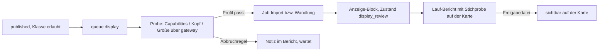

# ADR 0039 — Alles Anzeigbare auf die Karte

- **Status:** **Entwurf.** Die Vorgabe ist fest (Otto, 28.11.2026). Offen sind die Fragen F1–F13 (§12). Die Zahlen je Weg fehlen noch; sie kommen aus Ottos Zählung (Anhang A) als Nachtrag.
- **Datum:** 2026-11-28.
- **Aufgabe:** Auftrag von Otto vom 28.11.2026, Stufe C. Die Nummer 0039 war beim Start frei: Auf `main` endet die Reihe mit 0038, und von den offenen PRs ändert nur #437/#438 ein ADR (0026).
- **Autonomiestufe:** C. Kein Produktivcode.
  - Geändert sind nur dieses ADR und eine Zeile im Entscheidungslog.
  - Unverändert bleiben `backend/`, `frontend/`, `scripts/`, Registry, Migrationen, Fixtures, Backlog, M5-Plan, `.importlinter`, `.github/`, `.claude/`, `CODEOWNERS` und `CLAUDE.md`.
- **Vorgabe (Otto, 28.11.2026):** Jeder Datensatz, dessen Lizenz die Anzeige erlaubt, ist auf der Karte sichtbar. Das gilt auch für Vektordaten und für Raster in Formaten, die wir heute nicht lesen. Heute sind nur COG, Zarr und NetCDF voll angebunden; alles andere bleibt gelistet (`adr/0031` §8).
- **Fester Rahmen:**
  - Modulgrenzen nach `architekturplan.md` 3.1;
  - ausgehende Requests nur über `gateway`;
  - Worker-Kern zustandslos (B9);
  - Oberfläche nur Englisch, keine Hinweistexte;
  - Lizenz-Einstufung und Freigabe immer durch Otto.
- **Grundlage:**
  - `ENTSCHEIDUNGEN_2026-09-18.md` §2, §4, §5; `KLAERUNGEN.md` B8, B9, B10, B11 (mit Nachtrag 27.11.), B13.
  - `projektuebersicht.md` §2 (Prinzipien 1, 9, 10, 12, 13, 15, 16) und §5.
  - `architekturplan.md` 0, 3.1, 6.1, 6.2, 6.3, 6.5, 7.3, 12.3.
  - `adr/0011` (Adapter, Item-Vertrag), `adr/0022` (Datennähe), `adr/0023` §7.1 und §7.2, `adr/0025` (Harvest), `adr/0031` (§4, §7, §8, §9), `adr/0032` §5.3 (Auslegung von Prinzip 1), `adr/0033` (§4, §8, §9), `adr/0035` (Looks).
  - Entscheidungslog, Zeile „Lizenzstufe für volle Einträge“ vom 2026-11-25; Lizenzliste `plans/m5/m5-20-lizenzliste.md` (K1–K7).
- **Betroffen (erst mit einer Entscheidung):**
  - Postgres: gelistete Einträge bekommen einen Anzeige-Block.
  - Neuer Reader für Kartenbilder; Vektor-Reader; `access` und `api` mit Kachelrouten.
  - `jobs`: zwei neue Job-Arten, Vektor-Import und Raster-Wandlung.
  - `discovery`: ein Prüfschritt „Anzeige“ im Lauf.
  - Frontend: Ebenen „Kartenbild“ und „Vektor“, Legende, Attribute per Klick.
  - Image: GDAL mit Vektortreibern (F4).

---

## Methode und Belegstufen

Belegstufen wie in `adr/0025`, `adr/0031` und `adr/0033`:

- **M:** in dieser Sitzung gemessen; Verfahren im Text.
- **P:** am Primärdokument gelesen, im Repo mit Pfad.
- **S:** Suchtreffer oder Zusammenfassung, Wortlaut nicht geprüft. Die Primärseiten von MapLibre, Protomaps und GDAL waren aus der Sitzung nicht erreichbar. Alle Aussagen zum Stand der Technik außerhalb des Repos sind deshalb **S**.
- **A:** eigene Ableitung, ein Argument und kein Beleg.

**Gemessen am 28.11.2026 [M]:**

- **GDAL im Backend:** `rasterio` 1.5.2 aus `requirements-dev.lock` bringt GDAL 3.12.2 mit 147 Treibern. Darunter sind `GTiff`, `COG`, `JP2OpenJPEG`, `AAIGrid`, `HFA`, `netCDF`, `HDF5`, `GRIB`, `Zarr`, `WMS`, `WMTS`, `MVT`, `MBTiles`, `GPKG`, `ESRI Shapefile` und `GeoJSON`. Es fehlen `FlatGeobuf`, `Parquet`, `PMTiles`, `WFS`, `OAPIF`, `KML`/`LIBKML`, `GML`, `CSV` und `ECW`. Abgefragt mit `rasterio.env.Env().drivers()`. `rasterio` öffnet nur Raster. Ein Python-Zugang zu den Vektortreibern (`pyogrio`, `fiona`, `osgeo`) ist nicht installiert.
- **Vektoren heute:** Nur der AOI-Upload liest Vektoren (`access/aoi_upload.py`: GeoJSON, KML, Shapefile im ZIP, mit `pyshp` und `defusedxml`) [P].
- **Ablage gelisteter Einträge:** Format und Medientyp jeder Ressource stehen in `content -> 'earthx:distributions'` (`discovery/report.py`), die Lizenz als `license_ref`. Die Klasse K1–K7 steht nur in `backend/catalog/licenses/terms.yaml` (Git), nicht in Postgres (`catalog/licences.py`) [P].
- **Zählabfrage (Anhang A):** In einer Wegwerf-Datenbank mit den Migrationen 002–038 gegen acht synthetische Zeilen und einen Grabstein geprüft. Je Format, je Weg und je Kombination kam die erwartete Zahl heraus, der Grabstein zählte nicht. PowerShell gibt es in der Sitzung nicht. Das Skript um die Abfrage ist deshalb **nicht gelaufen**.
- **Keine Quelle abgerufen**, keine Datenpixel, keine Zahlen aus Ottos Bestand.

---

## 0. Kurzfassung

1. **Was heute fehlt:** Sichtbar sind nur volle Einträge (YAML, Lizenzklasse K1/K2, Formate COG, Zarr, NetCDF). Ein gelisteter Eintrag ist immer Stufe `catalog` (`terms.yaml`, Kopf) und hat keine Karte. Rund 102 000 Einträge in Ottos Bestand (Log 27.11.) liegen damit nur in der Liste.
2. **Empfehlung: ein dritter Weg „Anzeige“ (§3, F1).**
   - Der Eintrag bleibt gelistet und liegt weiter in Postgres, ohne YAML und ohne Onboarding-PR.
   - Er bekommt einen **Anzeige-Block**: Art, geprüfte Adresse, Layer, Legende, Attribution, Stil, Fassung.
   - Den Block füllt ein Prüfschritt im Harvest-Lauf. Sichtbar wird er erst mit einer Freigabe je Lauf und einer Stichprobe auf der Karte (wie `adr/0033` §8).
   - Processing bleibt dem vollen Weg vorbehalten.
3. **Kartendienste (§4, F2):** WMS, WMTS, OGC API Tiles und Maps werden als Bild durchgereicht.
   - Kacheln laufen über eine eigene Route und einen neuen Reader über `gateway`, unverändert, nur in EPSG:3857.
   - Legende und Attribution stammen aus den Capabilities.
   - Dienste nur über `http`, ohne EPSG:3857 oder mit mehreren Layern ohne Regel bleiben gelistet.
4. **Vektordaten (§5, F3–F5):**
   - Dateien und kleine Dienste werden **vorab** importiert: FlatGeobuf für Klick, Zuschnitt und Export, PMTiles für die Karte, beides im eigenen Objektspeicher.
   - Frist 30 Tage, verlängert nach Prüfung der Fassung, wie bei den Übersichtspyramiden (`adr/0032` §5.3).
   - Große Dienste kommen als Kartenbild, falls die Quelle eines hat, sonst live je Kachel ab einem Mindestzoom.
   - Den Stil liefert die Quelle (SLD, sonst automatisch). Ein Klick zeigt die Attribute.
5. **Weitere Raster (§6, F6):** Die Probe entscheidet.
   - Gekachelte GeoTIFFs mit Übersichten werden direkt gelesen.
   - GeoTIFF in Streifen, JPEG2000, ASCII-Grid und ERDAS IMG werden **beim Laden verlustfrei nach COG gewandelt**, mit Frist und Verlängerung wie oben.
   - ECW nie (proprietäres SDK).
6. **Lizenz (§7, F7–F9):** Anzeige ohne Frage für K1 und K2. Für K3, K4 und K5 ist eine Stufe „nur Anzeige“ vertretbar, aber Ottos Entscheidung:
   - K3: Anzeige ja, kein Export.
   - K4: Anzeige ja, solange es kein kostenpflichtiges Angebot gibt.
   - K5: nur das unveränderte Kartenbild der Quelle. Das widerspricht dem Wortlaut von B11, deshalb als Frage.
   - K6 und K7 nie.
7. **Onboarding in Menge (§8, F10, F11):**
   - Profile je Weg statt je Datensatz.
   - Die Warteschlange wird abgeleitet: sichtbare gelistete Einträge mit passender Klasse und erkannter Form.
   - 16 Abbruchregeln.
   - Neue Hosts nicht mehr einzeln durch Otto, sondern mit Vorgabewerten und der Lauf-Freigabe (F10).
8. **Kosten (§9) [A]:**
   - Kartendienste: kein Speicher; je angezeigter Kachel eine Anfrage an die Quelle und rund 20–80 KB eigener Egress.
   - Vektor und Raster: Speicher im einstelligen Euro-Bereich je Monat bei 10⁴ Datensätzen. Der Engpass ist die Last an den Quellen beim ersten Import, nicht Geld.
9. **Schnitt (§10):** zehn Aufgaben. Die Reihenfolge folgt der Zahl der Einträge je Weg aus Ottos Zählung (Anhang A); vorläufig: Lizenzstufe und Anzeige-Block, dann Kartendienste, Vektor-Dateien, Raster-Wandlung, Vektor-Dienste.

---

## 1. Kontext und Frage

`adr/0031` §8 leitet einen Kandidaten nur dann auf den vollen Weg, wenn Format, Adapter, Profil und Lizenzstufe passen; alles andere wird gelistet. `adr/0033` hat gelistete Einträge nach Postgres gelegt (Zielgröße 10⁶), mit Freigabe je Lauf statt je Eintrag. Seit dem 25.11.2026 ist `processing` auf K1/K2 begrenzt, und ein gelisteter Eintrag ist immer `catalog`.

Ottos Vorgabe verschiebt die Grenze: **Sichtbarkeit auf der Karte hängt an der Lizenz, nicht am Format.**

**Fragen (Auftrag, Punkte 1–6):**

1. Kartendienste (WMS, WMTS, OGC API Tiles/Maps) über `gateway` als Bild: Legende, Attribution, Grenzen der Anbieter.
2. Vektordaten (SHP, GeoPackage, GeoJSON, KML, FlatGeobuf, GeoParquet, WFS, OGC API Features): live oder vorab als Vektorkacheln. Außerdem Größengrenzen, Stil ohne Handfarben, Attribute per Klick, Zuschnitt und Export, sinnvolles Processing.
3. Weitere Raster: beim Laden nach COG wandeln oder direkt lesen.
4. Lizenz: welche Klassen die Anzeige erlauben; „nur Anzeige“ für K3/K4 als Frage.
5. Onboarding: Profile, Warteschlange und Abbruchregeln aus `adr/0031`, in Menge ohne Handarbeit.
6. Schnitt in Aufgaben, Reihenfolge nach der Zahl der Einträge je Weg.

**Nicht Teil dieses ADR:**

- Bau und Tabellenentwürfe im Einzelnen (Pläne der Aufgaben in §10).
- Processing auf Vektoren über die erste Auswahl in §5.7 hinaus; das braucht ein eigenes ADR zu Rezept und Operatoren (`adr/0014`).
- Würfelformate HDF und GRIB jenseits der Zählung; sie folgen dem Leseweg aus `adr/0029`.
- Punktwolken (LAS/LAZ), CAD (DXF/DWG) und Tabellen ohne Geometrie.

## 2. Befund

### 2.1 Code und Regeln [P]

| Stelle | Heute | Folge |
|---|---|---|
| Wege (`adr/0031` §8) | voll oder gelistet | Kein Weg zeigt einen Datensatz ohne Leseweg und Processing |
| Stufen (`LicenseTier`) | `catalog`, `display`, `processing` (`catalog/licences.py`, `_TIER_ORDER`) | Die Stufe `display` gibt es im Modell, aber kein Eintrag nutzt sie |
| gelistete Einträge (`terms.yaml`, Kopf) | „A listed entry is always in tier catalog“ | Muss sich für den Anzeige-Weg ändern (§7) |
| Ressourcen je Eintrag | `earthx:distributions` mit `href`, `format`, `media_type`, `title` (`discovery/report.py`) | Grundlage für Zählung und Prüfschritt |
| Formatwörter (`discovery/extract.py`, `_FORMAT_KINDS`) | Raster, Vektor, Tabelle, Dienst (WMS, WMTS, WFS, WCS, OGC API …), Dokument, Seite, Datei | Die Zählung (Anhang A) übernimmt dieses Vokabular |
| Probe (`discovery/probe.py`) | TIFF-Kopf ohne GDAL aus den ersten 16 KB; nur für Raster | Erweiterbar um Capabilities und Vektor-Köpfe (§8) |
| `gateway` | nur `https`, Host-Allowlist, Abstand und Verbindungen je Host aus `hosts.yaml` (`architekturplan.md` 6.5, Nachträge M5-36, M5-37) | Dienste nur über `http` sind nicht anzeigbar |
| Objektspeicher | Ergebnisse 7 Tage; Übersichtspyramiden 30 Tage mit Verlängerung nach Prüfung der Fassung (`adr/0032` §5.3) | Vorbild für vorab erzeugte Vektor- und Rasterdateien |
| Frontend | MapLibre GL JS 6 (`frontend/package.json`), Rasterquellen aus dem `tiler` | Vektorquellen und Rasterquellen fremder Bilder sind eingebaut (MapLibre-Stilspezifikation) [S] |
| Prinzip 13 (Nachtrag 15.11.) | „Nische vor Breite“ gilt für volle Einträge (Anzeige, Processing) | Die Vorgabe erweitert die Anzeige auf alle Datentypen; Nachtrag nötig (§11) |

### 2.2 Stand der Technik [S]

| Thema | Befund | Quelle |
|---|---|---|
| WMS in MapLibre | Rasterquelle mit GetMap-Vorlage und Platzhalter `{bbox-epsg-3857}`; nur EPSG:3857 | MapLibre, Beispiel „Add a WMS source“ |
| WMS 1.3.0 | `CRS` statt `SRS`; Achsenfolge nach EPSG, bei 3857 unkritisch; `LegendURL` je Style mit GetLegendGraphic | OGC 06-042; Beispiel-Capabilities von Esri |
| WMTS | Tile-Matrix-Set `GoogleMapsCompatible` für EPSG:3857; RESTful und KVP | OGC 07-057r7; GDAL-Treiber WMTS |
| OGC API Tiles / Maps | Tiles Part 1 (OGC 20-057) und Maps Part 1 (OGC 20-058, genehmigt 2024) sind Standard; Styles ist Entwurf; Tile-Matrix-Sets nach OGC 17-083r4 | docs.ogc.org; ogcapi.ogc.org |
| Anbietergrenzen | OSM: kein Massenabruf, kein Vorab-Laden, Sperre ohne Vorwarnung. geo.admin.ch: Fair Use, Grenzen seit 2025 geändert. basemap.de: CC BY 4.0 oder DL-DE BY 2.0 mit Pflichtvermerk | operations.osmfoundation.org; geo.admin.ch; BKG-Nutzungsbedingungen |
| CORS | Ohne `Access-Control-Allow-Origin` blockiert der Browser; abhilft nur der Server oder ein Proxy | Praxisberichte |
| PMTiles v3 | ein Archiv mit Vektor- oder Rasterkacheln, gelesen über HTTP-Range | protomaps.com; github.com/protomaps/PMTiles |
| Werkzeuge | GDAL schreibt PMTiles ab 3.8 (`ogr2ogr -f PMTiles`); tippecanoe (BSD-2) schreibt MBTiles und PMTiles | gdal.org; github.com/felt/tippecanoe |
| Live aus PostGIS | Martin (Apache-2.0/MIT), pg_tileserv (Apache-2.0), TiPg (FastAPI, OGC Features und Tiles) | jeweilige Repositories |
| FlatGeobuf | räumlicher Index (Hilbert-R-Baum) im Kopf; Teil-Lesen über Range | github.com/flatgeobuf |
| GeoParquet | 1.1 mit `bbox`-Covering; 2.0 als RC; für Produktion 1.1 empfohlen | geoparquet.org; cloudnativegeo.org |
| GeoPackage | OGC 12-128, Fassung 1.4 (2024); SQLite-Datei | docs.ogc.org |
| WFS / OAPIF in GDAL | Seitenweise Abfrage; OAPIF Seitengröße 1 000; WFS-Paging nur mit `OGR_WFS_PAGING_ALLOWED` | gdal.org, Treiberseiten |
| Stil | SLD 1.0 / SE 1.1; GeoStyler übersetzt SLD in MapLibre-Stile (Lizenz BSD-2 laut Aggregatoren) | github.com/geostyler |
| große GeoJSON im Browser | geojson-vt verarbeitet 100 MB; für große Daten Vektorkacheln statt GeoJSON | maplibre.org/geojson-vt; Mapbox-Hilfe |
| COG | GDAL-Treiber `COG` seit 3.1, Blockgröße 512; rio-cogeo | gdal.org; cogeotiff |
| JPEG2000 über Netz | Fensterlesen nicht garantiert effizient; OpenJPEG 2.5.2 brauchte 122 statt 2 Range-Anfragen (gdal-dev, 11/2024) | lists.osgeo.org |
| ECW | GDAL braucht das proprietäre SDK; Server-Einsatz lizenzpflichtig | gdal.org, Treiber ECW |
| CC 4.0 §2(a)(4) | Technische Änderungen, um die Rechte in anderen Medien und Formaten auszuüben, sind erlaubt und erzeugen „never … Adapted Material“; ND verbietet das Teilen von Adapted Material | creativecommons.org, Legal Code BY-ND 4.0 |
| Objektspeicher | Hetzner 1 TB Speicher und 1 TB Egress im Grundpreis (4,99–6,49 €, Quellen widersprechen sich), danach 1 €/TB; R2 0,015 USD/GB-Monat, kein Egress; S3 rund 0,023 USD/GB-Monat und 0,09 USD/GB Egress | hetzner.com; developers.cloudflare.com; Drittquellen zu AWS |

## 3. Grundsatz: drei Wege

| Weg | Inhalt | Ablage | Freigabe | Karte | Klick | Zuschnitt, Export | Processing |
|---|---|---|---|---|---|---|---|
| gelistet | Metadaten, Link | Postgres | Lauf (`adr/0033` §8) | Ausdehnung | — | — | — |
| **Anzeige (neu)** | wie gelistet plus Anzeige-Block | Postgres; abgeleitete Dateien im Objektspeicher mit Frist | Lauf plus Anzeige-Stichprobe (F11) | Kartenbild, Vektor oder Raster | Attribute (Vektor) | Vektor: K1/K2 (F12) | — |
| voll | YAML, Profil, Capabilities | Git, Image, pgstac | Onboarding-PR (`adr/0031`) | ja | Werte | ja | ja |

**Warum nicht einfach den vollen Weg öffnen [A]:**

- Ein voller Eintrag ist eine YAML-Datei im Git mit allen Feldern (B10). Ottos Prüfaufwand wächst damit je Eintrag. Bei 10⁴–10⁵ anzeigbaren Einträgen trägt das nicht; das ist dieselbe Rechnung wie in `adr/0033` §0.
- Processing verlangt K1/K2 und Capabilities je Datensatz. Für die Anzeige braucht es beides nicht.

**Was der Anzeige-Block ist (Vorschlag, Form im Plan von A1):**

- `kind`: `map_wms`, `map_wmts`, `map_ogcapi`, `vector`, `raster`.
- `endpoint`: die geprüfte Adresse; die Vorlage der Kachel wird daraus abgeleitet und nie aus einer Anfrage genommen.
- `layer`, `style`, `format`, `tile_matrix_set` je nach Art.
- `legend`: Adresse der Legende der Quelle oder ein Verweis auf den eigenen Stil.
- `attribution`: Vermerk aus Capabilities bzw. Lizenz (`attribution_unmodified` / `_modified`, §7).
- `version`: Fassung der Quelle (ETag, `updated`, Hash der Capabilities); `artifact`: Präfix im Objektspeicher.
- `checked_at`, `bounds`, `min_zoom`, `max_zoom`.

**Ein Eintrag mit mehreren Wegen (z. B. WMS und Shapefile):** Daten vor Bild.

- Eine Vektor- oder Rasterdatei gibt Klick, Export und einen eigenen Stil.
- Das Kartenbild ist der Rückfall, wenn die Datei an einer Grenze aus §5.4 oder §6 scheitert.
- Ein Eintrag zeigt immer genau einen Weg. Die Anzahl der Kombinationen liefert die Zählung (`kombinationen.csv`).

## 4. Kartendienste als Bild

### 4.1 Optionen

| | Option | Bewertung |
|---|---|---|
| K-a | **Proxy über `gateway`:** Route `/listed/{id}/map/{z}/{x}/{y}` in `api`; ein neuer Reader `readers/mapimage.py` holt GetMap bzw. GetTile in EPSG:3857 über `gateway` und gibt die Bytes unverändert zurück | erfüllt B8; die Adresse kommt nur aus dem Anzeige-Block; CORS der Quelle egal; Limits je Host greifen |
| K-b | Browser lädt direkt bei der Quelle | verletzt „ausgehende Requests nur über `gateway`“ (fester Rahmen); jede Quelle bräuchte CORS; die IP der Nutzer ginge an Dritte. **Scheidet aus** |
| K-c | wie K-a, aber der Server projiziert um (Dienste ohne EPSG:3857) | Umprojektion ist Bearbeitung (B11), kostet Rechenzeit je Kachel und verwischt Text in Kartenbildern [A]; höchstens für K1/K2 und später |

**Empfehlung K-a (F2).** Dienste ohne EPSG:3857 bleiben gelistet, Abbruchregel 4.

### 4.2 Ablauf einer Kachel

1. `api` liest den Anzeige-Block des Eintrags. Ist der Eintrag nicht `published` oder fehlt der Block, antwortet die Route mit `404`; bei einem Grabstein mit `410`.
2. `access` baut aus Block und `z/x/y` die Anfrage:
   - WMS: `BBOX` in EPSG:3857, 256² oder 512², `FORMAT` `image/png` bzw. `image/jpeg`, `TRANSPARENT=TRUE`;
   - WMTS: Zeile und Spalte im Tile-Matrix-Set `GoogleMapsCompatible` bzw. `WebMercatorQuad`;
   - OGC API: `/collections/{id}/map/tiles/WebMercatorQuad/{z}/{y}/{x}` bzw. `/map?bbox=…`.
3. `readers/mapimage.py` ruft über `gateway` ab. Es prüft:
   - Status `200`;
   - `Content-Type` `image/png`, `image/jpeg` oder `image/webp`;
   - höchstens 2 MB;
   - die ersten Bytes passen zum Typ.

   Eine XML-Fehlermeldung (WMS `ServiceException`) wird nie an den Browser gereicht.
4. Antwort unverändert, Kopf `X-EarthX-Source: service`, Cache-Zeit höchstens wie bei der Quelle und höchstens 24 h. Kein eigener Kachel-Cache auf der Platte (Prinzip 1; `architekturplan.md` 12.3).

**Module:** Der Reader liegt in `readers` (darf `gateway`), die Auflösung in `access` (darf `readers`), die Route in `api`. **Keine Importregel ändert sich** [P, `architekturplan.md` 3.1].

### 4.3 Legende, Attribution, Ehrlichkeit

- **Legende:** `LegendURL` des gewählten Styles (WMS, WMTS) bzw. die Legende der OGC-API-Collection. Sie wird über dieselbe Route mit `…/legend` und `gateway` geholt, als Bild, ohne Änderung. Fehlt sie, gibt es keine Legende und keinen Ersatztext (keine Hinweistexte).
- **Attribution:** Bevorzugt das Element `Attribution` der Capabilities [S]. Sonst gilt der Vermerk der Lizenz aus `terms.yaml` mit `{publisher}`. Er steht in der Attribution der MapLibre-Quelle. Der Text der Quelle bleibt im Wortlaut, auch auf Deutsch; er ist Inhalt, keine Oberfläche.
- **Darstellung:** Am Bild ist nichts einstellbar außer Deckkraft. „Apply“ (ENTSCHEIDUNGEN §2) und Looks (`adr/0035`) gelten nicht. Die Ebene trägt die Marke „Map image“ (Prinzip 9), ohne Tooltip-Erklärung.
- **Klick:** nur Bild, keine Attribute. GetFeatureInfo ist nicht vorgesehen (Vorgabe „nur als Bild“).

### 4.4 Grenzen der Anbieter

| Grenze | Umgang |
|---|---|
| Fair Use und Rate Limits (z. B. geo.admin.ch, OSM) [S] | Abstand und Verbindungen je Host wie heute; Vorgabe für neue Hosts 2 Verbindungen, kein Abstand für Kacheln (G3 aus M5-36), Unterbrecher nach 3 Fehlern in Folge |
| Verbot von Vorab-Laden und Massenabruf (OSM) [S] | nie vorab laden; nur Kacheln, die ein Browser anfragt |
| Caching-Verbote | `Cache-Control` der Quelle wird nie verlängert |
| `MaxWidth`/`MaxHeight` [S] | höchstens 512² je Anfrage; kleiner, wenn die Capabilities es verlangen |
| nur `http` | nicht anzeigbar (`gateway`, M1-03 F4); gezählt in Anhang A, Spalte `entries_https` |
| Dienst verlangt Anmeldung oder Schlüssel | nicht anzeigbar (Prinzip 2) |
| Hintergrundkarten (Basemaps) | nicht Teil des Katalogs; ein Dienst, dessen einziger Inhalt eine allgemeine Hintergrundkarte ist, bleibt gelistet (Abbruchregel 14) |

## 5. Vektordaten

### 5.1 Live oder vorab

| | Option | Bewertung |
|---|---|---|
| V-a | **Vorab-Import als Job:** Die Quelle wird einmal gelesen und als **FlatGeobuf** (Original-Attribute, EPSG:4326) und **PMTiles** (MVT, EPSG:3857, z0 bis `max_zoom`) im Objektspeicher abgelegt; dazu `style.json` | eine Last an der Quelle je Fassung; schnelle Kacheln; Klick, Zuschnitt und Export aus einer Datei; Speicher nötig |
| V-b | Live je Kachel: WFS- bzw. OAPIF-Abfrage mit `bbox`, Umwandlung in MVT im `tiler` | kein Speicher; jede kalte Kachel belastet die Quelle; Dateien (SHP im ZIP) lassen sich so nicht lesen |
| V-c | Import in PostGIS, Kacheln live mit `ST_AsMVT` (Martin, pg_tileserv, TiPg) | eine weitere Tabelle je Datensatz bzw. ein großer Bestand in der Plattform-Datenbank; Martin wäre ein zusätzlicher Dienst; der Grundsatz „keine dauerhafte Rohdatenhaltung“ wäre in Postgres schwerer mit Fristen zu halten als im Objektspeicher [A] |
| V-d | GeoJSON direkt im Browser | nur über `gateway`, also über einen Proxy; ab einigen MB träge [S]; kein Export, keine Grenzen |

**Empfehlung (F3):** V-a für alle Dateien und für Dienste bis zur Grenze aus §5.4. Darüber das Kartenbild der Quelle, wenn es eines gibt, sonst V-b ab einem Mindestzoom.

### 5.2 Ablage und Frist

```
display/{dataset_id}/{fassung}/data.fgb
display/{dataset_id}/{fassung}/tiles.pmtiles
display/{dataset_id}/{fassung}/style.json
```

- `fassung`: kurzer Hash aus ETag bzw. `Last-Modified` und Größe der Quelldatei, bei Diensten aus `numberMatched` und `updated` bzw. der Capabilities.
- **Frist und Verlängerung wie Übersichtspyramiden:**
  - 30 Tage ab der letzten Bestätigung der Fassung.
  - Vor Ablauf prüft ein `HEAD` bzw. eine bedingte Anfrage über `gateway`. Ist die Fassung unverändert, wird nur `checked-at` neu gesetzt; hat sie sich geändert, wird neu importiert; ist die Quelle nicht erreichbar, läuft die Datei ab.
  - Lebenszyklus-Regel 31 Tage auf `display/` (`adr/0032` §5.2, §5.3).
- **Auslegung von Prinzip 1:** `adr/0032` §5.3 gilt heute nur für Pyramiden. Der Anzeige-Weg braucht dieselbe Auslegung für `display/` (F3, §11).
- **Kacheln an den Browser:** `api` liest die PMTiles-Datei über `objectstore` mit Range und gibt MVT unter `/listed/{id}/vector/{z}/{x}/{y}.mvt` aus. Der Objektspeicher bleibt intern, und das Frontend braucht kein PMTiles-Protokoll und keine neue npm-Abhängigkeit [A]. Den Lesezugriff auf PMTiles (Kopf, Verzeichnis, Kachel) gibt es als kleine Bibliothek oder als eigener Leser mit rund 200 Zeilen [A]; Wahl im Plan von A4.

### 5.3 Wer baut, wie

- **Job-Art „Vektor-Import“** in `jobs`, wie die Pyramide (`adr/0032` §5.2):
  - Der **Kern** (`processing`) liest die Quelle über `gateway` in ein lokales Arbeitsverzeichnis. Er schreibt FlatGeobuf und PMTiles lokal und gibt Pfade, Statistik und Stil zurück. Er kennt keinen Objektspeicher (B9).
  - Die **Hülle** lädt hoch und schreibt den Anzeige-Block.
- **Werkzeug (F4):** GDAL ≥ 3.8 als Kommandozeile `ogr2ogr` im Image, mit den Treibern GPKG, ESRI Shapefile, GeoJSON, LIBKML, FlatGeobuf, Parquet, WFS, OAPIF und PMTiles. Das GDAL im rasterio-Wheel hat davon nur GPKG, Shapefile und GeoJSON [M].
  - Zwei GDAL im Image (Wheel und System) sind möglich, aber ein Risiko für Versionen und Konfiguration [A]. Der Spike in A4 klärt die Quelle: Debian-Paket oder eigener Bau in einer Bau-Stufe wie bei pgvector (M5-43).
  - tippecanoe erzeugt bessere Kacheln bei sehr dichten Daten (Ausdünnen je Zoom) [S]. Es wäre aber ein zweites Werkzeug, deshalb erst bei Bedarf.
  - GDAL lädt über `/vsicurl` selbst nach. Jede Adresse geht vorher durch `gateway`, und `gateway` setzt die GDAL-Konfiguration wie bei Rastern (B8). Für WFS und OAPIF ruft GDAL selbst Folgeseiten auf. Ob diese Adressen die Allowlist passieren, prüft der Spike. Sonst liest ein eigener Seitenleser über `gateway` und gibt GeoJSON an `ogr2ogr` weiter.
- **ZIP:** Ein Archiv wird nur entpackt, wenn darin genau ein Datensatz eines bekannten Formats liegt (z. B. ein Shapefile mit `.shp`, `.shx`, `.dbf`, `.prj`). Grenzen wie beim AOI-Upload: gedeckelte Größe je Mitglied, keine Pfade außerhalb (`access/aoi_upload.py`).
- **Sicherheit:** Fremde Dateien laufen durch GDAL im Kind des Workers (Aufseher und Kindprozesse, `adr/0013`), ohne Netz außer `gateway`, mit Zeit- und Speichergrenze. XML (KML, GML, SLD, Capabilities) wird mit `defusedxml` gelesen bzw. von GDAL ohne Netz für externe Entitäten [A].

### 5.4 Größengrenzen (Vorschlag [A], im Spike zu messen)

| Größe | Grenze | darüber |
|---|---|---|
| Quelldatei | 1 GB komprimiert, 4 GB entpackt | Kartenbild der Quelle, sonst gelistet |
| Objekte | 5 Mio. | wie oben |
| Attribute je Objekt | 100 Spalten, Werte bis 1 KB | weitere Spalten weggelassen, Feld `truncated` im Block |
| Dienst (WFS, OAPIF) | 500 000 Objekte laut `numberMatched` bzw. `resultType=hits` | Kartenbild, sonst live ab `min_zoom` mit höchstens 5 000 Objekten je Kachel |
| Import-Job | 30 min, 4 GB Arbeitsspeicher, 8 GB Platte | Abbruch, Notiz, Regel 10 |
| PMTiles | `max_zoom` 14, höher nur bei Punkten unter 1 Mio. [A] | — |

### 5.5 Stil ohne Farben von Hand (F5)

Rangfolge:

1. **Stil der Quelle:** ein SLD, das der WMS desselben Eintrags für den Layer liefert (`GetStyles`, SLD 1.0/SE 1.1). Dazu ein SLD oder QML, das als eigene Ressource neben der Datei liegt.
   - Übersetzt wird eine **Teilmenge**: Füllung, Kontur, Linienbreite, Punktsymbol (Kreis, Quadrat), Regeln mit Gleichheit, Bereich und `ElseFilter`, Maßstabsgrenzen. Beschriftung nur mit einem Attribut.
   - Was außerhalb der Teilmenge liegt, wird weggelassen und im Block gezählt (`style_dropped`).
   - Die Übersetzung läuft beim Import im Kern und schreibt `style.json`. Ob GeoStyler (JavaScript) als Vorlage taugt oder ein eigener Übersetzer in Python schmaler ist, klärt A5 [S].
2. **Automatisch** ohne Stil der Quelle:
   - **Kategorien:** Gibt es eine Textspalte mit 2–12 Werten, die mindestens 95 % der Objekte deckt, wird nach ihr gefärbt. Eine Spalte, deren Name nach Klasse klingt (`class`, `type`, `art`, `kategorie`, `nutzung` …), hat Vorrang.
   - **Sonst einfarbig nach Geometrie:** Fläche halbdurchsichtig mit Kontur, Linie, Punkt.
   - Die Farben kommen aus einer festen Palette der Plattform (die Farbtoken des HUD-Designs, ENTSCHEIDUNGEN §2). Die Startfarbe richtet sich nach dem Hash der ID, damit zwei Ebenen nebeneinander verschieden sind.
   - Niemand wählt Farben je Datensatz.
3. **Legende:** aus `style.json` erzeugt (Klassen mit Farbe, Werte aus den Daten). Keine Erklärtexte.

### 5.6 Klick, Zuschnitt, Export

- **Klick:** MapLibre `queryRenderedFeatures` auf die MVT-Ebene; die Attribute stehen in der Kachel [S]. Gezeigt werden Name und Wert im Wortlaut der Quelle, in der Reihenfolge der Quelle, in einer Tafel mit dem englischen Titel „Attributes“.
- **Zuschnitt und Export (F12):**
  - Der Kern schneidet `data.fgb` mit der AOI. Der räumliche Index liest nur die betroffenen Teile.
  - Ausgabe als GeoPackage (Vorgabe), GeoJSON oder FlatGeobuf, im ZIP mit Attribution und Lizenz. Ein Stil liegt bei, wie bei Rastern (`.qml`, M5-64), sobald §5.5 ihn kennt.
  - Kein Shapefile als Ausgabe: Feldnamen höchstens 10 Zeichen, Dateien höchstens 2 GB [A].
  - Gilt nur für K1/K2 (Weitergabe und Bearbeitung; ein Ausschnitt ist eine Bearbeitung, §7).
  - Lädt ein Nutzer ganz herunter, verweist der Link wie heute auf die Quelle (Prinzip 10).

### 5.7 Welches Processing für Vektoren sinnvoll ist

Nur Vorschlag. Processing braucht den vollen Weg oder ein eigenes ADR, das Vektoren als Eingabe in das Rezept nimmt (`adr/0014`).

| Rang | Operator | Nutzen | Bemerkung |
|---|---|---|---|
| 1 | **Zonale Statistik Raster × Polygone** (z. B. WorldCover-Anteile je Gemeinde, Höhenmittel je Schutzgebiet) | verbindet die vollen Raster mit den neuen Vektoren; fast jede Anfrage aus dem Planungsalltag [A] | baut auf Statistik je Polygon (`architekturplan.md` 6.3) und Klassenanteilen (M5-16) auf |
| 2 | Zuschnitt mit Attributfilter | Grundlage für Export und für 1 | §5.6 |
| 3 | Fläche, Länge, Anzahl je Klasse | Übersicht ohne GIS | rein im Kern, kein Netz |
| 4 | Puffer, Verschneidung mit der AOI | häufige GIS-Grundoperation | Projektion in metrisches CRS nötig |
| 5 | Punkte in Polygonen zählen, räumlicher Join zweier Vektor-Datensätze | erst mit mehreren Eingaben (`adr/0037`) | später |

Nicht sinnvoll in dieser Plattform: Topologie-Korrektur, Netzwerkanalyse, Geokodierung im Stapel [A].

## 6. Weitere Raster

### 6.1 Was das Format kostet [S, A]

| Format | direkt über `/vsicurl` | Bewertung |
|---|---|---|
| GeoTIFF gekachelt mit Übersichten | wie COG (Range je Block) | **direkt** |
| GeoTIFF gekachelt ohne Übersichten | volle Auflösung gut, Herauszoomen liest alles | direkt mit Pyramide nach `adr/0032`, oder wandeln |
| GeoTIFF in Streifen | große Teile der Datei je Kachel | **wandeln** |
| JPEG2000 | Fensterlesen nicht verlässlich effizient (122 statt 2 Anfragen gemessen von GDAL-Entwicklern) | **wandeln** |
| ASCII-Grid (AAIGrid), XYZ-Text | Text; die ganze Datei wird gelesen | **wandeln** |
| ERDAS IMG (HFA) | Kopf und Blöcke über Range möglich, Übersichten in `.rrd` daneben | **wandeln** |
| ECW | proprietäres SDK, Server-Lizenz | **nie**, gelistet |
| HDF, GRIB | Leseweg nach `adr/0029` bzw. `adr/0023` §7.1 | nicht Teil dieses ADR |

### 6.2 Optionen

| | Option | Bewertung |
|---|---|---|
| R-a | **Nach Probe:** direkt, wo die Datei gekachelt ist und Übersichten hat; sonst beim Laden verlustfrei nach COG wandeln (Job „Raster-Wandlung“) | wenig Speicher, wo er nicht nötig ist; der TIFF-Kopf steht schon in der Probe (`discovery/probe.py`) |
| R-b | immer wandeln | einfach; Speicher und eine volle Last an der Quelle auch bei guten Dateien |
| R-c | nie wandeln, nur direkt lesen | kein Speicher; Streifen, JPEG2000 und Text liefern keine brauchbaren Kacheln [S] |

**Empfehlung R-a (F6).**

- **Verlustfrei** heißt: gleiche Pixelwerte, gleicher Datentyp, gleiches CRS, gleiches Nodata, keine Neuabtastung. Hinzu kommen nur Kachelung (512), Kompression (Deflate bzw. LERC_ZSTD ohne Fehler) und Übersichten. Die Resampling-Methode der Übersichten folgt der Art der Werte: `mode` bei Klassen, sonst `average` (wie `adr/0032` §5.2).
- Ablage `display/{dataset_id}/{fassung}/{datei}.tif`, Frist und Verlängerung wie §5.2.
- Gelesen wird die Kopie mit dem vorhandenen COG-Reader. Der `tiler` öffnet sie über `objectstore` wie Pyramiden und Ergebnisse [P, `architekturplan.md` 3.1, Nachtrag M4-13c-5]; keine Importregel ändert sich.
- **Ehrlichkeit:** Kopf `X-EarthX-Source: copy`. Die Wandlung ist eine technische Formatänderung; die Werte sind die der Quelle. Die Kachel trägt den Vermerk für unveränderte Daten, solange keine Darstellung (Stretch, Colormap) gewählt ist. Mit Darstellung gilt der Vermerk für geänderte Daten wie heute.
- **Grenzen [A]:** je Datei höchstens 2 GB. Kachel-Datensätze aus vielen Dateien (z. B. DGM1 eines Landes) erst nach Messung im Spike. Sie brauchen je Datei einen Job und je Host Abstand (`adr/0032` §8.1: 45 000 Dateien ≈ 3–6 h).
- **Anzeige, nicht Processing:** Ein Raster auf dem Anzeige-Weg bekommt eine Standard-Darstellung aus Metadaten (Graustufen mit Perzentilen bzw. Farbtabelle, wo die Datei eine hat) und die Steuerung mit „Apply“. Statistik, Zuschnitt und Jobs bleiben beim vollen Weg (§3). Ein K1/K2-Raster mit Kopie ist danach ein guter Kandidat für den vollen Weg (`adr/0031` §8, „Gelistet heißt nicht für immer“).

## 7. Lizenz

### 7.1 Was Anzeige rechtlich ist [A, kein Rechtsrat]

| Anzeige-Art | Handlung der Plattform | Weitergabe | Bearbeitung |
|---|---|---|---|
| Kartenbild durchgereicht | Bild der Quelle unverändert an den Nutzer | ja | nein |
| Raster-Kopie (COG) | Formatwandlung, Kachel daraus, ggf. Umprojektion und Darstellung | ja | Formatwandlung nach CC 4.0 §2(a)(4) keine [S]; Umprojektion und Stretch ja (B11, Prinzip 1) |
| Vektor (PMTiles, eigener Stil) | Formatwandlung, Generalisierung je Zoom, Stil der Plattform | ja | ja (Generalisierung, Stil) |
| Export eines Ausschnitts | Ausschnitt der Daten als Datei | ja | ja |

### 7.2 Klassen

| Klasse | Flags (Lizenzliste) | Anzeige | Begründung |
|---|---|---|---|
| K1 offen ohne Namensnennung | J/J/J/N/N | **ja** | B11: Weitergabe und Bearbeitung erlaubt |
| K2 offen mit Namensnennung | J/J/J/N/J | **ja**, mit Vermerk; bei Bearbeitung „modified“ | wie K1 |
| K3 gleiche Bedingungen (BY-SA, ODbL) | J/J/J/J/J | **Frage F7** | Anzeige und Bearbeitung erlaubt. Die Pflicht zur gleichen Lizenz trifft geteilte Bearbeitungen: Kacheln und Bilder müssten unter derselben Lizenz stehen. Für die Anzeige lässt sich das mit dem Vermerk erfüllen; für Ergebnisse von Processing nicht (Grund der Entscheidung vom 25.11.) |
| K4 nicht kommerziell (BY-NC, `terms_ask`) | J/N/J/N/J | **Frage F8** | Anzeige ist Weitergabe. Ob die Plattform kommerziell ist, hängt am Geschäftsmodell (`projektuebersicht.md` §11); B11 erlaubt NC „nur im Gratis-Tier“ |
| K5 keine Bearbeitung (BY-ND) | J/J/N/N/J | **Frage F9** | B11: „nur Katalogeintrag mit Link, solange keine Rechtsberatung etwas anderes ergibt“. Ein unverändert durchgereichtes Kartenbild ist keine Bearbeitung [A]; Umprojektion und eigener Stil wären es |
| K6 unbekannt oder geschlossen | N/N/N/N/N | **nein** | keine Weitergabe erlaubt |
| K7 keine Lizenz | — | **nein** | nie sichtbar |

**Folge für die Daten [A]:** Die Stufe hängt künftig an der Klasse *und* am Weg.

- Gelistete Einträge der erlaubten Klassen bekommen die Stufe `display`; der Satz „A listed entry is always in tier catalog“ in `terms.yaml` ändert sich (A1).
- Der Lader prüft Klasse gegen Stufe, wie heute für `processing` (`CLASSES_ABOVE_CATALOG`).
- Für K5 nach F9 = 1 gäbe es eine engere Stufe `display_unmodified`, die nur Kartenbilder zulässt.
- Ottos Einstufung je Lizenz bleibt unberührt. Neu ist nur die Regel, welche Klasse welche Stufe trägt.

## 8. Onboarding in Menge

### 8.1 Wo es läuft

Der Prüfschritt braucht Netz. Cloud-Sitzungen erreichen die Quellen nicht (`adr/0031` §2). Er läuft deshalb im Harvest-Lauf bei Otto: `scripts/harvest-cycle.ps1` bekommt einen Schritt `harvest-display` nach der Linkprüfung. Die Jobs für Import und Wandlung laufen im Worker der lokalen Plattform.



### 8.2 Profile je Weg

`adr/0031` §7 baut Profile je Art von Datensatz (Höhe, Landbedeckung …) für den vollen Weg. Der Anzeige-Weg braucht keine Capabilities, deshalb **Profile je Form**. Jedes Profil ist eine Datei unter `backend/catalog/profiles/display/`; der Prüfschritt rechnet den Anzeige-Block aus Probe und Profil.

| Profil | erkennt | Probe | Ergebnis |
|---|---|---|---|
| `map-wms` | WMS 1.1.1/1.3.0 | GetCapabilities (höchstens 2 MB): Version, Layer, CRS, Styles, `LegendURL`, `Attribution`, Formate, `MaxWidth` | Block `map_wms` |
| `map-wmts` | WMTS 1.0.0 | Capabilities: Layer, `GoogleMapsCompatible` bzw. gleichwertiges Set, Formate, Styles | Block `map_wmts` |
| `map-ogcapi` | OGC API Tiles/Maps | Landing Page, `/conformance`, Collection mit `WebMercatorQuad` | Block `map_ogcapi` |
| `vector-file` | SHP, GPKG, GeoJSON, KML/KMZ, FGB, GeoParquet, GML; ZIP mit genau einem davon | `HEAD`: Größe, ETag; bei FGB und GeoParquet der Kopf über Range | Job Vektor-Import |
| `vector-service` | WFS 2.0, OAPIF | Capabilities bzw. `/collections/{id}`, Zahl der Objekte | Job Vektor-Import oder live |
| `raster-file` | GeoTIFF, JPEG2000, AAIGrid, IMG | TIFF-Kopf (vorhanden), sonst Größe und Signatur | direkt oder Job Raster-Wandlung |

### 8.3 Warteschlange

Abgeleitet, keine zweite Liste (wie `adr/0031` §4.2):

- **Eingang:** Einträge im Zustand `published`, deren Klasse die Anzeige erlaubt (§7), mit mindestens einer Ressource, die ein Profil erkennt.
- **Abzug:** Einträge mit gültigem Anzeige-Block und unveränderter Fassung, Einträge mit Notiz innerhalb der Wartefrist (7 Tage, dann neuer Versuch, höchstens dreimal), gesperrte Einträge (`blocked.yaml`).
- **Reihenfolge:**
  1. `pin` aus `onboarding.yaml`;
  2. Weg nach Kosten: Kartenbild vor Vektor-Datei vor Raster-Wandlung vor Vektor-Dienst;
  3. Kategorien im Wechsel;
  4. älteste Freigabe zuerst.
- **Menge je Lauf [A]:** Kartendienste brauchen nur eine Capabilities-Anfrage, bis 2 000 je Lauf. Vektor-Importe bis 200 und Raster-Wandlungen bis 50 je Lauf; nach der Messung der ersten Läufe anpassen. Abstand je Host gilt.

### 8.4 Freigabe und Sichtbarkeit (F11)

- Ein neuer Block steht im Zustand `display_review` und ist unsichtbar.
- **Lauf-Bericht:** Zahlen je Profil und Abbruchregel, dazu eine **Stichprobe von 30 Einträgen**, die Otto auf der lokalen Karte ansieht. Ein Link je Eintrag öffnet die Ebene. Die Häkchen stehen in der Freigabedatei wie bei `adr/0033` §8.4.
- **Freigabedatei** `backend/catalog/approvals/display/<Tag>-<n>.yaml` mit Fingerabdruck des Stapels. Erst der Merge macht die Blöcke sichtbar. Sie kommt in denselben täglichen PR wie die anderen Freigaben.
- **Nach der Freigabe:** Ein Wechsel der Fassung erneuert die Dateien ohne neue Freigabe. Ein Wechsel von Lizenz, Herausgeber oder Host des Dienstes verbirgt den Block bis zur nächsten Freigabe (wie `adr/0033` §11).

### 8.5 Abbruchregeln

Die Automatik schreibt in diesen Fällen eine Notiz in den Bericht; der Eintrag bleibt gelistet. Sie baut nie Code und ändert keine gemeinsame Datei.

| # | Fall |
|---|---|
| 1 | Klasse erlaubt die Anzeige nicht (K6, K7; K3–K5 je nach F7–F9) |
| 2 | Ressource nur über `http` oder mit Anmeldung, Schlüssel bzw. Token |
| 3 | Capabilities bzw. Kopf nicht lesbar, größer als 2 MB oder kein gültiges XML/JSON |
| 4 | Kartendienst ohne EPSG:3857 bzw. `GoogleMapsCompatible`/`WebMercatorQuad` |
| 5 | WMS mit mehreren Layern, und keiner ist eindeutig: weder `LAYERS` in der Adresse noch genau ein benannter Layer noch ein benannter oberster Layer |
| 6 | Bildformat nicht PNG, JPEG oder WebP |
| 7 | `robots.txt` verbietet den Pfad, oder der Host ruht nach dem Unterbrecher |
| 8 | Vektor- oder Rasterdatei über der Grenze aus §5.4 bzw. §6.2 |
| 9 | ZIP mit keinem oder mehreren Datensätzen, mit Pfaden nach außen oder über der Größengrenze |
| 10 | Job scheitert zweimal (Zeit, Speicher, Formatfehler) |
| 11 | CRS unbekannt oder ohne Transformation nach EPSG:4326 bzw. 3857 |
| 12 | ECW, MrSID oder ein anderes Format mit proprietärem SDK |
| 13 | Geometrie leer bzw. alle Objekte ohne Geometrie, oder ein Raster nur aus Nodata |
| 14 | Dienst ist eine allgemeine Hintergrundkarte bzw. die Ausdehnung der Kacheln widerspricht der Ausdehnung des Eintrags grob (mehr als das Zehnfache) |
| 15 | neuer Host nach F10 = 2 (wenn Otto Hosts einzeln bestätigen will) |
| 16 | Eine Neuerung wäre nötig: neues Profil, neuer Treiber, neue Abhängigkeit, neues Feld |

### 8.6 Hosts (F10)

`adr/0031` §9 Fall 7 und M5-36 verlangen für jeden Host eines vollen Eintrags eine Zeile in `hosts.yaml`, bestätigt von Otto. Beim Anzeige-Weg wären das Tausende Hosts von Gemeinden, Landesämtern und Bundesämtern [A].

- **Vorschlag:** Hosts des Anzeige-Wegs brauchen keine Zeile. Sie bekommen Vorgabewerte: 2 Verbindungen für Kacheln, 1 s Abstand bei Import und Probe, Unterbrecher wie heute.
- Zugelassen werden sie mit der Freigabe des Laufs, in der Otto die neuen Hosts als Liste mit Zahl der Einträge sieht.
- Eine Zeile in `hosts.yaml` gibt es nur für Abweichungen (Fair-Use-Regeln einer Quelle).
- Die Allowlist von `gateway` für Anzeige-Routen kommt aus den sichtbaren Blöcken in Postgres, nicht aus der Registry. Sie wird je Prozess kurz gecacht und je Anfrage am Block geprüft.

## 9. Kosten (Schätzung [A], Preise [S])

**Variablen aus der Zählung (Anhang A):** N_map (Kartendienste), N_vec (Vektor), N_ras (Raster-Wandlung).

| Posten | Kartendienste | Vektor | Raster-Wandlung |
|---|---|---|---|
| Speicher | 0 | FlatGeobuf etwa wie die Quelle, PMTiles bis z14 das 0,5- bis 2-fache [A]; im Mittel geschätzt 10–30 MB je Datensatz | COG etwa das 0,8- bis 1,3-fache der Quelle (Kompression ohne Verlust, Übersichten +33 %) [A] |
| erste Last an der Quelle | 1 Capabilities-Anfrage | 1 vollständiger Download | 1 vollständiger Download je Datei |
| laufende Last an der Quelle | je angezeigter Kachel 1 Anfrage | 1 `HEAD` je 30 Tage, Neuimport nur bei Änderung | wie Vektor |
| Rechnen | keins | Import je Datensatz geschätzt 0,5–5 min [A] | Wandlung je GB geschätzt 1–3 min [A] |
| Egress der Plattform | je Kachel 20–80 KB [A] | je MVT-Kachel 5–100 KB [A] | wie heutige Kacheln |

**Beispiel [A]:** N_vec = 10 000, N_ras = 2 000 mit im Mittel 200 MB, N_map = 20 000.

- Speicher: Vektor rund 100–300 GB; Raster rund 320–520 GB. Zusammen unter 1 TB, also im Grundpreis von Hetzner Object Storage (4,99–6,49 € je Monat) [S]. Bei R2 rund 6–12 USD je Monat [S].
- Rechnen: einmalig rund 80–830 h CPU für Vektor und 7–20 h für Raster, verteilt auf Läufe. Danach nur bei geänderter Fassung.
- Egress der Plattform: 100 000 Kacheln am Tag × 50 KB ≈ 150 GB im Monat; bei Hetzner im Freikontingent (1 TB) [S].
- **Last an den Quellen:** Der erste Import holt jede Datei einmal ganz, bei 1 s Abstand je Host. Ein Landesamt mit 2 000 Vektor-Datensätzen braucht rund 35 min Abstand plus Übertragung. Das ist der eigentliche Taktgeber. Deshalb gelten Mengen je Lauf (§8.3) und der Unterbrecher.

Ein Objektspeicher in der Cloud ist ein **kostenpflichtiger Dienst** (Projektplan §1.1). Lokal läuft Garage ohne Kosten (`adr/0015`); die Wahl des Anbieters bleibt M6 und Otto.

## 10. Schnitt (Vorschlag)

Reihenfolge nach Nutzen. **Nutzen = Zahl sichtbarer Einträge, die ein Weg zusätzlich auf die Karte bringt.** Gemeint ist die Spalte `visible` aus `kombinationen.csv`, je Weg nur die Einträge, die kein früherer Weg schon zeigt, in den Klassen, die nach F7–F9 erlaubt sind. Bis Ottos Zahlen da sind, gilt die vorläufige Reihenfolge unten [A]: Kartendienste sind bei Behörden häufig und am billigsten.

| | Aufgabe | Stufe | hängt ab von | Umfang [A] |
|---|---|---|---|---|
| **A0** | Zählung auf Ottos Bestand (Anhang A); Nachtrag mit den Zahlen in §10 | Otto, dann A | — | Skript liegt vor |
| **A1** | Stufe `display` für gelistete Einträge nach Klasse (F7–F9); Anzeige-Block und Zustand `display_review` in Postgres (Migration); Felder im Lesepfad der API | B | F1, F7–F9 | ~300 Zeilen |
| **A2** | Prüfschritt `harvest-display` mit Warteschlange, Profilen, Abbruchregeln, Lauf-Bericht, Freigabedatei; Allowlist aus Blöcken (F10) | B | A1 | 2 PRs |
| **A3** | Kartendienste: Profile `map-wms`, `map-wmts`, Reader `mapimage`, Route, Legende, Attribution; Frontend-Ebene „Map image“ | B | A1, A2 | 2 PRs (Backend, Frontend) |
| **A4** | Vektor-Import: Spike GDAL im Image (F4) und Messung der Grenzen §5.4; Job, Ablage, Frist, MVT-Route, Frontend-Ebene, Klick | C (Spike), dann B | A1, A2, F4 | Spike + 3 PRs |
| **A5** | Stil: Teilmenge SLD/QML nach MapLibre; automatischer Stil; Legende aus Stil | B | A4 | 1–2 PRs |
| **A6** | Raster-Wandlung: Profil `raster-file`, Job, Kopie, Standard-Darstellung | B | A1, A2 | 2 PRs |
| **A7** | Vektor-Dienste: WFS und OAPIF bis zur Grenze über A4; darüber live je Kachel | B | A4 | 1–2 PRs |
| **A8** | Zuschnitt und Export für Vektoren (K1/K2) | B | A4, F12 | 1 PR |
| **A9** | OGC API Tiles/Maps (`map-ogcapi`) | A | A3 | 1 PR |
| **A10** | ADR „Vektoren im Rezept“ (zonale Statistik zuerst, §5.7) | C | A4 | ADR |

**Anpassung nach der Zählung:** Liegt die Zahl einer späteren Zeile (z. B. A6) deutlich über der einer früheren (z. B. A3), tauschen beide, soweit die Abhängigkeiten es zulassen. A1 und A2 bleiben vorn, weil jeder Weg sie braucht.

## 11. Widersprüche zu bestehenden Regeln

| Regel | Widerspruch | Vorschlag |
|---|---|---|
| `terms.yaml`, Kopf: gelistete Einträge immer `catalog` | Anzeige-Weg braucht `display` | mit A1 ändern, nach F7–F9 |
| `adr/0031` §8: Format nicht gelesen → gelistet | Anzeige ohne vollen Weg | Nachtrag: dritter Weg „Anzeige“; §8 gilt weiter für den vollen Weg |
| `adr/0031` §9 Fall 7, M5-36: Zeile je Host von Otto | Tausende Hosts | F10 |
| `adr/0032` §5.3: Auslegung von Prinzip 1 nur für Pyramiden | Vektor- und Rasterdateien mit Frist und Verlängerung | Auslegung auf `display/` erweitern (F3) |
| Prinzip 13, Nachtrag 15.11.: Nische (Raster) für volle Einträge | Anzeige jetzt für alle Datentypen | Nachtrag: gilt für Processing; Anzeige folgt der Lizenz (Vorgabe 28.11.) |
| B11: ND nur Katalogeintrag | F9 = 1 ließe unveränderte Kartenbilder zu | nur mit Ottos Entscheidung; Nachtrag in B11 |
| `adr/0032` §5.1 P4: fremde Pyramide (WMTS) verworfen | Kartendienste werden angezeigt | kein Widerspruch: P4 betraf die Werte eines vollen Eintrags; hier ist das Bild der einzige Inhalt |
| `architekturplan.md` 6.2, Rang 4: „Altformat ohne Range-Zugriff: nur Katalogeintrag“ | Wandlung nach COG | Nachtrag: Rang 4 gilt nur noch für Formate, die weder gewandelt noch gelesen werden (ECW) |

## 12. Fragen an Otto

**F1 — Dritter Weg „Anzeige“ (§3)?**
1. Gelistete Einträge bekommen einen Anzeige-Block in Postgres, ohne YAML und ohne Onboarding-PR; Processing bleibt beim vollen Weg **(Empfehlung)**
2. Anzeige nur über den vollen Weg (YAML je Datensatz)
3. Kein neuer Weg; die Vorgabe wartet auf mehr Formate im vollen Weg

**F2 — Kartendienste (§4)?**
1. Proxy über `gateway`, Bild unverändert, nur EPSG:3857, Legende und Attribution aus den Capabilities; ohne EPSG:3857 bleibt gelistet **(Empfehlung)**
2. Wie 1, zusätzlich Umprojektion auf dem Server für K1/K2
3. Nur WMTS (kachelbar), kein WMS

**F3 — Vektoren live oder vorab (§5.1, §5.2)?**
1. Vorab als FlatGeobuf und PMTiles im Objektspeicher, 30 Tage mit Verlängerung nach Prüfung der Fassung (Auslegung von Prinzip 1 wie bei Pyramiden); große Dienste als Kartenbild, sonst live ab Mindestzoom **(Empfehlung)**
2. Alles live je Kachel, nichts gespeichert (Dateien wie SHP im ZIP dann nicht anzeigbar)
3. Import in PostGIS mit Live-Kacheln (Martin o. ä.)

**F4 — Werkzeug für Vektoren (§5.3)?**
1. GDAL ≥ 3.8 als `ogr2ogr` im Image mit den nötigen Treibern; Quelle (Debian-Paket oder eigener Bau) klärt ein Spike; tippecanoe erst bei Bedarf **(Empfehlung)**
2. `pyogrio` als Python-Abhängigkeit plus tippecanoe
3. Nur eigene Leser in Python (wie `pyshp`), Formate schrittweise

**F5 — Stil (§5.5)?**
1. Stil der Quelle (SLD/QML, Teilmenge), sonst automatisch nach Klassenspalte bzw. Geometrie aus der festen Palette; keine Farben von Hand **(Empfehlung)**
2. Immer automatisch, Stil der Quelle nie
3. Nur Stil der Quelle, ohne Stil keine Anzeige

**F6 — Weitere Raster (§6)?**
1. Nach Probe: gekachelt mit Übersichten direkt, sonst verlustfrei nach COG wandeln, Frist wie F3; ECW nie **(Empfehlung)**
2. Immer wandeln
3. Nur direkt lesen, nie wandeln

**F7 — K3 (gleiche Bedingungen) auf der Karte (§7.2)?**
1. Anzeige ja, mit Vermerk der Lizenz; kein Export, kein Processing **(Empfehlung)**
2. Anzeige und Export unter derselben Lizenz
3. Nein, bleibt `catalog`

**F8 — K4 (nicht kommerziell) auf der Karte (§7.2)?**
1. Anzeige ja, solange die Plattform kein kostenpflichtiges Angebot hat; Wiedervorlage mit dem Geschäftsmodell; kein Export **(Empfehlung)**
2. Nein, bleibt `catalog`
3. Anzeige ja, unabhängig vom Geschäftsmodell

**F9 — K5 (keine Bearbeitung) auf der Karte (§7.2)?**
1. Nur das unveränderte Kartenbild der Quelle (Stufe `display_unmodified`); keine Kopie, kein eigener Stil; Nachtrag in B11 **(Empfehlung)**
2. Nein, bleibt `catalog`, bis eine Rechtsberatung vorliegt (B11 wie heute)
3. Auch formatgewandelte Daten (CC 4.0 §2(a)(4)), aber ohne eigenen Stil

**F10 — Hosts des Anzeige-Wegs (§8.6)?**
1. Keine Zeile in `hosts.yaml`; Vorgabewerte; Zulassung mit der Lauf-Freigabe, in der neue Hosts aufgelistet sind; Zeile nur für Abweichungen **(Empfehlung)**
2. Jeder neue Host einzeln durch dich wie heute (`hosts_confirmed`, Zeile in `hosts.yaml`)
3. Wie 1, aber nur für Hosts von Behörden; andere einzeln

**F11 — Freigabe der Anzeige (§8.4)?**
1. Eigene Freigabedatei je Lauf mit Stichprobe von 30 Einträgen auf der Karte; im selben täglichen PR **(Empfehlung)**
2. Ohne eigene Freigabe: sichtbar, sobald der Prüfschritt grün ist (die Lauf-Freigabe des Eintrags genügt)
3. Freigabe je Eintrag

**F12 — Zuschnitt, Export und Processing für Vektoren (§5.6, §5.7)?**
1. Zuschnitt und Export (GeoPackage, GeoJSON, FlatGeobuf) nur für K1/K2; Processing erst mit eigenem ADR, zonale Statistik zuerst **(Empfehlung)**
2. Nur Anzeige und Klick, kein Export
3. Export auch für K3 unter derselben Lizenz

**F13 — Reihenfolge (§10)?**
1. A1 und A2 zuerst, dann nach deiner Zählung (Anhang A); vorläufig Kartendienste, Vektor-Dateien, Raster, Vektor-Dienste **(Empfehlung)**
2. Feste Reihenfolge wie in §10, unabhängig von der Zählung
3. Erst die Zählung, dann ein neuer Schnitt in einem Nachtrag

## 13. Risiken und Grenzen

- **Last an den Quellen:** Tausende Kartendienste kleiner Behörden sind nicht für Plattform-Last gebaut [A]. Gegenmittel sind Verbindungen und Unterbrecher je Host, kein Vorab-Laden und keine verlängerte Cache-Zeit.
- **Personenbezug in Attributen:** Offene Vektordaten können Namen oder Adressen enthalten [A]. Die Plattform zeigt nur, was die Quelle unter offener Lizenz veröffentlicht. Ein Herausgeber, der Entfernung wünscht, nutzt die Sperrliste (`adr/0033` §9).
- **Qualität der Metadaten:** Formatangaben in CKAN sind oft leer oder falsch. Die Zählung schätzt aus Format, Medientyp und Adresse; erst die Probe weiß es genau. Viele Ressourcen sind ZIP mit unbekanntem Inhalt (eigene Spalte `archive`).
- **Zwei GDAL im Image** (F4): Konflikte bei Versionen und Konfiguration. Deshalb ein Spike vor dem Bau.
- **SLD-Übersetzung:** Komplexe Stile (Muster, Signaturen) gehen verloren. Gezählt im Block, ohne Hinweistext.
- **Recht:** §7 ist kein Rechtsrat. F7–F9 entscheidet Otto. B11 nennt für ND ausdrücklich die Rechtsberatung.
- **Stufe C:** Alle Zeiten, Größen und Kosten in §5.4, §8.3 und §9 sind Schätzungen [A]. Die Primärdokumente zum Stand der Technik sind nicht gelesen [S].

## 14. Folgen

- **Entscheidungslog:** eine Zeile für die Vorgabe vom 28.11.2026 und diesen Entwurf; nach Ottos Antworten eine Zeile für die Annahme.
- **Nach Annahme:**
  - Nachträge in `adr/0031` §8 (dritter Weg), `adr/0032` §5.3 (Auslegung für `display/`), `adr/0033` §4 (Anzeige-Block, Freigabe);
  - `KLAERUNGEN` B11 (Stufe je Klasse und Weg) und B13 (Anzeige-Block in Postgres);
  - `projektuebersicht.md` Prinzip 13;
  - `architekturplan.md` 6.2 (Rang 4) und 3.1 (Reader `mapimage`; keine neue Importregel).
- Die Aufgaben A0–A10 kommen in den M5-Plan bzw. das Backlog durch die nächste Doku-Aufgabe oder durch Otto, nicht in diesem PR.

## 15. Quellen

**Im Repo [P]:** `CLAUDE.md`; `docs/ENTSCHEIDUNGEN_2026-09-18.md`; `docs/KLAERUNGEN.md` B8–B13; `docs/projektuebersicht.md` §2, §5; `docs/architekturplan.md` 0, 3.1, 6.1–6.5, 7.3, 12.3; `docs/adr/0011`, `0014`, `0015`, `0022`, `0023`, `0025`, `0029`, `0031`, `0032`, `0033`, `0035`, `0037`; `docs/plans/m5/m5-20-lizenzliste.md`; `docs/ENTSCHEIDUNGSLOG.md` (25.11.–27.11.2026). Code: `backend/earthx/catalog/licences.py`, `backend/catalog/licenses/terms.yaml`, `backend/earthx/catalog/migrations/021_listed_entry.sql`, `032_listing_approval.sql`, `034_delivery_page.sql`, `037_link_check.sql`, `backend/earthx/discovery/extract.py`, `report.py`, `probe.py`, `backend/earthx/access/aoi_upload.py`, `frontend/package.json`, `docker-compose.yml`, `scripts/m5-66-messung.ps1`.

**Stand der Technik [S]** (Suchtreffer am 28.11.2026; Primärseiten von maplibre.org, protomaps.com und gdal.org aus der Sitzung nicht erreichbar):

- MapLibre: https://maplibre.org/maplibre-gl-js/docs/examples/add-a-wms-source/, https://maplibre.org/maplibre-style-spec/sources, https://maplibre.org/geojson-vt/
- OGC: https://docs.ogc.org/is/13-082r2/13-082r2.html (WMTS Simple), https://docs.ogc.org/is/20-057/20-057.html (Tiles), https://docs.ogc.org/is/20-058/20-058.html (Maps), https://docs.ogc.org/is/17-083r4/17-083r4.html (TMS 2.0), https://ogcapi.ogc.org/styles/overview.html, https://docs.ogc.org/is/12-128r19/12-128r19.html (GeoPackage 1.4)
- WMS-Beispiele: https://geoserver.org/geoserver/en/user/services/wms/basics, https://resources.arcgis.com/en/help/main/10.2/0154/01540000048n000000.htm
- Anbieter: https://operations.osmfoundation.org/policies/tiles/, https://geo.admin.ch/en/change-limits-fair-use, https://docs.geo.admin.ch/visualize-data/wmts.html, https://sgx.geodatenzentrum.de/public/gdz/lizenz/deu/nutzungsbedingungen_basemapde.pdf
- Vektor: https://github.com/protomaps/PMTiles, https://docs.protomaps.com/pmtiles/, https://gdal.org/en/stable/drivers/vector/pmtiles.html, https://github.com/felt/tippecanoe, https://github.com/maplibre/martin, https://github.com/developmentseed/tipg, https://github.com/flatgeobuf/flatgeobuf, https://geoparquet.org/releases/v1.1.0, https://cloudnativegeo.org/blog/2025/10/geoparquet-parquet-geospatial-types-a-time-of-transition/, https://gdal.org/en/stable/drivers/vector/oapif.html, https://gdal.org/en/stable/drivers/vector/wfs.html, https://github.com/geostyler/geostyler, https://docs.mapbox.com/help/troubleshooting/working-with-large-geojson-data/
- Raster: https://gdal.org/drivers/raster/cog.html, https://github.com/cogeotiff/rio-cogeo, https://www.cogeo.org/developers-guide.html, https://lists.osgeo.org/pipermail/gdal-dev/2024-November/059805.html, https://gdal.org/drivers/raster/ecw.html
- Lizenz: https://creativecommons.org/licenses/by-nd/4.0/legalcode, https://creativecommons.org/licenses/by/4.0/legalcode
- Preise: https://www.hetzner.com/storage/object-storage/pricing/, https://docs.hetzner.com/storage/object-storage/overview, https://developers.cloudflare.com/r2/pricing/, https://www.cloudzero.com/blog/s3-pricing

---

## Anhang A — Zählung auf Ottos Bestand

**Zweck:** Zahl der gelisteten Einträge je Format bzw. Dienstart und Lizenzklasse, ohne Kennungen, als Grundlage für §10.

**Was gezählt wird:**

- Zustände `published` (als `visible`), `link_hidden`, `in_review` und `needs_rule`. Nicht gezählt werden Grabsteine, Dubletten, `not_geodata`, `superseded` und `blocked`; ihre Zahl steht nur in `zustaende.csv`.
- Lizenzklasse aus `backend/catalog/licenses/terms.yaml` des Checkouts. `none` heißt: Eintrag ohne Lizenz; `unknown` heißt: eine Lizenz, die `terms.yaml` nicht kennt.
- Je Ressource eine **Sorte**: zuerst aus dem Format (Vokabular wie `discovery/extract.py`), dann aus dem Medientyp, dann aus der Adresse (`service=wms`, `/collections/…/items`, Dateiendung). Die Adresse wird nur im Postgres gelesen und nie ausgegeben.
- Je Sorte ein **Weg**:
  - `map_service`: WMS, WMTS, OGC API Tiles/Maps;
  - `vector_service`: WFS, OGC API Features;
  - `vector_file`: SHP, GPKG, GeoJSON, KML, FGB, GeoParquet, GML;
  - `raster_read`: COG, Zarr, NetCDF;
  - `raster_convert`: TIFF, JPEG2000, ASCII-Grid, IMG, ECW;
  - `raster_cube`: HDF, GRIB;
  - `raster_service`: WCS;
  - `download_feed`: ATOM;
  - `archive`: ZIP und Ähnliches;
  - `rest`: alles andere.

**Ausgaben** nach `..\earthx-ausgaben\adr-0039\` neben dem Repo, Trennzeichen `;`:

| Datei | Spalten | Inhalt |
|---|---|---|
| `sorten.csv` | `state_group; licence_class; sorte; entries; entries_https` | Einträge mit mindestens einer Ressource dieser Sorte; `entries_https`: davon mit `https`-Adresse |
| `wege.csv` | `state_group; licence_class; way; entries; entries_https` | dasselbe je Weg (ein Eintrag kann in mehreren Wegen stehen) |
| `kombinationen.csv` | `state_group; licence_class; ways; entries` | je Eintrag genau eine Zeile: seine Wege ohne `rest`, mit `+` verbunden; Grundlage für „zusätzlich je Weg“ in §10 |
| `uebersicht.csv` | `state_group; licence_class; data_kind; delivery; entries` | Gegenprobe mit den Spalten der Tabelle |
| `zustaende.csv` | `state; entries` | alle Zustände, auch die nicht gezählten |
| `lauf.txt` | — | Zeitpunkt, Zahl der Lizenzen aus `terms.yaml` |

**Aufruf** (Windows PowerShell 5.1, aus dem Wurzelverzeichnis des Repos auf `main`, `docker compose up -d postgres` läuft). Der Block unten wird aus diesem ADR auf dem PR-Branch gelesen und neben das Repo geschrieben; ins Repo kommt nichts:

```text
git fetch origin claude/dazzling-tesla-eed2n9
$adr = (git show FETCH_HEAD:docs/adr/0039-alles-anzeigbare-auf-die-karte.md) -join "`n"
$block = [regex]::Match($adr, '(?s)<!-- zaehlung-start -->\s*```powershell\n(.*?)\n```').Groups[1].Value
New-Item -ItemType Directory -Force ..\earthx-ausgaben | Out-Null
Set-Content -Encoding UTF8 ..\earthx-ausgaben\adr-0039-zaehlung.ps1 $block
powershell -NoProfile -ExecutionPolicy Bypass -File ..\earthx-ausgaben\adr-0039-zaehlung.ps1
```

Das Skript enthält nur ASCII, damit PowerShell 5.1 es ohne BOM-Fragen liest und an psql weiterreicht. Die SQL-Abfrage ist an einer Wegwerf-Datenbank geprüft (Methode, M); das PowerShell drumherum ist nicht gelaufen.

<!-- zaehlung-start -->
```powershell
<#
.SYNOPSIS
    Counts the listed entries by format or kind of service and by licence class, without ids (adr/0039, Anhang A).

.DESCRIPTION
    Windows PowerShell 5.1, no extra modules. Run it from the repository root while the compose service `postgres`
    runs. Reads backend\catalog\licenses\terms.yaml of the checkout for the licence classes and asks Postgres through
    `docker compose exec`. Writes to ..\earthx-ausgaben\adr-0039\ next to the repository, never into it. No id, title,
    address or area is written; the only texts are format names, ways, states and classes.
#>
$ErrorActionPreference = 'Stop'
$repo = (Get-Location).Path
if (-not (Test-Path (Join-Path $repo 'docker-compose.yml'))) { throw 'Bitte aus dem Wurzelverzeichnis des Repos starten' }
$termsFile = Join-Path $repo 'backend\catalog\licenses\terms.yaml'
if (-not (Test-Path $termsFile)) { throw "Nicht gefunden: $termsFile" }
$out = Join-Path (Split-Path -Parent $repo) 'earthx-ausgaben\adr-0039'
New-Item -ItemType Directory -Force -Path $out | Out-Null
$OutputEncoding = New-Object System.Text.UTF8Encoding $false

$pattern = '(?m)^- license_ref:\s*([a-z0-9][a-z0-9.-]{0,63})\s*\r?\n\s+licence_class:\s*(K[1-7])\s*$'
$pairs = [regex]::Matches((Get-Content -Raw -Encoding UTF8 $termsFile), $pattern)
if ($pairs.Count -eq 0) { throw "Keine Lizenzklassen in $termsFile gefunden" }
$values = ($pairs | ForEach-Object { "('{0}', '{1}')" -f $_.Groups[1].Value, $_.Groups[2].Value }) -join ', '

$view = @'
CREATE TEMP VIEW adr39_kind AS
WITH terms(license_ref, licence_class) AS (VALUES __TERMS__),
e AS (
  SELECT l.dataset_id,
         CASE l.state WHEN 'published' THEN 'visible' ELSE l.state END AS state_group,
         CASE WHEN l.license_ref IS NULL THEN 'none' ELSE coalesce(t.licence_class, 'unknown') END AS licence_class,
         l.data_kind, l.delivery,
         CASE WHEN jsonb_typeof(l.content -> 'earthx:distributions') = 'array'
              THEN l.content -> 'earthx:distributions' ELSE '[]'::jsonb END AS dists
  FROM public.earthx_listed_entry l
  LEFT JOIN terms t ON t.license_ref = l.license_ref
  WHERE l.state IN ('published', 'link_hidden', 'in_review', 'needs_rule')
),
d AS (
  SELECT e.dataset_id, e.state_group, e.licence_class, e.data_kind, e.delivery,
         coalesce(x ->> 'format', '') AS f,
         lower(coalesce(x ->> 'media_type', '')) AS mraw,
         lower(coalesce(x ->> 'href', '')) AS h
  FROM e LEFT JOIN LATERAL jsonb_array_elements(e.dists) x ON true
),
n AS (
  SELECT d.*,
         upper(regexp_replace(CASE WHEN f LIKE '%://%' THEN regexp_replace(rtrim(f, '/'), '^.*/', '') ELSE f END,
                              '[^A-Za-z0-9]', '', 'g')) AS tok,
         trim(split_part(mraw, ';', 1)) AS m
  FROM d
),
k AS (
  SELECT dataset_id, state_group, licence_class, data_kind, delivery, h,
    CASE
      WHEN tok IN ('WMS', 'WMSSRVC', 'OGCWMS') OR m = 'application/vnd.ogc.wms_xml' THEN 'WMS'
      WHEN tok IN ('WMTS', 'WMTSSRVC', 'OGCWMTS') THEN 'WMTS'
      WHEN tok = 'OGCAPITILES' THEN 'OGCAPI_TILES'
      WHEN tok = 'OGCAPIMAPS' THEN 'OGCAPI_MAPS'
      WHEN tok IN ('WFS', 'WFSSRVC', 'OGCWFS') OR m = 'application/vnd.ogc.wfs_xml' THEN 'WFS'
      WHEN tok = 'OGCAPIFEATURES' THEN 'OGCAPI_FEATURES'
      WHEN tok IN ('WCS', 'WCSSRVC', 'OGCWCS', 'OGCAPICOVERAGES') THEN 'WCS'
      WHEN tok IN ('ATOM', 'ATOMFEED') OR m = 'application/atom+xml' THEN 'ATOM'
      WHEN tok IN ('OGCAPI', 'OGCAPIRECORDS') THEN 'OGCAPI_OTHER'
      WHEN tok = 'COG' OR mraw LIKE '%cloud-optimized%' THEN 'COG'
      WHEN tok IN ('TIFF', 'TIF', 'GEOTIFF') OR m = 'image/tiff' THEN 'TIFF'
      WHEN tok IN ('JPEG2000', 'JP2') OR m = 'image/jp2' THEN 'JP2'
      WHEN tok IN ('ASCIIGRID', 'AAIGRID', 'GRIDASCII', 'ASC', 'ESRIASCIIGRID') THEN 'ASCIIGRID'
      WHEN tok IN ('IMG', 'HFA', 'ERDASIMAGINE') THEN 'IMG'
      WHEN tok = 'ECW' THEN 'ECW'
      WHEN tok IN ('NETCDF', 'NC') OR m IN ('application/x-netcdf', 'application/netcdf') THEN 'NETCDF'
      WHEN tok IN ('HDF', 'HDF4', 'HDF5') OR m IN ('application/x-hdf', 'application/x-hdf5') THEN 'HDF'
      WHEN tok IN ('GRIB', 'GRIB2') THEN 'GRIB'
      WHEN tok = 'ZARR' OR m IN ('application/vnd+zarr', 'application/vnd.zarr') THEN 'ZARR'
      WHEN tok IN ('SHP', 'SHAPE', 'SHAPEFILE', 'ESRISHAPEFILE') THEN 'SHP'
      WHEN tok IN ('GPKG', 'GEOPACKAGE') OR m = 'application/geopackage+sqlite3' THEN 'GPKG'
      WHEN tok = 'GEOJSON' OR m = 'application/geo+json' THEN 'GEOJSON'
      WHEN tok IN ('KML', 'KMZ') OR m LIKE 'application/vnd.google-earth.kml%' THEN 'KML'
      WHEN tok IN ('FLATGEOBUF', 'FGB') OR m = 'application/flatgeobuf' THEN 'FGB'
      WHEN tok IN ('GEOPARQUET', 'PARQUET') OR m IN ('application/vnd.apache.parquet', 'application/x-parquet') THEN 'GEOPARQUET'
      WHEN tok = 'GML' OR m = 'application/gml+xml' THEN 'GML'
      WHEN tok IN ('DXF', 'DWG') THEN 'CAD'
      WHEN tok IN ('LAS', 'LAZ') THEN 'POINTCLOUD'
      WHEN tok IN ('CSV', 'XLSX', 'XLS', 'ODS') OR m IN ('text/csv', 'application/vnd.ms-excel') THEN 'TABLE'
      WHEN tok IN ('PDF', 'DOC', 'DOCX') OR m IN ('application/pdf', 'application/msword') THEN 'DOCUMENT'
      WHEN tok IN ('ZIP', 'GZ', 'TAR', '7Z') OR m = 'application/zip' THEN 'ARCHIVE'
      WHEN h ~ '[?&]service=wmts' OR h ~ '/wmts([/?]|$)' OR h ~ '\{tilematrix\}' THEN 'WMTS'
      WHEN h ~ '[?&]service=wms' OR h ~ '/wms([/?]|$)' THEN 'WMS'
      WHEN h ~ '[?&]service=wfs' OR h ~ '/wfs([/?]|$)' THEN 'WFS'
      WHEN h ~ '[?&]service=wcs' OR h ~ '/wcs([/?]|$)' THEN 'WCS'
      WHEN h ~ '/collections/[^/?]+/items([/?]|$)' THEN 'OGCAPI_FEATURES'
      WHEN h ~ '/collections/[^/?]+/(map/)?tiles([/?]|$)' THEN 'OGCAPI_TILES'
      WHEN h ~ '/collections/[^/?]+/map([/?]|$)' THEN 'OGCAPI_MAPS'
      WHEN h ~ '\.tiff?([?#]|$)' THEN 'TIFF'
      WHEN h ~ '\.(jp2|j2k)([?#]|$)' THEN 'JP2'
      WHEN h ~ '\.asc([?#]|$)' THEN 'ASCIIGRID'
      WHEN h ~ '\.img([?#]|$)' THEN 'IMG'
      WHEN h ~ '\.ecw([?#]|$)' THEN 'ECW'
      WHEN h ~ '\.nc([?#]|$)' THEN 'NETCDF'
      WHEN h ~ '\.zarr(/|[?#]|$)' THEN 'ZARR'
      WHEN h ~ '\.shp([?#]|$)' THEN 'SHP'
      WHEN h ~ '\.gpkg([?#]|$)' THEN 'GPKG'
      WHEN h ~ '\.geojson([?#]|$)' THEN 'GEOJSON'
      WHEN h ~ '\.kmz?([?#]|$)' THEN 'KML'
      WHEN h ~ '\.fgb([?#]|$)' THEN 'FGB'
      WHEN h ~ '\.parquet([?#]|$)' THEN 'GEOPARQUET'
      WHEN h ~ '\.gml([?#]|$)' THEN 'GML'
      WHEN h ~ '\.(zip|gz|tgz|7z)([?#]|$)' THEN 'ARCHIVE'
      WHEN tok IN ('HTML', 'HTM', 'XHTML', 'WEBPAGE') OR m IN ('text/html', 'application/xhtml+xml') THEN 'PAGE'
      WHEN tok IN ('JSON', 'XML', 'TXT') OR m IN ('application/json', 'application/xml', 'text/plain') THEN 'FILE'
      WHEN h = '' AND tok = '' AND m = '' THEN 'NONE'
      ELSE 'OTHER'
    END AS sorte
  FROM n
)
SELECT k.*,
  CASE
    WHEN sorte IN ('WMS', 'WMTS', 'OGCAPI_TILES', 'OGCAPI_MAPS') THEN 'map_service'
    WHEN sorte IN ('WFS', 'OGCAPI_FEATURES') THEN 'vector_service'
    WHEN sorte IN ('SHP', 'GPKG', 'GEOJSON', 'KML', 'FGB', 'GEOPARQUET', 'GML') THEN 'vector_file'
    WHEN sorte IN ('COG', 'ZARR', 'NETCDF') THEN 'raster_read'
    WHEN sorte IN ('TIFF', 'JP2', 'ASCIIGRID', 'IMG', 'ECW') THEN 'raster_convert'
    WHEN sorte IN ('HDF', 'GRIB') THEN 'raster_cube'
    WHEN sorte = 'WCS' THEN 'raster_service'
    WHEN sorte = 'ATOM' THEN 'download_feed'
    WHEN sorte = 'ARCHIVE' THEN 'archive'
    ELSE 'rest'
  END AS way,
  h LIKE 'https://%' AS https
FROM k;
'@
$view = $view.Replace('__TERMS__', $values)

$queries = [ordered]@{
    'sorten'        = "SELECT state_group, licence_class, sorte, count(DISTINCT dataset_id) AS entries, count(DISTINCT dataset_id) FILTER (WHERE https) AS entries_https FROM adr39_kind GROUP BY 1, 2, 3 ORDER BY 1, 2, 3"
    'wege'          = "SELECT state_group, licence_class, way, count(DISTINCT dataset_id) AS entries, count(DISTINCT dataset_id) FILTER (WHERE https) AS entries_https FROM adr39_kind GROUP BY 1, 2, 3 ORDER BY 1, 2, 3"
    'kombinationen' = "SELECT state_group, licence_class, ways, count(*) AS entries FROM (SELECT dataset_id, state_group, licence_class, coalesce(string_agg(DISTINCT way, '+' ORDER BY way) FILTER (WHERE way <> 'rest'), 'rest') AS ways FROM adr39_kind GROUP BY 1, 2, 3) c GROUP BY 1, 2, 3 ORDER BY 1, 2, 3"
    'uebersicht'    = "SELECT state_group, licence_class, data_kind, delivery, count(DISTINCT dataset_id) AS entries FROM adr39_kind GROUP BY 1, 2, 3, 4 ORDER BY 1, 2, 3, 4"
    'zustaende'     = "SELECT state, count(*) AS entries FROM public.earthx_listed_entry GROUP BY 1 ORDER BY 1"
}

foreach ($name in $queries.Keys) {
    $sql = $view + "`nCOPY (" + $queries[$name] + ") TO STDOUT WITH (FORMAT csv, HEADER, DELIMITER ';');`n"
    $lines = $sql | docker compose exec -T postgres sh -c 'psql -X -q -v ON_ERROR_STOP=1 -U $POSTGRES_USER -d $POSTGRES_DB'
    if ($LASTEXITCODE -ne 0) { throw "psql scheiterte bei $name (Exit $LASTEXITCODE)" }
    $lines | Set-Content -Encoding UTF8 (Join-Path $out "$name.csv")
    Write-Host ('{0,-14} {1} Zeilen' -f $name, [math]::Max(0, @($lines).Count - 1))
}
@("ADR 0039 Zaehlung, $(Get-Date -Format s)", "Lizenzen aus terms.yaml: $($pairs.Count)") |
    Set-Content -Encoding UTF8 (Join-Path $out 'lauf.txt')
Write-Host "Fertig: $out"
```
