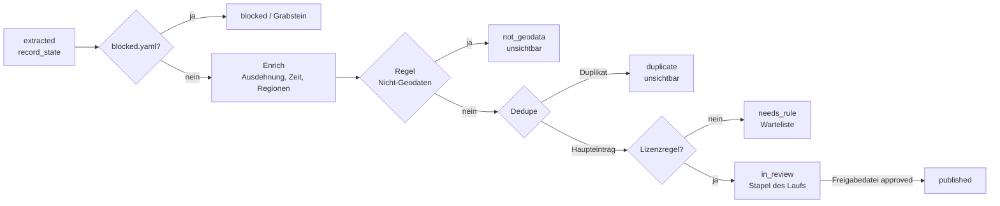

# M5-20 — Verify, Enrich, Dedupe, Lizenzregeln, Freigabe geernteter Einträge, Kandidaten

**Status (19.11.2026):** Entwurf mit Fragen F1–F8 (§13) an Otto. **Stufe B.** Umsetzung erst nach den Antworten, im selben Draft-PR (PR 1) und einem zweiten (PR 2); höchstens zwei PRs (M5-Plan §2 Punkt 11).
**Aufgabe:** M5-20 aus `docs/plans/m5/m5-discovery-und-suche.md` §6.2, Auftrag von Otto vom 19.11.2026.
**Grundlagen:** `adr/0025` (Schnitt 5, §5.1, §5.4, §6.3, §6.4, §6.5, §6.7 mit Nachträgen), `adr/0033` (§4–§11, §13 Zeile M5-20), `plans/m5/m5-19-harvest-kern.md` §12 (Befunde der Läufe, §12.11 offene Punkte), `plans/m5/m5-40-gelistete-in-postgres.md` (Tabelle, Filter, F10), M5-Plan §2 Punkt 12 (alle Datentypen, Filter nach Region und Zeit), `projektuebersicht.md` Prinzipien 12, 15, 16, KLAERUNGEN B8, B9, B11.

Belegstufen wie in `adr/0025`: **P** am Quelltext gelesen (Stand `main` 0689cd7), **M** von Otto gemessen (aus dem M5-19-Plan übernommen), **S** Vorwissen, **A** eigene Ableitung. Aus dieser Sitzung geht keine Anfrage an eine Quelle und keine an Ottos Datenbank; was dort zu zählen ist, steht in §4 als Befehl.

---

## 1. Ziel

Der zweite Teil der Pipeline (`adr/0025` §5.1, Schnitt 5): aus den Zwischenformen, die M5-19 in `earthx_record_state` ablegt, werden sichtbare gelistete Einträge – nur nach Ottos Freigabe.

1. **Enrich:** räumliche und zeitliche Ausdehnung für alle Datentypen (M5-Plan §2 Punkt 12), Regionen, Behandlung der Funde ohne Ausdehnung (F1, F2).
2. **Nicht-Geodaten:** eine Regel mit Stichprobe zu Ottos Freigabe statt nur `blocked.yaml` von Hand (F3).
3. **Dedupe** innerhalb einer Quelle, zwischen Quellen und gegen volle und Handeinträge, mit Distributionen (F4).
4. **Lizenzregeln** in der Form L2 (`adr/0033` §6.2): Lizenzkatalog und Freigaben je Herausgeber, Warteliste (H2) (F5).
5. **Freigabe je Lauf:** `discovery report` mit Stapel, Bericht, Stichprobe (N2) und Freigabedatei; `discovery publish`; Aktualisierungen nach U1 (`adr/0033` §8, §11).
6. **Verify** für die Stichprobe und für Kandidaten; **Kandidaten des vollen Wegs** und `discovery propose` (F6).
7. **Skript und Anleitung** für Ottos lokalen Lauf (PowerShell und bash), Abschnitt in der README.
8. **Offene Punkte aus M5-19 §12.11:** `gone` bei mehrtägigen Durchgängen (§3.1), data.gv.at (F7), Tabellengröße (nur vermerkt, §3.3).

**Nicht Teil von M5-20:** GeoSphere, INSPIRE-ATOM, STAC Index (M5-21); Prozess `harvester` als Takt und Health-Checks (M5-24); der Tages-PR des automatischen Onboardings (`adr/0031` V1–V9, übernimmt später die `harvest/`-Branches, `adr/0033` §8.4); Oberfläche zur Freigabe (M6); Tabellen mit Koordinaten oder Vektordaten auf der Karte (M5-Plan §2 Punkt 12, später).

## 2. Ausgangslage im Code [P]

| Stelle | Heute | Folge für M5-20 |
|---|---|---|
| `earthx_record_state` (Migration 024) | Zustände `extracted`, `invalid`, `gone`; Zwischenform als `jsonb` mit `bbox`, `geometry`, `spatial_text`, `extent_known`, `temporal` (Texte), `publisher`, `licence_statements`, `data_kind`, `category`, `landing_url`, `distributions` | Eingang von Enrich, Regel, Dedupe; nichts davon ist sichtbar |
| `discovery/extract.py`, `ckan.py` | `extent_known` = Geometrie **oder** Ortstext; INSPIRE- und EU-Themen gehen nur in `category_of` ein und werden nicht gespeichert; DCAT `identifier` wird nicht gelesen | Themen und Kennung werden Felder der Zwischenform (A12); neue Extraktor-Version, einmal `--reextract` ohne Anfrage |
| `earthx_listed_entry` (Migration 021) | Zustände `published`, `in_review`, `needs_rule`, `blocked`, `tombstone`, `superseded`; `footprint` und `regions` Pflicht für jede Zeile außer Grabsteinen; Indizes nur über `published` | Fußabdruck muss leer sein dürfen (F1); neue Zustände `not_geodata`, `duplicate`; Herkunft der Ausdehnung als Spalte |
| `catalog/listed_search.py` | Fläche: `footprint && …` (Zeilen ohne Fußabdruck fielen heraus); Zeit: Einträge ohne Zeitraum bleiben und stehen in `ignored_filters_by_collection` (M5-40 F10); Region: `regions && …` | Regel für Einträge ohne Fußabdruck ist F1; die Zeitregel bleibt |
| `catalog/listed_store.py` | Handeinträge, Regionen (`REGIONS_OF` gegen `earthx_region_part`), Sperrliste mit Grabstein; ein Statement je Massenänderung | `publish`, Ableitung der Regionen und Grabsteine `source_removed` kommen hierher (Import `catalog` darf kein `discovery`) |
| `backend/catalog/regions.json` | Natural Earth: Staaten (ISO 3166-1) und Länder/Kantone/Bundesländer (ISO 3166-2) mit Umriss, je ein Name (Natural Earth, z. B. „Bern“); 299 Regionen | Grundlage der Ortsnamen (F2) |
| `backend/catalog/blocked.yaml` | leer; Gründe `provider_request`, `not_geodata`, `quality`, `legal`, `other` | wird im Harvest vor der Einstufung angewandt (A11) |
| `backend/catalog/licenses/`, `approvals/`, `candidates/` | gibt es nicht | neu (§8, §9, §11) |
| `harvest_store.mark_gone` | voller Durchgang über mehrere Läufe setzt `gone` für alles, was kein Lauf seit Beginn des Durchgangs gesehen hat; Test `test_gone_after_a_pass_over_several_runs_is_what_none_of_them_saw` | Lücke in §3.1 |

## 3. Offene Punkte aus M5-19 §12.11

### 3.1 `gone` bei mehrtägigen Durchgängen nach Keyset — erledigt bis auf eine Lücke [P]

Erledigt mit M5-19 §12.7 (Migration 030): Keyset verschiebt keine Seite, `mark_gone(seen_since_run=<erster Lauf des Durchgangs>)` setzt `gone` für alles, was keiner der Läufe des Durchgangs gesehen hat, mit Test.

**Lücke:** `--reextract` und das Nachauswerten veralteter Funde in einem inkrementellen Lauf schreiben über `write_find` auch `last_seen_run` = ihr eigener Lauf (`harvest_store.py`, `INSERT … ON CONFLICT … last_seen_run = EXCLUDED.last_seen_run`). Ein Fund, der bei der Quelle verschwunden ist, gilt damit als „gesehen“, wenn während eines offenen Durchgangs neu ausgewertet wurde (z. B. Ottos Läufe 38/39 am 19.11. nach F12), und wird in diesem Durchgang nicht `gone`. Schaden: nur ein verspätetes `gone` (der nächste volle Durchgang holt es nach), nie ein falsches. **Behebung in PR 1 (A2):** Neu auswerten ohne Anfrage lässt `last_seen_run` unverändert; Test dazu.

### 3.2 data.gv.at — erster Lauf

`data-gv-at.yaml` steht mit `enabled: false`, Endpunkt und Herausgeberfeld sind [S] (`adr/0025` §10, M5-19 F7). Ob `www.data.gv.at/katalog/api/3/action/` noch CKAN v3 ohne Schlüssel antwortet und was dort `robots.txt` sagt, ist aus der Sitzung nicht prüfbar. Zwei Blicke im Browser genügen für F7:

- `https://www.data.gv.at/katalog/api/3/action/package_search?rows=1` (JSON mit `"success": true`?)
- `https://www.data.gv.at/robots.txt` (sperrt sie `/katalog/api/`?)

### 3.3 Tabellengröße (für M6, nur vermerkt)

M5-19 §12.11: rund 1 GB für rund 185 000 Funde (`earthx_raw_record` 576 MB, `earthx_record_state` 363 MB, Übergänge 46 MB). M5-20 legt für jeden nicht gesperrten Fund eine Zeile in `earthx_listed_entry` an; der Inhalt dort ist von der Größe der Zwischenform [A], also nochmals einige 100 MB. Vermerkt für M6 (Aufbewahrung, Doppelung von Zwischenform und Inhalt); in M5-20 keine Maßnahme.

## 4. Messung vor den Antworten (Befehle für Otto, freiwillig, rund 5 min)

Die Fragen F1, F3, F4 und F5 hängen an Zahlen aus Ottos Datenbank. Die Abfragen lesen nur, ohne Anfrage an eine Quelle. Aus dem Checkout, PowerShell, mit laufendem `docker compose up -d`:

```powershell
function q($sql) { $sql | docker compose exec -T postgres sh -c 'psql -U $POSTGRES_USER -d $POSTGRES_DB' }
```

**M1 — Art der Ausdehnung je Quelle (F1):**

```powershell
q "SELECT source_id, CASE WHEN jsonb_typeof(extracted->'bbox') = 'array' THEN 'geometrie' WHEN extracted->>'spatial_text' IS NOT NULL THEN 'ortstext' ELSE 'unbekannt' END AS art, count(*) FROM earthx_record_state WHERE state = 'extracted' GROUP BY 1, 2 ORDER BY 1, 2;"
```

**M2 — die häufigsten Ortstexte (F2):** ob es Ortsnamen, Kürzel oder URIs sind (GovData z. B. `dcat-ap.de/def/politicalGeocoding/…` [S]).

```powershell
q "SELECT source_id, left(extracted->>'spatial_text', 80) AS ort, count(*) FROM earthx_record_state WHERE state = 'extracted' AND extracted->>'spatial_text' IS NOT NULL GROUP BY 1, 2 ORDER BY 3 DESC LIMIT 40;"
```

**M3 — Datentyp und Thema gegen Ausdehnung (F1, F3):**

```powershell
q "SELECT source_id, extracted->>'data_kind' AS typ, extracted->>'category' AS thema, count(*) AS funde, count(*) FILTER (WHERE NOT extent_known) AS ohne_ausdehnung FROM earthx_record_state WHERE state = 'extracted' GROUP BY 1, 2, 3 ORDER BY 4 DESC LIMIT 40;"
```

**M4 — größte Herausgeber ohne Ausdehnung (F1, F2, F3):** ob der Name einen Ort trägt („Kanton …“, „Stadt …“, „Land …“).

```powershell
q "SELECT source_id, left(extracted->>'publisher', 60) AS herausgeber, count(*) FILTER (WHERE NOT extent_known) AS ohne, count(*) AS alle FROM earthx_record_state WHERE state = 'extracted' GROUP BY 1, 2 ORDER BY 3 DESC LIMIT 30;"
```

**M5 — Stichprobe Tabellen und Dokumente ohne Ausdehnung (F3):** 20 Titel; bitte grob zählen, wie viele davon Geodaten sind.

```powershell
q "SELECT source_id, left(extracted->>'title', 90) AS titel, extracted->>'data_kind' AS typ FROM earthx_record_state WHERE state = 'extracted' AND NOT extent_known AND extracted->>'data_kind' IN ('table', 'document', 'other') ORDER BY md5(source_key) LIMIT 20;"
```

**M6 — Dubletten über die Seite des Datensatzes (F4):** Gruppen gleicher Seite beim Anbieter (Kleinschreibung, ohne Abfrage, Fragment und `/` am Ende), je Kombination von Quellen.

```powershell
q "WITH g AS (SELECT lower(rtrim(split_part(split_part(extracted->>'landing_url', '#', 1), '?', 1), '/')) AS u, array_agg(DISTINCT source_id ORDER BY source_id) AS q, count(*) AS n FROM earthx_record_state WHERE state = 'extracted' AND extracted->>'landing_url' IS NOT NULL GROUP BY 1 HAVING count(*) > 1) SELECT array_to_string(q, '+') AS quellen, count(*) AS gruppen, sum(n) AS funde FROM g GROUP BY 1 ORDER BY 3 DESC;"
```

**M7 — opendata.swiss und FSDI (F4):** wie viele Funde von opendata.swiss die ID einer FSDI-Collection in einer Adresse tragen.

```powershell
q "SELECT count(DISTINCT o.source_key) AS opendata_funde, count(DISTINCT f.source_key) AS fsdi_collections FROM earthx_record_state o JOIN earthx_record_state f ON f.source_id = 'fsdi-stac' AND f.state = 'extracted' WHERE o.source_id = 'opendata-swiss' AND o.state = 'extracted' AND strpos(o.extracted->>'source_url' || ' ' || coalesce(o.extracted->>'landing_url', '') || ' ' || (o.extracted->'distributions')::text, f.source_key) > 0;"
```

**M8 — Lizenzangaben je Quelle (F5):** die 40 häufigsten Angaben, wörtlich.

```powershell
q "SELECT source_id, left(s, 100) AS lizenzangabe, count(*) FROM earthx_record_state, jsonb_array_elements_text(extracted->'licence_statements') AS s WHERE state = 'extracted' GROUP BY 1, 2 ORDER BY 3 DESC LIMIT 40;"
```

Die Ausgaben enthalten nur öffentliche Metadaten der Kataloge (Titel, Ortsnamen, Herausgeber, Lizenzen); sie dürfen als Kommentar in den PR. Wer keine Zeit hat, antwortet ohne; die Empfehlungen gelten dann mit den Zahlen aus §2 und M5-19 §12.

## 5. Ablauf nach dem Extract



- **Ein Schritt `discovery report <source>`** macht alles nach dem Extract für eine Quelle, ohne Anfrage an die Quelle (bis auf Verify der Stichprobe, §10): Sperrliste, Enrich, Regel, Dedupe, Lizenz, Stapel, Bericht, Freigabedatei. Er schreibt je Fund eine Zeile in `earthx_listed_entry` in einem unsichtbaren Zustand; nur `publish` setzt `published` (`adr/0033` §10).
- **Jeder Schritt ist über eine Version geschlüsselt** wie der Extract (M5-19 §12.2): Ändert sich eine Regeldatei (Ortsnamen, Nicht-Geodaten, Lizenzen, Sperrliste, Rangfolge der Quellen), wertet der nächste `report` die betroffenen Funde neu aus, ohne Anfrage.
- **Ein Fund ändert sich bei der Quelle** (`adr/0033` §11, U1): beschreibende Felder (Titel, Beschreibung, Schlagworte, Ausdehnung, Zeit, Datentyp, Pfad des Links auf demselben Host) übernimmt `report` in die veröffentlichte Zeile sofort; ein Wechsel von Lizenzangabe, Herausgeber, `access.account`, `access.delivery` oder Host des Links macht den Eintrag unsichtbar (`in_review`) bis zur nächsten Freigabe.
- **Bei der Quelle weg** (`gone` nach einem vollen Durchgang): beim ersten Mal bleibt der Eintrag sichtbar und trägt `missing_since`; fehlt er im nächsten vollen Durchgang wieder, wird er Grabstein mit `source_removed` ohne Freigabe (`adr/0033` §9; A4).

## 6. Enrich

### 6.1 Räumliche Ausdehnung (F1, F2)

Stufen, die erste, die trifft, gilt; die Herkunft steht als `extent_basis` in der Zeile und als `earthx:extent_basis` im Eintrag:

| Stufe | `extent_basis` | Woraus | Fußabdruck | Regionen |
|---|---|---|---|---|
| 1 | `source` | Geometrie bzw. Rechteck der Quelle (STAC `extent.spatial`, CKAN `spatial` als GeoJSON) | ja | abgeleitet wie heute (`REGIONS_OF`) |
| 2 | `place` | Ortstext der Quelle, der **genau** einen Namen des Ortsverzeichnisses trifft (F2) | Umriss des Orts | der Ort und sein Staat |
| 3 | `publisher` | Herausgeber, dessen Name genau einen Ort des Verzeichnisses enthält („Kanton Basel-Stadt“, „Landesamt … Schleswig-Holstein“) | nein | der Ort und sein Staat |
| 4 | `catalog` | Staat des Katalogs (opendata.swiss CH, GovData DE, data.gv.at AT; neues Feld `country` der Seed-Datei, `null` bei STAC) | nein | nur der Staat |
| 5 | `none` | nichts davon | nein | keine |

- **Genau heißt:** Vergleich nach Kleinschreibung, ohne Akzente, ganze Wörter; trifft ein Text mehrere Orte oder einen mehrdeutigen Namen („Freiburg“, „Neuenburg“), gilt die Stufe nicht. Kein unscharfer Vergleich, kein Raten aus dem Titel [A].
- **Warum Stufen 3 und 4 keinen Fußabdruck bekommen [A]:** Ein Datensatz der Stadt Zürich mit dem Umriss des Kantons fände sich bei einer AOI in Winterthur; ein GovData-Fund mit dem Umriss Deutschlands bei jeder AOI in Deutschland. Bei 58 % ohne Ausdehnung (GovData [M]) wären das rund 98 000 Treffer je AOI. Der Regionsfilter dagegen trifft sie richtig: „liegt in Deutschland“ bzw. „betrifft den Kanton Zürich“.
- **Filter (Empfehlung F1 = 1):** AOI-Filter nur über den Fußabdruck (Stufen 1 und 2); Regionsfilter über `regions` (Stufen 1–4); ohne Filter und in der Textsuche alle. Nichts wird wegen fehlender Ausdehnung verworfen.
- **Data catalogue (A7):** Ohne Fußabdruck trägt die Collection nach STAC-Pflicht das Rechteck der Region bzw. die ganze Erde und `earthx:extent_basis`; die Zeile „Spatial extent“ zeigt dann „—“ wie heute bei einem unlesbaren Rechteck, keine Zusatztexte (M5-Plan §2 Punkt 9). Eine Zeile Frontend in PR 2.

### 6.2 Ortsverzeichnis (F2)

`backend/catalog/place_names.yaml` (neu, Entscheidung in Git): je Code aus `regions.json` die Namen, unter denen Kataloge den Ort schreiben, in Deutsch, Englisch, Französisch, Italienisch und üblichen Formen („Kanton Zürich“, „Canton de Zurich“, „Freistaat Bayern“, „Land Berlin“, „Niederösterreich“). Für DACH und Liechtenstein enthält `regions.json` 4 Staaten, 26 Kantone, 16 Länder, 9 Bundesländer und die 11 Gemeinden Liechtensteins [P], je mit einem Namen (z. B. „Bern“, „Aargau“). Die Session schreibt die Datei [S], Otto prüft sie im PR. Gemeinden und Städte kennt das Verzeichnis nach F2 = 1 nicht (außer denen Liechtensteins); ein Ortstext „Stadt Zürich“ trifft dann nur über das Wort „Zürich“ – das wäre mehrdeutig (Stadt und Kanton) und gilt nicht [A].

### 6.3 Zeitliche Ausdehnung

- Aus `temporal` der Zwischenform: ISO-Datum, Datum mit Zeit, Jahr (`2019` → 01.01.–31.12.), offenes Ende erlaubt; alles andere und ein Ende vor dem Anfang → kein Zeitraum (A5). Kein Ableiten aus Titeln („Luftbild 2019“).
- Ohne Zeitraum gilt M5-40 F10: bei einem Zeitfilter bleibt der Eintrag und steht in `ignored_filters_by_collection`.

### 6.4 Regionen

Wie heute aus dem Fußabdruck (`REGIONS_OF`, Teile von `earthx_region_part`); aus den Stufen 2–4 direkt aus dem Code. Eine Änderung von `regions.json` leitet wie heute alle Zeilen mit Fußabdruck neu ab; die übrigen tragen Codes, die sich nicht ändern.

## 7. Nicht-Geodaten (F3)

Heute nur `blocked.yaml` mit `not_geodata` von Hand (`adr/0033` §9). Vorschlag einer Regel **R-G**, als Datei `backend/catalog/geodata.yaml` (Entscheidung in Git, wie `categories.yaml`):

- **Geo-Signal** (eines genügt, dann Geodaten): Datentyp `raster`, `vector` oder `service`; ein Geo-Format unter den Distributionen (die Formattabelle des Extract, dazu KML/KMZ, GPX); ein INSPIRE-Thema; Ausdehnung der Stufe 1 oder 2, die kleiner ist als der Staat des Katalogs (ein Rechteck „ganze Schweiz“ an jedem Datensatz ist kein Signal [A]); Thema `elevation`, `land_cover`, `optical`, `radar`, `geology_soil`, `boundaries`.
- **Nicht-Geo-Signal:** EU-Thema `GOVE`, `ECON`, `JUST`, `EDUC`, `INTR`, `TECH`; oder ein Begriff der Liste `not_geodata_terms` in Titel oder Schlagworten (Vorschlag: Wahl, Wahlen, Abstimmung, Haushalt, Haushaltsplan, Budget, Jahresrechnung, Sitzung, Protokoll, Ratsinformation, Stellenplan, Archivbestand, Pressemitteilung, Geschäftsbericht; dazu die Formen auf Englisch, Französisch, Italienisch).
- **Regel (F3 = 1):** Nicht-Geodaten ist ein Fund **ohne** Geo-Signal **mit** Nicht-Geo-Signal. Alles andere gilt als Geodaten und kommt in den Stapel.
- **Wirkung:** Zustand `not_geodata`, unsichtbar, **kein Grabstein**: Ändert Otto die Regel, kommt der Fund mit dem nächsten `report` ohne Anfrage zurück in den Stapel. `blocked.yaml` bleibt für Einzelfälle und ganze Herausgeber.
- **Stichprobe zur Freigabe der Regel:** `python -m earthx.discovery.report <source> --classify` wendet die Regel trocken an (schreibt nichts) und druckt je Quelle Zahlen nach Signal sowie zwei Stichproben zu 30, gezogen mit festem Startwert: als Nicht-Geodaten eingestuft; als Geodaten eingestuft **ohne** Geo-Signal (die Grenzfälle). Otto prüft beide, die Session passt Liste und Regel an; der Merge von `geodata.yaml` ist die Freigabe (Prinzip 12).
- **Im Bericht jedes Laufs** dazu 15 zufällige Funde, die die Regel verborgen hat (`adr/0033` §8.2 prüft bisher nur, was sichtbar wird).
- **Was die Regel nicht kann [A]:** Eine Tabelle mit Messstationen ohne Geo-Format, ohne INSPIRE-Thema und ohne Nicht-Geo-Begriff bleibt Geodaten (gewollt, M5-Plan §2 Punkt 12); eine Wahlstatistik mit Shapefile der Wahlkreise ebenso (sie hat ein Geo-Signal).

## 8. Dedupe mit Distributionen (F4)

**Erwartete Fälle:** Daten der FSDI auch in opendata.swiss; dieselben Datensätze mehrfach in GovData (über Landesportal und über GDI-DE bzw. mCLOUD [S]); FSDI-Collections, die schon volle Einträge sind (`swissalti3d`); Handeinträge (CORINE, Landsat) in GovData. Landesportale erntet M5 nicht selbst; „GovData gegen Landesportal“ ist damit eine Dublette innerhalb von GovData.

**Schlüssel, nur genau (F4 = 1),** nach `adr/0025` §6.4 und je Stufe gegen alle Quellen:

1. DOI (Kleinschreibung).
2. Kennung des Datensatzes: DCAT `identifier` (neu in der Zwischenform, A12); bei STAC die Collection-ID am Host der Quelle. Gegen volle Einträge: Host und Collection-ID ihrer Quelle aus der Registry.
3. Seite des Datensatzes beim Anbieter (`landing_url` Rang 2, kanonisch: Schema, Host klein, ohne Fragment und `/` am Ende; Abfrage bleibt, weil sie oft den Datensatz wählt).
4. Eine Datei-Distribution ist dieselbe Adresse wie die Seite oder eine Datei-Distribution eines anderen Fundes. **Dienste zählen nie** (ein WMS bedient Dutzende Datensätze).
5. Gleicher Titel und gleicher Herausgeber (normalisiert): **nur im Bericht**, nie zusammengelegt (`adr/0025` §6.4).

**Haupteintrag** einer Gruppe: voller Eintrag > Handeintrag > Quelle mit kleinerem `dedupe_rank` (neues Pflichtfeld der Seed-Datei; Vorschlag: FSDI und Earth Search 1, data.gv.at und opendata.swiss 2, GovData 3 – der Anbieter vor dem Portal, das von ihm erntet) > besserer Rang des Links „Source“ > Ausdehnung der Stufe 1/2 > kleinerer Schlüssel. Gewählt wird nur unter Funden, die sichtbar werden können (nicht gesperrt, keine Nicht-Geodaten); fehlt dem Haupteintrag die Lizenzregel, wartet die ganze Gruppe (kein Ausweichen auf eine Quelle mit anderer Lizenzangabe [A]).

**Wirkung:** Die übrigen Funde gehen nach `duplicate` mit `duplicate_of`, unsichtbar. Ihre Datei- und Dienst-Distributionen und ihr Link „Source“ kommen als `earthx:distributions` (Herkunft je Distribution: Quelle) an den Haupteintrag; die Lizenz des Haupteintrags gilt für den Eintrag, die Distributionen nennen die Quelle, nicht deren Lizenz. Ein Duplikat eines vollen oder Handeintrags gibt nur Distributionen ab, wenn der volle Eintrag das je Registry zulässt – in M5-20 gar nicht (die Registry hat kein Feld dafür) [A]. Im Data catalogue erscheinen die zusätzlichen Distributionen in M5-20 nicht (kein Frontend; eigene kleine Aufgabe, wenn Otto sie sehen will).

## 9. Lizenzregeln (L2) und Warteliste (F5)

Form wie entschieden (`adr/0033` §6.2, F2 = 1):

- `backend/catalog/licenses/terms.yaml`: je Lizenz `license_ref`, `matches` (wörtlich; nur Leerzeichen am Rand und `/` am Ende ignoriert), `spdx_id`, Name, URL, fünf Flags, `tier`, zwei Attributionstexte mit `{publisher}`, `terms`, `approved_on`.
- `backend/catalog/licenses/grants/<source_id>.yaml`: Herausgeber (genau der Wert aus dem Feld der Seed-Datei) → Liste der `license_ref`, je Zeile `approved_on`.
- **Prüfung beim Laden** (von `discovery` und `catalog-load`): Angabe in höchstens einer `license_ref`; `tier` passt zu den Flags (B11); kein `unclear`, kein `proto-`; jede `license_ref` in `grants/` steht im Katalog, jede Quelle in `sources/`.
- **Treffer:** Jede Lizenzangabe des Fundes (Paket und Distributionen) muss zu einer `license_ref` gehören, die für diesen Herausgeber dieser Quelle freigegeben ist; die engste bestimmt den Eintrag (A10). Sonst Warteliste `needs_rule` mit Grund: `no_licence` (keine Angabe), `unknown_licence` (Angabe nicht im Katalog), `not_granted` (Paar nicht freigegeben). Gelistete Einträge haben immer `tier = catalog` (`adr/0033` §6.2).
- **Bericht der Warteliste:** die 20 größten Paare (Quelle, Herausgeber, Lizenzangabe) mit Zahl, Rest als Summe (`adr/0033` §8.1 Punkt 5). Daraus schlägt `license-checker` Einträge vor; schreiben und mergen tut Otto.
- **Erste Einträge (F5):** Die Session legt in PR 1 die Dateien leer an. Mit M8 (§4) schlägt `license-checker` die häufigsten Lizenzen als eigenen Commit vor (z. B. CC BY 4.0, CC0, Datenlizenz Deutschland Namensnennung 2.0 und Zero 2.0, die Nutzungsbedingungen von opendata.swiss [S]), jede mit Belegstelle; die Einstufung entscheidet Otto im PR. `grants/` schlägt die Session nicht von sich aus vor, nur aus Ottos Antwort (welche Herausgeber).

## 10. Verify

Für gelistete Einträge nur in der Stichprobe (`adr/0033` §14 zu `adr/0025` §5.1), für Kandidaten des vollen Wegs nach `adr/0025` §6.3. Alles über `gateway` mit `open_source_gateway`:

- **Stichprobe (30 je Stapel):** der Link „Source“ einmal `HEAD` (bei `405` ein `GET` mit `Range: bytes=0-0`), `robots.txt` beachtet; Ergebnis im Bericht neben dem Eintrag: Status, Medientyp, ob eine Weiterleitung den Host wechselt. Die Adresse steht im Bericht (öffentliche Metadaten), nie im Log.
- **Kandidaten:** höchstens 3 Datei-Distributionen je Kandidat, `HEAD`, dann `GET` mit `Range: bytes=0-16383`; Format aus den ersten Bytes (TIFF/COG, NetCDF/HDF5, `zarr.json`), `Accept-Ranges`, CORS mit `Origin`; daraus der Vorschlag `access.account` (`200/206` → `none`, `401/403` → `free_account`). Nichts davon wird gespeichert außer dem Ergebnis.
- **Hosts ohne Zeile in `hosts.yaml`** (fremde Datei-Hosts): je 1 Verbindung und 1 s Abstand (A6); höchstens 50 neue Hosts je Lauf; eine Weiterleitung auf einen anderen Host ist „nicht geprüft“, kein Anlass, die Liste zu erweitern (`adr/0025` §6.3).
- Verify läuft nur bei Otto lokal; die Tests nutzen eine Transport-Attrappe am `Gateway` (wie M5-19).

## 11. Kandidaten des vollen Wegs und `discovery propose` (F6)

- **Wer Kandidat wird (F6 = 1):** Raster-Funde mit einem lesbaren Format (COG/GeoTIFF, NetCDF/HDF5, Zarr) als Datei-Distribution oder STAC-Asset, Verify ohne Konto bestanden, kein voller Eintrag mit demselben Schlüssel (§8 Stufe 2). Ein Kandidat bleibt zugleich gelistet (`adr/0033` §11).
- **Datei:** `backend/catalog/candidates/<source_id>/<dataset_id>.yaml` (nie im Image, `adr/0025` F8): Geerntetes (Titel, Beschreibung, Herausgeber, Lizenzangaben wörtlich, Vorschlag aus dem Lizenzkatalog, Ausdehnung, Zeitraum, Link, DOI, Distributionen, Verify-Ergebnis, Vorschlag `access.account`, `data_region` nur bei AWS-Hosts) und leere Entscheidungsfelder.
- **`discovery propose <source>`:** höchstens 20 Kandidaten je Quelle und Aufruf, neue und geänderte zuerst, dann nach Herausgeber; ein Aufruf ohne neue oder geänderte Kandidaten schreibt nichts (`adr/0025` K5).
- **Git nur im Skript auf Ottos Rechner (A13):** Der Container schreibt Dateien in ein eingebundenes Verzeichnis (`backend/catalog/approvals/`, `backend/catalog/candidates/`); das Skript prüft, dass der Checkout sauber ist und auf `main` steht, legt den Branch an, committet und pusht **nie**. Kein Git und kein Zugang zum Repo im Image.

## 12. Freigabe je Lauf

Nach `adr/0033` §8 (F1, F4, F5 = 1) und §8.4:

- **Stapel:** alle Funde einer Quelle, die mit diesem `report` sichtbar werden sollen (neu mit Regel, aus der Warteliste mit neuer Regel, nach U1 erneut vorgelegt). Manifest = sortierte Liste (ID, Hash des Inhalts, `license_rule`); Fingerabdruck = SHA-256 des Manifests. Tabellen `earthx_listing_batch` und `earthx_listing_batch_entry` (Migration 032). Ein späterer `report` derselben Quelle übernimmt Funde eines unfreigegebenen Stapels in seinen eigenen; der ältere verfällt.
- **Bericht** (Markdown, Deutsch) und **Freigabedatei** `backend/catalog/approvals/<datum>-<source_id>.yaml` mit `decision: pending`, Fingerabdruck, Zahlen und der Stichprobe (15 zufällig, 15 gezielt: erstmals treffende Lizenzen, neue Hosts, neue Zugangsart; Startwert = Fingerabdruck) mit leeren Häkchen; dazu 15 verborgene Nicht-Geodaten (§7) und die unscharfen Dubletten (§8 Stufe 5). Der Bericht liegt neben der Freigabedatei, Branch `harvest/<datum>-<source_id>`.
- **`publish`:** setzt einen Stapel `published`, wenn seine Freigabedatei im Image liegt, `decision: approved` trägt und ihr Fingerabdruck dem Stapel in Postgres gleicht; `revoked_on` nimmt ihn zurück (Zustand `in_review`). Die Logik liegt in `catalog/listed_store.py`; `catalog-load` wendet beim Start alle Freigabedateien des Images an (wie heute `blocked.yaml`), `python -m earthx.discovery.publish` tut dasselbe von Hand (A3). Idempotent.
- **IDs gelisteter geernteter Einträge (A1):** `<source_id>.<schlüssel>`, wenn der Schlüssel klein geschrieben aus `[a-z0-9._-]` besteht und die ID höchstens 128 Zeichen hat (CKAN-UUIDs, FSDI-Collections), sonst `<source_id>.h<erste 20 Zeichen des SHA-256 des Schlüssels>`; stabil über Läufe.

## 13. Fragen an Otto

**F1 — (a) Funde ohne Ausdehnung: listen und filtern?** (GovData 58 %, opendata.swiss 45 % [M])
1. Ausdehnung in Stufen (Geometrie → Ortstext → Herausgeber → Staat des Katalogs, §6.1); alle gelistet; AOI-Filter nur mit Fußabdruck (Geometrie, Ortstext), Regionsfilter auch über Herausgeber und Katalog; im Data catalogue „—“ ohne Fußabdruck **(Empfehlung)**
2. Wie 1, aber ohne die Stufe „Staat des Katalogs“ (Einträge ohne jede Angabe finden sich nur ohne Flächen- und Regionsfilter)
3. Wie 1, aber Einträge ohne Fußabdruck bleiben auch bei AOI-Filter in der Liste, gekennzeichnet wie Einträge ohne Zeitraum (rund 10⁵ zusätzliche Treffer je AOI in Deutschland)
4. Ohne Fußabdruck nicht listen, sondern zurückstellen, bis die Quelle eine Ausdehnung liefert

**F2 — Ortsverzeichnis für Ortstexte und Herausgeber (§6.2)?**
1. Staaten und Länder/Kantone/Bundesländer aus `regions.json` mit Namen in vier Sprachen, Datei von der Session, Prüfung durch dich; keine Gemeinden **(Empfehlung)**
2. Zusätzlich Gemeinden und Städte aus amtlichen Grenzen (swissBOUNDARIES3D, VG250, Statistik Austria); eigene Datei, Lizenz-Einstufung durch dich, eher eigene Aufgabe nach M5-20
3. Kein Verzeichnis; nur Geometrie der Quelle zählt

**F3 — (b) Regel für Nicht-Geodaten (§7)?**
1. Nicht-Geodaten nur ohne Geo-Signal **und** mit Nicht-Geo-Signal (EU-Thema Verwaltung/Wirtschaft/Justiz/Bildung, Begriffsliste); verborgen, nicht gelöscht; Freigabe der Regel über `--classify` mit zwei Stichproben zu 30, danach 15 Verborgene je Bericht **(Empfehlung)**
2. Streng: gelistet nur mit Geo-Signal; alles ohne verborgen
3. Keine Regel; weiter nur `blocked.yaml` (auch je Herausgeber), der Bericht nennt Herausgeber mit wenig Geo-Signal

**F4 — (c) Dedupe zwischen Quellen (§8)?**
1. Genaue Schlüssel (DOI, Kennung, Seite beim Anbieter, gleiche Datei; nie Dienste), Haupteintrag nach Rang (voll > Hand > Anbieter-Katalog > nationales Portal > GovData), Duplikate verborgen, ihre Distributionen am Haupteintrag; Titel+Herausgeber nur im Bericht **(Empfehlung)**
2. Wie 1, aber Duplikate nur verbergen, ohne Distributionen zu übernehmen
3. Nur im Bericht zählen, alle bleiben sichtbar

**F5 — Erste Einträge im Lizenzkatalog (§9)?**
1. Dateien in PR 1 leer; danach schlägt `license-checker` die häufigsten Lizenzen aus M8 mit Belegstelle vor (eigener Commit), du stufst ein; `grants/` nur nach deiner Liste der Herausgeber **(Empfehlung)**
2. Wie 1, und `grants/` schlägt die Session für die 50 größten Herausgeber je Quelle vor
3. Katalog und `grants/` füllst du selbst

**F6 — Wer wird Kandidat des vollen Wegs (§11)?**
1. Raster mit COG/GeoTIFF, NetCDF/HDF5 oder Zarr, Verify ohne Konto bestanden, noch kein voller Eintrag; höchstens 20 je Quelle und PR **(Empfehlung)**
2. Nur STAC-Collections (FSDI, Earth Search)
3. Keine Kandidaten in M5-20; `propose` erst mit `adr/0031` V1–V9

**F7 — data.gv.at (§3.2)?** Bitte die zwei Adressen im Browser öffnen.
1. Antwortet JSON und `robots.txt` sperrt die API nicht: `enabled: true` in PR 1, Werte wie GovData (50 Zeilen, 400 Seiten, 60 s Timeout) bis zum ersten Lauf **(Empfehlung, wenn so)**
2. Sperrt `robots.txt` die API: Ausnahme wie bei GovData, du nennst die Doku-Seite des Anbieters als Beleg
3. Kein CKAN mehr bzw. anderer Endpunkt: bleibt `enabled: false`, eigene kleine Aufgabe

**F8 — Schnitt in zwei PRs?** Beide liegen über dem Richtwert von rund 400 Zeilen (Schätzung mit Tests je 1 000–1 400 [A]).
1. **PR 1 (dieser):** Plan; Migration 032; Fix `gone` (§3.1); Seed-Felder `country`, `dedupe_rank`; Zwischenform mit Themen und Kennung; Enrich; `place_names.yaml`; R-G mit `--classify`; Dedupe; Lizenzkatalog leer mit Lader; `report` mit Stapel, Bericht, Freigabedatei; `publish` und `catalog-load`; U1; Grabstein `source_removed`; Skript und README für den gelisteten Weg. **PR 2:** Verify (Stichprobe, Kandidaten), Kandidaten und `propose`, „—“ im Data catalogue, data.gv.at, erste Lizenzen nach F5 **(Empfehlung)**
2. Wie 1, aber Dedupe in PR 2 statt PR 1
3. M5-20 nur gelisteter Weg (PR 1 und 2); Verify, Kandidaten und `propose` als neue Aufgabe (eigene Nummer, neue Session)

## 14. Auslegungen (gelten, wenn Otto nicht widerspricht)

- **A1** IDs geernteter Einträge wie §12; keine `proto-`-ID möglich (die Quelle `proto-*` ist im Seed verboten).
- **A2** Neu auswerten ohne Anfrage (`--reextract`, veraltete Extraktor-Version) zählt nicht als „gesehen“; `last_seen_run` ändert nur ein Abruf (§3.1).
- **A3** `publish` lebt in `catalog`, `catalog-load` wendet Freigabedateien des Images an; `discovery` ruft dieselbe Funktion (Importregeln unverändert).
- **A4** Bei der Quelle weg: erst `missing_since`, beim zweiten vollen Durchgang ohne den Fund Grabstein `source_removed` (`adr/0033` §9 „stale, dann Grabstein“; `stale` als sichtbarer Zustand mit Datum).
- **A5** Zeiträume nur aus Datumsangaben der Quelle (§6.3).
- **A6** Fremde Hosts im Verify: 1 Verbindung, 1 s, höchstens 50 je Lauf; Seiten mit `robots.txt`, Datei-`HEAD`/`Range` ohne (`adr/0025` §6.2).
- **A7** Ohne Fußabdruck: STAC-Rechteck der Region bzw. der Erde, `earthx:extent_basis`, „—“ im Data catalogue.
- **A8** Enrich schreibt in die Zeile von `earthx_listed_entry`, nicht in die Zwischenform; deren Hash bleibt die Grundlage für „geändert“.
- **A9** Bericht und Freigabedatei enthalten öffentliche Metadaten (Titel, Links, Herausgeber als Organisation), nie Personen, nie eine AOI.
- **A10** „Engste“ Lizenz: kleinste Stufe, Flags als UND; für gelistete Einträge ist die Stufe ohnehin `catalog`, maßgeblich sind Flags und Attribution.
- **A11** `blocked.yaml` wirkt in `report` vor Enrich (`adr/0033` §9) und weiter in `catalog-load`.
- **A12** Zwischenform neu mit `themes` (INSPIRE- und EU-Themen als Codes) und `identifier`; neue Extraktor-Version, Ottos erster Lauf nach dem Merge wertet einmal ohne Anfrage neu aus und zählt die Funde einmal als „geändert“.
- **A13** Git nur im Skript auf dem Rechner, nie im Image; das Skript pusht nie (`adr/0025` §8 Schritt 5).

## 15. Tests (Plan)

Ohne Netz, synthetische Fixtures (M5-19 A5), Transport-Attrappe am `Gateway`:

- **Enrich:** jede Stufe; mehrdeutiger Ortsname gilt nicht; Ortsname als Teil eines anderen Wortes gilt nicht; Herausgeber mit zwei Orten; kaputte Geometrie; Jahr, Datum, Zeit, Ende vor Anfang, Unsinn; Filter: AOI trifft nur Stufen 1/2, Region trifft 1–4, ohne Filter alle.
- **R-G:** jedes Signal einzeln; Geo- schlägt Nicht-Geo-Signal; Begriff nur als ganzes Wort; `--classify` schreibt nichts und zieht bei gleichem Stand dieselbe Stichprobe; Regeländerung holt verborgene Funde ohne Anfrage zurück.
- **Dedupe:** jede Stufe; zwei Datensätze am selben WMS bleiben getrennt; Stände derselben Kachel bleiben getrennt (`adr/0025` §9); Haupteintrag nach Rang; voller Eintrag gewinnt; Titel+Herausgeber nur im Bericht.
- **Lizenz:** Ladefehler (doppelte Angabe, `tier` zu hoch, unbekannte `license_ref`, unbekannte Quelle); Treffer genau; `/` am Ende; mehrere Angaben, eine ohne Regel → Warteliste; engste gewinnt.
- **Freigabe:** Fingerabdruck stabil; `pending`/`rejected` veröffentlicht nichts; falscher Fingerabdruck veröffentlicht nichts; `revoked_on`; späterer Stapel übernimmt älteren; U1 je Feld; Grabstein beim zweiten Fehlen; Sperrliste vor Enrich.
- **Verify:** `200`, `206`, `401`, `403`, `405` → `GET`, Weiterleitung auf fremden Host, Host-Grenze 50, `robots.txt` bei Seiten.
- **Fix §3.1:** `--reextract` im offenen Durchgang verhindert `gone` nicht mehr.
- **Integration (Postgres):** Migration 032 auf 031; Indizes; Prüfungen der Tabelle mit leerem Fußabdruck.
- **Skript:** bricht ab bei schmutzigem Checkout und außerhalb von `main`; pusht nie (Test am Text des Skripts wie bei bestehenden Skripten [A]).

## 16. Befehle für Ottos lokalen Lauf (nach der Umsetzung, Entwurf)

```powershell
git switch main
git pull
docker compose build
docker compose up -d
docker compose run --build --rm harvest govdata
docker compose run --rm harvest-report govdata --classify
powershell -NoProfile -ExecutionPolicy Bypass -File .\scripts\harvest-report.ps1 -Source govdata
```

- Das Skript legt `harvest/<datum>-govdata` an, ruft `report` im Container, committet Bericht und Freigabedatei und nennt den Befehl zum Pushen; PR mit deinem Zugang. Nach deinem Merge mit `decision: approved`: `git pull`, `docker compose build`, `docker compose up -d` – `catalog-load` veröffentlicht den Stapel.
- Genaue Befehle, bash-Fassung und README-Abschnitt kommen mit PR 1; Verify und `propose` mit PR 2.
