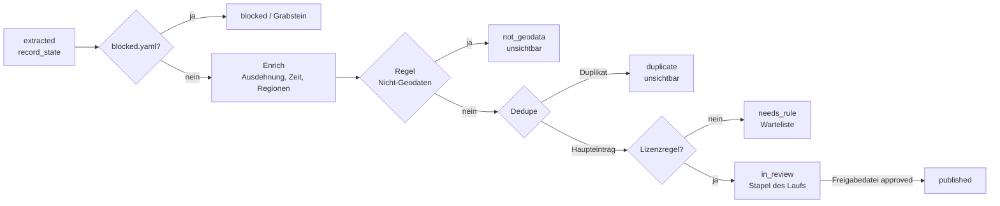

# M5-20 — Verify, Enrich, Dedupe, Lizenzregeln, Freigabe geernteter Einträge, Kandidaten

**Status (19.11.2026):** Plan angenommen (Otto, 19.11.2026: F1–F6 und F8 je 1, F7 = 3, §13a; Vorgaben aus der Messung §4 in §13b, sie gehen §6–§9 vor; F9–F11 je 1 und A18 angenommen, §13c; Vorgaben aus `-Classify` vom 20.11. in §13d und §13e; F12 = 1 und 2). **Stufe B.** PR 1 in [#388](https://github.com/oscipal/earthX/pull/388), PR 2 danach; höchstens zwei PRs (M5-Plan §2 Punkt 11).
**Aufgabe:** M5-20 aus `docs/plans/m5/m5-discovery-und-suche.md` §6.2, Auftrag von Otto vom 19.11.2026.
**Grundlagen:** `adr/0025` (Schnitt 5, §5.1, §5.4, §6.3, §6.4, §6.5, §6.7 mit Nachträgen), `adr/0033` (§4–§11, §13 Zeile M5-20), `plans/m5/m5-19-harvest-kern.md` §12 (Befunde der Läufe, §12.11 offene Punkte), `plans/m5/m5-40-gelistete-in-postgres.md` (Tabelle, Filter, F10), M5-Plan §2 Punkt 12 (alle Datentypen, Filter nach Region und Zeit), `projektuebersicht.md` Prinzipien 12, 15, 16, KLAERUNGEN B8, B9, B11.

Belegstufen wie in `adr/0025`: **P** am Quelltext gelesen (Stand `main` 0689cd7), **M** von Otto gemessen (aus dem M5-19-Plan übernommen), **S** Vorwissen, **A** eigene Ableitung. Aus dieser Sitzung geht keine Anfrage an eine Quelle und keine an Ottos Datenbank; was dort zu zählen ist, steht in §4 als Befehl.

---

## 1. Ziel

Der zweite Teil der Pipeline (`adr/0025` §5.1, Schnitt 5): aus den Zwischenformen, die M5-19 in `earthx_record_state` ablegt, werden sichtbare gelistete Einträge – nur nach Ottos Freigabe.

1. **Enrich:** räumliche und zeitliche Ausdehnung für alle Datentypen (M5-Plan §2 Punkt 12), Regionen, Behandlung der Funde ohne Ausdehnung (F1, F2).
2. **Nicht-Geodaten:** eine Regel mit Stichprobe zu Ottos Freigabe statt nur `blocked.yaml` von Hand (F3).
3. **Dedupe** innerhalb einer Quelle, zwischen Quellen und gegen volle und Handeinträge, mit Distributionen (F4).
4. **Lizenzregeln** in der Form L2 (`adr/0033` §6.2): Lizenzkatalog und Freigaben je Herausgeber, Warteliste (H2) (F5).
5. **Freigabe je Lauf:** `discovery report` mit Stapel, Bericht, Stichprobe (N2) und Freigabedatei; `discovery publish`; Aktualisierungen nach U1 (`adr/0033` §8, §11).
6. **Verify** für die Stichprobe und für Kandidaten; **Kandidaten des vollen Wegs** und `discovery propose` (F6).
7. **Skript und Anleitung** für Ottos lokalen Lauf (PowerShell und bash), Abschnitt in der README.
8. **Offene Punkte aus M5-19 §12.11:** `gone` bei mehrtägigen Durchgängen (§3.1), data.gv.at (F7), Tabellengröße (nur vermerkt, §3.3).

**Nicht Teil von M5-20:** GeoSphere, INSPIRE-ATOM, STAC Index (M5-21); Prozess `harvester` als Takt und Health-Checks (M5-24); der Tages-PR des automatischen Onboardings (`adr/0031` V1–V9, übernimmt später die `harvest/`-Branches, `adr/0033` §8.4); Oberfläche zur Freigabe (M6); Tabellen mit Koordinaten oder Vektordaten auf der Karte (M5-Plan §2 Punkt 12, später).

## 2. Ausgangslage im Code [P]

| Stelle | Heute | Folge für M5-20 |
|---|---|---|
| `earthx_record_state` (Migration 024) | Zustände `extracted`, `invalid`, `gone`; Zwischenform als `jsonb` mit `bbox`, `geometry`, `spatial_text`, `extent_known`, `temporal` (Texte), `publisher`, `licence_statements`, `data_kind`, `category`, `landing_url`, `distributions` | Eingang von Enrich, Regel, Dedupe; nichts davon ist sichtbar |
| `discovery/extract.py`, `ckan.py` | `extent_known` = Geometrie **oder** Ortstext; INSPIRE- und EU-Themen gehen nur in `category_of` ein und werden nicht gespeichert; DCAT `identifier` wird nicht gelesen | Themen und Kennung werden Felder der Zwischenform (A12); neue Extraktor-Version, einmal `--reextract` ohne Anfrage |
| `earthx_listed_entry` (Migration 021) | Zustände `published`, `in_review`, `needs_rule`, `blocked`, `tombstone`, `superseded`; `footprint` und `regions` Pflicht für jede Zeile außer Grabsteinen; Indizes nur über `published` | Fußabdruck muss leer sein dürfen (F1); neue Zustände `not_geodata`, `duplicate`; Herkunft der Ausdehnung als Spalte |
| `catalog/listed_search.py` | Fläche: `footprint && …` (Zeilen ohne Fußabdruck fielen heraus); Zeit: Einträge ohne Zeitraum bleiben und stehen in `ignored_filters_by_collection` (M5-40 F10); Region: `regions && …` | Regel für Einträge ohne Fußabdruck ist F1; die Zeitregel bleibt |
| `catalog/listed_store.py` | Handeinträge, Regionen (`REGIONS_OF` gegen `earthx_region_part`), Sperrliste mit Grabstein; ein Statement je Massenänderung | `publish`, Ableitung der Regionen und Grabsteine `source_removed` kommen hierher (Import `catalog` darf kein `discovery`) |
| `backend/catalog/regions.json` | Natural Earth: Staaten (ISO 3166-1) und Länder/Kantone/Bundesländer (ISO 3166-2) mit Umriss, je ein Name (Natural Earth, z. B. „Bern“); 299 Regionen | Grundlage der Ortsnamen (F2) |
| `backend/catalog/blocked.yaml` | leer; Gründe `provider_request`, `not_geodata`, `quality`, `legal`, `other` | wird im Harvest vor der Einstufung angewandt (A11) |
| `backend/catalog/licenses/`, `approvals/`, `candidates/` | gibt es nicht | neu (§8, §9, §11) |
| `harvest_store.mark_gone` | voller Durchgang über mehrere Läufe setzt `gone` für alles, was kein Lauf seit Beginn des Durchgangs gesehen hat; Test `test_gone_after_a_pass_over_several_runs_is_what_none_of_them_saw` | Lücke in §3.1 |

## 3. Offene Punkte aus M5-19 §12.11

### 3.1 `gone` bei mehrtägigen Durchgängen nach Keyset — erledigt bis auf eine Lücke [P]

Erledigt mit M5-19 §12.7 (Migration 030): Keyset verschiebt keine Seite, `mark_gone(seen_since_run=<erster Lauf des Durchgangs>)` setzt `gone` für alles, was keiner der Läufe des Durchgangs gesehen hat, mit Test.

**Lücke:** `--reextract` und das Nachauswerten veralteter Funde in einem inkrementellen Lauf schreiben über `write_find` auch `last_seen_run` = ihr eigener Lauf (`harvest_store.py`, `INSERT … ON CONFLICT … last_seen_run = EXCLUDED.last_seen_run`). Ein Fund, der bei der Quelle verschwunden ist, gilt damit als „gesehen“, wenn während eines offenen Durchgangs neu ausgewertet wurde (z. B. Ottos Läufe 38/39 am 19.11. nach F12), und wird in diesem Durchgang nicht `gone`. Schaden: nur ein verspätetes `gone` (der nächste volle Durchgang holt es nach), nie ein falsches. **Behebung in PR 1 (A2):** Neu auswerten ohne Anfrage lässt `last_seen_run` unverändert; Test dazu.

### 3.2 data.gv.at — erster Lauf

**Nachtrag 19.11.2026 (Otto, F7 = 3):** data.gv.at läuft nicht mehr auf CKAN, sondern auf piveau (`/api/hub/search/`, 76 729 Datensätze laut `count` am 19.11.); `/katalog/api/3/action/` und `robots.txt` gibt es nicht. Nicht Teil von M5-20; eigene Aufgabe **M5-63** (Adapter piveau hub-search). `data-gv-at.yaml` bleibt mit `enabled: false`; sie trägt nur die neuen Pflichtfelder `country` und `dedupe_rank`. Der Text darunter ist der Stand vor der Prüfung.

`data-gv-at.yaml` steht mit `enabled: false`, Endpunkt und Herausgeberfeld sind [S] (`adr/0025` §10, M5-19 F7). Ob `www.data.gv.at/katalog/api/3/action/` noch CKAN v3 ohne Schlüssel antwortet und was dort `robots.txt` sagt, ist aus der Sitzung nicht prüfbar. Zwei Blicke im Browser genügen für F7:

- `https://www.data.gv.at/katalog/api/3/action/package_search?rows=1` (JSON mit `"success": true`?)
- `https://www.data.gv.at/robots.txt` (sperrt sie `/katalog/api/`?)

### 3.3 Tabellengröße (für M6, nur vermerkt)

M5-19 §12.11: rund 1 GB für rund 185 000 Funde (`earthx_raw_record` 576 MB, `earthx_record_state` 363 MB, Übergänge 46 MB). M5-20 legt für jeden nicht gesperrten Fund eine Zeile in `earthx_listed_entry` an; der Inhalt dort ist von der Größe der Zwischenform [A], also nochmals einige 100 MB. Vermerkt für M6 (Aufbewahrung, Doppelung von Zwischenform und Inhalt); in M5-20 keine Maßnahme.

## 4. Messung vor den Antworten (Befehle für Otto, freiwillig, rund 5 min)

Die Fragen F1, F3, F4 und F5 hängen an Zahlen aus Ottos Datenbank. Die Abfragen lesen nur, ohne Anfrage an eine Quelle. Aus dem Checkout, PowerShell, mit laufendem `docker compose up -d`:

```powershell
function q($sql) { $sql | docker compose exec -T postgres sh -c 'psql -U $POSTGRES_USER -d $POSTGRES_DB' }
```

**M1 — Art der Ausdehnung je Quelle (F1):**

```powershell
q "SELECT source_id, CASE WHEN jsonb_typeof(extracted->'bbox') = 'array' THEN 'geometrie' WHEN extracted->>'spatial_text' IS NOT NULL THEN 'ortstext' ELSE 'unbekannt' END AS art, count(*) FROM earthx_record_state WHERE state = 'extracted' GROUP BY 1, 2 ORDER BY 1, 2;"
```

**M2 — die häufigsten Ortstexte (F2):** ob es Ortsnamen, Kürzel oder URIs sind (GovData z. B. `dcat-ap.de/def/politicalGeocoding/…` [S]).

```powershell
q "SELECT source_id, left(extracted->>'spatial_text', 80) AS ort, count(*) FROM earthx_record_state WHERE state = 'extracted' AND extracted->>'spatial_text' IS NOT NULL GROUP BY 1, 2 ORDER BY 3 DESC LIMIT 40;"
```

**M3 — Datentyp und Thema gegen Ausdehnung (F1, F3):**

```powershell
q "SELECT source_id, extracted->>'data_kind' AS typ, extracted->>'category' AS thema, count(*) AS funde, count(*) FILTER (WHERE NOT extent_known) AS ohne_ausdehnung FROM earthx_record_state WHERE state = 'extracted' GROUP BY 1, 2, 3 ORDER BY 4 DESC LIMIT 40;"
```

**M4 — größte Herausgeber ohne Ausdehnung (F1, F2, F3):** ob der Name einen Ort trägt („Kanton …“, „Stadt …“, „Land …“).

```powershell
q "SELECT source_id, left(extracted->>'publisher', 60) AS herausgeber, count(*) FILTER (WHERE NOT extent_known) AS ohne, count(*) AS alle FROM earthx_record_state WHERE state = 'extracted' GROUP BY 1, 2 ORDER BY 3 DESC LIMIT 30;"
```

**M5 — Stichprobe Tabellen und Dokumente ohne Ausdehnung (F3):** 20 Titel; bitte grob zählen, wie viele davon Geodaten sind.

```powershell
q "SELECT source_id, left(extracted->>'title', 90) AS titel, extracted->>'data_kind' AS typ FROM earthx_record_state WHERE state = 'extracted' AND NOT extent_known AND extracted->>'data_kind' IN ('table', 'document', 'other') ORDER BY md5(source_key) LIMIT 20;"
```

**M6 — Dubletten über die Seite des Datensatzes (F4):** Gruppen gleicher Seite beim Anbieter (Kleinschreibung, ohne Abfrage, Fragment und `/` am Ende), je Kombination von Quellen.

```powershell
q "WITH g AS (SELECT lower(rtrim(split_part(split_part(extracted->>'landing_url', '#', 1), '?', 1), '/')) AS u, array_agg(DISTINCT source_id ORDER BY source_id) AS q, count(*) AS n FROM earthx_record_state WHERE state = 'extracted' AND extracted->>'landing_url' IS NOT NULL GROUP BY 1 HAVING count(*) > 1) SELECT array_to_string(q, '+') AS quellen, count(*) AS gruppen, sum(n) AS funde FROM g GROUP BY 1 ORDER BY 3 DESC;"
```

**M7 — opendata.swiss und FSDI (F4):** wie viele Funde von opendata.swiss die ID einer FSDI-Collection in einer Adresse tragen.

```powershell
q "SELECT count(DISTINCT o.source_key) AS opendata_funde, count(DISTINCT f.source_key) AS fsdi_collections FROM earthx_record_state o JOIN earthx_record_state f ON f.source_id = 'fsdi-stac' AND f.state = 'extracted' WHERE o.source_id = 'opendata-swiss' AND o.state = 'extracted' AND strpos(o.extracted->>'source_url' || ' ' || coalesce(o.extracted->>'landing_url', '') || ' ' || (o.extracted->'distributions')::text, f.source_key) > 0;"
```

**M8 — Lizenzangaben je Quelle (F5):** die 40 häufigsten Angaben, wörtlich.

```powershell
q "SELECT source_id, left(s, 100) AS lizenzangabe, count(*) FROM earthx_record_state, jsonb_array_elements_text(extracted->'licence_statements') AS s WHERE state = 'extracted' GROUP BY 1, 2 ORDER BY 3 DESC LIMIT 40;"
```

Die Ausgaben enthalten nur öffentliche Metadaten der Kataloge (Titel, Ortsnamen, Herausgeber, Lizenzen); sie dürfen als Kommentar in den PR. Wer keine Zeit hat, antwortet ohne; die Empfehlungen gelten dann mit den Zahlen aus §2 und M5-19 §12.

## 5. Ablauf nach dem Extract



- **Ein Schritt `discovery report <source>`** macht alles nach dem Extract für eine Quelle, ohne Anfrage an die Quelle (bis auf Verify der Stichprobe, §10): Sperrliste, Enrich, Regel, Dedupe, Lizenz, Stapel, Bericht, Freigabedatei. Er schreibt je Fund eine Zeile in `earthx_listed_entry` in einem unsichtbaren Zustand; nur `publish` setzt `published` (`adr/0033` §10).
- **Jeder Schritt ist über eine Version geschlüsselt** wie der Extract (M5-19 §12.2): Ändert sich eine Regeldatei (Ortsnamen, Nicht-Geodaten, Lizenzen, Sperrliste, Rangfolge der Quellen), wertet der nächste `report` die betroffenen Funde neu aus, ohne Anfrage.
- **Ein Fund ändert sich bei der Quelle** (`adr/0033` §11, U1): beschreibende Felder (Titel, Beschreibung, Schlagworte, Ausdehnung, Zeit, Datentyp, Pfad des Links auf demselben Host) übernimmt `report` in die veröffentlichte Zeile sofort; ein Wechsel von Lizenzangabe, Herausgeber, `access.account`, `access.delivery` oder Host des Links macht den Eintrag unsichtbar (`in_review`) bis zur nächsten Freigabe.
- **Bei der Quelle weg** (`gone` nach einem vollen Durchgang): beim ersten Mal bleibt der Eintrag sichtbar und trägt `missing_since`; fehlt er im nächsten vollen Durchgang wieder, wird er Grabstein mit `source_removed` ohne Freigabe (`adr/0033` §9; A4).

## 6. Enrich

### 6.1 Räumliche Ausdehnung (F1, F2)

Stufen, die erste, die trifft, gilt; die Herkunft steht als `extent_basis` in der Zeile und als `earthx:extent_basis` im Eintrag:

| Stufe | `extent_basis` | Woraus | Fußabdruck | Regionen |
|---|---|---|---|---|
| 1 | `source` | Geometrie bzw. Rechteck der Quelle (STAC `extent.spatial`, CKAN `spatial` als GeoJSON) | ja | abgeleitet wie heute (`REGIONS_OF`) |
| 2 | `place` | Ortstext der Quelle, der **genau** einen Namen des Ortsverzeichnisses trifft (F2) | Umriss des Orts | der Ort und sein Staat |
| 3 | `publisher` | Herausgeber, dessen Name genau einen Ort des Verzeichnisses enthält („Kanton Basel-Stadt“, „Landesamt … Schleswig-Holstein“) | nein | der Ort und sein Staat |
| 4 | `catalog` | Staat des Katalogs (opendata.swiss CH, GovData DE, data.gv.at AT; neues Feld `country` der Seed-Datei, `null` bei STAC) | nein | nur der Staat |
| 5 | `none` | nichts davon | nein | keine |

- **Genau heißt:** Vergleich nach Kleinschreibung, ohne Akzente, ganze Wörter; trifft ein Text mehrere Orte oder einen mehrdeutigen Namen („Freiburg“, „Neuenburg“), gilt die Stufe nicht. Kein unscharfer Vergleich, kein Raten aus dem Titel [A].
- **Warum Stufen 3 und 4 keinen Fußabdruck bekommen [A]:** Ein Datensatz der Stadt Zürich mit dem Umriss des Kantons fände sich bei einer AOI in Winterthur; ein GovData-Fund mit dem Umriss Deutschlands bei jeder AOI in Deutschland. Bei 58 % ohne Ausdehnung (GovData [M]) wären das rund 98 000 Treffer je AOI. Der Regionsfilter dagegen trifft sie richtig: „liegt in Deutschland“ bzw. „betrifft den Kanton Zürich“.
- **Filter (Empfehlung F1 = 1):** AOI-Filter nur über den Fußabdruck (Stufen 1 und 2); Regionsfilter über `regions` (Stufen 1–4); ohne Filter und in der Textsuche alle. Nichts wird wegen fehlender Ausdehnung verworfen.
- **Data catalogue (A7):** Ohne Fußabdruck trägt die Collection nach STAC-Pflicht das Rechteck der Region bzw. die ganze Erde und `earthx:extent_basis`; die Zeile „Spatial extent“ zeigt dann „—“ wie heute bei einem unlesbaren Rechteck, keine Zusatztexte (M5-Plan §2 Punkt 9). Eine Zeile Frontend in PR 2.

### 6.2 Ortsverzeichnis (F2)

`backend/catalog/place_names.yaml` (neu, Entscheidung in Git): je Code aus `regions.json` die Namen, unter denen Kataloge den Ort schreiben, in Deutsch, Englisch, Französisch, Italienisch und üblichen Formen („Kanton Zürich“, „Canton de Zurich“, „Freistaat Bayern“, „Land Berlin“, „Niederösterreich“). Für DACH und Liechtenstein enthält `regions.json` 4 Staaten, 26 Kantone, 16 Länder, 9 Bundesländer und die 11 Gemeinden Liechtensteins [P], je mit einem Namen (z. B. „Bern“, „Aargau“). Die Session schreibt die Datei [S], Otto prüft sie im PR. Gemeinden und Städte kennt das Verzeichnis nach F2 = 1 nicht (außer denen Liechtensteins); ein Ortstext „Stadt Zürich“ trifft dann nur über das Wort „Zürich“ – das wäre mehrdeutig (Stadt und Kanton) und gilt nicht [A].

### 6.3 Zeitliche Ausdehnung

- Aus `temporal` der Zwischenform: ISO-Datum, Datum mit Zeit, Jahr (`2019` → 01.01.–31.12.), offenes Ende erlaubt; alles andere und ein Ende vor dem Anfang → kein Zeitraum (A5). Kein Ableiten aus Titeln („Luftbild 2019“).
- Ohne Zeitraum gilt M5-40 F10: bei einem Zeitfilter bleibt der Eintrag und steht in `ignored_filters_by_collection`.

### 6.4 Regionen

Wie heute aus dem Fußabdruck (`REGIONS_OF`, Teile von `earthx_region_part`); aus den Stufen 2–4 direkt aus dem Code. Eine Änderung von `regions.json` leitet wie heute alle Zeilen mit Fußabdruck neu ab; die übrigen tragen Codes, die sich nicht ändern.

## 7. Nicht-Geodaten (F3)

Heute nur `blocked.yaml` mit `not_geodata` von Hand (`adr/0033` §9). Vorschlag einer Regel **R-G**, als Datei `backend/catalog/geodata.yaml` (Entscheidung in Git, wie `categories.yaml`):

- **Geo-Signal** (eines genügt, dann Geodaten): Datentyp `raster`, `vector` oder `service`; ein Geo-Format unter den Distributionen (die Formattabelle des Extract, dazu KML/KMZ, GPX); ein INSPIRE-Thema; Ausdehnung der Stufe 1 oder 2, die kleiner ist als der Staat des Katalogs (ein Rechteck „ganze Schweiz“ an jedem Datensatz ist kein Signal [A]); Thema `elevation`, `land_cover`, `optical`, `radar`, `geology_soil`, `boundaries`.
- **Nicht-Geo-Signal:** EU-Thema `GOVE`, `ECON`, `JUST`, `EDUC`, `INTR`, `TECH`; oder ein Begriff der Liste `not_geodata_terms` in Titel oder Schlagworten (Vorschlag: Wahl, Wahlen, Abstimmung, Haushalt, Haushaltsplan, Budget, Jahresrechnung, Sitzung, Protokoll, Ratsinformation, Stellenplan, Archivbestand, Pressemitteilung, Geschäftsbericht; dazu die Formen auf Englisch, Französisch, Italienisch).
- **Regel (F3 = 1):** Nicht-Geodaten ist ein Fund **ohne** Geo-Signal **mit** Nicht-Geo-Signal. Alles andere gilt als Geodaten und kommt in den Stapel.
- **Wirkung:** Zustand `not_geodata`, unsichtbar, **kein Grabstein**: Ändert Otto die Regel, kommt der Fund mit dem nächsten `report` ohne Anfrage zurück in den Stapel. `blocked.yaml` bleibt für Einzelfälle und ganze Herausgeber.
- **Stichprobe zur Freigabe der Regel:** `python -m earthx.discovery.report <source> --classify` wendet die Regel trocken an (schreibt nichts) und druckt je Quelle Zahlen nach Signal sowie zwei Stichproben zu 30, gezogen mit festem Startwert: als Nicht-Geodaten eingestuft; als Geodaten eingestuft **ohne** Geo-Signal (die Grenzfälle). Otto prüft beide, die Session passt Liste und Regel an; der Merge von `geodata.yaml` ist die Freigabe (Prinzip 12).
- **Im Bericht jedes Laufs** dazu 15 zufällige Funde, die die Regel verborgen hat (`adr/0033` §8.2 prüft bisher nur, was sichtbar wird).
- **Was die Regel nicht kann [A]:** Eine Tabelle mit Messstationen ohne Geo-Format, ohne INSPIRE-Thema und ohne Nicht-Geo-Begriff bleibt Geodaten (gewollt, M5-Plan §2 Punkt 12); eine Wahlstatistik mit Shapefile der Wahlkreise ebenso (sie hat ein Geo-Signal).

## 8. Dedupe mit Distributionen (F4)

**Erwartete Fälle:** Daten der FSDI auch in opendata.swiss; dieselben Datensätze mehrfach in GovData (über Landesportal und über GDI-DE bzw. mCLOUD [S]); FSDI-Collections, die schon volle Einträge sind (`swissalti3d`); Handeinträge (CORINE, Landsat) in GovData. Landesportale erntet M5 nicht selbst; „GovData gegen Landesportal“ ist damit eine Dublette innerhalb von GovData.

**Schlüssel, nur genau (F4 = 1),** nach `adr/0025` §6.4 und je Stufe gegen alle Quellen:

1. DOI (Kleinschreibung).
2. Kennung des Datensatzes: DCAT `identifier` (neu in der Zwischenform, A12); bei STAC die Collection-ID am Host der Quelle. Gegen volle Einträge: Host und Collection-ID ihrer Quelle aus der Registry.
3. Seite des Datensatzes beim Anbieter (`landing_url` Rang 2, kanonisch: Schema, Host klein, ohne Fragment und `/` am Ende; Abfrage bleibt, weil sie oft den Datensatz wählt).
4. Eine Datei-Distribution ist dieselbe Adresse wie die Seite oder eine Datei-Distribution eines anderen Fundes. **Dienste zählen nie** (ein WMS bedient Dutzende Datensätze).
5. Gleicher Titel und gleicher Herausgeber (normalisiert): **nur im Bericht**, nie zusammengelegt (`adr/0025` §6.4).

**Haupteintrag** einer Gruppe: voller Eintrag > Handeintrag > Quelle mit kleinerem `dedupe_rank` (neues Pflichtfeld der Seed-Datei; Vorschlag: FSDI und Earth Search 1, data.gv.at und opendata.swiss 2, GovData 3 – der Anbieter vor dem Portal, das von ihm erntet) > besserer Rang des Links „Source“ > Ausdehnung der Stufe 1/2 > kleinerer Schlüssel. Gewählt wird nur unter Funden, die sichtbar werden können (nicht gesperrt, keine Nicht-Geodaten); fehlt dem Haupteintrag die Lizenzregel, wartet die ganze Gruppe (kein Ausweichen auf eine Quelle mit anderer Lizenzangabe [A]).

**Wirkung:** Die übrigen Funde gehen nach `duplicate` mit `duplicate_of`, unsichtbar. Ihre Datei- und Dienst-Distributionen und ihr Link „Source“ kommen als `earthx:distributions` (Herkunft je Distribution: Quelle) an den Haupteintrag; die Lizenz des Haupteintrags gilt für den Eintrag, die Distributionen nennen die Quelle, nicht deren Lizenz. Ein Duplikat eines vollen oder Handeintrags gibt nur Distributionen ab, wenn der volle Eintrag das je Registry zulässt – in M5-20 gar nicht (die Registry hat kein Feld dafür) [A]. Im Data catalogue erscheinen die zusätzlichen Distributionen in M5-20 nicht (kein Frontend; eigene kleine Aufgabe, wenn Otto sie sehen will).

## 9. Lizenzregeln (L2) und Warteliste (F5)

Form wie entschieden (`adr/0033` §6.2, F2 = 1):

- `backend/catalog/licenses/terms.yaml`: je Lizenz `license_ref`, `matches` (wörtlich; nur Leerzeichen am Rand und `/` am Ende ignoriert), `spdx_id`, Name, URL, fünf Flags, `tier`, zwei Attributionstexte mit `{publisher}`, `terms`, `approved_on`.
- `backend/catalog/licenses/grants/<source_id>.yaml`: Herausgeber (genau der Wert aus dem Feld der Seed-Datei) → Liste der `license_ref`, je Zeile `approved_on`.
- **Prüfung beim Laden** (von `discovery` und `catalog-load`): Angabe in höchstens einer `license_ref`; `tier` passt zu den Flags (B11); kein `unclear`, kein `proto-`; jede `license_ref` in `grants/` steht im Katalog, jede Quelle in `sources/`.
- **Treffer:** Jede Lizenzangabe des Fundes (Paket und Distributionen) muss zu einer `license_ref` gehören, die für diesen Herausgeber dieser Quelle freigegeben ist; die engste bestimmt den Eintrag (A10). Sonst Warteliste `needs_rule` mit Grund: `no_licence` (keine Angabe), `unknown_licence` (Angabe nicht im Katalog), `not_granted` (Paar nicht freigegeben). Gelistete Einträge haben immer `tier = catalog` (`adr/0033` §6.2).
- **Bericht der Warteliste:** die 20 größten Paare (Quelle, Herausgeber, Lizenzangabe) mit Zahl, Rest als Summe (`adr/0033` §8.1 Punkt 5). Daraus schlägt `license-checker` Einträge vor; schreiben und mergen tut Otto.
- **Erste Einträge (F5):** Die Session legt in PR 1 die Dateien leer an. Mit M8 (§4) schlägt `license-checker` die häufigsten Lizenzen als eigenen Commit vor (z. B. CC BY 4.0, CC0, Datenlizenz Deutschland Namensnennung 2.0 und Zero 2.0, die Nutzungsbedingungen von opendata.swiss [S]), jede mit Belegstelle; die Einstufung entscheidet Otto im PR. `grants/` schlägt die Session nicht von sich aus vor, nur aus Ottos Antwort (welche Herausgeber).

## 10. Verify

Für gelistete Einträge nur in der Stichprobe (`adr/0033` §14 zu `adr/0025` §5.1), für Kandidaten des vollen Wegs nach `adr/0025` §6.3. Alles über `gateway` mit `open_source_gateway`:

- **Stichprobe (30 je Stapel):** der Link „Source“ einmal `HEAD` (bei `405` ein `GET` mit `Range: bytes=0-0`), `robots.txt` beachtet; Ergebnis im Bericht neben dem Eintrag: Status, Medientyp, ob eine Weiterleitung den Host wechselt. Die Adresse steht im Bericht (öffentliche Metadaten), nie im Log.
- **Kandidaten:** höchstens 3 Datei-Distributionen je Kandidat, `HEAD`, dann `GET` mit `Range: bytes=0-16383`; Format aus den ersten Bytes (TIFF/COG, NetCDF/HDF5, `zarr.json`), `Accept-Ranges`, CORS mit `Origin`; daraus der Vorschlag `access.account` (`200/206` → `none`, `401/403` → `free_account`). Nichts davon wird gespeichert außer dem Ergebnis.
- **Hosts ohne Zeile in `hosts.yaml`** (fremde Datei-Hosts): je 1 Verbindung und 1 s Abstand (A6); höchstens 50 neue Hosts je Lauf; eine Weiterleitung auf einen anderen Host ist „nicht geprüft“, kein Anlass, die Liste zu erweitern (`adr/0025` §6.3).
- Verify läuft nur bei Otto lokal; die Tests nutzen eine Transport-Attrappe am `Gateway` (wie M5-19).

## 11. Kandidaten des vollen Wegs und `discovery propose` (F6)

- **Wer Kandidat wird (F6 = 1):** Raster-Funde mit einem lesbaren Format (COG/GeoTIFF, NetCDF/HDF5, Zarr) als Datei-Distribution oder STAC-Asset, Verify ohne Konto bestanden, kein voller Eintrag mit demselben Schlüssel (§8 Stufe 2). Ein Kandidat bleibt zugleich gelistet (`adr/0033` §11).
- **Datei:** `backend/catalog/candidates/<source_id>/<dataset_id>.yaml` (nie im Image, `adr/0025` F8): Geerntetes (Titel, Beschreibung, Herausgeber, Lizenzangaben wörtlich, Vorschlag aus dem Lizenzkatalog, Ausdehnung, Zeitraum, Link, DOI, Distributionen, Verify-Ergebnis, Vorschlag `access.account`, `data_region` nur bei AWS-Hosts) und leere Entscheidungsfelder.
- **`discovery propose <source>`:** höchstens 20 Kandidaten je Quelle und Aufruf, neue und geänderte zuerst, dann nach Herausgeber; ein Aufruf ohne neue oder geänderte Kandidaten schreibt nichts (`adr/0025` K5).
- **Git nur im Skript auf Ottos Rechner (A13):** Der Container schreibt Dateien in ein eingebundenes Verzeichnis (`backend/catalog/approvals/`, `backend/catalog/candidates/`); das Skript prüft, dass der Checkout sauber ist und auf `main` steht, legt den Branch an, committet und pusht **nie**. Kein Git und kein Zugang zum Repo im Image.

## 12. Freigabe je Lauf

Nach `adr/0033` §8 (F1, F4, F5 = 1) und §8.4:

- **Stapel:** alle Funde einer Quelle, die mit diesem `report` sichtbar werden sollen (neu mit Regel, aus der Warteliste mit neuer Regel, nach U1 erneut vorgelegt). Manifest = sortierte Liste (ID, Hash des Inhalts, `license_rule`); Fingerabdruck = SHA-256 des Manifests. Tabellen `earthx_listing_batch` und `earthx_listing_batch_entry` (Migration 032). Ein späterer `report` derselben Quelle übernimmt Funde eines unfreigegebenen Stapels in seinen eigenen; der ältere verfällt.
- **Bericht** (Markdown, Deutsch) und **Freigabedatei** `backend/catalog/approvals/<datum>-<source_id>.yaml` mit `decision: pending`, Fingerabdruck, Zahlen und der Stichprobe (15 zufällig, 15 gezielt: erstmals treffende Lizenzen, neue Hosts, neue Zugangsart; Startwert = Fingerabdruck) mit leeren Häkchen; dazu 15 verborgene Nicht-Geodaten (§7) und die unscharfen Dubletten (§8 Stufe 5). Der Bericht liegt neben der Freigabedatei, Branch `harvest/<datum>-<source_id>`.
- **`publish`:** setzt einen Stapel `published`, wenn seine Freigabedatei im Image liegt, `decision: approved` trägt und ihr Fingerabdruck dem Stapel in Postgres gleicht; `revoked_on` nimmt ihn zurück (Zustand `in_review`). Die Logik liegt in `catalog/listed_store.py`; `catalog-load` wendet beim Start alle Freigabedateien des Images an (wie heute `blocked.yaml`), `python -m earthx.discovery.publish` tut dasselbe von Hand (A3). Idempotent.
- **IDs gelisteter geernteter Einträge (A1):** `<source_id>.<schlüssel>`, wenn der Schlüssel klein geschrieben aus `[a-z0-9._-]` besteht und die ID höchstens 128 Zeichen hat (CKAN-UUIDs, FSDI-Collections), sonst `<source_id>.h<erste 20 Zeichen des SHA-256 des Schlüssels>`; stabil über Läufe.

## 13. Fragen an Otto

**F1 — (a) Funde ohne Ausdehnung: listen und filtern?** (GovData 58 %, opendata.swiss 45 % [M])
1. Ausdehnung in Stufen (Geometrie → Ortstext → Herausgeber → Staat des Katalogs, §6.1); alle gelistet; AOI-Filter nur mit Fußabdruck (Geometrie, Ortstext), Regionsfilter auch über Herausgeber und Katalog; im Data catalogue „—“ ohne Fußabdruck **(Empfehlung)**
2. Wie 1, aber ohne die Stufe „Staat des Katalogs“ (Einträge ohne jede Angabe finden sich nur ohne Flächen- und Regionsfilter)
3. Wie 1, aber Einträge ohne Fußabdruck bleiben auch bei AOI-Filter in der Liste, gekennzeichnet wie Einträge ohne Zeitraum (rund 10⁵ zusätzliche Treffer je AOI in Deutschland)
4. Ohne Fußabdruck nicht listen, sondern zurückstellen, bis die Quelle eine Ausdehnung liefert

**F2 — Ortsverzeichnis für Ortstexte und Herausgeber (§6.2)?**
1. Staaten und Länder/Kantone/Bundesländer aus `regions.json` mit Namen in vier Sprachen, Datei von der Session, Prüfung durch dich; keine Gemeinden **(Empfehlung)**
2. Zusätzlich Gemeinden und Städte aus amtlichen Grenzen (swissBOUNDARIES3D, VG250, Statistik Austria); eigene Datei, Lizenz-Einstufung durch dich, eher eigene Aufgabe nach M5-20
3. Kein Verzeichnis; nur Geometrie der Quelle zählt

**F3 — (b) Regel für Nicht-Geodaten (§7)?**
1. Nicht-Geodaten nur ohne Geo-Signal **und** mit Nicht-Geo-Signal (EU-Thema Verwaltung/Wirtschaft/Justiz/Bildung, Begriffsliste); verborgen, nicht gelöscht; Freigabe der Regel über `--classify` mit zwei Stichproben zu 30, danach 15 Verborgene je Bericht **(Empfehlung)**
2. Streng: gelistet nur mit Geo-Signal; alles ohne verborgen
3. Keine Regel; weiter nur `blocked.yaml` (auch je Herausgeber), der Bericht nennt Herausgeber mit wenig Geo-Signal

**F4 — (c) Dedupe zwischen Quellen (§8)?**
1. Genaue Schlüssel (DOI, Kennung, Seite beim Anbieter, gleiche Datei; nie Dienste), Haupteintrag nach Rang (voll > Hand > Anbieter-Katalog > nationales Portal > GovData), Duplikate verborgen, ihre Distributionen am Haupteintrag; Titel+Herausgeber nur im Bericht **(Empfehlung)**
2. Wie 1, aber Duplikate nur verbergen, ohne Distributionen zu übernehmen
3. Nur im Bericht zählen, alle bleiben sichtbar

**F5 — Erste Einträge im Lizenzkatalog (§9)?**
1. Dateien in PR 1 leer; danach schlägt `license-checker` die häufigsten Lizenzen aus M8 mit Belegstelle vor (eigener Commit), du stufst ein; `grants/` nur nach deiner Liste der Herausgeber **(Empfehlung)**
2. Wie 1, und `grants/` schlägt die Session für die 50 größten Herausgeber je Quelle vor
3. Katalog und `grants/` füllst du selbst

**F6 — Wer wird Kandidat des vollen Wegs (§11)?**
1. Raster mit COG/GeoTIFF, NetCDF/HDF5 oder Zarr, Verify ohne Konto bestanden, noch kein voller Eintrag; höchstens 20 je Quelle und PR **(Empfehlung)**
2. Nur STAC-Collections (FSDI, Earth Search)
3. Keine Kandidaten in M5-20; `propose` erst mit `adr/0031` V1–V9

**F7 — data.gv.at (§3.2)?** Bitte die zwei Adressen im Browser öffnen.
1. Antwortet JSON und `robots.txt` sperrt die API nicht: `enabled: true` in PR 1, Werte wie GovData (50 Zeilen, 400 Seiten, 60 s Timeout) bis zum ersten Lauf **(Empfehlung, wenn so)**
2. Sperrt `robots.txt` die API: Ausnahme wie bei GovData, du nennst die Doku-Seite des Anbieters als Beleg
3. Kein CKAN mehr bzw. anderer Endpunkt: bleibt `enabled: false`, eigene kleine Aufgabe

**F8 — Schnitt in zwei PRs?** Beide liegen über dem Richtwert von rund 400 Zeilen (Schätzung mit Tests je 1 000–1 400 [A]).
1. **PR 1 (dieser):** Plan; Migration 032; Fix `gone` (§3.1); Seed-Felder `country`, `dedupe_rank`; Zwischenform mit Themen und Kennung; Enrich; `place_names.yaml`; R-G mit `--classify`; Dedupe; Lizenzkatalog leer mit Lader; `report` mit Stapel, Bericht, Freigabedatei; `publish` und `catalog-load`; U1; Grabstein `source_removed`; Skript und README für den gelisteten Weg. **PR 2:** Verify (Stichprobe, Kandidaten), Kandidaten und `propose`, „—“ im Data catalogue, data.gv.at, erste Lizenzen nach F5 **(Empfehlung)**
2. Wie 1, aber Dedupe in PR 2 statt PR 1
3. M5-20 nur gelisteter Weg (PR 1 und 2); Verify, Kandidaten und `propose` als neue Aufgabe (eigene Nummer, neue Session)

## 13a. Antworten Otto (19.11.2026)

- **F1 = 1, F2 = 1, F3 = 1, F4 = 1, F5 = 1, F6 = 1, F8 = 1.** A1–A13 gelten.
- **F7** folgt, sobald Otto die zwei Adressen aus §3.2 im Browser geprüft hat; bis dahin bleibt `data-gv-at.yaml` mit `enabled: false`.
- **Messung §4:** Otto lässt M1–M8 laufen und hängt die Ausgaben an den PR. Damit werden die Begriffsliste und die Signale der Regel R-G (§7) und die Rangfolge `dedupe_rank` (§8) geschärft. Beide liegen deshalb als Daten in Git-Dateien (`geodata.yaml`, Seed-Dateien), nicht im Code: Schärfen heißt eine Zeile ändern, und `report` wertet ohne Anfrage neu aus.

## 13b. Messung (Otto, 19.11.2026) und Vorgaben daraus

Die Ausgaben von M1–M8 stehen als Kommentar am PR. Die Vorgaben gehen §6–§9 vor, wo sie davon abweichen.

**Ausdehnung (M1, M2; §6):**

- opendata.swiss: kein Fund mit Geometrie, 8 839 nur Ortstext, 7 377 nichts. GovData: 70 559 Geometrie, 98 299 nichts; die 24 Ortstexte von GovData sind der Text `"null"`. **Umsetzung:** Der Extract behandelt einen Ortstext `null` (gleich welche Schreibung) wie fehlend; die Extraktor-Version ändert sich damit von selbst, ein `--reextract` ohne Anfrage setzt es um.
- **Ortsverzeichnis** (F2 = 1, erweitert): Namen in Deutsch, Französisch, Englisch (Italienisch, wo üblich); Kürzel allein und in Klammern („GE“, „Kanton Schwyz (SZ)“, „Canton de Fribourg (FR)“), Kürzel der Unterteilungen nur im Staat des Katalogs; Doppelnamen mit „/“ („Kanton Bern / Canton de Berne“, „Biel/Bienne“): jeder Teil muss treffen, alle Treffer zusammen sind der Ort; Staaten („CH“, „Switzerland“); Liechtenstein mit seinen 11 Gemeinden (in `regions.json` enthalten [P]).
- **Gliederungswörter ohne Ort** („Kantone“, „Gemeinden“, „Politische Gemeinden“, „Bezirke“, „Grossregionen“, „Sonstige Raumgliederungen“) gelten als Staat des Katalogs (Stufe `catalog`).
- **Ungefähre Angaben** („Grossraum Basel“, „… und angrenzende Gebiete“, „Schweiz (mit grenznahem Ausland)“) werden auf den genannten Kern zurückgeführt; Zusätze wie „Grossraum“ und „und angrenzende Gebiete“ stehen als Liste in `place_names.yaml`.
- **Keine Orte** („Spatial“, „Landeskarte 1:500'000“) werden übergangen wie ein fehlender Ortstext.
- **GeoNames-Adressen** (`sws.geonames.org/<id>`) treffen über eine Tabelle `geonames` (ID → Code) in `place_names.yaml`. Die Tabelle ist leer, bis die IDs belegt sind (F10).
- **Städte und Gemeinden** („Stadt Bern“, „Winterthur“, „Emmen“, „Riehen“): `earthx_region` hält heute nur Staaten (237) und Unterteilungen (CH 26, DE 16, AT 9, LI 11 Gemeinden) aus Natural Earth [P]; Gemeinden der Schweiz, Deutschlands und Österreichs fehlen. Grenzen nur aus einer amtlichen Quelle, deren Lizenz Otto einstuft; **keine Daten ins Repo vor der Einstufung** (F9). Bis dahin trifft ein Gemeindename nicht und der Fund fällt auf die nächste Stufe (Herausgeber, dann Staat des Katalogs). Ein Ortsname, der auch eine Gemeinde ist („Zürich“, „Bern“, „Basel“), bleibt bis dahin ohne Treffer, statt geraten zu werden.
- **Ortstexte ohne Treffer** zählt `report --classify` je Quelle (die 30 häufigsten mit Zahl), damit Verzeichnis, Zusätze und GeoNames-Tabelle nachgeschärft werden können.

**Nicht-Geodaten (M3–M5; §7):**

- Die Masse ohne Ausdehnung bei GovData sind Statistiktabellen: `table`/`population` 33 594, davon 32 848 ohne Ausdehnung; Herausgeber Statistisches Amt für Hamburg und Schleswig-Holstein 22 107, Bayerisches Landesamt für Statistik 12 022, Destatis 3 182, IT.NRW 2 375; Titelmuster „Ort: Merkmal“.
- **Ein Ort im Titel ist kein Geo-Signal.**
- Stichprobe von 20: 2 Geodaten (POI Wintersport, Kindertagesstätten Thurgau), 5 Grenzfälle (3× Grundwassermessstelle, Raddauerzählstellen, Feldstudie Hengduan), 13 keine.
- **Geo-Begriffe, die nie verborgen werden** (Geo-Signal, auch als Teil eines zusammengesetzten Wortes: „Grundwassermessstelle“, „Raddauerzählstellen“): u. a. Messstelle, Zählstelle, POI, Standorte. Liste in `geodata.yaml`, Wortende mit `*` (`"*messstelle"`).
- **Nicht-Geo-Begriffe** wirken auch auf den Namen des Herausgebers (Statistikämter). Die Liste ist ein Vorschlag; freigegeben wird die Regel wie beschlossen über `--classify` mit Stichproben.

**Dedupe (M6, M7; §8):**

- Die Seite beim Anbieter ist **kein** Schlüssel: Gruppen gleicher Seite gibt es nur innerhalb einer Quelle und nur als Sammelseiten (fsdi-stac alle 515 eine Adresse, earth-search alle 9, GovData 170 Gruppen mit 4 899 Funden, opendata.swiss 527 mit 4 106), keine über Quellen hinweg. Innerhalb einer Quelle wird nie allein über eine Seite dedupliziert.
- Hauptfall **opendata.swiss ↔ FSDI:** 689 Funde von opendata.swiss tragen die ID von 460 der 515 Collections. Verglichen wird die ID als **ganzes Token** einer Adresse, nie als Teilstring (`ch.swisstopo.x` ≠ `ch.swisstopo.x-y`).
- Schlüssel damit: DOI, DCAT-Kennung, Collection-ID als ganzes Token. Gleiche Datei-Adresse wird nicht verwendet (nicht gemessen, A14). Haupteintrag nach Rang (F4 = 1).
- Der Bericht zeigt **20 zufällige Paare** (Haupteintrag, Duplikat) zur Prüfung.

**Lizenzen (M8; §9):**

- Schreibweisen derselben Lizenz (http/https, `2.0`/`2_0`, `govdata.de/dl-de/by-2-0` = `dcat-ap.de/…/dl-by-de/2.0`, CC-BY-Freitexte) führt der Lizenzkatalog in `matches` einer `license_ref` zusammen.
- **Keine Lizenz** sind Adressen von Feeds und Seiten (`…/api/feed/dcat-ap/3.0.0.json`, `…/nutzungsbedingungen…`), „Es gelten keine Zugriffsbeschränkungen“, „Weitere Informationen …“: Sie stehen in keinem `matches`, der Fund wartet (`needs_rule`, `unknown_licence`).
- **Die Einstufung jeder Lizenz macht Otto.** Zu stufen sind mindestens: `other-closed`, `cc-by-nc-de/3.0`, `terms_by_ask`, `odbl`, `cc-by-sa`, `geonutz/20130319`, `officialWork`, `ccpdm/1.0`, `other-open`, `other-opensource` und `proprietary` von fsdi-stac, dazu die häufigen offenen Lizenzen (CC BY, CC0, DL-DE BY/Zero, die Nutzungsbedingungen von opendata.swiss). Zahlen je Angabe lagen der Sitzung nicht vor: Ottos Zusammenfassung von M8 nennt die Angaben ohne Zahl, und der PR-Kommentar mit der vollen Ausgabe war am PR nicht zu finden. Die Zahlen liefert `-Classify` in der Warteliste („häufigste 20 Paare“, §16); die Liste unten steht deshalb ohne Zahl. `license-checker` legt je Lizenz einen Vorschlag mit Belegstelle vor (F5 = 1), als eigener Commit in PR 2 oder einem eigenen PR.
- **Ohne Ottos Einstufung kommt nichts in `in_review`:** Bis `terms.yaml` und `grants/` Einträge haben, endet jeder Fund in der Warteliste; `report` schreibt dann keinen Stapel und keine Freigabedatei.

**Neue Fragen:**

**F9 — Gemeindegrenzen für Ortsnamen (Vorschlag, nichts ins Repo vor deiner Einstufung)?**
1. Schweiz zuerst: swissBOUNDARIES3D von swisstopo (Gemeinden, amtlich) [S]; Lizenz nach deiner Einstufung, dann ein Skript wie `scripts/write-region-outlines.py`, das die Gemeinden mit Kanton und vereinfachtem Umriss in eine eigene Datei schreibt; Deutschland (VG250 des BKG [S]) erst, wenn GovData-Ortstexte es verlangen (heute 24, alle `null`) **(Empfehlung)**
2. Schweiz und Deutschland zugleich
3. Keine Gemeinden; Gemeindenamen fallen auf Herausgeber bzw. Staat des Katalogs

**F11 — Ortstext, der nur ganze Staaten nennt („Schweiz“; Fund aus der Review, umgesetzt nach Empfehlung, A19)?**
1. Regionen ohne Fußabdruck wie die Stufe `catalog`: Der Regionsfilter „Schweiz“ findet sie, eine AOI nicht **(Empfehlung)**
2. Fußabdruck ganzes Land: jede AOI im Land findet sie

**F10 — GeoNames-IDs aus Ortstexten (`sws.geonames.org/<id>`)?**
1. `report --classify` zählt die IDs; die Session schlägt die Zuordnung ID → Code nach den Seiten von GeoNames vor (Lesen von Webseiten, keine Harvest-Quelle), du prüfst sie im PR **(Empfehlung)**
2. Du lieferst die Zuordnung
3. GeoNames-Adressen übergehen

## 13c. Antworten Otto (19.11.2026, zweite Runde)

- **F9 = 1:** Gemeinden der Schweiz aus swissBOUNDARIES3D. **Lizenz (Einstufung Otto):** freie Nutzung mit Quellenangabe (opendata.swiss `terms_by`), Quelle „© swisstopo“. Gemeinden mit Kanton und vereinfachtem Umriss über ein Skript; Deutschland (VG250) erst, wenn GovData-Ortstexte es verlangen.
- **F10 = 1:** `--classify` zählt die GeoNames-IDs; die Session schlägt die Zuordnung ID → Code vor, Otto prüft im PR.
- **F11 = 1:** Ortstext mit nur ganzen Staaten gibt Regionen ohne Fußabdruck (A19, so umgesetzt).
- **A18 angenommen**, als **Abweichung von `adr/0033` §11** (letzte Zeile der Tabelle): Eine geänderte Einstufung einer Lizenz macht die veröffentlichten Einträge unsichtbar bis zur nächsten Freigabe, statt die alte Fassung sichtbar zu lassen. Den Nachtrag im ADR bringt Otto mit der nächsten Doku-Runde.
- **Schreibrechte unter Linux:** Die Freigabe darf nicht an Ordnerrechten hängen (der spätere Server läuft unter Linux). Umgesetzt: Die Skripte starten den Bericht als Besitzer des Checkouts (`--user`); Test mit einer Attrappe von `docker` (§17).
- **Lizenzliste:** Die Einstufung jeder Lizenz macht Otto; zu stufen sind die Angaben aus §13b. Die Zahlen je Angabe liefert `-Classify` (§16), weil die Sitzung nur die Namen kennt.

**Gemeinden (F9), umgesetzt:**

- `scripts/write-municipality-outlines.py` liest eine lokale GeoPackage-Datei von swissBOUNDARIES3D (LV95), Ebene der Hoheitsgebiete, nur `objektart` = Gemeindegebiet [S, Namen aus der Doku von swisstopo, an keiner Datei geprüft; das Skript nennt sonst, was die Datei hält]. Teile einer Gemeinde werden vereint, nach WGS84 gerechnet, auf 0,001° vereinfacht. Ergebnis `backend/catalog/municipalities.json` mit Release, Dateiname, SHA-256 und „© swisstopo“; Code `CH-<Kanton>-<BFS-Nummer>`.
- Die Datei im Repo enthält keine Gemeinde, bis Otto das Skript laufen lässt (keine Abrufe aus der Sitzung). `catalog-load` schreibt sie in `earthx_municipality` (Migration 033).
- Ein Ortstext trifft eine Gemeinde mit ihrem amtlichen Namen („Winterthur“, „Buchs (AG)“), jedem Teil eines Doppelnamens („Biel/Bienne“, „Bienne“) oder nach einer Bezeichnung („Stadt Bern“, „Commune de …“). Ein Name, den zwei Gemeinden tragen, trifft keine; ein Name, den eine Region allein trägt („Aargau“), bleibt der Region; ein mehrdeutiger Kantonsname („Bern“, „Zürich“) ist jetzt die Gemeinde, der Kanton braucht seine Bezeichnung („Kanton Bern“).
- Eine Gemeinde ist keine Region: Der Eintrag bekommt ihren Umriss als Fußabdruck und die Regionen ihres Kantons und Staats.
- Im Namen eines Herausgebers zählt eine Gemeinde nur nach ihrer Bezeichnung („Stadt Zürich“): „Amt für Wald“ nennt keine Gemeinde Wald.
- „Grossraum Basel“ trifft damit die Gemeinde Basel (Kern nach §13b).
- Quellenangabe in `backend/THIRD_PARTY_NOTICES.md`.

## 13d. Vorgaben aus `-Classify` (Otto, 20.11.2026) und Umsetzung

Otto hat `-Classify` für opendata-swiss, govdata und fsdi-stac laufen lassen und `municipalities.json` gepusht (swissBOUNDARIES3D 2026-01, 2 110 Gemeinden). Die Ausgaben lagen der Sitzung nicht vor (am PR über die Schnittstelle nicht abrufbar); umgesetzt ist nach Ottos Vorgaben:

1. **Ortstexte ohne Treffer:**
   - „Jura (JU)“ (121): ein Kürzel in Klammern bestätigt einen mehrdeutigen Namen davor → Kanton Jura (Fehler behoben, Test). Ebenso „Luzern (LU)“ → Kanton; „Bern (Kanton)“: eine Bezeichnung in Klammern gilt für den Namen davor; eine Anmerkung in Klammern, die kein Ort ist, fällt weg („Basel (Stadtplan 1987 - 1992)“ → Basel).
   - EU-Länder-URIs (`publications.europa.eu/resource/authority/country/<code>`) über den Ländercode, Alpha-2 oder Alpha-3 (Tabelle `alpha3` in `place_names.yaml`).
   - Gliederungswörter ergänzt (Sprachgebiete, Statistische Städte, Gemeinden (Politik), Städtische/Ländliche Gebiete, NUTS 0 Staaten, Fachhochschulen; Präfix „Urban Audit“) = Staat des Katalogs.
   - Produktnamen sind keine Orte (Präfixe Landeskarte, swissTLMRegio, swissALTIRegio, SWISSIMAGE, Orthofoto, Topografisches Landschaftsmodell, GeoMol15).
   - Kern statt Zusatz: „Agglomeration“, „Seen im/in“ vorn weg („Agglomeration Bern“ → Bern, „Seen im Kanton Luzern“ → Kanton Luzern).
   - **A25:** „Europa“, „Welt“, „International“, „Grenzüberschreitend…“ ergeben **keine Region** (Stufe `none`), ohne Rückfall auf Herausgeber oder Staat des Katalogs.
   - **GeoNames (F10):** Die drei IDs 2657907, 7287644 und 6458807 waren aus der Sitzung nicht auflösbar (`geonames.org` nicht erreichbar, Websuche ohne Treffer). Keine Zuordnung geraten; Bitte an Otto: die drei Seiten im Browser öffnen und Name und Ebene nennen, oder die Hosts `www.geonames.org` und `sws.geonames.org` für die Umgebung freigeben.
2. **Gleichnamige Stadt und Kanton** (Bern, Zürich, Luzern, Zug, Schwyz, Solothurn, Schaffhausen, St. Gallen, Freiburg, Glarus …): Ein nackter Name ist der Kanton, wenn der Herausgeber eine Stelle dieses Kantons ist („Kanton Zug“, „Amt für Geoinformation Kanton Schwyz“), sonst die Stadt. `-Classify` zählt je Name und Entscheid („zug: Kanton“, „zug: Stadt“). Mit Bezeichnung („Stadt Zug“) gilt das Genannte.
3. **Nicht-Geodaten:** `geodata.yaml` mit neuen Listen `not_geo_publishers` (Materials Cloud, PSI Data Catalog, Deutsche Bibliotheksstatistik, Bundeskriminalamt, Bundesamt für Justiz) und `geo_publishers` (EnviDat), Begriffen ohne Geodaten (Kriminalstatistik, Staatsarchiv, Bibliotheksstatistik, Wissenschaftliche Bibliotheken, Organigramm, Fernsehprogramm, Jahresabschluss, Abfuhrtermine) und Geo-Signalen (Denkmalliste, Straßen-/Strassenverzeichnis, Ortschaftenverzeichnis, Niederschlag, Verkehrszählung, auch in zusammengesetzten Wörtern). Die Einträge „Staatsarchiv Hamburg …“ der Behörde für Kultur und Medien trifft der Begriff Staatsarchiv; die übrigen Einträge dieser Behörde bleiben.
4. **`no_access`** (govdata 67 415, opendata-swiss 701): ausgelöst, wenn der Extract weder `delivery` noch `account` sicher kennt (M5-19 §5.2: nie geraten). Im Einzelnen, aus dem Code [P]:
   - `delivery` leer: keine Ressource ist eine Datei (Format der Formattabelle oder Download-Adresse ohne Dienst-/Seitenformat) und keine ein Dienst. Das sind Funde nur mit Seiten (HTML, auch die Viewer, die Rang 1 des Links „Source“ sind), mit Formaten, die die Tabelle nicht kennt (z. B. leer, „API“, Freitext), oder ohne Ressource mit `https`-Adresse (`http`-Ressourcen hält die Zwischenform nicht).
   - `account` leer: `access_rights` ist nicht „public“ (eingeschränkt, nicht öffentlich oder ein unbekannter Wert).
   - Die zehn Beispiele mit Grund kann die Session nicht zeigen (die Daten liegen in Ottos Datenbank). `-Classify` zählt seit diesem Stand die Gründe und zeigt zehn Beispiele (Grund, Titel, Link, Formate).
   - **Bewertung:** Gewollt ist, dass nicht geraten wird. Wahrscheinlich ist aber, dass ein großer Teil „nur Seiten“ oder „Format unbekannt“ ist, also Daten, die man über die Seite des Anbieters bekommt. Dafür fehlt eine Erkennung; die Entscheidung folgt nach den Zahlen (F12).
5. **FSDI „proprietary“:** In STAC heißt das „siehe Link `rel=license`“; der Extract nimmt nur noch die Adresse des Links als Angabe, „proprietary“ (auch „other“, „various“) allein ist keine. Neue Extraktor-Version, `--reextract` setzt es um.
6. **PowerShell 5.1:** Das Skript stellt Ein- und Ausgabe der Konsole auf UTF-8.
7. **Lizenzliste:** `docs/plans/m5/m5-20-lizenzliste.md`, vorbereitet von `license-checker`, mit Schreibweisen, Bedeutung, Flags und Beleg. Die Belege konnten nicht abgerufen werden (Hosts aus der Sitzung nicht erreichbar, nur Suchtreffer), die Zahlen fehlen; `-Classify` druckt jetzt je Angabe Zahl und häufigste Herausgeber. Die Einstufung macht Otto.

**Dazu A26:** Kennt das Ortsverzeichnis Gemeinden, die `earthx_municipality` nicht hält (`catalog-load` nicht gelaufen), bricht der Bericht mit Hinweis ab, statt Zeilen ohne Fußabdruck zu schreiben.

**F12 — Funde ohne erkannten Zugangsweg (`no_access`), Entscheidung nach den Gründen aus dem nächsten `-Classify`:**
1. Funde mit Seite (Viewer oder Download-Seite beim Anbieter, Rang 1 oder 2 des Links „Source“) und ohne erkannte Datei bekommen eine neue Zugangsart `page` („über die Seite des Anbieters“), Migration und Feld in `adr/0033` §5; Formate, die oft vorkommen, kommen in die Formattabelle; `access_rights` nicht öffentlich bleibt Warteliste **(Empfehlung, wenn „nur Seiten“ und „Format unbekannt“ überwiegen)**
2. Nur die Formattabelle erweitern, Seiten bleiben ohne Zugangsart (Warteliste)
3. So lassen: wer keinen Zugangsweg nennt, wartet

## 13e. Zweiter Lauf `-Classify` und Antworten (Otto, 20.11.2026)

Die Ausgaben liegen der Sitzung jetzt vor (Datei im Chat). Zahlen: opendata-swiss 16 216 Funde (`not_geodata` 6 517, `no_access` 701, `unknown_licence` 8 998), govdata 168 882 (`not_geodata` 48 714, `no_access` 64 985, `unknown_licence` 55 183), fsdi-stac 515 (alle `unknown_licence`).

- **F12 = 1 und 2, umgesetzt:**
  - **A28:** Fehlende `access_rights` sind kein Ausschluss (GovData: 54 147 der 64 985 `no_access`, die Beispiele öffentlich). Nur eine Angabe „eingeschränkt“ oder „nicht öffentlich“ (EU-Vokabular `RESTRICTED`, `NON_PUBLIC`, auch `CONFIDENTIAL`, `SENSITIVE`) hält zurück; ein Freitext wie „nur nach Vereinbarung“ wird nicht gelesen.
  - **A29:** Neue Zugangsart `page` („über die Seite des Anbieters“, Migration 034) für Funde mit `https`-Ressource, die nur Seiten oder unbekannte Formate nennen („SERVICE“, „API“, „onLine“); Dokumentation allein zählt nicht; nur `http` bleibt `no_access`. Neue Extraktor-Version. Nachtrag zu `adr/0033` §5 (Werte von `access.delivery`) mit der nächsten Doku-Runde.
- **GeoNames (F10):** 2657907 und 6458807 → Kanton Zug, 7287644 → Gemeinde Zug (die Tabelle nimmt dafür Gemeindecodes).
- **Ortstexte:** weitere Produktnamen (DHM25, swissBATHY3D, Siegfriedkarte, Carte nationale/géologique, Luftfahrt-, Strassen-, Skitourenkarte, „Satellitenbilder (swisstopo)“) und Muster „…karte 1:…“ sowie leere RDF-Knoten („N“ und 32 Hexziffern) sind keine Orte; „Hektaren“, „Letzteiszeitliches Maximum“ ebenso; „Grand Genève“ → Kanton Genf; Gliederungswörter Raum mit städtischem Charakter, Stadt/Land-Typologie, Arbeitsmarktregionen, Pädagogische Hochschulen; „Welt: Regionen“ wie „Welt“; HTML-Entities (auch „@squot;“) werden vor dem Abgleich dekodiert.
- **Nicht-Geodaten, letzte Runde:** Herausgeber Identitas AG und Bundesjustizamt; Begriffe Entwurf eines Landesgesetzes/einer Landesverordnung, Corona, Vornamen, Schwarzarbeit, GZR/Gewerbezentralregister, Landsgemeinde, Kantonsrat, Handschriften, Ordnungsbussen; Geo-Signale Bebauungsplan, Flächennutzungsplan (auch „Flaechen…“), Naturschutzgebiet, Netzplan, Findlinge, AIS, Lärm (nur als Wort oder Wortanfang und Bahn-/Strassen-/Fluglärm, nicht „Alarm“), Beurteilungspegel, Hydrometrie, Luftqualität. Danach bleibt der Rest sichtbar.
- **FSDI „proprietary“ (Frage Otto):** Die Änderung hat den Lauf nicht erreicht. `docker compose build` baut keine Dienste unter einem Profil mit, und `harvest` steht im Profil `harvest`; mein Befehl in §16 hatte für `harvest … --reextract` kein `--build`, lief also mit dem alten Extraktor. Das Bericht-Skript baut selbst und zeigte deshalb die neuen Abschnitte. Mit `--build` (§16) verschwindet „proprietary“; die Collections mit Link `rel=license` tragen dann dessen Adresse. Aus den Zahlen [A]: 492 Funde mit „proprietary“, aber nur rund 350 Link-Angaben insgesamt, also tragen gut 140 Collections keinen Link. **Ohne Link** hat eine Collection danach keine Lizenzangabe und wartet mit `no_licence` (F13).
- **Lizenzliste:** `docs/plans/m5/m5-20-lizenzliste.md` mit Zahlen und Herausgebern je Angabe, den Wirkungen der Einstufung und sieben vorgeschlagenen Klassen. `-Classify` gibt die 200 häufigsten Angaben zusätzlich vollständig als JSON aus (für den genauen Wortlaut in `matches`).
- **Skript:** Unter Windows PowerShell 5.1 wirkt die UTF-8-Einstellung des Skripts nicht auf eine äußere Pipe (`Tee-Object`); die README nennt `[Console]::OutputEncoding = [Text.Encoding]::UTF8` vor dem Aufruf. Das Image baut das Skript in einem eigenen, leisen Schritt (`--progress quiet`), überspringbar mit `-NoBuild` bzw. `--no-build`; der Bericht läuft danach ohne `--build`.

**F13 — FSDI-Collections ohne Lizenzangabe (kein `license`-Wert außer „proprietary“, kein Link `rel=license`; geschätzt gut 140)?**
1. Sie warten (`no_licence`) und erscheinen im Bericht; eine Lizenz unterstellt die Plattform nicht **(Empfehlung)**
2. Je Quelle eine Vorgabe in der Seed-Datei (z. B. FSDI: Nutzungsbedingungen von geo.admin.ch), gilt für Funde ohne Angabe, nach deiner Einstufung
3. Je Herausgeber eine Vorgabe in `grants/` (z. B. swisstopo → swisstopo OGD), nach deiner Einstufung

## 13f. Lizenz-Einstufung und F13 (Otto, 20.11.2026)

Grundlage: `m5-20-lizenzliste.md` und der dritte Lauf `-Classify` (fsdi-stac 515 Funde: `no_licence` 164, `unknown_licence` 351; opendata-swiss 16 216: `not_geodata` 7 761, `no_access` 102, `unknown_licence` 8 353; govdata 168 882: `not_geodata` 59 035, `no_access` 3 754, `unknown_licence` 106 093).

- **F13 = 1:** FSDI-Collections ohne Lizenzangabe warten (`no_licence`); die Plattform unterstellt keine Lizenz.
- **Einstufung, umgesetzt in `backend/catalog/licenses/terms.yaml`:** 36 Lizenzen in den Klassen der Lizenzliste, über der jeweiligen Lizenz vermerkt. Änderungen gegenüber dem Vorschlag:
  - Freitexte des Luftfahrt-Bundesamts („Statistiken“ 43, „Listen“ 11): K2 als eigene Lizenz `lba-free-use`, Namensnennung „© Luftfahrt-Bundesamt“.
  - „NB-GDIKOM-B für Geodatendienste …“ (Wuppertal, 36): K6 `nb-gdikom-b`.
  - „Sie dürfen: Teilen … Bearbeiten …“ (27): eine Schreibweise von CC BY 4.0.
  - `mdd-nrw-nutzungsbedingungen`: K7, nicht aufgenommen.
  - officialWork, official-work und § 5 UrhG (beide Schreibweisen): K1 `de-official-work`, nicht freigegeben.
  - `http://disclaimer.admin.ch` und die admin.ch-Nutzungsbedingungen: K6.
  - swisstopo OGD: „© swisstopo“. DL-DE BY 2.0: „{publisher}, Datenlizenz Deutschland – Namensnennung – Version 2.0“.
  - Sonst bei Namensnennung „© {publisher}“; für veränderte Daten jeweils mit „ (modified)“ wie bei den vollen Einträgen.
- **Schreibweisen (A30):** Jede Angabe aus dem JSON-Abschnitt des dritten Laufs mit mindestens zwei Funden, die eindeutig eine eingestufte Lizenz meint, ist ein `match` dieser Lizenz: 115 Angaben. Dazu zählen Freitexte zu DL-DE BY 2.0, DL-DE Zero 2.0, CC0 und CC BY 4.0, auch mit Haftungsausschluss oder Quellenvermerk davor oder danach. Nicht aufgenommen, weil nicht eindeutig oder ohne Einstufung:
  - „Alle veröffentlichten Statistiken …“ (3): Wortlaut des LBA ohne den Namen; Herausgeber unbekannt, die Namensnennung „© Luftfahrt-Bundesamt“ wäre falsch.
  - ODbL mit CC BY-SA 4.0 für die Inhalte (3): zwei Lizenzen in einer Angabe.
  - „Weitergabe unter gleichen Bedingungen — …“ (2): Auszug ohne Lizenz und Version.
  - CC BY-NC-SA 4.0 (3 + 2), DL-DE BY-NC 1.0 (7), BSD (5), GPL 3.0 (3), `http://dcat-ap.de/def/licenses` (2): nicht in der Lizenzliste eingestuft.
  - Alles mit einem Fund (z. B. „CC-BY 4.0“, „CC0-1.0“).
  Funde mit diesen Angaben warten weiter (`unknown_licence`), ebenso jeder Fund, von dessen Angaben nur eine fehlt. Wer sie sichtbar haben will, stuft sie nach; eine neue Zeile in `matches` genügt.
- **Freigaben (A31):** K1 bis K5 für alle Herausgeber jeder Quelle, ohne `de-official-work`; K6 nie. Die Regel bleibt je Herausgeber (L2; L3 ist in `adr/0033` F2 verworfen). Deshalb schreibt der neue Befehl `harvest-grants` (`python -m earthx.discovery.grants`) `grants/<quelle>.yaml` aus den Herausgebern der extrahierten Funde in der Datenbank. Jeder Herausgeber bekommt alle Lizenzen aus `backend/catalog/licenses/grant-to-all.yaml` (27 Lizenzen, Ottos Entscheidung vom 20.11.2026). Eigenschaften:
  - Ein zweiter Lauf behält unveränderte Zeilen samt Tag und ergänzt neue Herausgeber; Zeilen von Herausgebern, die nicht mehr in der Datenbank stehen, bleiben stehen.
  - Ändert sich `grant-to-all.yaml`, bekommt jede Zeile die neue Liste und den Tag des Laufs.
  - Neue Herausgeber eines späteren Harvests warten, bis der Befehl wieder läuft.
- **Funde ohne Herausgeber (F14):** Eine Freigabe nennt einen Herausgeber; Funde ohne Herausgeberfeld (oder mit Leerzeichen am Rand) warten deshalb mit `not_granted`. `harvest-grants` gibt ihre Zahl je Quelle aus.

**F14 — Funde ohne Herausgeber?** **Otto, 20.11.2026: F14 = 1.**
1. Sie warten; der Befehl zählt sie, ich entscheide nach den Zahlen **(Empfehlung)**
2. Je Quelle eine Freigabe „ohne Herausgeber“ mit den Lizenzen aus `grant-to-all.yaml` (Lader und Regel bekommen dafür einen eigenen Wert)

**Serieller Testlauf (Frage Otto, 20.11.2026):** `test_report` und `test_listed_load` scheiterten zusammen mit `pytest -n 0` an fehlendem `earthx_region`.
- **Erste Ursache:** Ein serieller Lauf nutzte vor M5-61 die eingestellte Datenbank, und die war nicht migriert. Nur xdist-Worker bekamen eine migrierte Kopie. M5-61 (auf `main`) gibt jedem Lauf eine eigene, migrierte Kopie, auch seriell.
- **Danach sichtbar, aus M5-20:** Gemeinden, die ein früheres Modul derselben Datenbank committet (`catalog-load`, `test_report`), halten ihren Kanton über den Fremdschlüssel von Migration 033. Die Regionstests von `test_listed_load` können Kantone dann nicht umschreiben oder löschen. Unter xdist hing das von der Verteilung auf die Worker ab.
- **Behoben:** `test_listed_load` leert `earthx_municipality` in der zurückgerollten Transaktion jedes Tests. `CATALOGUE_TABLES` (M5-61) zählt `earthx_municipality` mit, denn `catalog-load` schreibt sie.

## 13g. Befunde aus der Freigabe govdata (Otto, 23.11.2026)

Bericht und Freigabedatei vom 23.11. verworfen. Umgesetzt (Ursachen aus dem Code abgeleitet; die Sitzung hatte weder die Datenbank noch Zugang zu GovData):

- **Dedupe (F4 = 1 geschärft):** Zwei falsche Dubletten („Internationale Flussgebietseinheiten nach Wasserrahmenrichtlinie“ → `fsdi-stac.ch.bafu.wasser-einzugsgebietsgliederung`; „Bevölkerungsentwicklung (jahresweise)“ → „Gäste und Übernachtungen im Jahresverlauf“). Ursachen im Code: (a) DOI und Kennung galten bis zu fünf Funden als Schlüssel, auch zweimal in einer Quelle; (b) Gruppen bildeten sich über Ketten (A teilt mit B einen Schlüssel, B mit der Collection einen anderen). Neu: DOI und Kennung sind nur Schlüssel, wenn höchstens ein Fund je Quelle sie trägt (A21 bleibt); ein Duplikat teilt immer selbst einen Schlüssel mit seinem Haupteintrag. Collection-IDs unverändert. Der Bericht nennt je Paar den gemeinsamen Schlüssel.
- **Metadaten-Schnittstellen:** `/api/hub/repo/`, `/api/hub/search/` (piveau) und `/api/3/action/` (CKAN) sind nie Link „Source“. Ein piveau-Datensatz von `open.bydata.de` steht für `https://open.bydata.de/datasets/<id>`; andere piveau-Portale fallen auf den nächsten Rang. `-Classify` zählt Links „Source“ mit Mustern einer Schnittstelle (ArcGIS REST, GeoNetwork, OGC-Pfad, SPARQL, OAI-PMH, Pfadteil `/api` oder `/rest`, Format-Parameter) mit zehn Beispielen.
- **Statistiktabellen:** Sie hielt das schwache Geo-Signal Ausdehnung (`extent:place` aus dem Ortstext „Sachsen“ bzw. `extent:source` mit dem Kasten des Landes; abgeleitet, nicht an den Funden geprüft). Neu: Ausdehnung und Herausgeber sind schwache Geo-Signale; sie halten keinen Fund eines Statistikamts (`statistics_publishers` in `geodata.yaml`) und keine Software (`software_terms`). Format, INSPIRE, Kategorie und Geo-Begriffe halten weiter. `-Classify` zeigt verborgene Funde je Herausgeber ohne/mit dieser Regel und welche schwachen Signale sie vorher hielten.
- **Geo-Begriffe** „Karte“, „Karten“, „Plan“ (ganze Wörter); **Software:** software, solver, source code, Quellcode, Programmcode, OpenFOAM.
- **not_granted:** „Sächsisches Landesamt für Umwelt, Landwirtschaft und Geologie“ steht in `grants/govdata.yaml` mit `dl-de-by-2.0`. Die Warteliste zählte bisher jede Angabe eines wartenden Fundes, also auch die freigegebene; vermutlich trägt jeder der 224 Funde eine zweite, nicht freigegebene Angabe. Neu nennt die Warteliste die nicht freigegebenen Lizenzen oder „Herausgeber ohne Zeile“.

## 13h. Restbefunde aus den Freigaben (Otto, 23.11.2026, Nachtrag)

Ursachen wieder aus dem Code und den Zahlen der Rückmeldung abgeleitet; die Sitzung hatte weder die Datenbank noch Zugang zu GovData.

- **Link „Source“ auf Schnittstellen (223 bei GovData):** Jede Adresse, die ein Muster von `api_pattern` trifft (ArcGIS REST, GeoNetwork `/srv/api`, OGC-Pfade, SPARQL, OAI-PMH, `/api`, `/rest`, `format=json|xml|rdf`), ist in Rang 1 und 2 nie Kandidat (`links._candidate`, für CKAN und STAC). Die Katalogseite (Rang 3) ist die eigene Adresse der Quelle und wird nicht danach beurteilt. Ein GeoNetwork-Datensatz (`…/srv/api/records/<id>[/formatters/<format>]`, auch `/srv/api/0.1/…`, mit Pfadvorsatz wie `/geonetwork`) steht für `https://<Host><Vorsatz>/srv/eng/catalog.search#/metadata/<id>`; so auch `/formatters/xml_iso19139`, den ein früherer Test noch als Metadatensatz ohne Seite führte. `metaver.de/…/opensearch/query?format=rdf…` fällt auf den nächsten Rang. `--explain-links` nennt die neuen Gründe `url_api`, `extras_page_api` und `html_api`.
- **224 Funde „Sächsisches Landesamt für Umwelt, Landwirtschaft und Geologie | dl-by-de/2.0“ auf der Warteliste:** Die Freigabe war in Ordnung (Zeile in `grants/govdata.yaml` mit `dl-de-by-2.0`). Die Angabe `dl-by-de/2.0` ist die Kurzform der Lizenz-ID (CKAN `license_id`) und stand in keinem `matches`; nur die Adressen `http://dcat-ap.de/def/licenses/dl-by-de/2.0` und Verwandte waren eingetragen. Ein Fund wartet als `unknown_licence`, sobald **eine** Angabe unbekannt ist, auch wenn die Adresse daneben bekannt ist. Behoben: `dl-by-de/2.0` als weitere Schreibweise von `dl-de-by-2.0` (K2) in `terms.yaml` (§13b Lizenzen: Schreibweisen derselben Lizenz führt der Katalog in `matches` zusammen; keine neue Einstufung). Die Warteliste nennt je Fund nur noch die unbekannten Angaben, nicht mehr die bekannte daneben (die frühere Vermutung in §13g, eine zweite nicht freigegebene Angabe, war nicht die Ursache).
- **Dedupe:** „Internationale Flussgebietseinheiten nach Wasserrahmenrichtlinie“ (`govdata.ac63368c-…`) bekam den Schlüssel `coll:data.geo.admin.ch/ch.bafu.wasser-einzugsgebietsgliederung`, weil `find_keys` auch die Adressen der Distributionen nach Collection-IDs durchsuchte; es verweist nur auf die Collection. Neu zählt eine Collection-ID nur in der Kennung (`identifier`) oder in der Seite des Datensatzes selbst (`source_url`, `landing_url`); Distributionen und Verweise zählen nicht. Folge für M7: Funde von opendata.swiss, die die ID nur in einer Distribution trugen, verlieren den Schlüssel und werden keine Dubletten der FSDI-Collection mehr; der Bericht zeigt die Zahl der Paare.
- **PRTR / Betriebsstätten:** `prtr`, `*betriebsstätte(n)` und `*betriebsstaette(n)` sind Geo-Begriffe in `geodata.yaml` (Standorte).

- **`-Classify` zeigt Dubletten (Otto, 23.11.2026, nach dem Lauf von govdata und opendata-swiss):** Abschnitt „Dubletten“ mit den Paaren, die die Quelle berühren, je Schlüsselart (DOI, Kennung, Collection-ID), mit den Schlüsseln dieser Ableitung und mit denen des letzten Berichts in der Datenbank; dazu die weggefallenen und neuen Paare und je zehn Beispiele. `ok` in `-Classify` zieht keine Dubletten ab: bei opendata-swiss waren es im Bericht vom 23.11. ok 8 353 − 605 Dubletten = 7 748 Einträge im Stapel.

- **Enge Regel für opendata-swiss (Otto, 24.11.2026):** Zahlen aus der Datenbank: 407 Funde mit der FSDI-ID in Kennung oder Seite, bis zu 248 nur über Distribution oder Verweis; vorher 603 Dubletten von opendata-swiss über `coll:` und 1 bei GovData (WRRL). Ursache: Viele Funde teilen sich den Viewer-Link einer Collection (z. B. `ch.bakom.notruf` bei den Notrufnummern 117 und 144, `ch.bafu.neophyten`); die Sammelseiten-Regel (a) überspringt ihn als Link „Source“, und die ID steht nur noch in `skipped_url`, `link_candidates` und den Distributionen. Neu: Schalter `dedupe_collection_links` in der Quell-Datei (Standard `false`, nur bei `opendata-swiss` `true`). Mit ihm zählen diese drei Stellen mit, aber nur Links `map.geo.admin.ch` mit `layers=` (Komma-Liste, `@Parameter` je Ebene abgeschnitten) und `data.geo.admin.ch` mit `/collections/<id>`, und nur, wenn alle Adressen zusammen (Kennung, Seite, Links) genau eine bekannte Collection-ID nennen; sonst kein Schlüssel. GovData hat den Schalter nicht, der WRRL-Fall bleibt ohne Schlüssel. Erwartet im `-Classify`: opendata-swiss rund 603 Paare wie vorher, GovData 0.

## 14. Auslegungen (gelten, wenn Otto nicht widerspricht)

- **A1** IDs geernteter Einträge wie §12; keine `proto-`-ID möglich (die Quelle `proto-*` ist im Seed verboten).
- **A2** Neu auswerten ohne Anfrage (`--reextract`, veraltete Extraktor-Version) zählt nicht als „gesehen“; `last_seen_run` ändert nur ein Abruf (§3.1).
- **A3** `publish` lebt in `catalog`, `catalog-load` wendet Freigabedateien des Images an; `discovery` ruft dieselbe Funktion (Importregeln unverändert).
- **A4** Bei der Quelle weg: erst `missing_since`, beim zweiten vollen Durchgang ohne den Fund Grabstein `source_removed` (`adr/0033` §9 „stale, dann Grabstein“; `stale` als sichtbarer Zustand mit Datum).
- **A5** Zeiträume nur aus Datumsangaben der Quelle (§6.3).
- **A6** Fremde Hosts im Verify: 1 Verbindung, 1 s, höchstens 50 je Lauf; Seiten mit `robots.txt`, Datei-`HEAD`/`Range` ohne (`adr/0025` §6.2).
- **A7** Ohne Fußabdruck: STAC-Rechteck der Region bzw. der Erde, `earthx:extent_basis`, „—“ im Data catalogue.
- **A8** Enrich schreibt in die Zeile von `earthx_listed_entry`, nicht in die Zwischenform; deren Hash bleibt die Grundlage für „geändert“.
- **A9** Bericht und Freigabedatei enthalten öffentliche Metadaten (Titel, Links, Herausgeber als Organisation), nie Personen, nie eine AOI.
- **A10** „Engste“ Lizenz: kleinste Stufe, Flags als UND; für gelistete Einträge ist die Stufe ohnehin `catalog`, maßgeblich sind Flags und Attribution.
- **A11** `blocked.yaml` wirkt in `report` vor Enrich (`adr/0033` §9) und weiter in `catalog-load`.
- **A12** Zwischenform neu mit `themes` (INSPIRE- und EU-Themen als Codes) und `identifier`; neue Extraktor-Version, Ottos erster Lauf nach dem Merge wertet einmal ohne Anfrage neu aus und zählt die Funde einmal als „geändert“.
- **A13** Git nur im Skript auf dem Rechner, nie im Image; das Skript pusht nie (`adr/0025` §8 Schritt 5).
- **A14** Dedupe über gleiche Datei-Adressen entfällt in PR 1: gemessen ist nur die Seite (M6, kein Schlüssel); eine Datei-Regel käme erst mit einer Messung.
- **A16** Die Distributionen der Duplikate schreibt der Bericht nicht in den Inhalt des Haupteintrags (der Stapel bliebe sonst nie gleich), sondern `api` hängt sie beim Ausliefern als `earthx:also_at` an (Quelle, Link „Source“, Dateien je Duplikat). Volle Einträge aus pgstac bekommen das nicht; der Data catalogue zeigt es in M5-20 nicht.
- **A17** Ein veröffentlichter Eintrag, dessen Fund ungültig wird, bleibt mit dem alten Inhalt sichtbar; ein nie veröffentlichter verschwindet. Ein Eintrag, der Duplikat wird, ist verborgen; wird er wieder Haupteintrag, kommt er erneut in die Prüfung.
- **A15** Kürzel aus zwei Buchstaben treffen nur als ganzer Ortstext oder in Klammern, nie als Teil einer Liste („DE, FR, IT“); das Kürzel einer Unterteilung des Staats des Katalogs geht einem gleichnamigen Staat vor (`GE` bei opendata.swiss ist CH-GE, nicht Georgien).
- **A18** Ändert Otto die Einstufung einer Lizenz (`terms.yaml`), gehen die veröffentlichten Einträge dieser Lizenz zurück in die Prüfung (unsichtbar bis zur nächsten Freigabe). Das ist strenger als `adr/0033` §11 letzte Zeile („alte Fassung sichtbar, im nächsten Stapel“), weil eine Zeile nur eine Fassung hält; nie eine Lizenz-Aussage, die Otto nicht mit dem Eintrag gesehen hat.
- **A19** Ein Ortstext, der nur ganze Staaten nennt („Schweiz“, „Switzerland“), gibt Regionen ohne Fußabdruck wie die Stufe `catalog`; sonst fände jede AOI im Staat alle diese Einträge (Begründung §6.1). Frage F11.
- **A20** Ein Ort aus Ortstext oder Herausgeber gilt nur im Staat des Katalogs („Sächsische Schweiz“ bei GovData ist nicht CH, „Vienne“ bei opendata.swiss nicht Wien); ein ganzer Staat aus dem Ortstext gilt überall.
- **A21** DOI und Kennung, die mehr als 5 Funde tragen, sind Platzhalter eines Portals und kein Dedupe-Schlüssel; Collection-IDs zählen ohne diese Grenze.
- **A22** Ein einzelner Fund, der sich nicht ableiten lässt oder den Postgres ablehnt, hält den Bericht nicht an: er wird als „fehlerhaft“ gezählt, seine Zeile bleibt, wie sie war. Ein Enddatum im Jahr 9999 ist ein offenes Ende. Eine Geometrie, deren Verschachtelung nicht zu ihrem Typ passt, gilt im Extract als keine.
- **A23** Nimmt Otto eine Freigabe in `grants/` oder eine Lizenz in `terms.yaml` zurück, macht `catalog-load` die betroffenen Einträge sofort unsichtbar (`needs_rule`, `adr/0033` §9), nicht erst der nächste Bericht.
- **A25** Ein Ortstext jenseits jedes Staats („Europa“, „Welt“, „International“, „Grenzüberschreitend…“) gibt keine Region und fällt nicht auf Herausgeber oder Staat des Katalogs zurück (Otto, 20.11.2026).
- **A26** Der Bericht läuft nur, wenn `earthx_municipality` alle Gemeinden des Ortsverzeichnisses hält.
- **A27** In Klammern: ein Kürzel bestätigt den mehrdeutigen Namen davor, eine Bezeichnung gilt für ihn, eine Anmerkung ohne Ort fällt weg (statt den ganzen Text ungültig zu machen).
- **A24** Fehlt die Freigabedatei des offenen Stapels im Ausgabeverzeichnis (Branch verworfen, Schreiben gescheitert), schreibt der nächste Bericht sie neu.

## 15. Tests (Plan)

Ohne Netz, synthetische Fixtures (M5-19 A5), Transport-Attrappe am `Gateway`:

- **Enrich:** jede Stufe; mehrdeutiger Ortsname gilt nicht; Ortsname als Teil eines anderen Wortes gilt nicht; Herausgeber mit zwei Orten; kaputte Geometrie; Jahr, Datum, Zeit, Ende vor Anfang, Unsinn; Filter: AOI trifft nur Stufen 1/2, Region trifft 1–4, ohne Filter alle.
- **R-G:** jedes Signal einzeln; Geo- schlägt Nicht-Geo-Signal; Begriff nur als ganzes Wort; `--classify` schreibt nichts und zieht bei gleichem Stand dieselbe Stichprobe; Regeländerung holt verborgene Funde ohne Anfrage zurück.
- **Dedupe:** jede Stufe; zwei Datensätze am selben WMS bleiben getrennt; Stände derselben Kachel bleiben getrennt (`adr/0025` §9); Haupteintrag nach Rang; voller Eintrag gewinnt; Titel+Herausgeber nur im Bericht.
- **Lizenz:** Ladefehler (doppelte Angabe, `tier` zu hoch, unbekannte `license_ref`, unbekannte Quelle); Treffer genau; `/` am Ende; mehrere Angaben, eine ohne Regel → Warteliste; engste gewinnt.
- **Freigabe:** Fingerabdruck stabil; `pending`/`rejected` veröffentlicht nichts; falscher Fingerabdruck veröffentlicht nichts; `revoked_on`; späterer Stapel übernimmt älteren; U1 je Feld; Grabstein beim zweiten Fehlen; Sperrliste vor Enrich.
- **Verify:** `200`, `206`, `401`, `403`, `405` → `GET`, Weiterleitung auf fremden Host, Host-Grenze 50, `robots.txt` bei Seiten.
- **Fix §3.1:** `--reextract` im offenen Durchgang verhindert `gone` nicht mehr.
- **Integration (Postgres):** Migration 032 auf 031; Indizes; Prüfungen der Tabelle mit leerem Fußabdruck.
- **Skript:** bricht ab bei schmutzigem Checkout und außerhalb von `main`; pusht nie (Test am Text des Skripts wie bei bestehenden Skripten [A]).

## 16. Befehle für Ottos lokalen Lauf

Stand 20.11.2026, nach §13f. Die Harvests aus dem Stand nach §13e (`--reextract` mit `--build`) bleiben gültig; neu sind nur Einstufung und Freigaben, und die leitet der Bericht ohne Anfrage neu ab. PowerShell im Checkout.

**1. PR 1 mergen** (nach deinem Review), dann:

```powershell
git switch main
git pull
docker compose build
docker compose up -d
```

`catalog-load` prüft dabei `terms.yaml`.

**2. Freigaben erzeugen**, auf einem eigenen Branch:

```powershell
git switch -c grants/2026-11-20
docker compose --progress quiet run --build --rm harvest-grants govdata opendata-swiss fsdi-stac
git status
```

Je Quelle eine Zeile, z. B. `govdata: 2100 Herausgeber in der Datenbank, 2100 Zeilen (2100 neu oder geändert), je 27 Lizenzen; Funde ohne Herausgeber: 400` (Zahlen erfunden).

**3. Vor dem Commit nachsehen, was sichtbar würde.** `-Classify` baut das Image mit den neuen Dateien:

```powershell
[Console]::OutputEncoding = [Text.Encoding]::UTF8
powershell -NoProfile -ExecutionPolicy Bypass -File .\scripts\harvest-report.ps1 -Source fsdi-stac -Classify | Tee-Object classify-fsdi-stac.txt
powershell -NoProfile -ExecutionPolicy Bypass -File .\scripts\harvest-report.ps1 -Source opendata-swiss -Classify -NoBuild | Tee-Object classify-opendata-swiss.txt
powershell -NoProfile -ExecutionPolicy Bypass -File .\scripts\harvest-report.ps1 -Source govdata -Classify -NoBuild | Tee-Object classify-govdata.txt
```

`in_review` in der Zeile „Ergebnis“ ist die Zahl, die mit der Freigabe des Laufs sichtbar würde; Dubletten über die Quellen zieht erst der echte Bericht ab. „Warten“ nennt den Rest nach Grund.

**4. Freigaben committen und mergen:**

```powershell
git add backend/catalog/licenses/grants
git commit -m "Grant K1 to K5 to the publishers of govdata, opendata-swiss and fsdi-stac"
git push -u origin grants/2026-11-20
```

Draft-PR öffnen, ansehen, mergen. Danach:

```powershell
git switch main
git pull
docker compose build
docker compose up -d
```

**5. Bericht je Quelle**, auf `main`, je ein Branch und eine Freigabedatei:

```powershell
powershell -NoProfile -ExecutionPolicy Bypass -File .\scripts\harvest-report.ps1 -Source fsdi-stac
git switch main
powershell -NoProfile -ExecutionPolicy Bypass -File .\scripts\harvest-report.ps1 -Source opendata-swiss -NoBuild
git switch main
powershell -NoProfile -ExecutionPolicy Bypass -File .\scripts\harvest-report.ps1 -Source govdata -NoBuild
```

Das Skript bleibt auf dem neuen Branch `harvest/<Tag>-<Quelle>`; vor der nächsten Quelle deshalb `git switch main`. FSDI zuerst, damit der Bericht von opendata.swiss die Dubletten zu den FSDI-Collections schon kennt (FSDI hat Rang 1 und stellt den Haupteintrag). Je Branch:

```powershell
git push -u origin harvest/2026-11-20-fsdi-stac
```

**6. Freigeben** je Draft-PR:
- In `backend/catalog/approvals/<Tag>-<Quelle>.yaml` jede Zeile der Stichprobe prüfen (Link, Lizenz, Herausgeber, Zugang, Ausdehnung, Geodaten) und `ok: true` oder `false` setzen.
- `decision: approved` und `decided_on: <Tag>` setzen. Einzelne Lizenzregeln lässt `excluded_rules` draußen.
- Mergen, dann `git switch main`, `git pull`, `docker compose build`, `docker compose up -d`.
- `catalog-load` macht den Stapel im Data catalogue sichtbar; prüfen mit der Abfrage am Ende von „Geerntete Einträge freigeben“ in der README (`state = published`).

## 17. Umsetzung PR 1 ([#388](https://github.com/oscipal/earthX/pull/388)), Stand 19.11.2026

- **Fix §3.1:** `--reextract` ändert `last_seen_run` nicht mehr (`harvest_store.write_find`), Test im offenen Durchgang.
- **Seed:** Pflichtfelder `country` (CH, DE, CH, AT, `null` für Earth Search) und `dedupe_rank` (FSDI und Earth Search 1, opendata.swiss und data.gv.at 2, GovData 3).
- **Extract:** Ortstext `null` gilt als fehlend; die Zwischenform trägt `themes` (`inspire:<code>`, `eu:<CODE>`) und `identifier`. Neue Extraktor-Version: der nächste Lauf oder `--reextract` wertet einmal ohne Anfrage neu aus.
- **Migration 032:** Zustände `not_geodata`, `duplicate`; `verdict`, `waiting_reason` (`no_licence`, `unknown_licence`, `not_granted`, `no_access`), `extent_basis`, Fußabdruck nur noch für `source`/`place`, `duplicate_of`, `missing_since`, `dedupe_keys`, `derived_sha256`; Tabellen `earthx_listing_batch` und `earthx_listing_batch_entry`.
- **Lizenzen:** `catalog/licences.py` mit `terms.yaml` und `grants/` (beide leer, F5 = 1); Prüfung auch in `catalog-load`.
- **Enrich:** `discovery/enrich.py` mit `place_names.yaml` (Staaten, Kantone, Länder, Bundesländer, Gemeinden Liechtensteins; mehrdeutige Namen nur mit Bezeichnung; Kürzel; Doppelnamen; Gliederungswörter; ungefähre Angaben; keine Orte; GeoNames-Tabelle leer).
- **R-G:** `discovery/geodata.py` mit `geodata.yaml` (Vorschlag nach §13b, Freigabe über `--classify`).
- **Dedupe:** `discovery/dedupe.py` (DOI, Kennung, Collection-ID als ganzes Token, nur IDs mit zwei Punkten in Adressen; nie die Seite); `earthx:also_at` in `catalog/listed_search.py` (A16).
- **Bericht und Freigabe:** `discovery/report.py` (`report`, `--classify`), `catalog/listing_store.py` (Zeilen, Verschwundene, Dubletten, Stapel), `catalog/approvals.py` (Freigabedateien, `publish` in `catalog-load`, `excluded_rules`, `revoked_on`; Freigabe nur mit abgehakter Stichprobe).
- **Lokaler Lauf:** Compose-Dienst `harvest-report` (Profil `harvest`, `backend/catalog/approvals` eingebunden), `scripts/harvest-report.ps1` und `.sh` (sauberer Checkout auf `main`, Branch, Commit, nie Push), README „Geerntete Einträge freigeben“.
- **Nach der Review (Subagent, 19.11.2026):** INSPIRE-Signal und Enddatum 9999 brachen den Bericht ab; ein Grabstein auf einem Duplikat und ein Upsert auf eine `superseded`-Zeile verletzten die CHECKs von 032; behoben mit Tests. Dazu A15, A18–A24 und F11.
- **Zweite Runde (Otto, 19.11.2026):** Gemeinden aus swissBOUNDARIES3D (Skript, `municipalities.json` leer bis zum Lauf, Migration 033, Namen im Verzeichnis, Fußabdruck aus dem Umriss); `--classify` zählt GeoNames-IDs; `geodata.yaml` nennt IT.NRW (2 375 Tabellen ohne „statisti*“ im Namen); die Skripte starten den Bericht unter Linux als Besitzer des Checkouts, mit `HOME=/tmp` im Dienst; Test mit `docker`-Attrappe in einem Wegwerf-Repository.
- **Dritte Runde (Otto, 20.11.2026, §13d):** Ortstexte (Kürzel in Klammern, EU-Länder-URIs, Gliederungswörter, Produktnamen, Kern statt Zusatz, „Europa“ ohne Region), gleichnamige Stadt und Kanton nach Herausgeber, `geodata.yaml` mit Herausgeber-Listen, Begriffen und Geo-Signalen, Gründe für `no_access` und Lizenzangaben in `-Classify`, STAC „proprietary“ → Link, UTF-8 in PowerShell 5.1, Lizenzliste `m5-20-lizenzliste.md`, Bericht prüft `earthx_municipality`.
- **Vierte Runde (Otto, 20.11.2026, §13e):** Zugangsart `page` und `access_rights` nach F12, GeoNames-Zuordnung, weitere Nicht-Orte, Muster und Entity-Dekodierung, letzte Runde der Regel R-G, Lizenzangaben vollständig als JSON, leiser Build und `-NoBuild`, UTF-8-Hinweis für `Tee-Object`, Lizenzliste mit Zahlen und Klassen.
- **Fünfte Runde (Otto, 20.11.2026, §13f):** `terms.yaml` nach Ottos Einstufung (36 Lizenzen, 115 Schreibweisen), `grant-to-all.yaml` (K1–K5 ohne amtliches Werk), Befehl `harvest-grants` (`discovery/grants.py`), der `grants/<quelle>.yaml` aus den Herausgebern in der Datenbank schreibt.
- **Nicht in PR 1** (F8 = 1, PR 2): Verify, Kandidaten und `discovery propose`, „—“ im Data catalogue.
