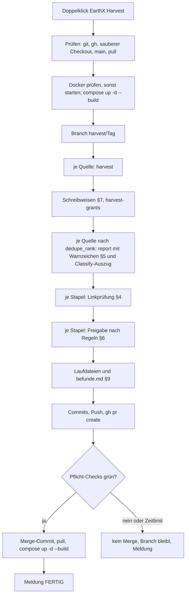

# M5-67 — Harvest ohne Handarbeit

**Status (24.11.2026):** Plan angenommen (Otto, 24.11.2026): F1, F4–F11 je 1; F2 und F3 ersetzt durch Ottos Zusatz „jeder Eintrag erst nach bestandener Prüfung seines eigenen Links“ (§4, §4a–§4d, §18a); F12 = 2 und „ungeprüft heißt unsichtbar“ (Otto, 24.11.2026, §18b); F13 = 1, F14 = 1, A18 angenommen (§18c). **Teil 1 fertig** (24.11.2026); Teil 2 umgesetzt (§21); **Fix 1** nach Ottos erstem Probelauf (§22). **Stufe B.** Teil 1 (Plan, Nachträge, Backend-Bausteine) in [#408](https://github.com/oscipal/earthX/pull/408), Teil 2 (Skript, Freigabe nach Regeln, Laufdateien) danach.
**Aufgabe:** M5-67, Auftrag von Otto vom 24.11.2026.
**Entscheidung Otto (24.11.2026):** Die Lauf-Freigabe geht von Otto auf feste Regeln über (`adr/0033` F1, Option 2, nachgelagerte Stichprobe). Otto übernimmt Haftung und Verantwortung. Lizenzen werden nie automatisch neu eingestuft. Grundsatz: **Im Zweifel wartet ein Fund; nie wird eine unsichere Lizenzangabe veröffentlicht.** Ziel: Otto startet einen Lauf mit einem Doppelklick, sonst nichts. Was er bisher aus dem Terminal kopiert hat, steht danach im Repo.
**Grundlagen:** `adr/0033` (§5–§11 mit den Nachträgen vom 23.11. und 24.11.), `plans/m5/m5-20-freigabe-geernteter-eintraege.md` (§10, §12, §13a–§13h, §14, §16), `adr/0002` (keine Abrufe realer Quellen aus der Sitzung, Tests ohne Netz), `adr/0025` §6.5 (P1), `scripts/harvest-report.ps1`, Entscheidungslog bis 24.11.2026, `projektuebersicht.md` Prinzipien 12, 15, KLAERUNGEN B8, B11.
**Betroffen:** `scripts/` (neu `harvest-cycle.ps1`), `backend/earthx/discovery/` (neue Schritte), `backend/earthx/catalog/approvals.py` und `licences.py`, `backend/catalog/` (neue Daten-Dateien), `docker-compose.yml` (Dienste im Profil `harvest`), `docs/harvest/` (neu), README. **Nicht:** `.github/`, `.claude/`, `CLAUDE.md`, `.importlinter`, `terms.yaml`, `geodata.yaml` (außer §12 nach F9), `blocked.yaml`.

Belegstufen wie in `adr/0025`: **P** am Quelltext gelesen (Stand `main` 7b8e8e8), **S** Vorwissen, **A** eigene Ableitung. Aus dieser Sitzung geht keine Anfrage an eine Quelle und keine an Ottos Datenbank.

---

## 1. Ziel und Grenzen

**Ziel:** Ein Doppelklick auf „EarthX Harvest“ erntet alle freigegebenen Quellen, bildet Bericht und Stapel, prüft die Stichprobe selbst, gibt nach festen Regeln frei, legt alle Ausgaben als Dateien in **einen** PR, wartet auf grüne Pflicht-Checks, merged und startet die Plattform neu. Am Ende steht im Fenster eine kurze Meldung. Was offen bleibt, steht in `docs/harvest/befunde.md`; eine spätere Session arbeitet es mit dem Satz „Arbeite die offenen Harvest-Befunde ab“ ab.

**Grenzen (fest):**

- Lizenzen stuft nur Otto ein (`terms.yaml`). Die Pipeline ordnet höchstens eine **neue Schreibweise** einer schon eingestuften Standardlizenz zu, nach den Kriterien in §7.
- Die Freigaben je Herausgeber schreibt weiter `harvest-grants` aus `grant-to-all.yaml` (Ottos Entscheidung vom 20.11.2026, `adr/0033` §6.2). Das ist Anwendung einer Entscheidung, keine Einstufung.
- Kein Abruf realer Quellen aus einer Session (`adr/0002`). Das Skript läuft nur bei Otto. Tests nutzen eine Transport-Attrappe am `Gateway` und eine `docker`-/`gh`-Attrappe.
- Kein self-hosted runner, keine Änderung an `.github/`, kein Zeitplan: Otto startet selbst.
- Ausgehende Requests nur über `gateway` (B8), auch die Linkprüfung.
- Lokale Ausgaben nur nach `..\earthx-ausgaben\`, nie ins Repo-Verzeichnis außerhalb des Commits.
- **Nicht Teil:** ein Klassifikator, der aus Ottos Entscheidungen lernt (§17, nur Ausblick); Kandidaten des vollen Wegs und `discovery propose` (M5-20 PR 2); eine Freigabe-Oberfläche (`adr/0033` A3).

## 2. Ausgangslage [P]

Heute (M5-20 §16) tippt Otto je Lauf rund 15 Befehle: `git switch main`, `git pull`, `docker compose build`, `docker compose up -d`, je Quelle `harvest`, `harvest-grants` auf einem eigenen Branch mit Commit, Push und PR, je Quelle `harvest-report.ps1 -Classify` und ohne `-Classify`, je Quelle `git push` und ein Draft-PR, Häkchen in der Freigabedatei, `decision`, Merge, wieder `pull`, `build`, `up -d`. Die Ausgaben von `-Classify` hat er aus dem Terminal kopiert; die Sitzungen sahen sie nur, wenn er sie an einen PR hängte.

Was schon da ist und bleibt:

| Teil | Stelle | Was er tut |
|---|---|---|
| Harvest | `discovery/harvest.py`, Dienst `harvest` | ein Lauf je Quelle; veraltete Extraktor-Version wird ohne Anfrage neu ausgewertet (`_reextract(outdated_only=True)`); `robots.txt` beachtet |
| Bericht | `discovery/report.py`, Dienst `harvest-report` | Stapel, Fingerabdruck, Stichprobe (15 zufällig, 15 gezielt), Freigabedatei `decision: pending`, `--classify` |
| Freigaben je Herausgeber | `discovery/grants.py`, Dienst `harvest-grants` | `grants/<quelle>.yaml` aus der Datenbank und `grant-to-all.yaml` |
| Veröffentlichen | `catalog/approvals.py`, `catalog-load` | `approved` und Fingerabdruck gleich → `published`; `excluded_rules`; `revoked_on`; ohne abgehakte Stichprobe Ladefehler (Prinzip 12) |
| Rücknahme | `blocked.yaml`, `revoked_on`, A23 | unverändert |
| Gateway für Quellen | `discovery/source_gateway.py` | Takt je Host aus `hosts.yaml` über Postgres, `robots.txt` |

## 3. Ablauf eines Laufs



Schritte des Skripts `scripts/harvest-cycle.ps1` (Windows PowerShell 5.1, nur ASCII im Quelltext wie `harvest-report.ps1`):

1. **Start:** Ordner `..\earthx-ausgaben\<Tag>-<Uhrzeit>\` anlegen, `Start-Transcript` dorthin; Sperrdatei gegen einen zweiten Start; Standby für die Dauer des Laufs verhindern (A4).
2. **Prüfen:** `git`, `gh` und `docker` vorhanden; `gh auth status` angemeldet; Checkout sauber (`git status --porcelain`), sonst Abbruch (F1); auf `main` wechseln, `git pull --ff-only`.
3. **Docker:** `docker info`; antwortet es nicht, Docker Desktop starten und bis zu 5 min warten. Dann `docker compose up -d --build` und warten, bis `catalog-load` fertig ist.
4. **Branch** `harvest/<Tag>`; ein zweiter Lauf am selben Tag nimmt `harvest/<Tag>-<Uhrzeit>` (§22). Vorher schließt der Lauf die Draft-PRs früherer gescheiterter Läufe und löscht ihre Branches (§22, A10 neu).
5. **Ernten:** Images des Profils `harvest` leise bauen (`--progress quiet`, wie M5-20 §13e), dann je Quelle mit `enabled: true` ein Lauf `harvest <quelle>`. Scheitert eine Quelle (Host antwortet nicht, `robots`), ist das ein Befund dieser Quelle, kein Abbruch; ihr Bericht entfällt in diesem Lauf (A2). Eine planmäßige Pause (Exit-Code 75, §22) ist dagegen ein Erfolg: der Bericht der Quelle läuft weiter, die Pause steht als Hinweis im Bericht des Laufs.
6. **Lizenzen:** `harvest-spellings` schreibt neue Schreibweisen nach §7 in `backend/catalog/licenses/spellings.yaml`; `harvest-grants` für alle Quellen (neue Herausgeber bekommen `grant-to-all.yaml`). Danach die Images neu bauen, damit der Bericht beides kennt.
7. **Bericht** je Quelle in der Reihenfolge `dedupe_rank`, dann ID (FSDI zuerst, M5-20 §16): Stapel, Warnzeichen (§5), Stichprobe aus den Funden **ohne** Warnzeichen, Freigabedatei `pending`, Bericht `.md`, Classify-Auszug (A14).
8. **Linkprüfung** (§4): neue und erneut vorgelegte Einträge aller Stapel, dann der Bestand nach Rotation (§4a), im Budget; Verbergen und Zurückholen nach §4a mit Schutz nach §4c; Ergebnis der Stichprobe in die Freigabedatei.
9. **Freigabe nach Regeln** je Datei (§6): `decision`, `decided_on`, `decided_by: rules`, `ok` je Eintrag, `excluded_entries`.
10. **Laufdateien** (§9): `docs/harvest/laeufe/<Tag>/`, `docs/harvest/befunde.md` fortschreiben, PR-Text.
11. **Git:** kleine Commits (Freigaben je Herausgeber; Schreibweisen; Bericht und Freigabe je Quelle; Laufdateien und Befunde), `git push -u origin harvest/<Tag>`, `gh pr create` (kein Draft, Titel „Harvest run <Tag>“).
12. **Warten** auf die vier Pflicht-Checks „Backend — lint and tests“, „Frontend — lint, types and tests“, „Module boundaries (import-linter)“, „Compose topology“ (`gh pr checks --json name,bucket`, alle `pass`), höchstens 90 min (A11).
13. **Merge** mit Merge-Commit (`gh pr merge --merge --delete-branch`), `git switch main`, `git pull --ff-only`, `docker compose up -d --build`; `catalog-load` veröffentlicht die freigegebenen Stapel.
14. **Ende:** eine Zeile `FERTIG: …` (Quellen, veröffentlicht, wartend, offene Befunde) oder `FEHLER in Schritt …` (§10); `Read-Host` hält das Fenster offen.

Ein Lauf ohne neuen Stapel und ohne neue Befunde erzeugt keinen PR (`adr/0025` K5); die Meldung sagt das.

## 4. Linkprüfung jedes Eintrags (Punkt 2; Zusatz Otto 24.11.2026)

**Vorgabe Otto (24.11.2026, ersetzt F2 und F3):** Ein gelisteter Eintrag wird erst sichtbar, wenn **sein eigener Link** die automatische Prüfung bestanden hat, nicht nur die Stichprobe. Wer nicht besteht, bleibt unsichtbar und kommt nach Muster gruppiert in die Befundliste. Gilt für geerntete Einträge; Handeinträge unter `listed/` schreibt `catalog-load` wie bisher.

**Bestanden** heißt, alle drei Punkte gelten:

| Punkt | Bestanden, wenn | Grund bei Fehlschlag |
|---|---|---|
| Antwort | `GET` auf den Link „Source“ endet nach höchstens 5 Weiterleitungen mit `200` und HTML | `http_<code>` (z. B. `http_404`) |
| Keine Start-, Fehler- oder Login-Seite | die Seite nach den Weiterleitungen ist nicht die Startseite des Hosts (Pfad leer, `/`, nur ein Sprachteil oder `index.*`, wo der Link tiefer zeigte); `<title>` nennt keinen Fehler („404“, „nicht gefunden“, „not found“, „Fehler“, „error“ …) und die Seite ist keine Anmeldung (Pfad mit `login`, `signin`, `anmelden`, `auth`, oder ein Passwortfeld, wo Titel und Kennung fehlen); Beispiel: GENESIS Statistik Sachsen „Tabelle zu groß für nicht registrierte Nutzer“ mit Rücksprung zur Startseite | `start_page`, `error_page`, `login_page` |
| Titel oder Kennung | der Titel des Datensatzes (normalisiert wie die Suche: Kleinschreibung, ohne Akzente, jede Folge anderer Zeichen ein Leerzeichen) steht im sichtbaren Text, in `<title>`, einer `<meta>`-Angabe (`og:title`, `twitter:title`, `description` …), im JSON-LD oder im `canonical`-Link; bei Titeln mit mindestens 4 Wörtern ab 4 Zeichen genügen 80 % dieser Wörter. **Oder** eine Kennung des Datensatzes (Schlüssel bei der Quelle, z. B. CKAN-Name oder UUID, Collection-ID, DCAT-Kennung; mindestens 6 Zeichen) steht an einer dieser Stellen | `no_title` |

- **Nicht prüfbar** (`unchecked`): `robots.txt` verbietet den Pfad, keine Verbindung, Timeout, `429`, `5xx` (je einmal wiederholt), Antwort größer als 2 MiB. **Ungeprüft heißt unsichtbar** (Otto, 24.11.2026): ein neuer Eintrag bleibt unsichtbar, ein schon sichtbarer wird verborgen, bis eine Prüfung besteht. Eine Adresse, die das Gateway ablehnt (privates Netz, kein `https`), fällt durch.
- **Weiterleitung auf einen anderen Host** ist erlaubt (z. B. `doi.org` → Anbieter); der Zielhost steht im Ergebnis. Die Prüfung von Titel oder Kennung deckt Prinzip 15 ab (keine fremde Seite).
- **Zugang** spielt keine Rolle: Bestellung, Konto, kostenpflichtig und „auf Anfrage“ werden weiter gelistet (Vorgabe 14.11.2026), sofern der Link sicher auf die Seite des Datensatzes führt. Eine Seite mit Bestell- oder Anmeldeknopf besteht, wenn Titel oder Kennung dort stehen; eine Weiterleitung auf eine Anmeldeseite besteht nicht.
- **Muster** des Links für die Gruppierung: Host und Pfad, in dem Kennungen des Datensatzes durch `{id}` und Teile mit Ziffern oder mehr als 40 Zeichen durch `{x}` ersetzt sind; Abfrage nur mit den Namen der Parameter (z. B. `www.govdata.de/suche/daten/{id}`, `www.geoportal.rlp.de/map?LAYER[id]&LAYER[zoom]`). Ein Fragment (`#…`) gehört dazu, weil der Server es nie sieht (§4d).
- **Über `gateway`:** Allowlist = die Hosts der Links dieses Laufs; Takt aus `hosts.yaml`, sonst 1 Verbindung und 1 s Abstand je Host (M5-20 A6); `Crawl-delay` aus `robots.txt` gilt, wenn größer; der Zeiger je Host liegt in Postgres (M5-37), gilt also auch zusammen mit dem Harvest. Das Gateway gibt dafür die Adresse nach den Weiterleitungen zurück (neues Feld `url` der Antwort, sonst unverändert).
- **Ergebnis** je Eintrag in Postgres (Tabelle `earthx_link_check`, Migration 037: Adresse, Host, Muster, Ergebnis, Grund, Status, Zielhost, Zeit, Schutz nach §4c). Ein Ergebnis gilt nur für die Adresse, mit der es geprüft wurde: ändert die Quelle den Link, ist der Eintrag ungeprüft. In der Freigabedatei steht es nur für die Stichprobe (`check`), in den Laufdateien als Zahlen je Host und Muster mit Beispielen.
- **Lizenzhinweis auf der Seite** nur zur Information in der Stichprobe (Name oder Adresse der Lizenz im Text: ja/nein).

### 4a. Sichtbar, verborgen, zurück

- **Neuer oder erneut vorgelegter Eintrag** (`in_review`): `publish` macht ihn nur sichtbar, wenn seine Freigabedatei `approved` ist **und** seine letzte Prüfung mit der aktuellen Adresse `passed` ist und nicht unter dem Schutz nach §4c steht. Sonst bleibt er `in_review` und kommt mit dem nächsten Lauf wieder in den Stapel; ist er dann geprüft, wird er sichtbar. Das gilt auch für eine Freigabe von Hand.
- **Veröffentlichter Eintrag mit Fehlschlag:** neuer Zustand `link_hidden`, unsichtbar wie jeder Zustand außer `published`, **nicht gelöscht**: Inhalt, Freigabedatei und Datum bleiben. Besteht er eine spätere Prüfung mit derselben Adresse und unverändertem Inhalt, wird er wieder `published`, ohne neue Freigabe (er war schon freigegeben). Ändert die Quelle Inhalt oder Link, geht er wie ein veröffentlichter Eintrag nach U1 (`adr/0033` §11) in die Prüfung.
- **Bestand beim ersten Lauf:** Alle veröffentlichten geernteten Einträge (rund 10⁵) werden geprüft, die neuen zuerst, dann der Bestand. **Am Ende jedes echten Laufs wird jeder veröffentlichte Eintrag ohne bestandene Prüfung seines aktuellen Links verborgen**, auch einer, den das Budget noch nicht erreicht hat (Otto, 24.11.2026: ungeprüft bleibt nicht sichtbar). Nach dem ersten echten Lauf ist also nur sichtbar, was in ihm bestanden hat; der Rest kommt mit den folgenden Läufen zurück. Empfehlung: den ersten echten Lauf mit größerem Budget starten (`--minutes`), der Probelauf zeigt vorher, wie viel das Budget schafft.
- **Rotation (vgl. M5-24):** Jeder sichtbare und jeder verborgene Eintrag wird erneut geprüft, wenn seine letzte Prüfung älter als 30 Tage ist, die ältesten zuerst. Weil Otto die Läufe selbst startet, gilt „etwa einmal im Monat“ nur bei mindestens einem Lauf im Monat.
- **Budget je Lauf:** höchstens 180 min Prüfzeit (in `linkcheck.yaml`); was nicht drankommt, folgt im nächsten Lauf. Reihenfolge: neue und erneut vorgelegte Einträge, dann nie geprüfte des Bestands, dann die ältesten Prüfungen.

### 4b. Laufzeit des ersten Laufs [A]

Die Hosts werden parallel geprüft, jeder in seinem Takt; die Laufzeit bestimmt der Host mit den meisten Links: **Dauer ≈ max über die Hosts von (Links × Abstand)**. Die Verteilung auf Hosts kennt nur Ottos Datenbank; geschätzt aus den Stichproben der Freigabedateien (je 30 Einträge, `backend/catalog/approvals/`):

| Quelle | Einträge | Host laut Stichprobe | geschätzte Links | Abstand | Dauer |
|---|---|---|---|---|---|
| govdata | 94 258 | `www.govdata.de` (17 von 30) | ≈ 53 000 | `robots.txt` sperrt Crawler außer großen Suchmaschinen (Kommentar in `sources/govdata.yaml` [P]) | keine Anfrage, alle nicht prüfbar (§4d) |
| govdata | | `www.gkd.bayern.de` (4 von 30) | ≈ 12 500 | 1 s | ≈ 3,5 h |
| govdata | | je rund 3 000–9 000: Schleswig-Holstein, Sachsen, Rheinland-Pfalz u. a. | | 1 s | ≈ 1–2,5 h, parallel |
| opendata-swiss | 7 790 | `opendata.swiss` (14 von 30) | ≈ 3 600 | `Crawl-delay` 10 s, falls wie bei `ckan.opendata.swiss` [S] | ≈ 10 h |
| fsdi-stac | 305 | `data.geo.admin.ch` (30 von 30) | 305 | 1 s | ≈ 5 min |

**Schätzung:** ohne GovData-Katalogseiten rund 4–10 h Prüfzeit für den Bestand, bei 180 min je Lauf also 2–4 Läufe; mit einer `robots`-Freigabe für `www.govdata.de` (§4d) kämen bei 1 s Abstand rund 15 h dazu. Die Stichproben sind klein (30 je Quelle), die Zahlen sind Größenordnungen. Der Probelauf (§18a) zählt vor der ersten Anfrage die Links je Host und rechnet Links × Abstand aus; diese Tabelle steht dann in den Laufdateien.

### 4c. Schutz je Host und Muster

Fällt in einem Lauf bei einem Host oder einem Muster ein großer Anteil durch, liegt es eher an der Prüfung als an den Daten (z. B. eine Seite, die ihren Inhalt per Skript lädt, oder ein falsch gebautes Muster).

- **Schwelle (Vorschlag, in `linkcheck.yaml`):** mindestens **20 gefragte** Links (bestanden, fehlgeschlagen oder ohne Antwort) und mindestens **25 % Fehlschläge oder ohne Antwort** in diesem Lauf, je Host und je Muster (A18). Ohne Antwort zählt, weil sonst ein Host, der gerade nicht antwortet, mit „ungeprüft heißt unsichtbar“ ganz verschwände; `robots.txt` und eine unbestätigte Adressform zählen nicht. [A] Echte tote Links liegen nach den Stichproben vom 21.–24.11. deutlich darunter (kein Linkfehler in 4 × 30); ein falsches Muster fällt nahezu ganz durch.
- **Wirkung:** Für die Einträge dieses Hosts bzw. Musters wird in diesem Lauf **nichts verborgen und nichts freigegeben**: Veröffentlichte bleiben sichtbar, neue bleiben unsichtbar, auch die bestandenen. Die Ergebnisse stehen mit `guarded` in der Tabelle.
- **Befund oben:** Der Fall steht als erster Befund aus den Läufen in `befunde.md`, mit Zahlen, Gründen und 5 Beispielen, und in den Laufdateien. Ebenso ein Host, bei dem mehr als die Hälfte nicht prüfbar ist (z. B. `robots.txt`).
- **Grenze [A]:** Der Schutz zählt je Lauf. Ein Host, von dem in einem Lauf weniger als 20 Links fällig sind (Rotation bei kleinen Hosts), wird nie geschützt; fällt er durch, wird er Stück für Stück verborgen. Bei einem Lauf je Woche sind von einem Host mit 300 Einträgen rund 70 fällig. Teil 2 zeigt die Fehlschläge je Muster über mehrere Läufe in der Befundliste, damit ein solcher Fall auffällt.

### 4d. Muster, die voraussichtlich durchfallen, und Vorschläge

Aus den Stichproben der Freigabedateien [P] und dem Code; geprüft wird nichts aus der Sitzung.

| Muster | Was dagegen spricht | Vorschlag |
|---|---|---|
| `www.govdata.de/suche/daten/{x}` (Katalogseite, Rang 3, aus `catalog_page` der Quell-Datei) | (1) Das Muster ist laut Quell-Datei ungeprüft [P: „[S, not checked from a session]“]. In den Daten stehen daneben `/web/guest/suchen/-/details/…` (ältere Form des Portals [S]). Die Seite, die Otto am 19.11. im Browser als Beleg geöffnet hat, hat die Form `https://www.govdata.de/daten/-/details/govdata-metadatenkatalog` [P, `robots_exception.evidence`]; dieselbe Form nennt eine Seite des Statistikportals [S]. (2) `robots.txt` von `www.govdata.de` sperrt Crawler; geprüft werden kann die Seite dann nicht. | (a) `catalog_page` auf `https://www.govdata.de/daten/-/details/{name}` umstellen, sobald Otto im Browser bestätigt, dass `…/suche/daten/3d-meshes-brandenburg`, `…/web/guest/suchen/-/details/3d-meshes-brandenburg` und `…/daten/-/details/3d-meshes-brandenburg` auf dieselbe Seite führen bzw. welche nicht; `catalog_page` geht in die Extraktor-Version ein [P, `extract.py`], der nächste Harvest wertet deshalb alle Funde ohne Anfrage neu aus. (b) **F12 = 2, umgesetzt (§18b):** Prüfung über die CKAN-API, erst nach Ottos Bestätigung der Adressform. |
| `data.geo.admin.ch/browser#/collections/{id}` (FSDI, alle 305) | Der Teil nach `#` geht nie an den Server; jede Adresse liefert dieselbe Seite des STAC-Browsers ohne Titel. Fällt ganz durch, der Schutz (§4c) greift | **F13 = 1, umgesetzt (§18c):** Prüfung über die Collection `<endpoint>/collections/<id>`, die der Browser anzeigt (derselbe Host) |
| `www.geoportal.rlp.de/map?LAYER[…]` (Viewer mit Ebene) | Viewer laden Ebenen per Skript; Titel wohl nicht im HTML [A] | Befund nach dem Probelauf; Vorschlag dann mit den Zahlen |
| `opendata.swiss/de/dataset/{id}` | Ob das Portal den Titel im HTML liefert, ist aus der Sitzung nicht prüfbar; `<title>` und `og:title` genügen nach Ottos Regel | Probelauf zeigt es |
| GENESIS-Datenbanken (z. B. Statistik Sachsen) | Tabellen über einer Größe nur angemeldet, Rücksprung zur Startseite | fällt als `start_page` durch, wie gewollt |

## 5. Warnzeichen am Fund

Rein aus den Metadaten, ohne Anfrage, im Bericht über **alle** Funde des Stapels. Ein Fund mit Warnzeichen kommt nicht in die Stichprobe, wird nicht veröffentlicht (`excluded_entries`, §6) und steht in der Befundliste. Die Wörter liegen als Daten in `backend/catalog/flags.yaml` (wie `geodata.yaml`), nicht im Code.

| Code | Warnzeichen | Beispiel (24.11.) |
|---|---|---|
| W1 | Titel enthält einen Begriff ohne Geodaten (`not_geo_terms`, `software_terms` aus `geodata.yaml`) oder ein Wort auf `*statistik`, `*statistiken`, obwohl die Regel R-G den Fund hält | „Bibliothekenstatistik …“, „Aktuelle Lage … zum Corona-Virus“ |
| W2 | Herausgeber steht in `not_geo_publishers` oder `statistics_publishers`, der Fund wird trotzdem gehalten | Identitas AG „Katzen – Verteilung pro Gemeinde“ |
| W3 | Link „Source“ ist eine allgemeine Anbieterseite: letzter Pfadteil `home`, `index`, `start`, `startseite` (mit oder ohne Endung) oder höchstens ein Pfadteil (Sprachteil zählt nicht, wie §13h) | — |
| W4 | Kategorie unplausibel: `optical`, `radar` oder `elevation`, aber weder Raster noch Dienst unter den Distributionen | Gemeindefinanzen „Auszahlungen …“ unter „Optical imagery“ |
| W5 | Titel nennt eine Kopie oder einen Test: `kopie`, `copy`, `test`, `testdaten`, `dummy`, `draft`, `entwurf` als ganzes Wort | „[BfTMAP] KOPIE MItarbeiter als Dienst“ |
| W6 | Mail-Adresse oder Telefonnummer in Titel oder Beschreibung (keine Person im Eintrag, `adr/0033` §5) | — |
| W7 | Titel kürzer als 4 Zeichen oder ein Dateiname (endet auf `.csv`, `.zip`, `.shp`, `.xlsx`, `.pdf` …) | — |

- **Fehlalarm aufheben:** Liste `cleared` in `flags.yaml` mit `dataset_id`, Code und Datum; Otto (oder eine Session auf seinen Auftrag, per PR) trägt ein, der nächste Lauf nimmt den Fund wieder auf.
- Ein Fund mit Warnzeichen bleibt `in_review` und kommt mit jedem Lauf wieder in den Stapel, solange das Warnzeichen besteht; die Befundliste führt ihn einmal, nicht je Lauf.

## 6. Freigabe nach Regeln (Punkt 3)

**Ein Stapel wird `approved`, wenn alles gilt:**

1. **Lizenzen:** Jeder Eintrag des Stapels hat eine Regel aus `terms.yaml` (bzw. einer Schreibweise nach §7) und `grants/`; das gilt schon heute, sonst wartet er (`needs_rule`). Einstufungen kommen nur aus `terms.yaml` auf `main`, die der Lauf nie ändert.
2. **Linkprüfung:** entfällt als Bedingung für den Stapel (F2 ersetzt): Jeder Eintrag wird nur mit eigener bestandener Prüfung sichtbar (§4a). Die Stichprobe zeigt das Ergebnis für die nachgelagerte Durchsicht.
3. **Warnzeichen:** Funde mit Warnzeichen sind vorher herausgenommen (§5); ein Stapel, in dem nach dem Herausnehmen nichts bleibt, wird nicht freigegeben.
4. **Größe:** höchstens 5 000 Einträge und höchstens 25 % der schon veröffentlichten Einträge der Quelle, mindestens aber 200 (F6). Ein Sprung darüber deutet auf einen Fehler der Pipeline (z. B. eine kaputte Regel R-G) und wartet auf Otto.
5. **Lauf ohne Fehler:** der Bericht hat keinen Fund als „fehlerhaft“ gezählt (M5-20 A22), oder höchstens 1 %.

**Wirkung:**

- **Erfüllt:** `decision: approved`, `decided_on: <Tag>`, `decided_by: rules`; je Eintrag der Stichprobe `ok: true` bei bestandener Prüfung, sonst `ok: false`; `excluded_entries` = Funde mit Warnzeichen. `catalog-load` veröffentlicht nach dem Merge die übrigen Einträge mit bestandener Prüfung (§4a).
- **Nicht erfüllt:** `decision: pending`, `decided_by: null`; die Datei wird trotzdem gemergt (nichts wird sichtbar, `adr/0033` §8.4), der Grund steht in der Befundliste. Otto kann sie später von Hand freigeben (wie bisher: Häkchen, `decision`, Merge), oder der nächste Lauf übernimmt die Funde in seinen Stapel (`adr/0033` §8.3, Takt).
- **Nie automatisch:** `rejected`, `excluded_rules`, `revoked_on`. Das bleiben Ottos Werkzeuge.

**Änderungen an der Freigabedatei** (`catalog/approvals.py`): neue Felder `decided_by` (`rules`, `otto`, `null`), `excluded_entries` (Liste von IDs), je Eintrag der Stichprobe `check`. Prüfung beim Laden: `decided_by: rules` nur mit `check` an jedem Eintrag der Stichprobe; `excluded_entries` nur IDs des Stapels (gegen die Datenbank in `publish`). Alte Dateien ohne die Felder bleiben gültig (`decided_by` fehlt = von Hand). `publish` überspringt `excluded_entries`; sie bleiben `in_review`.


## 7. Neue Schreibweisen einer eingestuften Lizenz

**Standardlizenz:** ein Eintrag in `terms.yaml` der Klassen K1–K5 mit einer SPDX-Kennung aus der SPDX-Liste (z. B. `CC-BY-4.0`, `CC0-1.0`, `DL-DE-BY-2.0`, `DL-DE-ZERO-2.0`, `ODbL-1.0`) oder mit einer festen Adresse des Lizenzgebers (die Nutzungsbedingungen von opendata.swiss). Nicht: amtliches Werk (`de-official-work`), K6, K7, eigene Lizenzen eines Herausgebers (`lba-free-use`).

**Eindeutig zuordenbar** ist eine Angabe, die bei wartenden Funden (`unknown_licence`) steht, nur nach einer dieser Regeln und nur, wenn sie zu **genau einer** Standardlizenz führt:

| Regel | Angabe | Gleich, wenn |
|---|---|---|
| S1 Adresse | eine URL | nach Normalisierung gleich einer Adresse in `matches` dieser Lizenz: `http`/`https`, `www.`, Groß-/Kleinschreibung des Hosts, `/` am Ende, Anhänge `/legalcode`, `/deed.<sprache>`, `.html`, `/index.html`, Sprachteil der Adresse |
| S2 Kennung | ein kurzer Text ohne Leerzeichen-Sätze | gleich der SPDX-Kennung oder einer Kurzform aus dem Vokabular `dcat-ap.de/def/licenses/` (z. B. `dl-by-de/2.0`), ohne Unterschied von Groß-/Kleinschreibung, `-`, `_`, Leerzeichen und `.`; **mit** Versionsnummer |
| S3 Schreibung | ein Freitext | gleich einer Angabe in `matches` dieser Lizenz nach Angleichen von Leerraum, Anführungszeichen, Gedankenstrichen und Groß-/Kleinschreibung |

**Nie zugeordnet:** eine Angabe ohne Versionsnummer; eine Angabe, die zwei Lizenzen nennt oder zu zwei führt; ein Freitext mit Zusätzen (Haftungsausschluss, Quellenvermerk), der nicht nach S3 gleich ist; NC, ND oder SA, wo die Lizenz es nicht hat (und umgekehrt); Feeds, Seiten und Hinweistexte (§13b). Diese Angaben warten und stehen in `lizenzangaben.md` und der Befundliste, mit Zahl und den häufigsten Herausgebern, damit Otto sie einstuft oder als Schreibweise einträgt.

**Ablage:** eigene Datei `backend/catalog/licenses/spellings.yaml`, geschrieben nur von `harvest-spellings`: je Zeile `license_ref`, die Angabe wörtlich, Regel S1–S3, `added_on`. `licences.py` lädt sie zusätzlich zu `matches`; jede Angabe gehört weiter zu höchstens einer Lizenz (Ladefehler sonst). `terms.yaml` bleibt Ottos Datei. `withdrawn_on: <Tag>` an einer Zeile nimmt die Zuordnung zurück (A23: sofort unsichtbar); die Zeile bleibt stehen, damit kein späterer Lauf sie wieder einträgt. Einträge, die erst durch eine neue Schreibweise eine Regel bekommen, sind in der Stichprobe gezielt dabei (`why: new_spelling`, vor `new_rule`).

## 8. Rücknahme und nachgelagerte Stichprobe (Punkt 4)

- **Rücknahme wie bisher:** `blocked.yaml` (Eintrag, Herausgeber, Host, Quelle; Grabstein) und `revoked_on` in einer Freigabedatei (der ganze Lauf). Neu dazu `cleared` in `flags.yaml` (§5) und `withdrawn_on` an einer Zeile in `spellings.yaml` (§7). Alles sind Dateien, die Otto am Handy im Editor von GitHub ändern kann; der nächste Lauf holt sie mit `git pull` und `catalog-load` wendet sie an.
- **Im Bericht des Laufs** (`docs/harvest/laeufe/<Tag>/README.md` und PR-Text) ein Abschnitt **„Seit dem letzten Lauf automatisch veröffentlicht“**: je Quelle die Zahl der Einträge, die mit `decided_by: rules` sichtbar wurden, und eine Stichprobe von 10 zum Nachsehen (Titel, Link, Lizenzregel, Herausgeber; gezogen mit dem Fingerabdruck als Startwert). Darunter je Freigabedatei die Zeile, die den Lauf zurücknimmt (`revoked_on: <Tag>` in `<Datei>`).

## 9. Ausgaben im Repo (Punkt 4b)

**Je Lauf ein Ordner** `docs/harvest/laeufe/<Tag>/` (am selben Tag `<Tag>-2`), im PR des Laufs:

| Datei | Inhalt |
|---|---|
| `README.md` | Kopf (Tag, Quellen, Dauer, Ergebnis), Zahlen je Quelle (Anfragen, Funde, Ergebnis nach Zustand, Warten nach Grund), Entscheidung je Stapel mit Begründung nach §6, „Seit dem letzten Lauf automatisch veröffentlicht“ (§8), Verweise auf die übrigen Dateien und die Freigabedateien |
| `<quelle>-classify.md` | Auszug aus `--classify`: Ergebnis, Warten, Ausdehnung, Ortstexte ohne Treffer (30), Nicht-Geodaten je Herausgeber, Schnittstellen-Links, Dubletten mit Beispielen, Lizenzangaben (die 20 häufigsten wartenden) |
| `warnzeichen.md` | Funde mit Warnzeichen je Code und Quelle: Zahl, bis zu 10 Beispiele mit Titel, Link, Herausgeber, ausschlaggebendem Wort und den Signalen, die R-G und die Kategorie entschieden haben |
| `lizenzangaben.md` | neue Angaben: automatisch zugeordnet (Regel, Lizenz, Zahl) und wartend (Zahl, häufigste Herausgeber) |
| `fehler.log` | Fehler und Warnungen des Laufs, bereinigt; „keine“, wenn leer |

Die Stichprobe mit dem Ergebnis der Linkprüfung steht im Bericht `.md` neben der Freigabedatei (`backend/catalog/approvals/`), wie bisher.

**Bereinigung** vor dem Schreiben (eine Funktion, mit Tests): keine AOI (der Lauf kennt keine); keine Hashes (kein SHA-256, kein Inhalts-Hash; der Fingerabdruck steht nur in der Freigabedatei, wie bisher); in Adressen fallen Abfrageparameter mit Signatur- oder Schlüsselnamen weg (`signature`, `sig`, `token`, `key`, `apikey`, `access_token`, `expires`, `X-Amz-*`, `X-Goog-*`); keine Umgebungsvariablen, keine Pfade außerhalb des Repos, keine Personen (`adr/0033` §5). Was `docker` und `git` vollständig ausgeben, bleibt im Protokoll unter `..\earthx-ausgaben\`.

**`docs/harvest/befunde.md`** (die erste Fassung liegt in diesem PR):

- **Kopf:** wofür die Datei da ist und was eine Session mit „Arbeite die offenen Harvest-Befunde ab“ tut: diese Datei und den letzten Laufordner lesen; Regeldaten (`geodata.yaml`, `flags.yaml`, `place_names.yaml`, Code) per Draft-PR ändern; nie eine Lizenz einstufen; `blocked.yaml` und `revoked_on` nur vorschlagen.
- **Offen, von Hand:** Befunde von Otto oder Sessions mit Kennung `H-<Tag>-<nn>`, Datum, Quelle, Beschreibung, Beispielen, Stand.
- **Offen, aus den Läufen:** der Lauf schreibt diesen Abschnitt neu: je Befund eine Kennung aus Art, Quelle und Schlüssel (z. B. `W1 opendata-swiss <dataset_id>`, `LIZENZ govdata <Angabe gekürzt>`, `STAPEL govdata pending: Linkprüfung 3 Fehler`, `QUELLE data-gv-at nicht erreichbar`), erstes und letztes Datum, Zahl, bis zu 3 Beispiele, Verweis auf den Laufordner.
- **Erledigt:** abgehakt (`- [x]`) mit Datum; ein Lauf hakt einen Befund aus den Läufen ab, der nicht mehr auftritt. Befunde von Hand hakt die Session ab, die sie behebt.

## 10. Unbeaufsichtigt: Fehlerfälle (Punkt 4a)

| Schritt | Fall | Verhalten | Meldung im Fenster |
|---|---|---|---|
| 2 | `gh` fehlt oder nicht angemeldet | Abbruch, nichts geändert | „gh fehlt bzw. ist nicht angemeldet: siehe Einrichtung im Plan M5-67 §11.“ |
| 2 | Checkout nicht sauber | Abbruch (F1) | „Im Checkout sind ungesicherte Änderungen. Erst committen oder verwerfen.“ |
| 2 | `git pull` nicht vorspulbar | Abbruch | „main lässt sich nicht aktualisieren.“ |
| 3 | Docker startet nicht in 5 min | Abbruch | „Docker antwortet nicht. Docker Desktop öffnen und neu starten.“ |
| 5 | eine Quelle scheitert (Exit-Code 1 oder anderer als 0 und 75) | weiter mit den übrigen; Befund `QUELLE` mit der Fehlerzeile | in der Schlusszeile gezählt |
| 5 | eine Quelle pausiert planmäßig (Exit-Code 75: Seiten- oder Anfragegrenze, Ruhe auf Bitten der Quelle) | **kein Fehler**; Bericht der Quelle läuft; Hinweis im Bericht des Laufs, kein Befund | „Hinweis: <Quelle> hat planmäßig pausiert“ |
| 6, 7 | Bericht, Schreibweisen oder Freigaben scheitern | Laufdateien mit `fehler.log` committen, pushen, **Draft-PR**, kein Merge (F10) | „FEHLER im Bericht von <quelle>. Branch harvest/<Tag>, PR <Nummer>.“ |
| 8 | Linkprüfung scheitert als Ganzes | nichts verborgen, nichts Neues sichtbar; Stapel nach Regeln wie sonst; Befund | in der Schlusszeile gezählt |
| 11 | Push oder PR scheitert | Abbruch, Branch bleibt lokal | „Push gescheitert, Branch harvest/<Tag> liegt lokal.“ |
| 12 | ein Pflicht-Check rot oder 90 min um | kein Merge, PR bleibt offen; Befund | „Checks nicht grün: <Name>. PR <Nummer> bleibt offen, nichts gemergt.“ |
| 13 | Merge abgelehnt (Branch-Schutz) | kein Merge | „Merge abgelehnt: <Grund von gh>. PR <Nummer> bleibt offen.“ |
| 13 | `compose up` nach dem Merge scheitert | gemergt, aber nicht veröffentlicht; Befund | „Gemergt, aber die Plattform startet nicht. Details: <Pfad>.“ |

Bei jedem Fehler: nichts gemergt, Branch bleibt stehen, Sperrdatei entfernt, Protokoll unter `..\earthx-ausgaben\<Lauf>\`. Ein offener PR eines früheren Laufs hält einen neuen Lauf nicht auf; er steht in der Befundliste (A10). Der neue Stapel übernimmt die Funde des alten (`adr/0033` §8.3).

## 11. Einmalige Einrichtung (Windows PowerShell 5.1, kein lokales Python)

Voraussetzung wie bisher: Git, Docker Desktop, der Checkout mit `.env`. Alles Python läuft in `docker compose`.

1. `gh` installieren (in PowerShell):

   ```powershell
   winget install --id GitHub.cli -e
   ```

   Danach ein neues PowerShell-Fenster öffnen.
2. Anmelden und `git` an `gh` binden (Browser, GitHub.com, HTTPS):

   ```powershell
   gh auth login
   gh auth setup-git
   ```

3. Im Checkout die Verknüpfung anlegen:

   ```powershell
   powershell -NoProfile -ExecutionPolicy Bypass -File .\scripts\harvest-cycle.ps1 -Install
   ```

   `-Install` prüft `git`, `gh` (Anmeldung), `docker` und `.env`, legt den Ordner `..\earthx-ausgaben\` und auf dem Desktop „EarthX Harvest“ an (Ziel: `powershell.exe -NoProfile -ExecutionPolicy Bypass -File <Checkout>\scripts\harvest-cycle.ps1`, Arbeitsordner der Checkout) und sagt, was fehlt.
4. Einmal prüfen, ob `gh` mergen darf: Ist für `main` eine Review-Pflicht eingestellt, lehnt GitHub den Merge des Skripts ab (§10). Dann Branch-Schutz anpassen oder den PR von Hand mergen.

Danach: Doppelklick. Der Lauf dauert je nach Quellen und CI rund 30–90 min [A]; der Rechner darf in der Zeit nicht ausgeschaltet werden.

## 12. Befunde aus der Freigabe am 24.11. (Punkt 5)

Alle sechs stehen als erste Einträge in `docs/harvest/befunde.md` (`H-2026-11-24-01` bis `-06`). Ursachen aus Code und Regeldaten abgeleitet [A]; die Sitzung hat weder die Datenbank noch die Funde.

| Nr. | Befund | Vermutete Ursache [A] | Vorschlag |
|---|---|---|---|
| 01 | „Betriebsstätte(n)“ zu breit; die Steuerstatistik von Destatis wurde gehalten | `*betriebsstätte(n)` und `*betriebsstaette(n)` sind Geo-Begriffe (§13h); ein Geo-Begriff hält auch Funde von Statistikämtern | **mit dieser Aufgabe:** die vier Begriffe aus `geo_terms` streichen; `prtr` bleibt, damit hält `PRTR_Betriebsstaetten_RLP` weiter (normalisiert „prtr betriebsstaetten rlp“, „prtr“ als ganzes Wort). Test mit beiden Titeln |
| 02 | Fehltreffer „Gewerbesteuer: Steuerpflichtige … Kreise … (ab 2010)“ (Statistik Sachsen), „Aktuelle Lage … Aachen zum Corona-Virus“ | Gewerbesteuer: wahrscheinlich ebenfalls „Betriebsstätten“ im Titel oder in den Schlagworten (das Statistikamt hebt schwache Signale schon auf); Corona: „corona“ ist Nicht-Geo-Begriff, also hält ein Geo-Signal, vermutlich die Ausdehnung (Stadt Aachen, schwach) | Gewerbesteuer prüft der erste Lauf nach 01 (Classify-Auszug); Corona fängt W1 vor der Veröffentlichung. Beide sind schon veröffentlicht: hält R-G sie danach nicht mehr, setzt der Bericht die Zeile auf `not_geodata` (`listing_store`, im Bau mit Test belegt); sonst Vorschlag `blocked.yaml` (Grund `not_geodata`) an Otto |
| 03 | „Bibliothekenstatistik“ (Thurgau) nicht als Nicht-Geodaten erkannt | Nicht-Geo-Begriff ist `bibliotheksstatistik` (mit „s“); „statisti*“ trifft nur Wortanfänge. **Beim Bau gefunden [P]:** Der Fund hat als Ausdehnung den Kanton Thurgau (schwaches Geo-Signal); ein Nicht-Geo-Begriff überstimmt eine Ausdehnung nach der Regel vom 23.11. nur bei Statistikämtern, der Begriff allein verbirgt ihn also nicht | **umgesetzt:** `bibliothekenstatistik` und `*bibliothekenstatistik` in `not_geo_terms` (wirkt ohne Ausdehnung); W1 hält solche Funde aus dem Stapel. Ob bestimmte Begriffe auch eine Ausdehnung überstimmen sollen: F14 |
| 04 | Identitas „Katzen – Verteilung pro Gemeinde“, „Ziegen – Verteilung pro Kanton“ nicht verborgen | Herausgeber ist Nicht-Geo-Signal, ein Geo-Signal hält sie; vermutlich schwach (Ausdehnung) | **mit dieser Aufgabe:** schwache Geo-Signale halten auch keine Funde von Herausgebern in `not_geo_publishers` (wie bei Statistikämtern, §13g). Hält ein starkes Signal, fängt W2 sie vor der Veröffentlichung, und der Classify-Auszug zeigt das Signal |
| 05 | LfULG (govdata) weiter 228 `unknown_licence`; `dl-by-de/2.0` war nicht die Ursache | unbekannt; die wartende Angabe steht nur in Ottos Datenbank | **Folgeaufgabe:** der erste Lauf schreibt die Angaben in `lizenzangaben.md`; ist es eine Schreibweise nach §7, ordnet der Lauf sie selbst zu, sonst stuft Otto ein |
| 06 | Gemeindefinanzen („Auszahlungen …“, „Einzahlungen …“) und „[BfTMAP] KOPIE MItarbeiter als Dienst“ unter „Optical imagery“ | Kategorie aus INSPIRE-Thema `oi`, EU-Thema oder einem Schlagwort wie `DOP`; welches, zeigt nur die Datenbank | **Folgeaufgabe** mit den Signalen aus `warnzeichen.md` (W4, W5 zeigen die Belege der Kategorie); bis dahin hält W4/W5 neue solche Funde draußen |

**Empfehlung (F9):** 01, 03, 04 mit dieser Aufgabe (je eine Zeile Regeldaten bzw. eine Bedingung in `geodata.py`, mit Tests); 02 mit dem ersten Lauf prüfen; 05 und 06 als Folgeaufgabe „Arbeite die offenen Harvest-Befunde ab“, sobald der erste Lauf die Daten ins Repo gelegt hat. Jede Änderung an R-G prüft Otto wie beschlossen über den Classify-Auszug, jetzt im Laufordner statt im Terminal.

## 13. Änderungen im Code

| Stelle | Neu oder geändert |
|---|---|
| `scripts/harvest-cycle.ps1` | Ablauf §3, `-Install`, Fehlerfälle §10; ruft nur `git`, `gh`, `docker`; wertet nur Exit-Codes aus; Pause als Erfolg, Fehlerzeile, Branch mit Uhrzeit, Aufräumen gescheiterter Draft-PRs (§22) |
| `backend/earthx/catalog/migrations/037_link_check.sql` (neu) | Tabelle `earthx_link_check`, Zustand `link_hidden` |
| `backend/earthx/catalog/link_checks.py` (neu) | Auswahl der fälligen Links (§4a), Ergebnisse speichern, Schutz (§4c), Verbergen und Zurückholen |
| `backend/earthx/discovery/linkcheck.py` (neu) | Prüfung einer Seite (§4, rein) und Lauf über `open_source_gateway` mit Budget; Muster; Befehl `python -m earthx.discovery.linkcheck` |
| `backend/catalog/linkcheck.yaml` (neu) | Schwellen, Budget, Fehler- und Anmelde-Wörter |
| `backend/earthx/gateway/client.py` | Antwort mit der Adresse nach den Weiterleitungen (A17) |
| `backend/earthx/catalog/listing_store.py` | `link_hidden` wie `published` bei U1, „bei der Quelle weg“, Rücknahme einer Regel |
| `backend/earthx/discovery/cycle.py` (neu) | Unterbefehle `spellings`, `decide`, `summary` für den Dienst `harvest-cycle`; Regeln §6; Laufdateien und `befunde.md` §9; Bereinigung |
| `backend/earthx/discovery/flags.py` (neu) | Warnzeichen §5, rein; liest `flags.yaml` |
| `backend/earthx/catalog/entry_files.py` | `dump_yaml`: der einzige Schreiber von YAML, ohne Anker und Aliase, liest sein Ergebnis mit dem strengen Lader zurück (§22) |
| `backend/earthx/discovery/harvest.py` | Exit-Code 75 (`EXIT_PAUSED`) für eine planmäßige Pause (§22) |
| `backend/earthx/discovery/report.py` | Warnzeichen vor der Stichprobe; `excluded_entries` vorbelegt; `why: new_spelling`; Classify-Auszug als Datei in einem Durchgang mit dem Bericht (A14) |
| `backend/earthx/catalog/approvals.py` | Felder `decided_by`, `excluded_entries`, `check`; Prüfung und `publish` §6 |
| `backend/earthx/catalog/licences.py` | lädt `spellings.yaml` zusätzlich |
| `backend/earthx/discovery/geodata.py`, `backend/catalog/geodata.yaml` | §12 nach F9 |
| `backend/catalog/flags.yaml`, `licenses/spellings.yaml` (neu) | Daten |
| `docker-compose.yml` | Dienst `harvest-cycle` (Profil `harvest`, eingebunden `approvals/`, `licenses/`, `docs/harvest/`) |
| `README.md`, `backend/catalog/approvals/README.md` | Doppelklick statt Befehlsliste; die Befehle bleiben für Hand-Läufe |

Importregeln unverändert: `discovery` importiert nur `adapters`, `catalog` und `gateway` [P, `.importlinter`].

## 14. Tests

Ohne Netz, synthetische Fixtures, Transport-Attrappe am `Gateway` (wie M5-19, M5-20):

- **Linkprüfung:** `200` mit Titel im Text, nur in `<title>`, nur in `og:title`, nur im JSON-LD, nur die Kennung; Titel fehlt → `no_title`; Startseite nach Weiterleitung, Fehlerseite mit `200`, Anmeldeseite → durchgefallen; `404`, `410`; `429`, `5xx`, Timeout → nicht prüfbar; Weiterleitung auf anderen Host besteht mit Titel; `robots.txt` verbietet → kein Abruf; nicht HTML; zu groß; Muster mit `{id}` und `{x}`; zweckfremd: Link auf private Adresse (Gateway lehnt ab), leerer Titel, Titel nur aus Satzzeichen, Kennung kürzer als 6 Zeichen zählt nicht.
- **Sichtbarkeit:** `publish` nur mit bestandener, ungeschützter Prüfung der aktuellen Adresse; Fehlschlag verbirgt (`link_hidden`), Inhalt bleibt; bestanden holt zurück; nicht prüfbar ändert nichts; Schutz je Host und Muster an der Grenze (19/20 Links, 24/25 %); Rotation nach 30 Tagen; Budget; `link_hidden` bei Sperrliste, Rücknahme einer Freigabe, Rücknahme einer Regel und „bei der Quelle weg“ wie `published`.
- **Warnzeichen:** jedes W einzeln und nicht bei ähnlichen Wörtern („Alarm“, „Testament“ trifft `test` nicht als ganzes Wort); `cleared` hebt auf; Fund mit Warnzeichen nie in der Stichprobe.
- **Freigabe nach Regeln:** jede Bedingung aus §6 einzeln an der Grenze; `pending` statt `rejected`; `excluded_entries` wird nicht veröffentlicht und bleibt `in_review`; alte Dateien ohne neue Felder laden; `decided_by: rules` ohne `check` ist Ladefehler; Fingerabdruck anders → nichts.
- **Schreibweisen:** S1–S3 je mit Treffer und Fast-Treffer (ohne Version, NC statt BY, zwei Lizenzen, Zusatztext, K6-Ziel, amtliches Werk); doppelte Zuordnung → Ladefehler; Zeile löschen → Einträge unsichtbar (A23).
- **Befundliste:** neuer Befund, bleibender Befund (ein Eintrag, Datum fortgeschrieben), weggefallener Befund abgehakt; Abschnitt von Hand bleibt unverändert; Bereinigung (Signaturparameter, SHA-256, Umgebungswerte).
- **§12:** Destatis-Steuerstatistik verborgen, `PRTR_Betriebsstaetten_RLP` gehalten; „Bibliothekenstatistik“ verborgen; Identitas mit nur schwachem Signal verborgen; veröffentlichte Zeile wird `not_geodata`.
- **Ein Lauf als Ganzes (Fix 1, §22):** `tests/integration/test_cycle_run.py` führt die Python-Schritte in der Reihenfolge des Skripts nacheinander aus (`sources`, `harvest` je Quelle, `spellings`, `grants`, `report` je Quelle, Linkprüfung als Probelauf, `decide`, `summary`), zweimal am selben Tag, mit einer Quelle, die pausiert, und Schreibweisen, die mehrfach vorkommen; ein Test hält die Reihenfolge gegen den Text des Skripts.
- **Skript** (als Text, wie `test_harvest_report_script.py`, und mit `docker`-/`gh`-/`git`-Attrappen, soweit ohne PowerShell möglich): nur ASCII; Abbruch bei schmutzigem Checkout; `git push` und `gh pr merge` nur nach den Prüfungen; `--merge` (kein Squash, kein Rebase); kein `--admin`, kein `--force`; Ausgaben nur nach `..\earthx-ausgaben\` oder in die Pfade des Commits; nie `.github/`. Ist `pwsh` in der Sitzung nicht vorhanden, prüft der Test die Syntax nicht; das steht im PR.

## 15. Nachträge in Dokumenten

- **In diesem PR:** `adr/0033` (Kopf, §8.5 neu, §11, §16 F1 neu), Entscheidungslog (eine Zeile am Ende), `docs/harvest/befunde.md` (erste Fassung).
- **Schnitt (F11 = 1):** Teil 1 in #408: Plan, Nachträge, Migration 037, Linkprüfung mit Sichtbarkeit und Schutz, Gateway-Feld, Freigabedatei-Felder, Warnzeichen, Schreibweisen, Regeldaten §12. Teil 2: Skript, `cycle.py` (Freigabe nach Regeln, Laufdateien, Befundliste), Compose-Dienst, README.
- **Im Bau-PR:** README (Abschnitt „Geerntete Einträge freigeben“), `approvals/README.md`, M5-20 §16 (Verweis auf den Doppelklick), Nachtrag zu `adr/0025` §6.5 und M5-20 A13 („das Skript pusht nie“ gilt nicht für `harvest-cycle.ps1`, Otto 24.11.2026).

## 16. Risiken und Grenzen

- **Linkprüfung ist keine Inhaltsprüfung:** Sie findet tote Links und falsche Seiten, nicht falsche Lizenzen an richtigen Seiten. Eine Seite, die Titel oder Kennung nur zurückspiegelt (z. B. eine Suchseite „keine Treffer für …“), kann bestehen; die Fehler-Wörter in `<title>` fangen den häufigsten Fall. Das Recht kommt weiter aus Ottos Einstufung und den Regeln; die Pipeline-Fehler fangen Warnzeichen, Schwellen und die nachgelagerte Stichprobe.
- **Seiten mit Inhalt per Skript** fallen durch, wenn auch `<title>`, Meta-Angaben und JSON-LD den Titel nicht nennen. Bei einem ganzen Muster greift der Schutz (§4c); der Probelauf zeigt es vor der ersten Wirkung.
- **Viele Anfragen an fremde Hosts:** rund 10⁵ beim ersten Lauf, danach rund 1/30 des Bestands je Tag Abstand zwischen den Läufen. Takt und `robots.txt` gelten; ein Host, der sich beschwert, kommt in `hosts.yaml` mit größerem Abstand.
- **Warnzeichen erzeugen Fehlalarme**, z. B. „Verkehrsstatistik mit Zählstellen“. Sie kosten nur Wartezeit; `cleared` hebt sie auf.
- **Repo wächst** je Lauf um die Laufdateien (geschätzt 50–150 KB [A]).
- **CI-Zeit:** Der PR berührt `backend/`, also läuft die volle Backend-Suite (rund 15–25 min [A]).
- **Haftung:** liegt nach Ottos Entscheidung bei Otto; das Skript handelt mit seinem `gh`-Zugang.
- **PR-Größe:** Der Bau liegt deutlich über dem Richtwert von 400 Zeilen (Schätzung mit Tests 1 800–2 400 [A]); Schnitt in F11.

## 17. Ausblick (nicht Teil dieser Aufgabe)

Ein Klassifikator, der aus Ottos Entscheidungen lernt (Häkchen der Stichproben, `cleared`, `blocked.yaml`, Änderungen an `geodata.yaml`), könnte Warnzeichen gewichten und Nicht-Geodaten besser erkennen. Die Daten dafür sammeln die Laufdateien ab jetzt. Eigene Aufgabe mit ADR, frühestens nach einigen Wochen automatischer Läufe.

## 18. Fragen an Otto — beantwortet am 24.11.2026

**Antworten (Otto, 24.11.2026):** F1, F4–F11 je **1**. F2 und F3 ersetzt durch den Zusatz „jeder Eintrag erst nach bestandener Prüfung seines eigenen Links“ (§4–§4d, §18a). Branch-Schutz prüft Otto.

**F1 — Checkout für den Lauf?**
1. Dein Checkout; Abbruch, wenn er ungesicherte Änderungen hat; sonst Wechsel auf `main` (dein Branch bleibt) **(Empfehlung)**
2. Ein eigener Checkout `..\earthx-harvest\` nur für den Lauf (eigene `.env`, eigenes Compose-Projekt, also eine zweite Datenbank)
3. Wie 1, aber auch ungesicherte Änderungen mit `git stash` zur Seite legen

**F2 — Wie viele Linkfehler in der Stichprobe von 30 lassen einen Stapel noch zu (§6 Punkt 2)?**
1. Höchstens 1; unter 10 prüfbaren keiner; höchstens ein Drittel nicht prüfbar **(Empfehlung)**
2. Keiner
3. Höchstens 3 (10 %)

**F3 — Neuer Host im Stapel (§4)?**
1. Je neuem Host wird ein Eintrag geprüft (höchstens 50 Hosts je Lauf); bestanden macht den Host bekannt; Funde auf ungeprüften oder durchgefallenen neuen Hosts warten **(Empfehlung)**
2. Nur die Stichprobe zählt; ein neuer Host ohne Eintrag in der Stichprobe gilt als bekannt
3. Neue Hosts warten immer, bis du sie in `hosts.yaml` einträgst

**F4 — Warnzeichen (§5)?**
1. W1–W7 wie in §5, Wörter in `flags.yaml`, Fehlalarm über `cleared` **(Empfehlung)**
2. Nur W1, W2 und W5
3. W1–W7 und zusätzlich jeder Fund ohne Fußabdruck mit Ortsangabe nur aus dem Herausgeber

**F5 — Neue Schreibweisen einer eingestuften Lizenz (§7)?**
1. S1–S3 nach den Kriterien in §7, nur Standardlizenzen, eigene Datei `spellings.yaml` **(Empfehlung)**
2. Nur S1 (Adressen) und S2 (Kennungen); Freitexte immer von dir
3. Keine automatische Zuordnung; die Pipeline schlägt nur vor

**F6 — Obergrenze für eine automatische Freigabe (§6 Punkt 4)?**
1. Höchstens 5 000 Einträge und 25 % der schon veröffentlichten der Quelle (mindestens 200); darüber wartet der Stapel auf dich **(Empfehlung)**
2. Keine Obergrenze
3. Höchstens 1 000 Einträge

**F7 — Erster Lauf?**
1. Probelauf: alles wie geplant, aber jede Freigabedatei bleibt `pending` mit dem Ergebnis, das die Regeln ergeben hätten; du siehst im Repo, wie die Linkprüfung bei den Quellen greift; ab dem zweiten Lauf automatisch **(Empfehlung)**
2. Gleich automatisch

**F8 — Laufdateien im Repo (§9)?**
1. Je Lauf ein Ordner `docs/harvest/laeufe/<Tag>/`, alle bleiben **(Empfehlung)**
2. Nur der jeweils letzte Lauf (der Ordner wird überschrieben; ältere nur in der Git-Geschichte)
3. Neben die Freigabedateien in `backend/catalog/approvals/`

**F9 — Befunde vom 24.11. (§12)?**
1. 01, 03, 04 mit dieser Aufgabe; 02 mit dem ersten Lauf prüfen; 05, 06 als Folgeaufgabe aus der Befundliste **(Empfehlung)**
2. Alle sechs als Folgeaufgabe
3. Alle sechs mit dieser Aufgabe (05 und 06 dann ohne Daten, nur mit Vermutungen)

**F10 — Lauf, der nach dem Anlegen des Branches scheitert (§10)?**
1. Laufdateien mit `fehler.log` committen, pushen, Draft-PR öffnen, nicht mergen; Befund in der Liste **(Empfehlung)**
2. Nur lokal unter `..\earthx-ausgaben\` und im Fenster; Branch bleibt lokal

**F11 — Schnitt (höchstens zwei PRs)?**
1. PR 1 (dieser): Plan und Nachträge, danach die Backend-Bausteine (Freigabedatei, Warnzeichen, Schreibweisen, Linkprüfung, §12). PR 2: Skript, Freigabe nach Regeln, Laufdateien, Befundliste, README **(Empfehlung)**
2. PR 1 nur Plan und Nachträge; PR 2 der ganze Bau (rund 2 000 Zeilen)

## 18a. Zusatz Otto (24.11.2026) und neue Fragen

**Zusatz (umgesetzt in §4–§4d, §6, §10, §14):** Prüfung jedes Links statt nur der Stichprobe; Bestehen nach drei Punkten; Fehlschlag unsichtbar und nach Muster in der Befundliste; ganze Muster, die durchfallen, gesondert untersucht (§4d); Bestand beim ersten Lauf geprüft und bei Fehlschlag verborgen, nicht gelöscht; danach rotierend etwa einmal im Monat; Laufzeit geschätzt (§4b); Schutz je Host und Muster (§4c); Bestellung, Konto, kostenpflichtig und „auf Anfrage“ weiter gelistet.

**Probelauf (F7 = 1, präzisiert):** Der erste Lauf prüft im Budget und schreibt die Ergebnisse in `earthx_link_check`, verbirgt aber nichts und gibt nichts frei: Freigabedateien bleiben `pending`. Die Laufdateien zeigen je Host und Muster: Links, bestanden, durchgefallen nach Grund, nicht prüfbar, Schutz ja/nein, was verborgen und was freigegeben würde, dazu die Tabelle Links × Abstand aus §4b. Ab dem zweiten Lauf wirken die Regeln; Ergebnisse des Probelaufs unter 30 Tagen gelten weiter.

**F12 — GovData-Katalogseiten, die `robots.txt` sperrt (§4d; rund die Hälfte der GovData-Einträge [A])?**
1. Bleiben ungeprüft: veröffentlichte bleiben sichtbar, neue warten; Befund oben. Für den Link gilt nach Möglichkeit der nächste Rang (Seite beim Anbieter), die Katalogseite nur zuletzt, wie heute **(Empfehlung)**
2. Prüfung über die CKAN-API der Quelle (`package_show`, schon mit `robots_exception` erlaubt): Datensatz mit Name und Titel vorhanden zählt als bestanden, wenn das Muster der Katalogseite von dir einmal im Browser bestätigt ist (§4d (a))
3. `robots_exception` auch für die Seiten von `www.govdata.de`, mit Beleg von dir

**F13 — Links mit `#/`-Pfad auf einen STAC-Browser (FSDI, §4d)?**
1. Geprüft wird die Collection der STAC-API auf demselben Host (Titel und Kennung im JSON); bestanden, wenn sie `200` liefert und Titel oder Kennung nennt **(Empfehlung)**
2. Der Link der FSDI-Funde wird ein anderer (z. B. der Viewer `map.geo.admin.ch` mit Ebene), mit derselben Frage dort
3. Sie fallen durch und bleiben unsichtbar, bis die Quelle eine prüfbare Seite liefert

Bis zu den Antworten auf F12 und F13 gilt der Schutz nach §4c: für diese Muster wird nichts verborgen und nichts Neues sichtbar.

**F14 — Nicht-Geo-Begriffe, die auch eine Ausdehnung überstimmen (§12, Befund 03)?** Heute überstimmt ein Begriff wie „Bibliothekenstatistik“ eine Ausdehnung nur bei Statistikämtern (Regel vom 23.11.); bei „Kanton Thurgau“ hält die Ausdehnung den Fund.
1. Neue Liste `strong_not_geo_terms` in `geodata.yaml` (zuerst `bibliothekenstatistik`, `bibliotheksstatistik`, `kriminalstatistik`, `corona`): sie verbergen auch bei Ausdehnung, nicht bei starken Signalen (Format, INSPIRE, Kategorie, Geo-Begriff); Prüfung über den Classify-Auszug **(Empfehlung)**
2. Nur Warnzeichen W1: solche Funde bleiben aus dem Stapel, schon veröffentlichte bleiben sichtbar
3. Jeder Nicht-Geo-Begriff im Titel überstimmt die Ausdehnung (breiter; „Statistik der Pegel“ würde verborgen)

## 18b. Antworten Otto (24.11.2026, dritte Runde)

- **F12 = 2:** Links auf die Katalogseite von GovData werden über die CKAN-API geprüft: bestanden, wenn ein Datensatz genau mit dem Namen aus dem Link existiert (`package_search`, je Anfrage bis zu 40 Namen, unter der `robots_exception` der Quelle). Die Prüfart ist eine **Einstellung der Quell-Datei**, kein Code:

  ```yaml
  catalog_page_check:
    via: api            # page (Standard) oder api (nur CKAN mit catalog_page)
    form_confirmed_on: null
  ```

  - **Adressform:** `catalog_page` in der Quell-Datei, wie bisher. Sie geht in die Extraktor-Version ein [P, `extract.py`]; nach einer Änderung baut der nächste Harvest die Links ohne Anfrage neu.
  - **Bestätigung:** Die API zeigt nur, dass der Datensatz existiert, nicht dass die Adresse zu seiner Seite führt. Deshalb fragt der Lauf die API erst, wenn `form_confirmed_on` den Tag nennt, an dem Otto die Form im Browser geprüft hat. Bis dahin sind diese Links `unchecked` (`form_unconfirmed`), ihre Einträge also unsichtbar.
  - **Stand:** `www.govdata.de` antwortet seit dem Nachmittag des 24.11. nicht (Otto). Sobald Otto die drei Formen geprüft hat: `catalog_page` auf die richtige Form setzen, `form_confirmed_on` auf den Tag.
- **Ungeprüft heißt unsichtbar:** Veröffentlichte Einträge mit ungeprüftem Link bleiben nicht sichtbar (§4, §4a). Umgesetzt als: sichtbar nur mit bestandener, ungeschützter Prüfung des aktuellen Links; der Zustand heißt deshalb `link_hidden` statt `link_failed`.
- **Offen bleiben F13 und F14** (§18a).

## 18c. Antworten Otto (24.11.2026, vierte Runde)

- **F13 = 1:** Links auf die Seite einer Collection im STAC-Browser der FSDI (`…/browser/index.html#/collections/<id>`) werden über die Collection geprüft, die der Browser anzeigt: bestanden, wenn `<endpoint>/collections/<id>` mit dieser `id` antwortet. Dieselbe Einstellung wie bei GovData (`catalog_page_check` mit `via: api`), jetzt auch für STAC-Quellen. Die Adressform gilt als bestätigt: Otto hat am 21.11.2026 die 30 Links der Stichprobe von Stapel 1 geöffnet, alle in Ordnung (`form_confirmed_on: 2026-11-21`).
- **F14 = 1:** Liste `strong_not_geo_terms` in `geodata.yaml`, kurz, jede Zeile mit dem Fund, der sie verlangt hat: `bibliothekenstatistik`, `bibliotheksstatistik`, `kriminalstatistik`, `corona`. Sie verbergen einen Fund auch gegen die schwachen Geo-Signale (Ausdehnung, Herausgeber), nie gegen ein starkes (Format, INSPIRE, Kategorie, Geo-Begriff). Befund 03 damit erledigt, 02 zum Teil.
- **A18 angenommen.**
- **Offen:** Ottos Browsertest der GovData-Adressformen (`www.govdata.de` war am 24.11. nicht erreichbar); bis dahin bleiben GovData-Katalogseiten ungeprüft und unsichtbar.

## 19. Auslegungen (gelten, wenn Otto nicht widerspricht)

- **A1** Quellen: alle mit `enabled: true` in `backend/catalog/sources/`, Reihenfolge nach `dedupe_rank`, dann ID. Ein Lauf je Quelle wie bisher (CKAN: 400 Seiten, ein voller Durchgang über mehrere Läufe); `--full` und `--reextract` nur von Hand, weil der Harvest veraltete Extraktor-Versionen selbst neu auswertet [P].
- **A2** Scheitert der Harvest einer Quelle, entfällt ihr Bericht in diesem Lauf; die anderen laufen weiter.
- **A3** Zweiter Start während eines Laufs: Meldung „Ein Lauf läuft schon“, Ende.
- **A4** Standby wird für die Dauer des Laufs verhindert (`SetThreadExecutionState`); der Bildschirm darf aus.
- **A5** Im Protokoll unter `..\earthx-ausgaben\` steht die volle Ausgabe; ins Repo nur das Bereinigte (§9).
- **A6** `decided_by` nennt eine Rolle (`rules`, `otto`), keinen Namen.
- **A7** `excluded_entries` hält nur Einträge zurück, nie Regeln; `excluded_rules` bleibt Otto.
- **A8** Commit-Nachrichten und PR-Titel englisch, Laufdateien deutsch.
- **A9** `harvest-grants` läuft in jedem Lauf (Anwendung von `grant-to-all.yaml`).
- **A10** Offene PRs früherer Läufe bleiben offen und stehen in der Befundliste. **Ausnahme (Otto, 24.11.2026, §22):** Draft-PRs gescheiterter Läufe (Titel „Harvest run … (failed)“, Branch `harvest/<Tag>…`) schließt der nächste Lauf selbst mit einem Kommentar und löscht ihre Branches; sonst schließt der Lauf keinen PR.
- **A11** Höchstens 90 min Warten auf die Checks; danach wie rot.
- **A12** Nach dem Merge wird der Branch gelöscht (`--delete-branch`); bei einem Fehler bleibt er.
- **A13** Das Skript schreibt nur `backend/catalog/approvals/`, `backend/catalog/licenses/grants/`, `backend/catalog/licenses/spellings.yaml` und `docs/harvest/`; es ändert nie `terms.yaml`, `geodata.yaml`, `flags.yaml`, `blocked.yaml`, `sources/` oder `.github/`.
- **A14** Der Classify-Auszug entsteht im selben Durchgang wie der Bericht, damit die Ableitung nur einmal läuft; `harvest-report.ps1 -Classify` bleibt für Hand-Läufe.
- **A15** Kein PR, wenn der Lauf weder einen neuen Stapel noch einen neuen oder erledigten Befund hat.
- **A16** Die Ergebnisse der Linkprüfung liegen nur in Postgres (`earthx_link_check`); Git hält Regeln und Schwellen (`backend/catalog/linkcheck.yaml`), die Laufdateien Zahlen und Beispiele. Verbergen braucht keine Freigabe (`adr/0033` §4: Entfernen nie), Zurückholen eines schon freigegebenen Eintrags mit unverändertem Inhalt auch nicht.
- **A17** Das Gateway liefert die Adresse nach den Weiterleitungen als neues Feld `url` der Antwort; sonst ändert sich am Gateway nichts.
- **A18** (angenommen, Otto 24.11.2026) Für den Schutz (§4c) zählt „ohne Antwort“ (Timeout, keine Verbindung, `429`, `5xx`, unlesbare API-Antwort) wie ein Fehlschlag. Sonst verschwände mit „ungeprüft heißt unsichtbar“ jeder Eintrag eines Hosts, der gerade ausfällt (wie `www.govdata.de` am 24.11.). Ein geschützter Host behält seine sichtbaren Einträge bis zum nächsten Lauf; `robots.txt` und eine unbestätigte Adressform schützen nicht.

## 20. Umsetzung Teil 1 ([#408](https://github.com/oscipal/earthX/pull/408)), Stand 24.11.2026

- **Linkprüfung jedes Eintrags (§4–§4c):** Migration 037 (`earthx_link_check`, Zustand `link_hidden`); `catalog/link_checks.py` (fällige Links nach Dringlichkeit, Ergebnisse, Schutz je Host und Muster, Verbergen und Zurückholen, Zählung im Probelauf); `discovery/linkcheck.py` (Prüfung einer Seite, Muster, Lauf über `open_source_gateway` mit Budget, Befehl `python -m earthx.discovery.linkcheck [--dry-run] [--minutes N]`); Regeln in `backend/catalog/linkcheck.yaml`. `publish` veröffentlicht nur Einträge mit bestandener, ungeschützter Prüfung der aktuellen Adresse, auch bei einer Freigabe von Hand. `link_hidden` wird wie `published` behandelt bei beschreibenden Änderungen, „bei der Quelle weg“, Rücknahme einer Regel und `revoked_on`.
- **Abweichungen beim Bau:**
  - Das Gateway kennt nur genau benannte Hosts. Eine Weiterleitung auf einen fremden Host (`doi.org` → Anbieter) lernt der Lauf in einer ersten Runde und prüft die betroffenen Links in einer zweiten Runde mit diesen Hosts (höchstens 200 je Lauf); die Allowlist bleibt genau, das Gateway wird nicht gelockert. Neu am Gateway nur das Feld `url` der Antwort (A17).
  - Ein Pfadwechsel des Links auf demselben Host lässt einen Eintrag nach U1 sichtbar; der neue Link ist dann ungeprüft und wird im nächsten Lauf vorrangig geprüft (Priorität 1), bei Fehlschlag verborgen. Ein Hostwechsel geht wie bisher in die Prüfung und wird erst mit bestandener Prüfung sichtbar.
  - Befund 03 (§12): Der Begriff allein verbirgt den Thurgauer Fund nicht, weil die Ausdehnung ihn hält; Frage F14.
- **Freigabedatei:** `decided_by` (`rules`, `otto`), `excluded_entries`, je Eintrag der Stichprobe `check` (Ergebnis, Grund, Status, Zielhost, `licence_seen`); `decided_by: rules` nur mit `check` an jedem Eintrag. Ältere Dateien laden unverändert.
- **Warnzeichen W1–W7 (§5):** `discovery/flags.py`, `backend/catalog/flags.yaml` mit `cleared`; der Bericht lässt Funde mit Warnzeichen aus der Stichprobe, schreibt sie in `excluded_entries` und listet sie je Code mit Beispielen.
- **Schreibweisen (§7):** `discovery/spellings.py` (S1–S3, nur Standardlizenzen aus `grant-to-all.yaml` mit SPDX-Kennung oder Adresse eines Lizenzgebers), `licenses/spellings.yaml` wird beim Laden des Katalogs mitgelesen und zählt im Fingerabdruck; `terms.yaml` bleibt unberührt.
- **Regeldaten (§12):** 01 und 04 umgesetzt, 03 teilweise (F14).
- **Für Hand-Läufe bis Teil 2:** Compose-Dienste `harvest-linkcheck` und `harvest-spellings` (Profil `harvest`). Wichtig: Ab dem Merge von Teil 1 macht eine Freigabe nur Einträge mit bestandener Prüfung sichtbar; vor einer Freigabe von Hand also `docker compose run --build --rm harvest-linkcheck` laufen lassen.
- **Nach dem Review (Subagent, 24.11.2026):** Ergebnisse, Schutz und Verbergen in einer Transaktion (ein Ergebnis ist nie ungeschützt sichtbar, ein abgebrochener Lauf hinterlässt keins); eine Kennung, die im Link selbst steht, zählt nur im Text, `<title>` und JSON-LD der Seite, nicht in `canonical` oder `og:url` (eine App spiegelt dort jede Adresse); Rücknahme einer Schreibweise über `withdrawn_on`, und `spellings.yaml` nimmt nur Standardlizenzen an; W6-Funde stehen im Bericht nur mit Kennung, ohne Titel und Link; Tests für `link_hidden` bei `revoked_on` und „bei der Quelle weg“; Grenze des Schutzes bei Rotation in §4c.
- **Nicht in Teil 1** (Teil 2): `harvest-cycle.ps1`, Freigabe nach Regeln (`cycle.py decide`), Laufdateien und Fortschreiben von `befunde.md`, `licence_seen` befüllen, Classify-Auszug als Datei, README.
- **Dritte Runde (Otto, 24.11.2026, §18b):** `catalog_page_check` in den Quell-Dateien (GovData: `via: api`, `form_confirmed_on: null`); Prüfung der Katalogseiten über `package_search` parallel zu den Seiten; ungeprüfte und nie geprüfte veröffentlichte Einträge werden verborgen (`link_hidden`); der Schutz zählt Hosts ohne Antwort mit (A18); `harvest.source_policy` öffentlich, damit die Prüfung dieselbe Regel für den Katalog nutzt wie der Harvest.
- **Vierte Runde (Otto, 24.11.2026, §18c):** F13 (`_collection_round`, `catalog_page_check` auch für STAC, `fsdi-stac.yaml`), F14 (`strong_not_geo_terms`), A18 angenommen. Teil 1 fertig.

## 21. Umsetzung Teil 2, Stand 24.11.2026

- **`scripts/harvest-cycle.ps1`** (ASCII, PowerShell 5.1): Ablauf §3 mit `-Install` (Verknüpfung „EarthX Harvest“), Sperrdatei, Standby aus, Docker-Start, Branch `harvest/<Tag>[-n]`, Harvest je freigegebener Quelle nach Rang, Schreibweisen und Freigaben je Herausgeber, Bericht mit JSON-Zahlen und Classify-Auszug je Quelle, Linkprüfung, Freigabe nach Regeln, Laufdateien, drei Commits, Push, PR, Warten auf die vier Pflicht-Checks (Namen wie in `ci.yml`, höchstens 90 min), `gh pr merge --merge --delete-branch`, `git pull`, `docker compose up -d --build`. Fehlerfälle nach §10; nach dem Anlegen des Branches Draft-PR mit `fehler.log` (F10 = 1).
- **`discovery/cycle.py`:** `sources` (Reihenfolge nach `dedupe_rank`), `decide` (Regeln aus `backend/catalog/approval_rules.yaml`, Linkprüfung der Stichprobe in `check`, `decided_by: rules`; im Probelauf bleibt alles `pending`), `summary` (Laufdateien §9, Befundliste mit Markierungen, Text des PR, Zeile fürs Fenster), `clean` (Signatur-Parameter, SHA-256, Mail-Adressen, Umgebungswerte).
- **JSON-Zahlen der Schritte:** `--json` an `report`, `linkcheck` und `spellings`; sie liegen nur im Laufordner außerhalb des Repos.
- **Compose:** Dienst `harvest-cycle` (Profil `harvest`).
- **Nachträge:** `adr/0025` §6.5 und M5-20 A13 (das Skript pusht), M5-20 §16 (Doppelklick als Regelfall), README, `approvals/README.md`.
- **Abweichungen:**
  - A14: Der Classify-Auszug kommt aus einem zweiten Aufruf `harvest-report --classify` je Quelle, nicht aus demselben Durchgang wie der Bericht. Die Dubletten-Gegenüberstellung von `--classify` gibt es nur dort; die Ableitung läuft deshalb zweimal (Zeit, keine Anfrage an eine Quelle).
  - A15 vereinfacht: Ein Lauf ohne neue Datei unter `backend/catalog/` legt trotzdem seine Laufdateien an, also immer einen PR. Das hält jeden Lauf im Repo nachvollziehbar.
  - Probelauf (F7): erkannt daran, dass `docs/harvest/laeufe/` noch keinen Ordner hat.
- **Nach dem Review (Subagent, 24.11.2026):** `Lines` gibt sein Array nie entpackt zurück (sonst brach jeder saubere Checkout ab, und aus PR 412 wurde PR 4); stderr bleibt aus den Daten; `decide` und `summary` lesen die eingebundenen Freigabedateien (`--approvals /approvals`), nicht die Kopie im Image; eine gescheiterte Linkprüfung hält den Lauf nicht an, sie wird Befund `LINKPRUEFUNG`; nur `pass` zählt bei den Pflicht-Checks (nicht `skipping`); die PR-Nummer wird geprüft; `summary` läuft nach einem Fehler nicht ein zweites Mal; die Sperre entsteht atomar mit der Prozessnummer, eine verwaiste wird übernommen; `clean` nimmt auch lokale Pfade heraus, Schlüssel der Befunde werden bereinigt und einzeilig; `gh auth status` bei `-Install` ohne roten Fehler.
- **Nicht geprüft in der Sitzung:** Das Skript selbst. Die Sitzung hat keine PowerShell, und das Ausführen einer heruntergeladenen PowerShell wurde abgelehnt. Die Tests prüfen den Text (ASCII, Merge nur mit `--merge` nach grünen Pflicht-Checks, kein `--admin`/`--force`, Schreiben nur in den Laufordner, nur drei Pfade im Commit, Dienste im Profil `harvest`, Probelauf, Draft-PR im Fehlerfall). Der erste Lauf bei Otto ist der erste echte Test; er ist ein Probelauf.

## 22. Fix 1 nach Ottos erstem Probelauf (24.11.2026, Stufe A)

Ottos erster Lauf (Probelauf, Draft-PR [#413](https://github.com/oscipal/earthX/pull/413), Branch `harvest/2026-11-24`) brach nach dem Schritt `spellings` ab: `report failed: spellings.yaml: not valid YAML: an anchor is not allowed (line 8)`. Dazu kamen drei Mängel aus seinem Protokoll. Alle vier sind behoben; die Ursachen stehen hier, weil sie in Teil 2 niemand gesehen hat (der erste echte Lauf war der erste Test des Ganzen, §21 „Nicht geprüft“).

1. **Anker in `spellings.yaml`.** `discovery/spellings.py` schrieb mit `yaml.safe_dump`. PyYAML gibt jedem Objekt, das mehrfach vorkommt, einen Anker (`&id001`) und schreibt es danach als Alias (`*id001`). Alle neuen Zeilen eines Laufs teilten dieselbe `date` (`added_on`), also stand der Anker in der ersten, der Alias in der zweiten neuen Zeile. Der strenge Lader (`entry_files`, M5-13: „Anker und Aliase sind Fehler“) lehnt das ab; `harvest-report` lädt die Lizenzen und brach ab. Behoben mit `entry_files.dump_yaml` (Dumper mit `ignore_aliases`; das Ergebnis wird mit dem strengen Lader zurückgelesen, ein nicht lesbarer Text ist also schon beim Schreiben ein Fehler). `spellings` und die Freigabedateien (`report.dump_approval`, hatte schon einen eigenen Dumper) nutzen sie. **Alle Schreiber des Laufs geprüft:** `spellings.yaml` (war betroffen), `approvals/*.yaml` (ohne Anker, jetzt über `dump_yaml`), `grants/*.yaml` (`dump_grants` schreibt von Hand, Texte als JSON-Zeichenketten, Anker nicht möglich), `docs/harvest/*` (Markdown und Text), `flags.yaml`, `geodata.yaml`, `place_names.yaml`, `terms.yaml`, `blocked.yaml` (Regeldaten, der Lauf schreibt sie nie, A13). Ein Test verbietet `yaml.dump` und `yaml.safe_dump` im ganzen Backend außerhalb von `entry_files.py`.
2. **Pause galt als Fehler.** `harvest` gab bei jedem Ergebnis außer `done` den Exit-Code 1 zurück, also auch bei `interrupted` mit `page_budget`; das Skript schrieb die Quelle in `quellen-fehler.txt`, und die Zusammenfassung meldete „Harvest gescheitert“. Jetzt gibt `harvest` bei einer planmäßigen Pause den Exit-Code **75** (`EXIT_PAUSED`, `EX_TEMPFAIL`) zurück, bei `done` 0, sonst 1. Das Skript wertet nur Exit-Codes aus: 0 und 75 sind Erfolg, der Bericht der Quelle läuft weiter, die Pause steht als Hinweis im Bericht des Laufs (`quellen-pause.txt`, Zeile im README), nicht als Befund und nicht in `fehler.log`. Stderr nativer Befehle zählt nie als Fehler: Ausgaben laufen durch `Text-Of` (ein leerer stderr-Eintrag, in Windows PowerShell 5.1 `System.Management.Automation.RemoteException`, wird zur leeren Zeile), nirgends wird `$?` oder der Text einer Ausgabe geprüft (ein Test hält das fest).
   - **A24 (Auslegung, gilt, wenn Otto nicht widerspricht):** Als planmäßige Pause zählen `page_budget`, `request_budget` und `rate_limited` (die Quelle bat um Ruhe, der Lauf behält seinen Platz) sowie der Start eines Laufs, den eine frühere Bitte um Ruhe verhindert (`SourceResting`). Alles andere, was einen Lauf früh beendet, bleibt ein Fehler: `robots` (braucht eine Ausnahme in der Quell-Datei), `upstream` (Quelle antwortet nicht), `host_resting` (Unterbrecher), `lease_expired`, `shape`. Die Menge steht als `PAUSE_REASONS` in `harvest.py`.
3. **Fehlermeldung mit Grund.** Jeder Schritt, der an einem Exit-Code scheitert, hängt die Zeile an, die sagt warum (`Reason`: die letzte Zeile der Ausgabe mit „failed“, „error“, „denied“ …, JSON-Logzeilen übersprungen, sonst die letzte Zeile; höchstens 240 Zeichen). Das Fenster, `lauf-fehler.txt` und damit `fehler.log`, der Text des PR und der Befund `LAUF` nennen sie, zum Beispiel „Bericht: Der Bericht von govdata ist gescheitert. Grund: report failed: spellings.yaml: not valid YAML: an anchor is not allowed (line 8)“. Das Repo bekommt sie bereinigt (`clean`), bis 500 Zeichen. Ein Fehler ohne eigene Meldung nennt die Zeile des Skripts. Der Fehler einer Quelle (`quellen-fehler.txt`) trägt Exit-Code und Grund.
4. **Zweiter Lauf am selben Tag.** Der erste Lauf eines Tages nimmt `harvest/<Tag>`; ist der Name hier oder auf `origin` vergeben, nimmt der Lauf `harvest/<Tag>-<HHmm>` (und `-<n>` in derselben Minute). Titel des PR: „Harvest run <Tag> <HH:mm>“. Vorher (nach den Prüfungen, vor dem neuen Branch) schließt der Lauf **Draft-PRs früherer gescheiterter Läufe**: nur Drafts, nur mit Titel „Harvest run … (failed)“ und Branch `harvest/<Tag>[-…]`, mit dem Kommentar „Geschlossen vom naechsten Harvest-Lauf …“; `--delete-branch` löscht den Branch auf `origin`, danach den lokalen. Nichts davon hält den Lauf an. PRs ohne Draft (Checks rot, Merge abgelehnt) bleiben offen und stehen wie bisher in der Befundliste (A10).
5. **Test, der es gefunden hätte:** `backend/tests/integration/test_cycle_run.py` (§14). Mit dem alten `spellings.py` scheitert er am Schritt `grants` mit genau der Meldung von Otto (`an anchor is not allowed (line 8)`).

**Nicht geprüft in der Sitzung:** Auch dieses Mal das Skript selbst (keine PowerShell in der Sitzung); die Textprüfungen halten Exit-Codes, Reihenfolge, Fehlerzeilen, Branch-Namen und das Schließen der Drafts fest. Der nächste Lauf bei Otto bleibt ein Probelauf, solange `docs/harvest/laeufe/` auf `main` leer ist.
