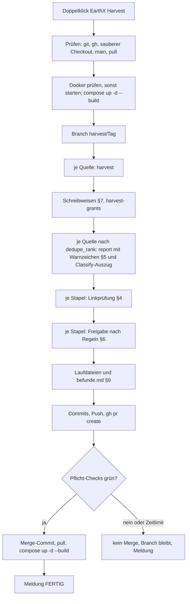

# M5-67 — Harvest ohne Handarbeit

**Status (24.11.2026):** Plan, wartet auf Ottos Antworten zu F1–F11 (§18). **Stufe B:** gebaut wird erst nach den Antworten.
**Aufgabe:** M5-67, Auftrag von Otto vom 24.11.2026.
**Entscheidung Otto (24.11.2026):** Die Lauf-Freigabe geht von Otto auf feste Regeln über (`adr/0033` F1, Option 2, nachgelagerte Stichprobe). Otto übernimmt Haftung und Verantwortung. Lizenzen werden nie automatisch neu eingestuft. Grundsatz: **Im Zweifel wartet ein Fund; nie wird eine unsichere Lizenzangabe veröffentlicht.** Ziel: Otto startet einen Lauf mit einem Doppelklick, sonst nichts. Was er bisher aus dem Terminal kopiert hat, steht danach im Repo.
**Grundlagen:** `adr/0033` (§5–§11 mit den Nachträgen vom 23.11. und 24.11.), `plans/m5/m5-20-freigabe-geernteter-eintraege.md` (§10, §12, §13a–§13h, §14, §16), `adr/0002` (keine Abrufe realer Quellen aus der Sitzung, Tests ohne Netz), `adr/0025` §6.5 (P1), `scripts/harvest-report.ps1`, Entscheidungslog bis 24.11.2026, `projektuebersicht.md` Prinzipien 12, 15, KLAERUNGEN B8, B11.
**Betroffen:** `scripts/` (neu `harvest-cycle.ps1`), `backend/earthx/discovery/` (neue Schritte), `backend/earthx/catalog/approvals.py` und `licences.py`, `backend/catalog/` (neue Daten-Dateien), `docker-compose.yml` (Dienste im Profil `harvest`), `docs/harvest/` (neu), README. **Nicht:** `.github/`, `.claude/`, `CLAUDE.md`, `.importlinter`, `terms.yaml`, `geodata.yaml` (außer §12 nach F9), `blocked.yaml`.

Belegstufen wie in `adr/0025`: **P** am Quelltext gelesen (Stand `main` 7b8e8e8), **S** Vorwissen, **A** eigene Ableitung. Aus dieser Sitzung geht keine Anfrage an eine Quelle und keine an Ottos Datenbank.

---

## 1. Ziel und Grenzen

**Ziel:** Ein Doppelklick auf „EarthX Harvest“ erntet alle freigegebenen Quellen, bildet Bericht und Stapel, prüft die Stichprobe selbst, gibt nach festen Regeln frei, legt alle Ausgaben als Dateien in **einen** PR, wartet auf grüne Pflicht-Checks, merged und startet die Plattform neu. Am Ende steht im Fenster eine kurze Meldung. Was offen bleibt, steht in `docs/harvest/befunde.md`; eine spätere Session arbeitet es mit dem Satz „Arbeite die offenen Harvest-Befunde ab“ ab.

**Grenzen (fest):**

- Lizenzen stuft nur Otto ein (`terms.yaml`). Die Pipeline ordnet höchstens eine **neue Schreibweise** einer schon eingestuften Standardlizenz zu, nach den Kriterien in §7.
- Die Freigaben je Herausgeber schreibt weiter `harvest-grants` aus `grant-to-all.yaml` (Ottos Entscheidung vom 20.11.2026, `adr/0033` §6.2). Das ist Anwendung einer Entscheidung, keine Einstufung.
- Kein Abruf realer Quellen aus einer Session (`adr/0002`). Das Skript läuft nur bei Otto. Tests nutzen eine Transport-Attrappe am `Gateway` und eine `docker`-/`gh`-Attrappe.
- Kein self-hosted runner, keine Änderung an `.github/`, kein Zeitplan: Otto startet selbst.
- Ausgehende Requests nur über `gateway` (B8), auch die Linkprüfung.
- Lokale Ausgaben nur nach `..\earthx-ausgaben\`, nie ins Repo-Verzeichnis außerhalb des Commits.
- **Nicht Teil:** ein Klassifikator, der aus Ottos Entscheidungen lernt (§17, nur Ausblick); Kandidaten des vollen Wegs und `discovery propose` (M5-20 PR 2); eine Freigabe-Oberfläche (`adr/0033` A3).

## 2. Ausgangslage [P]

Heute (M5-20 §16) tippt Otto je Lauf rund 15 Befehle: `git switch main`, `git pull`, `docker compose build`, `docker compose up -d`, je Quelle `harvest`, `harvest-grants` auf einem eigenen Branch mit Commit, Push und PR, je Quelle `harvest-report.ps1 -Classify` und ohne `-Classify`, je Quelle `git push` und ein Draft-PR, Häkchen in der Freigabedatei, `decision`, Merge, wieder `pull`, `build`, `up -d`. Die Ausgaben von `-Classify` hat er aus dem Terminal kopiert; die Sitzungen sahen sie nur, wenn er sie an einen PR hängte.

Was schon da ist und bleibt:

| Teil | Stelle | Was er tut |
|---|---|---|
| Harvest | `discovery/harvest.py`, Dienst `harvest` | ein Lauf je Quelle; veraltete Extraktor-Version wird ohne Anfrage neu ausgewertet (`_reextract(outdated_only=True)`); `robots.txt` beachtet |
| Bericht | `discovery/report.py`, Dienst `harvest-report` | Stapel, Fingerabdruck, Stichprobe (15 zufällig, 15 gezielt), Freigabedatei `decision: pending`, `--classify` |
| Freigaben je Herausgeber | `discovery/grants.py`, Dienst `harvest-grants` | `grants/<quelle>.yaml` aus der Datenbank und `grant-to-all.yaml` |
| Veröffentlichen | `catalog/approvals.py`, `catalog-load` | `approved` und Fingerabdruck gleich → `published`; `excluded_rules`; `revoked_on`; ohne abgehakte Stichprobe Ladefehler (Prinzip 12) |
| Rücknahme | `blocked.yaml`, `revoked_on`, A23 | unverändert |
| Gateway für Quellen | `discovery/source_gateway.py` | Takt je Host aus `hosts.yaml` über Postgres, `robots.txt` |

## 3. Ablauf eines Laufs



Schritte des Skripts `scripts/harvest-cycle.ps1` (Windows PowerShell 5.1, nur ASCII im Quelltext wie `harvest-report.ps1`):

1. **Start:** Ordner `..\earthx-ausgaben\<Tag>-<Uhrzeit>\` anlegen, `Start-Transcript` dorthin; Sperrdatei gegen einen zweiten Start; Standby für die Dauer des Laufs verhindern (A4).
2. **Prüfen:** `git`, `gh` und `docker` vorhanden; `gh auth status` angemeldet; Checkout sauber (`git status --porcelain`), sonst Abbruch (F1); auf `main` wechseln, `git pull --ff-only`.
3. **Docker:** `docker info`; antwortet es nicht, Docker Desktop starten und bis zu 5 min warten. Dann `docker compose up -d --build` und warten, bis `catalog-load` fertig ist.
4. **Branch** `harvest/<Tag>` (am selben Tag `harvest/<Tag>-2` usw.).
5. **Ernten:** Images des Profils `harvest` leise bauen (`--progress quiet`, wie M5-20 §13e), dann je Quelle mit `enabled: true` ein Lauf `harvest <quelle>`. Scheitert eine Quelle (Host antwortet nicht, `robots`), ist das ein Befund dieser Quelle, kein Abbruch; ihr Bericht entfällt in diesem Lauf (A2).
6. **Lizenzen:** `harvest-spellings` schreibt neue Schreibweisen nach §7 in `backend/catalog/licenses/spellings.yaml`; `harvest-grants` für alle Quellen (neue Herausgeber bekommen `grant-to-all.yaml`). Danach die Images neu bauen, damit der Bericht beides kennt.
7. **Bericht** je Quelle in der Reihenfolge `dedupe_rank`, dann ID (FSDI zuerst, M5-20 §16): Stapel, Warnzeichen (§5), Stichprobe aus den Funden **ohne** Warnzeichen, Freigabedatei `pending`, Bericht `.md`, Classify-Auszug (A14).
8. **Linkprüfung** je neuer Freigabedatei (§4), Ergebnis je Eintrag der Stichprobe in die Datei.
9. **Freigabe nach Regeln** je Datei (§6): `decision`, `decided_on`, `decided_by: rules`, `ok` je Eintrag, `excluded_entries`.
10. **Laufdateien** (§9): `docs/harvest/laeufe/<Tag>/`, `docs/harvest/befunde.md` fortschreiben, PR-Text.
11. **Git:** kleine Commits (Freigaben je Herausgeber; Schreibweisen; Bericht und Freigabe je Quelle; Laufdateien und Befunde), `git push -u origin harvest/<Tag>`, `gh pr create` (kein Draft, Titel „Harvest run <Tag>“).
12. **Warten** auf die vier Pflicht-Checks „Backend — lint and tests“, „Frontend — lint, types and tests“, „Module boundaries (import-linter)“, „Compose topology“ (`gh pr checks --json name,bucket`, alle `pass`), höchstens 90 min (A11).
13. **Merge** mit Merge-Commit (`gh pr merge --merge --delete-branch`), `git switch main`, `git pull --ff-only`, `docker compose up -d --build`; `catalog-load` veröffentlicht die freigegebenen Stapel.
14. **Ende:** eine Zeile `FERTIG: …` (Quellen, veröffentlicht, wartend, offene Befunde) oder `FEHLER in Schritt …` (§10); `Read-Host` hält das Fenster offen.

Ein Lauf ohne neuen Stapel und ohne neue Befunde erzeugt keinen PR (`adr/0025` K5); die Meldung sagt das.

## 4. Linkprüfung der Stichprobe (Punkt 2)

**Was geprüft wird**, je Eintrag der Stichprobe (30 je Stapel, `adr/0033` N2), über `gateway` mit `open_source_gateway`:

| Prüfung | Bestanden, wenn | Sonst |
|---|---|---|
| Link antwortet | `GET` auf den Link „Source“ ergibt `200` (Weiterleitungen auf demselben Host oder von `http` auf `https` gefolgt), Medientyp HTML; gelesen werden höchstens 1 MiB | `404`/`410` → **Fehler**; Timeout, `429`, `5xx` → einmal am Ende des Schritts wiederholt, dann **nicht prüfbar** |
| Titel steht auf der Seite | der Titel, normalisiert wie die Suche (Kleinschreibung, ohne Akzente, jede Folge anderer Zeichen ein Leerzeichen), steht im normalisierten Text der Seite (Text, `<title>`, `og:title`); bei langen Titeln genügen 80 % der Wörter mit mindestens 4 Zeichen | Seite mit Text: **Fehler**; Seite mit weniger als 200 Zeichen Text (Inhalt per Skript): **nicht prüfbar** |
| Host bekannt | Host des Links ist der Host der Quelle, steht in `hosts.yaml` oder bei einem schon veröffentlichten Eintrag derselben Quelle | siehe F3 |
| Kein fremder Host | eine Weiterleitung bleibt auf dem Host (Prinzip 15) | **Fehler** |
| `robots.txt` | erlaubt den Pfad | **nicht prüfbar** (kein Fehler, kein Abruf) |

- **Takt:** Hosts aus `hosts.yaml` mit ihren Grenzen; fremde Hosts 1 Verbindung, 1 s Abstand, höchstens 50 neue Hosts je Lauf (M5-20 A6). Der Zeiger je Host liegt in Postgres (M5-37), also gilt der Takt auch zusammen mit dem Harvest.
- **Lizenzhinweis auf der Seite:** nur zur Information (steht Name oder Adresse der Lizenz im Text: ja/nein). Viele Seiten nennen die Lizenz nicht; kein Fehler [A].
- **Ergebnis je Eintrag** in der Freigabedatei: `check: {status, title_found, host_known, licence_seen, result}` mit `result` aus `ok`, `failed`, `unchecked` und einem kurzen Grund. Im Bericht `.md` steht dieselbe Zeile neben dem Eintrag.
- **Neue Hosts außerhalb der Stichprobe** (F3, Empfehlung): je neuem Host im Stapel wird zusätzlich ein Eintrag geprüft; erst ein bestandener Eintrag macht den Host bekannt.
- Die Adresse steht in der Datei (öffentliche Metadaten), nie im Log (M5-20 §10).

## 5. Warnzeichen am Fund

Rein aus den Metadaten, ohne Anfrage, im Bericht über **alle** Funde des Stapels. Ein Fund mit Warnzeichen kommt nicht in die Stichprobe, wird nicht veröffentlicht (`excluded_entries`, §6) und steht in der Befundliste. Die Wörter liegen als Daten in `backend/catalog/flags.yaml` (wie `geodata.yaml`), nicht im Code.

| Code | Warnzeichen | Beispiel (24.11.) |
|---|---|---|
| W1 | Titel enthält einen Begriff ohne Geodaten (`not_geo_terms`, `software_terms` aus `geodata.yaml`) oder ein Wort auf `*statistik`, `*statistiken`, obwohl die Regel R-G den Fund hält | „Bibliothekenstatistik …“, „Aktuelle Lage … zum Corona-Virus“ |
| W2 | Herausgeber steht in `not_geo_publishers` oder `statistics_publishers`, der Fund wird trotzdem gehalten | Identitas AG „Katzen – Verteilung pro Gemeinde“ |
| W3 | Link „Source“ ist eine allgemeine Anbieterseite: letzter Pfadteil `home`, `index`, `start`, `startseite` (mit oder ohne Endung) oder höchstens ein Pfadteil (Sprachteil zählt nicht, wie §13h) | — |
| W4 | Kategorie unplausibel: `optical`, `radar` oder `elevation`, aber weder Raster noch Dienst unter den Distributionen | Gemeindefinanzen „Auszahlungen …“ unter „Optical imagery“ |
| W5 | Titel nennt eine Kopie oder einen Test: `kopie`, `copy`, `test`, `testdaten`, `dummy`, `draft`, `entwurf` als ganzes Wort | „[BfTMAP] KOPIE MItarbeiter als Dienst“ |
| W6 | Mail-Adresse oder Telefonnummer in Titel oder Beschreibung (keine Person im Eintrag, `adr/0033` §5) | — |
| W7 | Titel kürzer als 4 Zeichen oder ein Dateiname (endet auf `.csv`, `.zip`, `.shp`, `.xlsx`, `.pdf` …) | — |

- **Fehlalarm aufheben:** Liste `cleared` in `flags.yaml` mit `dataset_id`, Code und Datum; Otto (oder eine Session auf seinen Auftrag, per PR) trägt ein, der nächste Lauf nimmt den Fund wieder auf.
- Ein Fund mit Warnzeichen bleibt `in_review` und kommt mit jedem Lauf wieder in den Stapel, solange das Warnzeichen besteht; die Befundliste führt ihn einmal, nicht je Lauf.

## 6. Freigabe nach Regeln (Punkt 3)

**Ein Stapel wird `approved`, wenn alles gilt:**

1. **Lizenzen:** Jeder Eintrag des Stapels hat eine Regel aus `terms.yaml` (bzw. einer Schreibweise nach §7) und `grants/`; das gilt schon heute, sonst wartet er (`needs_rule`). Einstufungen kommen nur aus `terms.yaml` auf `main`, die der Lauf nie ändert.
2. **Linkprüfung:** höchstens **1 Fehler** in der Stichprobe (F2); höchstens ein Drittel **nicht prüfbar**; bei weniger als 10 prüfbaren Einträgen **kein** Fehler.
3. **Warnzeichen:** Funde mit Warnzeichen sind vorher herausgenommen (§5); ein Stapel, in dem nach dem Herausnehmen nichts bleibt, wird nicht freigegeben.
4. **Größe:** höchstens 5 000 Einträge und höchstens 25 % der schon veröffentlichten Einträge der Quelle, mindestens aber 200 (F6). Ein Sprung darüber deutet auf einen Fehler der Pipeline (z. B. eine kaputte Regel R-G) und wartet auf Otto.
5. **Lauf ohne Fehler:** der Bericht hat keinen Fund als „fehlerhaft“ gezählt (M5-20 A22), oder höchstens 1 %.

**Wirkung:**

- **Erfüllt:** `decision: approved`, `decided_on: <Tag>`, `decided_by: rules`; je Eintrag der Stichprobe `ok: true` bei `result: ok`, sonst `ok: false`; `excluded_entries` = Funde mit Warnzeichen plus Einträge der Stichprobe mit `failed`. `catalog-load` veröffentlicht den Rest nach dem Merge.
- **Nicht erfüllt:** `decision: pending`, `decided_by: null`; die Datei wird trotzdem gemergt (nichts wird sichtbar, `adr/0033` §8.4), der Grund steht in der Befundliste. Otto kann sie später von Hand freigeben (wie bisher: Häkchen, `decision`, Merge), oder der nächste Lauf übernimmt die Funde in seinen Stapel (`adr/0033` §8.3, Takt).
- **Nie automatisch:** `rejected`, `excluded_rules`, `revoked_on`. Das bleiben Ottos Werkzeuge.

**Änderungen an der Freigabedatei** (`catalog/approvals.py`): neue Felder `decided_by` (`rules`, `otto`, `null`), `excluded_entries` (Liste von IDs), je Eintrag der Stichprobe `check`. Prüfung beim Laden: `decided_by: rules` nur mit `check` an jedem Eintrag der Stichprobe; `excluded_entries` nur IDs des Stapels (gegen die Datenbank in `publish`). Alte Dateien ohne die Felder bleiben gültig (`decided_by` fehlt = von Hand). `publish` überspringt `excluded_entries`; sie bleiben `in_review`.

**Begründung der Schwelle [A]:** Ottos Stichproben vom 21.–24.11. hatten 0 bis 3 Fehler in 30, alle inhaltlich (Nicht-Geodaten), keiner am Link; die werden jetzt als Warnzeichen vorher herausgenommen. Ein Linkfehler, der übrig bleibt, ist selten und bei einem Fehler in 30 liegt der Fehleranteil mit 95 % Sicherheit unter rund 15 %, bei null unter rund 10 % („rule of three“, `adr/0033` §8.2 [S]). Strenger als 1 heißt: ein einziger toter Link beim Anbieter hält den ganzen Stapel auf.

## 7. Neue Schreibweisen einer eingestuften Lizenz

**Standardlizenz:** ein Eintrag in `terms.yaml` der Klassen K1–K5 mit einer SPDX-Kennung aus der SPDX-Liste (z. B. `CC-BY-4.0`, `CC0-1.0`, `DL-DE-BY-2.0`, `DL-DE-ZERO-2.0`, `ODbL-1.0`) oder mit einer festen Adresse des Lizenzgebers (die Nutzungsbedingungen von opendata.swiss). Nicht: amtliches Werk (`de-official-work`), K6, K7, eigene Lizenzen eines Herausgebers (`lba-free-use`).

**Eindeutig zuordenbar** ist eine Angabe, die bei wartenden Funden (`unknown_licence`) steht, nur nach einer dieser Regeln und nur, wenn sie zu **genau einer** Standardlizenz führt:

| Regel | Angabe | Gleich, wenn |
|---|---|---|
| S1 Adresse | eine URL | nach Normalisierung gleich einer Adresse in `matches` dieser Lizenz: `http`/`https`, `www.`, Groß-/Kleinschreibung des Hosts, `/` am Ende, Anhänge `/legalcode`, `/deed.<sprache>`, `.html`, `/index.html`, Sprachteil der Adresse |
| S2 Kennung | ein kurzer Text ohne Leerzeichen-Sätze | gleich der SPDX-Kennung oder einer Kurzform aus dem Vokabular `dcat-ap.de/def/licenses/` (z. B. `dl-by-de/2.0`), ohne Unterschied von Groß-/Kleinschreibung, `-`, `_`, Leerzeichen und `.`; **mit** Versionsnummer |
| S3 Schreibung | ein Freitext | gleich einer Angabe in `matches` dieser Lizenz nach Angleichen von Leerraum, Anführungszeichen, Gedankenstrichen und Groß-/Kleinschreibung |

**Nie zugeordnet:** eine Angabe ohne Versionsnummer; eine Angabe, die zwei Lizenzen nennt oder zu zwei führt; ein Freitext mit Zusätzen (Haftungsausschluss, Quellenvermerk), der nicht nach S3 gleich ist; NC, ND oder SA, wo die Lizenz es nicht hat (und umgekehrt); Feeds, Seiten und Hinweistexte (§13b). Diese Angaben warten und stehen in `lizenzangaben.md` und der Befundliste, mit Zahl und den häufigsten Herausgebern, damit Otto sie einstuft oder als Schreibweise einträgt.

**Ablage:** eigene Datei `backend/catalog/licenses/spellings.yaml`, geschrieben nur von `harvest-spellings`: je Zeile `license_ref`, die Angabe wörtlich, Regel S1–S3, `added_on`. `licences.py` lädt sie zusätzlich zu `matches`; jede Angabe gehört weiter zu höchstens einer Lizenz (Ladefehler sonst). `terms.yaml` bleibt Ottos Datei. Eine Zeile löschen nimmt die Zuordnung zurück (A23: sofort unsichtbar). Einträge, die erst durch eine neue Schreibweise eine Regel bekommen, sind in der Stichprobe gezielt dabei (`why: new_spelling`, vor `new_rule`).

## 8. Rücknahme und nachgelagerte Stichprobe (Punkt 4)

- **Rücknahme wie bisher:** `blocked.yaml` (Eintrag, Herausgeber, Host, Quelle; Grabstein) und `revoked_on` in einer Freigabedatei (der ganze Lauf). Neu dazu `cleared` in `flags.yaml` (§5) und das Löschen einer Zeile in `spellings.yaml` (§7). Alles sind Dateien, die Otto am Handy im Editor von GitHub ändern kann; der nächste Lauf holt sie mit `git pull` und `catalog-load` wendet sie an.
- **Im Bericht des Laufs** (`docs/harvest/laeufe/<Tag>/README.md` und PR-Text) ein Abschnitt **„Seit dem letzten Lauf automatisch veröffentlicht“**: je Quelle die Zahl der Einträge, die mit `decided_by: rules` sichtbar wurden, und eine Stichprobe von 10 zum Nachsehen (Titel, Link, Lizenzregel, Herausgeber; gezogen mit dem Fingerabdruck als Startwert). Darunter je Freigabedatei die Zeile, die den Lauf zurücknimmt (`revoked_on: <Tag>` in `<Datei>`).

## 9. Ausgaben im Repo (Punkt 4b)

**Je Lauf ein Ordner** `docs/harvest/laeufe/<Tag>/` (am selben Tag `<Tag>-2`), im PR des Laufs:

| Datei | Inhalt |
|---|---|
| `README.md` | Kopf (Tag, Quellen, Dauer, Ergebnis), Zahlen je Quelle (Anfragen, Funde, Ergebnis nach Zustand, Warten nach Grund), Entscheidung je Stapel mit Begründung nach §6, „Seit dem letzten Lauf automatisch veröffentlicht“ (§8), Verweise auf die übrigen Dateien und die Freigabedateien |
| `<quelle>-classify.md` | Auszug aus `--classify`: Ergebnis, Warten, Ausdehnung, Ortstexte ohne Treffer (30), Nicht-Geodaten je Herausgeber, Schnittstellen-Links, Dubletten mit Beispielen, Lizenzangaben (die 20 häufigsten wartenden) |
| `warnzeichen.md` | Funde mit Warnzeichen je Code und Quelle: Zahl, bis zu 10 Beispiele mit Titel, Link, Herausgeber, ausschlaggebendem Wort und den Signalen, die R-G und die Kategorie entschieden haben |
| `lizenzangaben.md` | neue Angaben: automatisch zugeordnet (Regel, Lizenz, Zahl) und wartend (Zahl, häufigste Herausgeber) |
| `fehler.log` | Fehler und Warnungen des Laufs, bereinigt; „keine“, wenn leer |

Die Stichprobe mit dem Ergebnis der Linkprüfung steht im Bericht `.md` neben der Freigabedatei (`backend/catalog/approvals/`), wie bisher.

**Bereinigung** vor dem Schreiben (eine Funktion, mit Tests): keine AOI (der Lauf kennt keine); keine Hashes (kein SHA-256, kein Inhalts-Hash; der Fingerabdruck steht nur in der Freigabedatei, wie bisher); in Adressen fallen Abfrageparameter mit Signatur- oder Schlüsselnamen weg (`signature`, `sig`, `token`, `key`, `apikey`, `access_token`, `expires`, `X-Amz-*`, `X-Goog-*`); keine Umgebungsvariablen, keine Pfade außerhalb des Repos, keine Personen (`adr/0033` §5). Was `docker` und `git` vollständig ausgeben, bleibt im Protokoll unter `..\earthx-ausgaben\`.

**`docs/harvest/befunde.md`** (die erste Fassung liegt in diesem PR):

- **Kopf:** wofür die Datei da ist und was eine Session mit „Arbeite die offenen Harvest-Befunde ab“ tut: diese Datei und den letzten Laufordner lesen; Regeldaten (`geodata.yaml`, `flags.yaml`, `place_names.yaml`, Code) per Draft-PR ändern; nie eine Lizenz einstufen; `blocked.yaml` und `revoked_on` nur vorschlagen.
- **Offen, von Hand:** Befunde von Otto oder Sessions mit Kennung `H-<Tag>-<nn>`, Datum, Quelle, Beschreibung, Beispielen, Stand.
- **Offen, aus den Läufen:** der Lauf schreibt diesen Abschnitt neu: je Befund eine Kennung aus Art, Quelle und Schlüssel (z. B. `W1 opendata-swiss <dataset_id>`, `LIZENZ govdata <Angabe gekürzt>`, `STAPEL govdata pending: Linkprüfung 3 Fehler`, `QUELLE data-gv-at nicht erreichbar`), erstes und letztes Datum, Zahl, bis zu 3 Beispiele, Verweis auf den Laufordner.
- **Erledigt:** abgehakt (`- [x]`) mit Datum; ein Lauf hakt einen Befund aus den Läufen ab, der nicht mehr auftritt. Befunde von Hand hakt die Session ab, die sie behebt.

## 10. Unbeaufsichtigt: Fehlerfälle (Punkt 4a)

| Schritt | Fall | Verhalten | Meldung im Fenster |
|---|---|---|---|
| 2 | `gh` fehlt oder nicht angemeldet | Abbruch, nichts geändert | „gh fehlt bzw. ist nicht angemeldet: siehe Einrichtung im Plan M5-67 §11.“ |
| 2 | Checkout nicht sauber | Abbruch (F1) | „Im Checkout sind ungesicherte Änderungen. Erst committen oder verwerfen.“ |
| 2 | `git pull` nicht vorspulbar | Abbruch | „main lässt sich nicht aktualisieren.“ |
| 3 | Docker startet nicht in 5 min | Abbruch | „Docker antwortet nicht. Docker Desktop öffnen und neu starten.“ |
| 5 | eine Quelle scheitert | weiter mit den übrigen; Befund `QUELLE` | in der Schlusszeile gezählt |
| 6, 7 | Bericht, Schreibweisen oder Freigaben scheitern | Laufdateien mit `fehler.log` committen, pushen, **Draft-PR**, kein Merge (F10) | „FEHLER im Bericht von <quelle>. Branch harvest/<Tag>, PR <Nummer>.“ |
| 8 | Linkprüfung scheitert als Ganzes | Stapel bleibt `pending`, weiter | in der Schlusszeile gezählt |
| 11 | Push oder PR scheitert | Abbruch, Branch bleibt lokal | „Push gescheitert, Branch harvest/<Tag> liegt lokal.“ |
| 12 | ein Pflicht-Check rot oder 90 min um | kein Merge, PR bleibt offen; Befund | „Checks nicht grün: <Name>. PR <Nummer> bleibt offen, nichts gemergt.“ |
| 13 | Merge abgelehnt (Branch-Schutz) | kein Merge | „Merge abgelehnt: <Grund von gh>. PR <Nummer> bleibt offen.“ |
| 13 | `compose up` nach dem Merge scheitert | gemergt, aber nicht veröffentlicht; Befund | „Gemergt, aber die Plattform startet nicht. Details: <Pfad>.“ |

Bei jedem Fehler: nichts gemergt, Branch bleibt stehen, Sperrdatei entfernt, Protokoll unter `..\earthx-ausgaben\<Lauf>\`. Ein offener PR eines früheren Laufs hält einen neuen Lauf nicht auf; er steht in der Befundliste (A10). Der neue Stapel übernimmt die Funde des alten (`adr/0033` §8.3).

## 11. Einmalige Einrichtung (Windows PowerShell 5.1, kein lokales Python)

Voraussetzung wie bisher: Git, Docker Desktop, der Checkout mit `.env`. Alles Python läuft in `docker compose`.

1. `gh` installieren (in PowerShell):

   ```powershell
   winget install --id GitHub.cli -e
   ```

   Danach ein neues PowerShell-Fenster öffnen.
2. Anmelden und `git` an `gh` binden (Browser, GitHub.com, HTTPS):

   ```powershell
   gh auth login
   gh auth setup-git
   ```

3. Im Checkout die Verknüpfung anlegen:

   ```powershell
   powershell -NoProfile -ExecutionPolicy Bypass -File .\scripts\harvest-cycle.ps1 -Install
   ```

   `-Install` prüft `git`, `gh` (Anmeldung), `docker` und `.env`, legt den Ordner `..\earthx-ausgaben\` und auf dem Desktop „EarthX Harvest“ an (Ziel: `powershell.exe -NoProfile -ExecutionPolicy Bypass -File <Checkout>\scripts\harvest-cycle.ps1`, Arbeitsordner der Checkout) und sagt, was fehlt.
4. Einmal prüfen, ob `gh` mergen darf: Ist für `main` eine Review-Pflicht eingestellt, lehnt GitHub den Merge des Skripts ab (§10). Dann Branch-Schutz anpassen oder den PR von Hand mergen.

Danach: Doppelklick. Der Lauf dauert je nach Quellen und CI rund 30–90 min [A]; der Rechner darf in der Zeit nicht ausgeschaltet werden.

## 12. Befunde aus der Freigabe am 24.11. (Punkt 5)

Alle sechs stehen als erste Einträge in `docs/harvest/befunde.md` (`H-2026-11-24-01` bis `-06`). Ursachen aus Code und Regeldaten abgeleitet [A]; die Sitzung hat weder die Datenbank noch die Funde.

| Nr. | Befund | Vermutete Ursache [A] | Vorschlag |
|---|---|---|---|
| 01 | „Betriebsstätte(n)“ zu breit; die Steuerstatistik von Destatis wurde gehalten | `*betriebsstätte(n)` und `*betriebsstaette(n)` sind Geo-Begriffe (§13h); ein Geo-Begriff hält auch Funde von Statistikämtern | **mit dieser Aufgabe:** die vier Begriffe aus `geo_terms` streichen; `prtr` bleibt, damit hält `PRTR_Betriebsstaetten_RLP` weiter (normalisiert „prtr betriebsstaetten rlp“, „prtr“ als ganzes Wort). Test mit beiden Titeln |
| 02 | Fehltreffer „Gewerbesteuer: Steuerpflichtige … Kreise … (ab 2010)“ (Statistik Sachsen), „Aktuelle Lage … Aachen zum Corona-Virus“ | Gewerbesteuer: wahrscheinlich ebenfalls „Betriebsstätten“ im Titel oder in den Schlagworten (das Statistikamt hebt schwache Signale schon auf); Corona: „corona“ ist Nicht-Geo-Begriff, also hält ein Geo-Signal, vermutlich die Ausdehnung (Stadt Aachen, schwach) | Gewerbesteuer prüft der erste Lauf nach 01 (Classify-Auszug); Corona fängt W1 vor der Veröffentlichung. Beide sind schon veröffentlicht: hält R-G sie danach nicht mehr, setzt der Bericht die Zeile auf `not_geodata` (`listing_store`, im Bau mit Test belegt); sonst Vorschlag `blocked.yaml` (Grund `not_geodata`) an Otto |
| 03 | „Bibliothekenstatistik“ (Thurgau) nicht als Nicht-Geodaten erkannt | Nicht-Geo-Begriff ist `bibliotheksstatistik` (mit „s“); „statisti*“ trifft nur Wortanfänge | **mit dieser Aufgabe:** `bibliothekenstatistik` und `*bibliothekenstatistik` in `not_geo_terms`; W1 fängt künftig jedes Wort auf `*statistik` als Warnzeichen, ohne die Regel R-G zu verbreitern |
| 04 | Identitas „Katzen – Verteilung pro Gemeinde“, „Ziegen – Verteilung pro Kanton“ nicht verborgen | Herausgeber ist Nicht-Geo-Signal, ein Geo-Signal hält sie; vermutlich schwach (Ausdehnung) | **mit dieser Aufgabe:** schwache Geo-Signale halten auch keine Funde von Herausgebern in `not_geo_publishers` (wie bei Statistikämtern, §13g). Hält ein starkes Signal, fängt W2 sie vor der Veröffentlichung, und der Classify-Auszug zeigt das Signal |
| 05 | LfULG (govdata) weiter 228 `unknown_licence`; `dl-by-de/2.0` war nicht die Ursache | unbekannt; die wartende Angabe steht nur in Ottos Datenbank | **Folgeaufgabe:** der erste Lauf schreibt die Angaben in `lizenzangaben.md`; ist es eine Schreibweise nach §7, ordnet der Lauf sie selbst zu, sonst stuft Otto ein |
| 06 | Gemeindefinanzen („Auszahlungen …“, „Einzahlungen …“) und „[BfTMAP] KOPIE MItarbeiter als Dienst“ unter „Optical imagery“ | Kategorie aus INSPIRE-Thema `oi`, EU-Thema oder einem Schlagwort wie `DOP`; welches, zeigt nur die Datenbank | **Folgeaufgabe** mit den Signalen aus `warnzeichen.md` (W4, W5 zeigen die Belege der Kategorie); bis dahin hält W4/W5 neue solche Funde draußen |

**Empfehlung (F9):** 01, 03, 04 mit dieser Aufgabe (je eine Zeile Regeldaten bzw. eine Bedingung in `geodata.py`, mit Tests); 02 mit dem ersten Lauf prüfen; 05 und 06 als Folgeaufgabe „Arbeite die offenen Harvest-Befunde ab“, sobald der erste Lauf die Daten ins Repo gelegt hat. Jede Änderung an R-G prüft Otto wie beschlossen über den Classify-Auszug, jetzt im Laufordner statt im Terminal.

## 13. Änderungen im Code

| Stelle | Neu oder geändert |
|---|---|
| `scripts/harvest-cycle.ps1` | Ablauf §3, `-Install`, Fehlerfälle §10; ruft nur `git`, `gh`, `docker` |
| `backend/earthx/discovery/cycle.py` (neu) | Unterbefehle `spellings`, `verify`, `decide`, `summary` für den Dienst `harvest-cycle`; Linkprüfung über `open_source_gateway`; Regeln §6; Laufdateien und `befunde.md` §9; Bereinigung |
| `backend/earthx/discovery/flags.py` (neu) | Warnzeichen §5, rein; liest `flags.yaml` |
| `backend/earthx/discovery/report.py` | Warnzeichen vor der Stichprobe; `excluded_entries` vorbelegt; `why: new_spelling`; Classify-Auszug als Datei in einem Durchgang mit dem Bericht (A14) |
| `backend/earthx/catalog/approvals.py` | Felder `decided_by`, `excluded_entries`, `check`; Prüfung und `publish` §6 |
| `backend/earthx/catalog/licences.py` | lädt `spellings.yaml` zusätzlich |
| `backend/earthx/discovery/geodata.py`, `backend/catalog/geodata.yaml` | §12 nach F9 |
| `backend/catalog/flags.yaml`, `licenses/spellings.yaml` (neu) | Daten |
| `docker-compose.yml` | Dienst `harvest-cycle` (Profil `harvest`, eingebunden `approvals/`, `licenses/`, `docs/harvest/`) |
| `README.md`, `backend/catalog/approvals/README.md` | Doppelklick statt Befehlsliste; die Befehle bleiben für Hand-Läufe |

Importregeln unverändert: `discovery` importiert nur `adapters`, `catalog` und `gateway` [P, `.importlinter`].

## 14. Tests

Ohne Netz, synthetische Fixtures, Transport-Attrappe am `Gateway` (wie M5-19, M5-20):

- **Linkprüfung:** `200` mit Titel; Titel fehlt bei Seite mit Text → Fehler; Skriptseite → nicht prüfbar; `404`, `410`; `429`, `5xx`, Timeout → einmal wiederholt, dann nicht prüfbar; Weiterleitung gleicher Host, `http`→`https`, fremder Host; `robots.txt` verbietet → kein Abruf; nicht HTML; mehr als 1 MiB; Takt und Grenze 50 neue Hosts; neuer Host wird nach bestandener Prüfung bekannt; zweckfremd: Link auf private Adresse (Gateway lehnt ab), leerer Titel, Titel nur aus Satzzeichen.
- **Warnzeichen:** jedes W einzeln und nicht bei ähnlichen Wörtern („Alarm“, „Testament“ trifft `test` nicht als ganzes Wort); `cleared` hebt auf; Fund mit Warnzeichen nie in der Stichprobe.
- **Freigabe nach Regeln:** jede Bedingung aus §6 einzeln an der Grenze; `pending` statt `rejected`; `excluded_entries` wird nicht veröffentlicht und bleibt `in_review`; alte Dateien ohne neue Felder laden; `decided_by: rules` ohne `check` ist Ladefehler; Fingerabdruck anders → nichts.
- **Schreibweisen:** S1–S3 je mit Treffer und Fast-Treffer (ohne Version, NC statt BY, zwei Lizenzen, Zusatztext, K6-Ziel, amtliches Werk); doppelte Zuordnung → Ladefehler; Zeile löschen → Einträge unsichtbar (A23).
- **Befundliste:** neuer Befund, bleibender Befund (ein Eintrag, Datum fortgeschrieben), weggefallener Befund abgehakt; Abschnitt von Hand bleibt unverändert; Bereinigung (Signaturparameter, SHA-256, Umgebungswerte).
- **§12:** Destatis-Steuerstatistik verborgen, `PRTR_Betriebsstaetten_RLP` gehalten; „Bibliothekenstatistik“ verborgen; Identitas mit nur schwachem Signal verborgen; veröffentlichte Zeile wird `not_geodata`.
- **Skript** (als Text, wie `test_harvest_report_script.py`, und mit `docker`-/`gh`-/`git`-Attrappen, soweit ohne PowerShell möglich): nur ASCII; Abbruch bei schmutzigem Checkout; `git push` und `gh pr merge` nur nach den Prüfungen; `--merge` (kein Squash, kein Rebase); kein `--admin`, kein `--force`; Ausgaben nur nach `..\earthx-ausgaben\` oder in die Pfade des Commits; nie `.github/`. Ist `pwsh` in der Sitzung nicht vorhanden, prüft der Test die Syntax nicht; das steht im PR.

## 15. Nachträge in Dokumenten

- **In diesem PR:** `adr/0033` (Kopf, §8.5 neu, §11, §16 F1 neu), Entscheidungslog (eine Zeile am Ende), `docs/harvest/befunde.md` (erste Fassung).
- **Im Bau-PR:** README (Abschnitt „Geerntete Einträge freigeben“), `approvals/README.md`, M5-20 §16 (Verweis auf den Doppelklick), Nachtrag zu `adr/0025` §6.5 und M5-20 A13 („das Skript pusht nie“ gilt nicht für `harvest-cycle.ps1`, Otto 24.11.2026).

## 16. Risiken und Grenzen

- **Linkprüfung ist keine Inhaltsprüfung:** Sie findet tote Links und falsche Seiten, nicht falsche Lizenzen an richtigen Seiten. Das Recht kommt weiter aus Ottos Einstufung und den Regeln; die Pipeline-Fehler fangen Warnzeichen, Schwellen und die nachgelagerte Stichprobe.
- **Seiten mit Inhalt per Skript** (Portale, die erst im Browser rendern) machen den Titel unprüfbar. Ist das bei einer ganzen Quelle so, wartet jeder ihrer Stapel (mehr als ein Drittel nicht prüfbar). Der Probelauf (F7) zeigt es vor der ersten automatischen Freigabe.
- **Warnzeichen erzeugen Fehlalarme**, z. B. „Verkehrsstatistik mit Zählstellen“. Sie kosten nur Wartezeit; `cleared` hebt sie auf.
- **Repo wächst** je Lauf um die Laufdateien (geschätzt 50–150 KB [A]).
- **CI-Zeit:** Der PR berührt `backend/`, also läuft die volle Backend-Suite (rund 15–25 min [A]).
- **Haftung:** liegt nach Ottos Entscheidung bei Otto; das Skript handelt mit seinem `gh`-Zugang.
- **PR-Größe:** Der Bau liegt deutlich über dem Richtwert von 400 Zeilen (Schätzung mit Tests 1 800–2 400 [A]); Schnitt in F11.

## 17. Ausblick (nicht Teil dieser Aufgabe)

Ein Klassifikator, der aus Ottos Entscheidungen lernt (Häkchen der Stichproben, `cleared`, `blocked.yaml`, Änderungen an `geodata.yaml`), könnte Warnzeichen gewichten und Nicht-Geodaten besser erkennen. Die Daten dafür sammeln die Laufdateien ab jetzt. Eigene Aufgabe mit ADR, frühestens nach einigen Wochen automatischer Läufe.

## 18. Fragen an Otto

**F1 — Checkout für den Lauf?**
1. Dein Checkout; Abbruch, wenn er ungesicherte Änderungen hat; sonst Wechsel auf `main` (dein Branch bleibt) **(Empfehlung)**
2. Ein eigener Checkout `..\earthx-harvest\` nur für den Lauf (eigene `.env`, eigenes Compose-Projekt, also eine zweite Datenbank)
3. Wie 1, aber auch ungesicherte Änderungen mit `git stash` zur Seite legen

**F2 — Wie viele Linkfehler in der Stichprobe von 30 lassen einen Stapel noch zu (§6 Punkt 2)?**
1. Höchstens 1; unter 10 prüfbaren keiner; höchstens ein Drittel nicht prüfbar **(Empfehlung)**
2. Keiner
3. Höchstens 3 (10 %)

**F3 — Neuer Host im Stapel (§4)?**
1. Je neuem Host wird ein Eintrag geprüft (höchstens 50 Hosts je Lauf); bestanden macht den Host bekannt; Funde auf ungeprüften oder durchgefallenen neuen Hosts warten **(Empfehlung)**
2. Nur die Stichprobe zählt; ein neuer Host ohne Eintrag in der Stichprobe gilt als bekannt
3. Neue Hosts warten immer, bis du sie in `hosts.yaml` einträgst

**F4 — Warnzeichen (§5)?**
1. W1–W7 wie in §5, Wörter in `flags.yaml`, Fehlalarm über `cleared` **(Empfehlung)**
2. Nur W1, W2 und W5
3. W1–W7 und zusätzlich jeder Fund ohne Fußabdruck mit Ortsangabe nur aus dem Herausgeber

**F5 — Neue Schreibweisen einer eingestuften Lizenz (§7)?**
1. S1–S3 nach den Kriterien in §7, nur Standardlizenzen, eigene Datei `spellings.yaml` **(Empfehlung)**
2. Nur S1 (Adressen) und S2 (Kennungen); Freitexte immer von dir
3. Keine automatische Zuordnung; die Pipeline schlägt nur vor

**F6 — Obergrenze für eine automatische Freigabe (§6 Punkt 4)?**
1. Höchstens 5 000 Einträge und 25 % der schon veröffentlichten der Quelle (mindestens 200); darüber wartet der Stapel auf dich **(Empfehlung)**
2. Keine Obergrenze
3. Höchstens 1 000 Einträge

**F7 — Erster Lauf?**
1. Probelauf: alles wie geplant, aber jede Freigabedatei bleibt `pending` mit dem Ergebnis, das die Regeln ergeben hätten; du siehst im Repo, wie die Linkprüfung bei den Quellen greift; ab dem zweiten Lauf automatisch **(Empfehlung)**
2. Gleich automatisch

**F8 — Laufdateien im Repo (§9)?**
1. Je Lauf ein Ordner `docs/harvest/laeufe/<Tag>/`, alle bleiben **(Empfehlung)**
2. Nur der jeweils letzte Lauf (der Ordner wird überschrieben; ältere nur in der Git-Geschichte)
3. Neben die Freigabedateien in `backend/catalog/approvals/`

**F9 — Befunde vom 24.11. (§12)?**
1. 01, 03, 04 mit dieser Aufgabe; 02 mit dem ersten Lauf prüfen; 05, 06 als Folgeaufgabe aus der Befundliste **(Empfehlung)**
2. Alle sechs als Folgeaufgabe
3. Alle sechs mit dieser Aufgabe (05 und 06 dann ohne Daten, nur mit Vermutungen)

**F10 — Lauf, der nach dem Anlegen des Branches scheitert (§10)?**
1. Laufdateien mit `fehler.log` committen, pushen, Draft-PR öffnen, nicht mergen; Befund in der Liste **(Empfehlung)**
2. Nur lokal unter `..\earthx-ausgaben\` und im Fenster; Branch bleibt lokal

**F11 — Schnitt (höchstens zwei PRs)?**
1. PR 1 (dieser): Plan und Nachträge, danach die Backend-Bausteine (Freigabedatei, Warnzeichen, Schreibweisen, Linkprüfung, §12). PR 2: Skript, Freigabe nach Regeln, Laufdateien, Befundliste, README **(Empfehlung)**
2. PR 1 nur Plan und Nachträge; PR 2 der ganze Bau (rund 2 000 Zeilen)

## 19. Auslegungen (gelten, wenn Otto nicht widerspricht)

- **A1** Quellen: alle mit `enabled: true` in `backend/catalog/sources/`, Reihenfolge nach `dedupe_rank`, dann ID. Ein Lauf je Quelle wie bisher (CKAN: 400 Seiten, ein voller Durchgang über mehrere Läufe); `--full` und `--reextract` nur von Hand, weil der Harvest veraltete Extraktor-Versionen selbst neu auswertet [P].
- **A2** Scheitert der Harvest einer Quelle, entfällt ihr Bericht in diesem Lauf; die anderen laufen weiter.
- **A3** Zweiter Start während eines Laufs: Meldung „Ein Lauf läuft schon“, Ende.
- **A4** Standby wird für die Dauer des Laufs verhindert (`SetThreadExecutionState`); der Bildschirm darf aus.
- **A5** Im Protokoll unter `..\earthx-ausgaben\` steht die volle Ausgabe; ins Repo nur das Bereinigte (§9).
- **A6** `decided_by` nennt eine Rolle (`rules`, `otto`), keinen Namen.
- **A7** `excluded_entries` hält nur Einträge zurück, nie Regeln; `excluded_rules` bleibt Otto.
- **A8** Commit-Nachrichten und PR-Titel englisch, Laufdateien deutsch.
- **A9** `harvest-grants` läuft in jedem Lauf (Anwendung von `grant-to-all.yaml`).
- **A10** Offene PRs früherer Läufe bleiben offen und stehen in der Befundliste; der Lauf schließt keinen PR.
- **A11** Höchstens 90 min Warten auf die Checks; danach wie rot.
- **A12** Nach dem Merge wird der Branch gelöscht (`--delete-branch`); bei einem Fehler bleibt er.
- **A13** Das Skript schreibt nur `backend/catalog/approvals/`, `backend/catalog/licenses/grants/`, `backend/catalog/licenses/spellings.yaml` und `docs/harvest/`; es ändert nie `terms.yaml`, `geodata.yaml`, `flags.yaml`, `blocked.yaml`, `sources/` oder `.github/`.
- **A14** Der Classify-Auszug entsteht im selben Durchgang wie der Bericht, damit die Ableitung nur einmal läuft; `harvest-report.ps1 -Classify` bleibt für Hand-Läufe.
- **A15** Kein PR, wenn der Lauf weder einen neuen Stapel noch einen neuen oder erledigten Befund hat.
