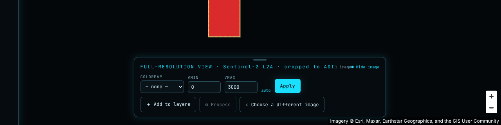
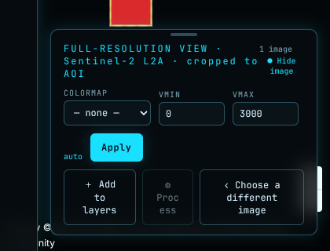
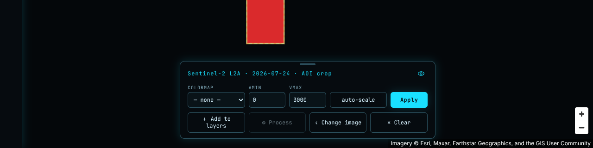
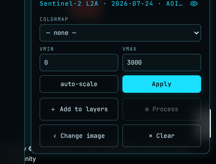
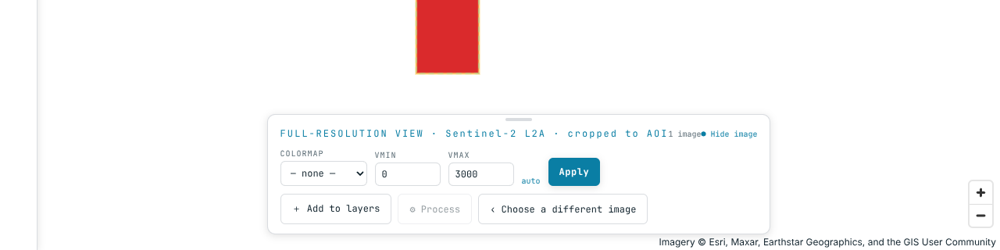
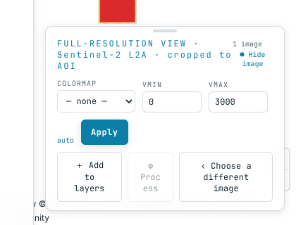
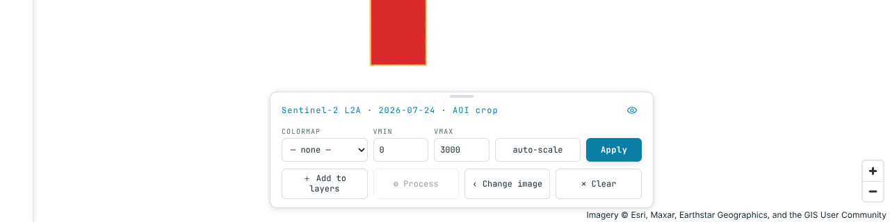
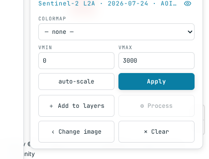
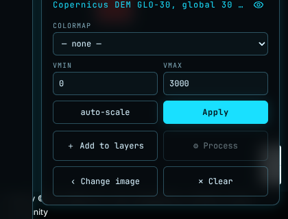
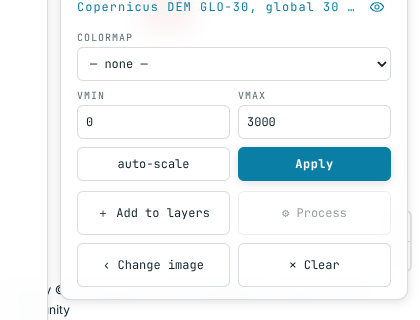

# UI-02 — Basemap-Auswahl und Projektion
 
**Stand:** 12.10.2026, beauftragt von Otto; ergänzt am 24.10.2026 (§3 Permalink); Plan mit Recherche am 27.10.2026 (§6), von Otto am 27.10.2026 freigegeben (§6.10).
**Meilenstein:** UI, direkt nach M4 (nach M4-20).
**Stufe B mit Recherche:** Plan mit Quellen im Draft-PR, Otto gibt frei, dann Code.
**Modell:** Opus (Effort hoch) für Plan und Recherche, Sonnet (Effort hoch) für die Umsetzung.
**Start:** Nach M4-20. Läuft nicht gleichzeitig mit UI-01, weil beide die Kartenschalter berühren.
**Startsatz:** „Führe Aufgabe UI-02 aus `docs/plans/vp3/ui-02-basemap-projektion.md` aus.“
 
## 1. Wünsche von Otto (12.10.2026)
 
1. Der Button „Mercator“ oben rechts entfällt. Ein Basemap-Menü ersetzt ihn.
2. **Basemaps:**
   - Satellitenbild
   - Straßenkarte
   - nur Umrisse (Küsten, Grenzen)
   - weitere Vorschläge willkommen
3. **Projektionen** im selben Menü:
   - Mercator
   - Globus
   - Equal Earth, falls möglich
Vorschläge für weitere Ebenen, im Plan zu bewerten:
- Schummerung aus dem eigenen Copernicus DEM
- Beschriftungen ein- und ausblendbar
- Gradnetz
- Sentinel-2-Kachelraster (MGRS) als Overlay
- der heutige Schalter „Light“ und gegebenenfalls „Dark“, eingegliedert ins Menü
## 2. Recherche mit Quellen (Pflicht vor jeder Empfehlung)
 
1. **Anbieter je Basemap.** Für jeden Anbieter:
   - **Lizenz:** Ist kommerzielle Nutzung erlaubt? Das Repo ist AGPL, die Plattform kann später kommerziell betrieben werden. Viele Satelliten-Basemaps sind nur nichtkommerziell nutzbar.
   - **Nutzungsregeln:** zum Beispiel die Tile Usage Policy von OSM, die keine starke Nutzung erlaubt.
   - **Attribution**
   - **API-Schlüssel:** Keine Secrets im Repo. Anbieter ohne Schlüssel bevorzugen. Braucht ein Anbieter einen Schlüssel, ist das eine Frage an Otto.
   - **Selbst hosten:** etwa PMTiles oder Protomaps, mit Aufwand und Speicherbedarf.
2. **Datenschutz.** Basemap-Kacheln lädt der Browser direkt bei Dritten. Die Regel „ausgehende Requests nur über `gateway`“ gilt für das Backend. Klären:
   - ob ein Hinweis für die Nutzer nötig ist,
   - ob ein Weg über die eigene Plattform sinnvoll wäre.
3. **Projektionen.**
   - Welche Projektionen kann die Kartenbibliothek des Frontends (Version im Lockfile)? Globus und Mercator wahrscheinlich ja.
   - Equal Earth: Geht das mit Kachelkarten überhaupt? Mit welchem Aufwand, etwa Wechsel der Bibliothek oder Reprojektion im Browser?
   - Was passiert mit den eigenen Ebenen (Kacheln aus dem Tiler, AOI-Zeichnung, Footprints, Coverage-Map) in jeder Projektion?
   - Am Code prüfen, nicht annehmen.
4. **Schummerung aus dem DEM.**
   - Geht das über den vorhandenen Tiler?
   - Wie steht es um die Regeln für `expression` und Algorithmen (`DefaultRender`, R5 aus M4-09)?
   - Was kostet es?
## 3. Im Plan mit Optionen und Empfehlung
 
- Auswahl der Basemaps und Anbieter, mit einer Tabelle zu Lizenz, Nutzungsregeln, Schlüssel und Attribution.
- Welche Projektionen jetzt kommen, welche später und welche nicht.
- Aufbau des Menüs (Englisch) und die Vorgabe beim ersten Start.
- Wird die Wahl des Nutzers im Browser gemerkt?
- **Permalink (aus M4-19e, 24.10.2026):** Der Permalink speichert heute keine Basemap, weil es nur eine gibt. Mit der Auswahl kommen Basemap und Projektion in den gespeicherten Zustand des Permalinks; ältere Permalinks ohne diese Felder öffnen mit der Vorgabe.
## 4. Grenzen
 
- Keine Secrets im Repo. Keine neue Abhängigkeit ohne Frage an Otto.
- Oberflächentexte nur auf Englisch.
- Attribution immer sichtbar, wie es die Lizenz verlangt.
- Backend nur, falls die Schummerung es braucht, und dann im Plan begründet.
- `CLAUDE.md`, `.github/`, `.claude/` und `CODEOWNERS` bleiben unverändert.
## 5. Abnahme
 
- Für jede Basemap und Projektion gibt es einen Test, dass die Auswahl greift und die Attribution stimmt.
- Die eigenen Ebenen bleiben in jeder angebotenen Projektion lagerichtig, belegt mit einem Test oder einer Prüfanleitung.
- Alle vier Pflicht-Checks der CI sind grün.
- Prüfanleitung für Otto (Browser).
- Log-Zeilen.
- Vor „fertig“ ist main geholt.

## 6. Plan (27.10.2026, von Otto am 27.10.2026 freigegeben)

**Freigabe (Otto, 27.10.2026):** Antworten auf alle zehn Fragen stehen in §6.10. Frage 1 bis 4, 7, 9 und 10 nach Option 1; abweichend: Der Knopf heißt „Basemap“ (nicht „Map“); Frage 5 (der Globus bleibt Globus, kein automatischer Wechsel zu Mercator), Frage 6 (Light/Dark bleibt ein eigener Knopf) und Frage 8 (ein Permalink überschreibt die gemerkte Wahl nicht). Die Änderungen sind in §6.0, §6.3, §6.5, §6.6, §6.8 und §6.9 eingearbeitet. Die Umsetzung beginnt mit UI-02a.

Stufe B: Bis zur Freigabe ist kein Produktivcode geändert. Grundlage ist `main` nach #209 (UI-01g gemergt, kein offener UI-PR). Belegstufen wie in `adr/0014`: [P] Code oder Primärquelle gelesen, [M] in der Sitzung gemessen bzw. mit einem Wegwerf-Test nachgestellt (nicht im Repo), [S] nur Zusammenfassung einer Websuche (Originalseite nicht abrufbar, vor einer Entscheidung gegenzuprüfen), [A] eigene Ableitung.

**Zur Quellenlage:** Das Netz der Cloud-Sitzung ließ nur `github.com` und `raw.githubusercontent.com` durch. Seiten von Esri, OSMF, CARTO, EOX, OpenFreeMap, Gerichten und Behörden waren nur als Suchtreffer erreichbar und tragen deshalb [S]. Lizenzfragen entscheidet Otto (CLAUDE.md); alles hier ist Vorschlag.

### 6.0 Kurzfassung

- **Menü:** Ein Knopf „Basemap“ oben rechts ersetzt „Mercator/Globe“. Er öffnet ein Menü mit drei Gruppen: Basemap, Overlays (ab UI-02b), Projection (§6.5). „Light/Dark“ bleibt ein eigener Knopf (Frage 6).
- **Basemaps jetzt:** Satellite (Esri World Imagery wie heute), Streets (OpenFreeMap Liberty), Grey (OpenFreeMap Positron), Outlines (Küsten und Grenzen aus denselben Vektorkacheln). Kein Schlüssel, keine neue Abhängigkeit (§6.2, §6.4).
- **Overlays jetzt:** Labels (ein/aus, auch über dem Satellitenbild) und Graticule (im Browser erzeugt). **Später:** Schummerung aus dem eigenen DEM (braucht Backend), Sentinel-2-Kachelraster (Lizenz und Datei ungeklärt).
- **Projektionen:** Mercator und Globus jetzt. **Equal Earth nicht:** MapLibre GL JS 5.24 kennt nur `mercator`, `globe` und `vertical-perspective` [P]. Es ginge nur mit einem Wechsel der Kartenbibliothek.
- **Befund Globus [M]:** Mit MapLibres eingebautem Globus liegen eigene Rasterkacheln und GeoJSON bei Zoom 8 bis 11,5 bis zu rund 20 px neben der Stelle, an die `map.project` sie rechnet. Geht der Globus schon bei Zoom 6–7 in Mercator über, liegt alles pixelgleich wie in Mercator. Entscheidung (Frage 5): Der Globus bleibt Globus, MapLibres Vorgabe ohne eigenen Übergang; Otto prüft die Abweichung auf einem echten Grafikprozessor mit der Prüfanleitung, zeigt sie sich dort auch, wird die Frage neu vorgelegt (§6.3).
- **Gemerkt** wird die Wahl im Browser (`localStorage`, wie heute Thema und Projektion). **Permalink:** Basemap und Projektion kommen in die gespeicherte Ansicht; das braucht eine kleine Änderung am Modell im Backend (§6.6).
- **Esri ohne Schlüssel** ist für einen kommerziellen Betrieb nicht belegbar zulässig [S]. Für die heutige, nicht kommerzielle Phase bleibt es; vor dem kommerziellen Start muss es ersetzt oder lizenziert werden (Frage 1; Vermerk für M6).
- **Attribution:** heute beim Start eingeklappt (V-7). Die OSMF-Richtlinie verlangt Sichtbarkeit ohne Interaktion [S]. Entscheidung: immer ausgeklappt (Frage 4).
- **Datenschutz:** Die Kacheln lädt der Browser bei Dritten; dabei gehen IP-Adresse und Kartenausschnitt dorthin. Entscheidung: jetzt Hinweis im Tooltip je Basemap, vor dem kommerziellen Start Selbst-Hosting der Vektorkacheln (Frage 9).
- **Schnitt:** drei PRs UI-02a bis UI-02c (§6.9). **Fragen an Otto:** 10, am 27.10.2026 beantwortet (§6.10).

### 6.1 Stand im Code [P]

- **Basiskarte:** `frontend/src/mapStyles.ts` baut einen einzigen Stil mit einer Rasterquelle `satellite` (Esri World Imagery, `server.arcgisonline.com`, ohne Schlüssel, `maxzoom: 19`, Attribution „Imagery © Esri, Maxar, Earthstar Geographics, and the GIS User Community“) über einer `background`-Ebene in der Themenfarbe `--map-bg`; dazu `sky` für den Globus.
- **Schalter:** `App.tsx` hat oben rechts „⤢ Zoom to selection“, „🌐 Globe/🗺 Mercator“ (`toggleProjection`) und „☀ Light/☾ Dark“ (`toggleTheme`). Beide Wahlen liegen in `store.ts` und über `preferences.ts` im `localStorage` (`earthx.projection`, `earthx.theme`). Tests: `AppTopBar.test.tsx` (Beschriftung nach dem Ziel des Klicks), `preferences.test.ts`, `mapStyles.test.ts`.
- **Projektion:** `MapView.tsx` ruft `map.setProjection({ type: 'mercator' | 'globe' })` in `style.load` und in einem Effekt auf den Store-Wert.
- **Stilwechsel:** Der Stil wird heute nie getauscht. `onStyleLoad` legt bei jedem `style.load` alle eigenen Quellen und Ebenen neu an (AOI, Coverage, Quicklooks, Mosaik, angeheftete Layer, Ergebnisse, Vorschau, Terra Draw).
- **Eigene Ebenen:** nur `raster` (Kacheln aus dem Tiler im Raster `WebMercatorQuad`, `api.ts`; Bild-Overlays als `image`-Quelle mit vier Ecken, `mapLayers.ts`), `fill`, `line` und `background`. Kein `symbol`, also brauchen die eigenen Ebenen heute keine Glyphen.
- **Zeichnen:** Terra Draw 1.32 mit `terra-draw-maplibre-gl-adapter` 1.4.1; der Adapter rechnet über `map.project`/`map.unproject` und folgt damit der Projektion der Karte.
- **Attribution:** `attributionControl: { compact: true }`, nach dem Erzeugen sofort eingeklappt (V-7, Otto 23.09.2026).
- **Permalink:** `permalink.ts` (`PermalinkView`: `center`, `zoom`, `range`), im Backend `api/processing_route.py::PermalinkView` mit `extra="forbid"` und `strict=True`. Ein unbekanntes Feld wird dort mit `422` abgewiesen.
- **Tiler:** `expression`, `algorithm` und `algorithm_params` werden auf jeder Route mit `400` abgewiesen (`api/tiler.py::_refuse_free_parameters`, M4-09 F3); Rechnen nur über registrierte Operatoren (`op=…`). Die Mosaikkachel (M4-17) nimmt 2 bis 64 Items ab Zoom 8.
- **Keine CSP** im Repo, die neue Kachel-Hosts sperren würde.

### 6.2 Recherche: Anbieter

| Anbieter | Typ | kommerziell | Regeln, Limits | Schlüssel | Attribution | Selbst hosten |
|---|---|---|---|---|---|---|
| Esri World Imagery, ohne Schlüssel (heute) | Raster | nicht belegt; ein Esri-Community-Beitrag sagt „nicht ohne Lizenz“ [S] | Export/Offline nicht vorgesehen [S] | offiziell Konto bei ArcGIS Location Platform nötig [S] | „Powered by Esri“ + Datenquellen; genauer Wortlaut nicht belegt [S] | nein |
| Esri über ArcGIS Location Platform | Raster/Vektor | ja, im Abo enthalten [S] | 2 Mio. Kacheln/Monat frei, dann 0,15 USD je 1000 [S] | ja (Frage an Otto) | wie oben | nein |
| EOX Sentinel-2 cloudless 2016 | Raster | ja, CC BY 4.0 [S] | Kachelserver laut EOX frei für nicht-kommerzielle Anwendungen [S] | nein | „Sentinel-2 cloudless – https://s2maps.eu by EOX IT Services GmbH (Contains modified Copernicus Sentinel data 2016)“ [S] | Originalkacheln ladbar, Größe unbekannt [S] |
| EOX Sentinel-2 cloudless 2018 und später | Raster | nein, CC BY-NC-SA 4.0; kommerziell nur mit EOX-Lizenz [S] | wie oben | nein | wie oben | – |
| OpenStreetMap `tile.openstreetmap.org` | Raster | nicht geregelt; Zugang jederzeit sperrbar, kein „heavy use“ [S] | User-Agent und Referer Pflicht, kein Vorabladen [S] | nein | „© OpenStreetMap contributors“, sichtbar ohne Interaktion [S] | – |
| CARTO (Positron, Dark Matter, Voyager) | Raster/Vektor | bis 1 Mio. Kacheln/Monat frei, dann 500 USD/Monat; FAQ widerspricht [P README][S] | widerruflich | ja (seit 2026) [P] | „© OpenStreetMap contributors, © CARTO“ [P] | nein |
| **OpenFreeMap** (Liberty, Bright, Positron) | Vektor | Bedingungen schweigen; Code MIT, Stil-Design CC BY 4.0, Daten ODbL [P] | „keine Limits“, kein SLA, Dienst kann enden [P] | nein [P] | kommt aus dem Stil: „OpenFreeMap © OpenMapTiles Data from OpenStreetMap“ [P] | ja, Planet ~170 GB, Server ~200 GB [P] |
| VersaTiles | Vektor | Bedingungen schweigen [P] | Rate-Limit je IP (`429`), keine Garantie, CDN empfohlen [P] | nein [P] | OSM (+ ESA WorldCover beim Tileset `osm`) [P] | ja, 62–64 GB [P] |
| Protomaps (PMTiles) | Vektor | ja, Daten ODbL, Design CC0 [P] | Hotlinking der Builds unerwünscht [P] | nur die gehostete API [S] | „© OpenStreetMap“ [P] | ja, Planet ~120 GB; braucht im Browser das Paket `pmtiles` (neue Abhängigkeit) [P] |
| Stadia/Stamen, MapTiler | Raster/Vektor | nur bezahlt (ab 20 bzw. 30 USD/Monat) [S] | Freikontingent nur nicht-kommerziell [S] | ja | Pflicht | nein |
| Natural Earth | Vektordaten | ja, Public Domain [P] | – | nein | nicht verlangt | Dateien: Küste 50m 1,6 MB, Grenzen 50m 0,7 MB, 10m bis 12,7 MB [P] |
| Mapterhorn, AWS Terrain Tiles (Gelände) | Raster-DEM | ungeklärt [P] | AWS: Buckets „für EC2 gedacht“ [P] | nein | Quellenliste [P] | ja (PMTiles bzw. Bucket) |

Quellen (Auswahl, alle abgerufen oder gesucht am 27.10.2026):
[OpenFreeMap README](https://github.com/hyperknot/openfreemap), [OpenFreeMap ToS](https://raw.githubusercontent.com/hyperknot/openfreemap/main/website/content/policies/tos.md), [OpenFreeMap Selbst-Hosting](https://github.com/hyperknot/openfreemap/blob/main/docs/self_hosting.md),
[VersaTiles-Server](https://raw.githubusercontent.com/versatiles-org/versatiles-documentation/main/guides/use_tiles_versatiles_org.md), [VersaTiles-Tilesets](https://raw.githubusercontent.com/versatiles-org/versatiles-documentation/main/basics/tilesets.md),
[Protomaps Downloads](https://raw.githubusercontent.com/protomaps/docs/main/basemaps/downloads.md), [PMTiles in MapLibre](https://raw.githubusercontent.com/protomaps/docs/main/pmtiles/maplibre.md),
[CARTO basemap-styles README](https://raw.githubusercontent.com/CartoDB/basemap-styles/master/README.md), [CARTO Basemap Terms](https://carto.com/legal/basemap-terms/) [S],
[Natural Earth Lizenz](https://raw.githubusercontent.com/nvkelso/natural-earth-vector/master/LICENSE.md), [Natural Earth GeoJSON](https://github.com/nvkelso/natural-earth-vector/tree/master/geojson),
[OSM Tile Usage Policy](https://operations.osmfoundation.org/policies/tiles/) [S], [OSMF Attribution Guidelines](https://osmfoundation.org/wiki/Licence/Attribution_Guidelines) [S],
[Esri Community: World Imagery](https://community.esri.com/t5/arcgis-location-platform-developers-ques/inquiry-about-world-imagery/td-p/1569266) [S], [ArcGIS Static Basemap Tiles](https://developers.arcgis.com/rest/static-basemap-tiles/) [S], [Location Platform Preise](https://location.arcgis.com/pricing/) [S], [Esri-Attribution](https://developers.arcgis.com/documentation/esri-and-data-attribution/) [S],
[EOX Lizenz](https://cloudless.eox.at/documentation/license) [S], [EOX 2022](https://eox.at/2023/10/sentinel-2-cloudless-2022/) [S],
[Stadia Preise](https://stadiamaps.com/pricing/) [S], [MapTiler Cloud-Terms](https://www.maptiler.com/terms/cloud/) [S],
[Mapterhorn](https://github.com/mapterhorn/mapterhorn), [AWS Terrain Tiles](https://raw.githubusercontent.com/awslabs/open-data-registry/main/datasets/terrain-tiles.yaml), [Joerd: Nutzung](https://raw.githubusercontent.com/tilezen/joerd/master/docs/use-service.md).

**Folgerungen [A]:**

- **Satellit:** Es gibt keinen Anbieter, der ohne Schlüssel und eindeutig kommerziell nutzbar ist. EOX 2016 ist offen lizenziert, aber zehn Jahre alt, mit 10 m Auflösung, und der EOX-Kachelserver ist nur für nicht-kommerzielle Anwendungen frei; kommerziell müsste man die Kacheln selbst hosten. Esri über Location Platform ist sauber, braucht aber Konto und Schlüssel.
- **Straße und Grau:** OpenFreeMap passt am besten: kein Schlüssel, keine Limits, Stile fertig, MapLibre setzt die Attribution selbst. Risiken: kein SLA, und die Bedingungen schweigen zur kommerziellen Nutzung. Ausweg ist derselbe Datenstand selbst gehostet (~200 GB), ohne neue Abhängigkeit im Browser, weil OpenFreeMap normale z/x/y-Kacheln ausliefert. `tile.openstreetmap.org` scheidet für eine Plattform aus.
- **Umrisse:** Zwei Wege. (a) Aus denselben Vektorkacheln nur die Ebenen für Wasserlinien und Grenzen zeigen: genau in jedem Zoom, aber Dritter. (b) Natural Earth lokal im Frontend: kein Dritter, aber im Maßstab 1:50 Mio. Bei Zoom 10 und mehr, wo man AOIs zeichnet, liegen die Linien Kilometer daneben. Dazu kommt die Frage der Sichtweise bei umstrittenen Grenzen (Natural Earth hat eigene Dateien je Land, OSM folgt der Lage vor Ort).

### 6.3 Recherche: Projektionen

**Was MapLibre 5.24 kann [P].** Version laut `frontend/package-lock.json`: `maplibre-gl` 5.24.0. `src/geo/projection/projection_factory.ts` kennt genau `mercator`, `globe` und `vertical-perspective`; jeder andere Name fällt mit einer Warnung auf Mercator zurück. `globe` ist dort selbst ein Ausdruck: `vertical-perspective` bis Zoom 11, ab Zoom 12 `mercator`. Ein eigener Ausdruck mit anderen Stufen ist erlaubt (`ProjectionSpecification`, Array-Zweig in der Fabrik). Alle Zeichenwege (`draw_raster`, `draw_fill`, `draw_line`, `draw_symbol`, `draw_heatmap`, `draw_hillshade`) haben einen Globus-Zweig.

**Equal Earth [P][A].** Nicht in MapLibre GL JS. Wege wären: (a) Wechsel auf eine Bibliothek, die Rasterkacheln im Browser umprojiziert (etwa OpenLayers mit proj4). Das heißt `MapView.tsx`, `mapLayers.ts`, `aoiClip.ts` und das Zeichnen neu zu schreiben, dazu neue Abhängigkeiten. (b) Eine zweite, statische Übersichtskarte (etwa mit d3-geo) neben der Karte, ohne Kacheln aus dem Tiler und ohne Zeichnen; auch das ist eine neue Abhängigkeit. Empfehlung: **nicht anbieten**; neu prüfen, wenn MapLibre weitere Projektionen bekommt.

**Eigene Ebenen in jeder Projektion [M].** Wegwerf-Test im Chromium der Sitzung (Software-Rendering SwiftShader, 800×600 px), mit MapLibre aus `node_modules` und drei synthetischen Flächen bei 55–70° N: Rasterkacheln im Raster `WebMercatorQuad`, im Browser erzeugt wie die Kacheln des Tilers; ein Bild als `image`-Quelle mit vier Ecken wie die Quicklook-Overlays; ein GeoJSON-Polygon wie AOI und Footprints. Gemessen wurde an jeder Ecke der Abstand zwischen dem Punkt aus `map.project` und dem ersten gemalten Pixel (Terra Draw und Klicks rechnen über `map.project`/`unproject`).

| Projektion | Zoom 3–7 | Zoom 8–11,5 | ab Zoom 12 |
|---|---|---|---|
| Mercator | alle drei 0–2 px (Kantenglättung) | 0–2 px | 0–2 px |
| `globe` (MapLibre-Vorgabe) | Kacheln bis 5 px, Bild und GeoJSON 0–2 px | Kacheln bis 24 px, GeoJSON bis 16 px daneben | 0–2 px |
| Globus mit Übergang Zoom 6 → 7 auf Mercator | 0–2 px | 0–2 px | 0–2 px |

Folgerungen: In Mercator liegen alle eigenen Ebenen exakt. Der eingebaute Globus hat im Übergangsbereich bis Zoom 11,5 einen Versatz zwischen Gemaltem und `map.project`; das betrifft das Zeichnen der AOI und den Klick auf eine Szene genau in den Zoomstufen, in denen man arbeitet. Ob ein echter Grafikprozessor dasselbe zeigt, prüft die Anleitung (§6.8). Entscheidung (Frage 5): Der Globus bleibt `{ type: 'globe' }` wie seit V-1, ohne eigenen Übergang auf Mercator; die Zeile „Globus mit Übergang“ ist nur der Messwert dazu. Otto prüft mit der Anleitung (§6.8), ob die Abweichung auf einem echten Grafikprozessor auch auftritt; wenn ja, wird die Frage neu vorgelegt.

**Weitere Folgen des Globus [P].** `map.getBounds()` ist im Globus eine Näherung aus acht Randpunkten und setzt bei sichtbarem Pol die volle Länge (`vertical_perspective_transform.ts`). Das nutzt die Coverage-Abfrage ohne AOI (`MapView.tsx::reportViewport`); bei einem ganz sichtbaren Globus wird die Abfrage damit weltweit, was sie heute bei Zoom 1,6 in Mercator auch ist. Kein Handlungsbedarf, Prüfpunkt in §6.8.

### 6.4 Recherche: Schummerung aus dem eigenen DEM [P][A]

- **Über den Tiler heute nicht:** `algorithm=hillshade` von TiTiler wird mit `400` abgewiesen (M4-09 F3). Es bräuchte einen neuen Operator in der Registry (`adr/0014`), etwa `hillshade` oder eine Ausgabe als Terrarium für die `hillshade`-Ebene von MapLibre. R5 betrifft nur `expression`; `DefaultRender` nimmt seit M4-13 `op`, `op_version`, `params`, das wäre der Weg für eine Standarddarstellung.
- **Als Basemap nicht tragbar:** Das DEM liegt als 1°×1°-Kacheln vor. Eine Kachel bei Zoom 3 überdeckt rund 45°×45°, also bis zu 2000 COGs; die Mosaikkachel nimmt höchstens 64 Items und erst ab Zoom 8. Jede Kachel liest live über `gateway` aus dem AWS-Bucket; reine `visual`-Kacheln brauchten vor #197 2,6–4,2 s (Backlog Punkt 26).
- **Was es kosten würde:** eine vorab gerechnete Pyramide (Terrarium oder fertige Schummerung) im eigenen Objektspeicher. VersaTiles nennt für ein globales Terrarium bis Zoom 12 407 GB, für eine Schummerung als Vektor bis Zoom 12 105 GB [P]. Dazu Rechenzeit über alle Kacheln des DEM (rund 26 000 [A]). Das ist Backend, Speicher und Betrieb.
- **Empfehlung:** nicht in UI-02. Als eigener Backlog-Punkt (Stufe B, Backend) mit Plan zu Operator, Vorabrechnung und Speicher. Fremde Geländekacheln (Mapterhorn, AWS) erst nach Klärung ihrer Bedingungen.

### 6.5 Menü (Oberfläche englisch)

Ein Knopf oben rechts neben „⤢ Zoom to selection“ und „☀ Light/☾ Dark“: **„Basemap“**, Tooltip „Basemap and projection“ (ab UI-02b „Basemap, overlays and projection“). Er öffnet ein Menü über die vorhandene `Popover`-Komponente (Tastatur, `Esc`, Klick daneben schließt). Inhalt:

- **Basemap** (eine Wahl): `Satellite` · `Streets` · `Grey` · `Outlines`. Tooltip je Eintrag mit Quelle und Hinweis, woher die Kacheln kommen, etwa „Esri World Imagery. Tiles load from arcgisonline.com.“
- **Overlays** (an/aus, ab UI-02b): `Labels` · `Graticule`.
- **Projection** (eine Wahl): `Mercator` · `Globe`.

„Grey“ statt „Light“, damit es sich nicht mit dem Knopf „Light“ des Themas verwechselt. „Light/Dark“ bleibt unverändert ein eigener Knopf (Frage 6). Alle Einträge sind immer wählbar; Labels gibt es auf jeder Basemap. Damit gibt es nichts auszublenden oder zu sperren (Regel vom 26.10.2026).

**Vorgabe beim ersten Start:** Satellite, Mercator, Labels aus, Graticule aus, Dark. Das ist der heutige Stand.

**Umsetzung [A], keine neue Abhängigkeit:**

- Ein Katalog `frontend/src/basemaps.ts`: je Basemap Id, Name, Tooltip und der Weg zu ihrem Stil (Raster-Definition für Satellite, Stil-URL bei OpenFreeMap für die anderen, bei Outlines mit einer festen Liste der zu zeigenden Ebenen).
- **Wechsel ohne Neuaufbau der eigenen Ebenen:** `map.setStyle(next, { diff: true, transformStyle })`. `transformStyle` nimmt den Stil der Basemap und hängt alle eigenen Quellen und Ebenen des bisherigen Stils unverändert an; Basemap-Ebenen tragen das Präfix `bm-`. MapLibre wendet dann nur die Differenz an, auch Glyphen und Sprite (`Map.setStyle` geht mit `diff` über `Style.setState`, das zuerst `transformStyle` anwendet und dann nur die Differenz ausführt; `setGlyphs` und `setSprite` gehören zu den Diff-Befehlen, `style/style.ts`, `style-spec/src/diff.ts`) [P]. So verschwindet beim Wechsel kein eigenes Bild (Vorgabe „Bild verschwindet nie“, UI-01a). Fällt MapLibre doch auf einen vollen Neuaufbau zurück, greift das bestehende `onStyleLoad`. Ob der Diff wirklich greift, prüft ein Test in UI-02a.
- **Labels:** die `symbol`-Ebenen der Basemap; über dem Satellitenbild die Beschriftungen aus dem Positron-Stil. Lage über den eigenen Bildern, unter AOI-Linie und Zeichnung (Frage 7).
- **Graticule:** im Browser erzeugtes GeoJSON, Linien alle 30° (Zoom < 3), 10° (< 6), 5° (< 8) und 1° darüber; ohne Gradzahlen, weil eine Beschriftung Glyphen eines Dritten bräuchte.
- **Hintergrund und Globus-Himmel** bleiben die Themenfarbe (`--map-bg`, `applyMapBackground`).

### 6.6 Merken und Permalink

- **Im Browser:** ja, wie heute in `preferences.ts`: `earthx.basemap`, `earthx.overlays` (neu), `earthx.projection`, `earthx.theme` (wie bisher). Unbekannte oder fehlende Werte fallen still auf die Vorgabe.
- **Permalink:** Die Ansicht bekommt zwei Felder, `basemap` (`satellite` | `streets` | `grey` | `outlines`) und `projection` (`mercator` | `globe`). Overlays und Thema kommen nicht hinein (Sie sind Geschmack des Betrachters).
- **Backend:** `PermalinkView` in `api/processing_route.py` bekommt beide Felder als optionale Aufzählung (Vorgabe `None`). Begründung für die Backend-Änderung: Das Modell weist unbekannte Felder mit `422` ab (`extra="forbid"`), ohne die Änderung könnte das Frontend die Felder nicht speichern. Gespeicherte Permalinks bleiben gültig.
- **Ältere Permalinks** ohne die Felder öffnen mit der Vorgabe: Satellite und Mercator. `permalink.ts::parseView` liest fehlende Felder als Vorgabe und weist unbekannte Werte ab wie heute.
- **Beim Öffnen** (Frage 8, Otto, abweichend von der Empfehlung) gelten Basemap und Projektion des Permalinks für die geöffnete Ansicht, überschreiben aber nicht die im Browser gespeicherte Vorgabe des Nutzers. Der Store hält deshalb die wirksame Wahl und die gemerkte Wahl getrennt; erst eine Wahl im Menü schreibt in den Speicher. Ein Neuladen der Seite öffnet wieder mit der gemerkten Wahl.

### 6.7 Attribution und Datenschutz

**Attribution.**

- Heute ist sie beim Start eingeklappt (V-7). Die OSMF-Richtlinie von 2021 verlangt, dass man nicht mit der Karte interagieren muss, um die Attribution zu sehen [S]. Für Streets, Grey und Outlines (OSM-Daten) wäre das Einklappen damit nicht konform.
- Empfehlung (Frage 4): `compact: false`, immer offen, klein gesetzt in der Ecke unten rechts.
- Den Text liefert die jeweilige Quelle (MapLibre zeigt die Attribution der sichtbaren Quellen). Bei Esri kommt „Powered by Esri“ dazu; der genaue Wortlaut ist vor dem kommerziellen Start an der Esri-Seite zu prüfen.

**Datenschutz [S][A].**

- **Was geht an Dritte:** IP-Adresse, User-Agent, Referer und die Kachelkoordinaten, also grob, wohin der Nutzer schaut.
- **Die Regel „nur über `gateway`“** gilt für das Backend, nicht für den Browser.
- **Rechtslage:** Zu Kartenkacheln fand die Recherche keine Rechtsprechung ([eRecht24](https://www.e-recht24.de/dsg/12709-openstreetmaps.html) [S]). Die Begründung des LG München I zu Google Fonts (20.01.2022, 3 O 17493/20: dynamische IP personenbezogen; kein berechtigtes Interesse, weil selbst hostbar) ist übertragbar ([gesetze-bayern.de](https://www.gesetze-bayern.de/Content/Document/Y-300-Z-GRURRS-B-2022-N-612?view=Print) [S]). Die DSK-Orientierungshilfe Telemedien sieht die Weitergabe der IP an Dritte in der Regel nicht durch Art. 6 Abs. 1 lit. f gedeckt ([DSK 2022](https://www.datenschutzkonferenz-online.de/media/oh/20221130_OH_Telemedien_Version_1.1.pdf) [S]). Die Vorlage des BGH an den EuGH zur Personenbezogenheit dynamischer IPs ist offen (VI ZR 258/24 [S]).
- **Optionen:**
  1. Hinweis in Tooltip und Datenschutzerklärung.
  2. Wie 1, dazu eine Vorgabe ohne US-Anbieter.
  3. Selbst-Hosting der Vektorkacheln (~200 GB) oder Proxy.
- **Bewertung:** Ein Proxy wäre ein ausgehender Backend-Pfad über `gateway` mit eigenem Verkehr; die OSM-Policy rät davon ab [S]. Satellitenbilder lassen sich weder so noch durch Selbst-Hosting ohne passende Lizenz abdecken.
- **Empfehlung (Frage 9):** jetzt Option 1, weil die Plattform noch nicht öffentlich läuft. Selbst-Hosting als Backlog-Punkt mit der Bedingung „vor dem öffentlichen oder kommerziellen Start“. Rechtliche Prüfung durch Otto bzw. einen Anwalt.

### 6.8 Tests, Prüfanleitung, Abnahme

**Vitest (in CI, ohne Netz, Stil-Fixtures synthetisch unter `frontend/src/fixtures`):**

- Je Basemap: Die Wahl im Menü setzt den Store, landet im `localStorage` und ergibt einen Stil mit der erwarteten Quelle und genau der erwarteten Attribution.
- Je Projektion: Die Wahl ergibt die erwartete `ProjectionSpecification` (Globus als `{ type: 'globe' }`).
- Beim Wechsel der Basemap bleiben alle eigenen Quellen und Ebenen in Reihenfolge erhalten (`transformStyle`), Basemap-Ebenen liegen unter ihnen, Labels nach Frage 7.
- Fehlerfälle: unbekannter Wert im `localStorage`; gesperrter Speicher; Stil-Fixture ohne erwartete Ebenen (Outlines zeigt dann nur den Hintergrund, kein Absturz); Permalink mit unbekannter Basemap (abgewiesen), ohne Felder (Vorgabe), mit Feldern (übernommen).
- Menü: Tastaturbedienung, `aria-checked`, `Esc`; „Mercator/Globe“ ist nicht mehr oben rechts, „Light/Dark“ bleibt (Gegenprobe zu `AppTopBar.test.tsx`).

**Pytest:** `PermalinkView` nimmt beide Felder an und lässt sie weg, weist unbekannte Werte und Fremdtypen ab (`strict`); ein gespeichertes Dokument ohne die Felder liest sich weiter.

**Lagerichtigkeit:** Ein Pixeltest wie der Wegwerf-Test in §6.3 bräuchte `@playwright/test` als neue Abhängigkeit. Empfehlung (Frage 10): Prüfanleitung statt Pixeltest in CI; der Wegwerf-Test wird im PR als Skript-Text beschrieben, nicht eingecheckt.

**Prüfanleitung für Otto (Browser, Kurzfassung, die volle Fassung kommt mit UI-02a):**

1. Erster Start mit leerem Speicher: Satellite, Mercator, Dark. Attribution unten rechts sichtbar.
2. Jede Basemap wählen: Bild wechselt, Attribution wechselt mit, angeheftete Layer und offene Ansicht bleiben ohne Aufblitzen stehen.
3. Labels und Graticule an und aus, auf jeder Basemap.
4. Lagerichtigkeit je Projektion: Szene in voller Auflösung bei hoher Breite (etwa Skandinavien) öffnen, AOI-Rechteck zeichnen, bei Zoom 6, 9 und 11 prüfen, dass Zuschnitt, AOI-Linie und Bildkante übereinanderliegen und ein Klick auf die Szene sie trifft. Coverage an und aus.
5. Neu laden: Die Wahl ist noch da. Permalink teilen, in einem privaten Fenster öffnen: Basemap und Projektion wie geteilt. Einen Permalink von vor UI-02c öffnen: Satellite und Mercator.

### 6.9 Schnitt

1. **UI-02a, Frontend (umgesetzt, §7):** Katalog, Menü „Basemap“ mit Basemap und Projection, Wechsel per Diff, Streets/Grey/Outlines, Attribution immer offen, Merken. „Light/Dark“ und der Globus bleiben unverändert. Tests. Geschätzt 350–400 Zeilen.
2. **UI-02b, Frontend:** Labels (inklusive über Satellite) und Graticule. Geschätzt 150–200 Zeilen.
3. **UI-02c, Backend und Frontend:** Basemap und Projektion im Permalink (wirksame und gemerkte Wahl getrennt, Frage 8). Geschätzt 100–150 Zeilen.

Je PR: Log-Zeile, Prüfanleitung, `main` holen vor „fertig“. Dazu Punkte für den Backlog (Vorschlag; `plans/nach-m4-backlog.md` bleibt auf Ottos Anweisung vom 27.10.2026 unverändert, Otto ordnet sie ein): Schummerung aus dem DEM (Stufe B, Backend), Sentinel-2-Kachelraster (ESA-Datei rund 106 MB KML, Lizenz ungeklärt [S]), Selbst-Hosting der Vektorkacheln vor dem öffentlichen Start, Satellit lizenzieren vor dem kommerziellen Start, Equal Earth bei neuer MapLibre-Version prüfen.

### 6.10 Fragen an Otto (beantwortet am 27.10.2026)

1. **Satellite:** (1) Esri ohne Schlüssel bleibt, mit Pflicht zur Ablösung vor dem kommerziellen Start (**Empfehlung**); (2) jetzt Esri Location Platform mit Schlüssel; (3) ersetzen durch EOX Sentinel-2 cloudless 2016. **Antwort Otto: Option 1.** Vor dem kommerziellen Start ersetzen oder lizenzieren (M6).
2. **Streets, Grey:** (1) OpenFreeMap Liberty und Positron (**Empfehlung**); (2) VersaTiles; (3) gleich selbst hosten. **Antwort Otto: Option 1.**
3. **Outlines:** (1) aus den Vektorkacheln von OpenFreeMap, genau in jedem Zoom (**Empfehlung**); (2) Natural Earth lokal, ohne Dritten, aber grob ab Zoom 10. **Antwort Otto: Option 1.**
4. **Attribution:** (1) immer offen, `compact: false` (**Empfehlung**, hebt V-7 auf); (2) bleibt beim Start eingeklappt. **Antwort Otto: Option 1.**
5. **Globus:** (1) Übergang auf Mercator bei Zoom 6–7 (**Empfehlung**); (2) MapLibre-Vorgabe mit dem gemessenen Versatz bis Zoom 11,5. **Antwort Otto: weder 1 noch 2 wörtlich.** Der Globus bleibt Globus, kein automatischer Wechsel zu Mercator. Otto prüft die Abweichung auf einem echten Grafikprozessor mit der Prüfanleitung; zeigt sie sich dort auch, wird die Frage neu vorgelegt.
6. **Light/Dark:** (1) ins Menü unter „Interface“ (**Empfehlung**); (2) eigener Knopf bleibt. **Antwort Otto: Option 2.** Light/Dark bleibt ein eigener Knopf.
7. **Labels:** (1) über den eigenen Bildern, unter AOI-Linie und Zeichnung (**Empfehlung**); (2) unter den eigenen Bildern. **Antwort Otto: Option 1.**
8. **Permalink öffnen:** (1) Basemap und Projektion gelten und werden gemerkt (**Empfehlung**); (2) gelten nur für diesen Besuch. **Antwort Otto: abweichend.** Basemap und Projektion des Permalinks gelten für die geöffnete Ansicht, überschreiben aber nicht die im Browser gespeicherte Vorgabe.
9. **Datenschutz:** (1) jetzt Hinweis im Tooltip, Selbst-Hosting vor dem öffentlichen Start als Backlog-Punkt (**Empfehlung**); (2) jetzt selbst hosten; (3) Proxy über `gateway`. **Antwort Otto: Option 1.**
10. **Beleg Lagerichtigkeit:** (1) Prüfanleitung, kein Pixeltest in CI (**Empfehlung**, keine neue Abhängigkeit); (2) Pixeltest mit `@playwright/test` als neue Entwicklungsabhängigkeit. **Antwort Otto: Option 1.**

## 7. UI-02a: Umsetzung (27.10.2026)

Umgesetzt nach §6 mit Ottos Antworten (§6.10): Katalog der Basemaps (`frontend/src/basemaps.ts`), Menü „Basemap“ (`components/BasemapMenu.tsx`) mit den Gruppen Basemap und Projection, Wechsel per Stil-Diff (`mapStyles.ts`), Attribution immer offen, Merken im Browser (`preferences.ts`, Schlüssel `earthx.basemap`). Labels und Graticule folgen mit UI-02b, der Permalink mit UI-02c. Backend unverändert.

### 7.1 Auslegungen (Vorschlag, gelten bis Otto widerspricht; Punkt 4, 7 und 8 von Otto entschieden)

1. **Outlines:** Die Küste ist der Rand der Meeresfläche (blasse Fläche), nicht eine Linie: Eine Linie entlang der Wasserpolygone zeigte die Kachelränder als Nähte. Länder- und, ab Zoom 4, Regionsgrenzen sind Linien. Meer und Linien sind halbtransparent bzw. mittelgrau, damit sie auf dem dunklen wie auf dem weißen Hintergrund lesbar bleiben.
2. **Menü:** Es bleibt nach einer Wahl offen (Basemap und Projektion lassen sich nacheinander ändern); `Esc`, Klick daneben und `Tab` schließen es.
3. **Stil holt die App selbst:** Streets und Grey werden mit `fetch` geladen, nicht von MapLibre, damit ein Fehler gemeldet werden kann („The Streets basemap could not be loaded: …“). Bei einem Fehler zeigt die Karte weiter, was sie hatte, das Menü geht auf diese Wahl zurück, die gewählte bleibt gespeichert (der nächste Besuch versucht sie erneut). Scheitert schon der erste Abruf (gespeichert ist Streets oder Grey), schaltet die Karte auf Satellite. Grenze: Weist MapLibre einen veröffentlichten Stil bei der Prüfung ab, meldet es nur ein `error`-Ereignis; die Karte bleibt dann unverändert, das Menü hakt aber die neue Basemap an, ohne Meldung (selten, nur Streets und Grey). Das weicht von §6.5 ab, wo MapLibre die Adresse selbst lud; die Diff-Technik ist dieselbe.
4. **Wortlaut der Attribution (Otto, 27.10.2026, zu #211):** Streets, Grey und Outlines zeigen „© OpenMapTiles · OpenFreeMap · © OpenStreetMap contributors“, jeder Teil mit Link (openmaptiles.org, openfreemap.org, openstreetmap.org/copyright). Die App setzt den Text auf die Vektorquellen, damit eine Änderung im TileJSON ihn nicht entfernen kann. Satellite behält den heutigen Text. Grundlage sind die Lizenzangaben, zitiert in §7.4.
5. **Tooltip der Projektion:** „Globe“ nennt, dass die Kugel ab Zoom 12 flach wird (MapLibres Vorgabe, `projection_factory.ts`).
6. **Eigene Ebenen werden nur beim ersten Laden gelegt:** MapLibre feuert nach jedem Stil-Diff `style.load` (`Style.setState`). Ohne Gegenmaßnahme hätte `MapView` bei jedem Wechsel Vorschau, Ergebnis-Overlay und Ansicht neu angelegt und das Zeichenwerkzeug neu gestartet (eine angefangene Polygonzeichnung ging verloren; gefunden im Review, im Browser nachgestellt). `hasOwnLayers` erkennt, dass die Ebenen der App schon da sind; dann gelten nur Projektion und Basemap. Gilt auch für den seltenen Rückfall von MapLibre auf einen vollen Neuaufbau (die Ebenen werden dann aus dem gesicherten Stand neu angelegt).
7. **Attribution der Stile (Otto, 27.10.2026, abweichend von der Empfehlung):** Sie nennt den Stil bzw. OpenMapTiles mit, siehe Punkt 4 und §7.4. Der Tooltip nennt weiter die Lizenz des Stils (bei Grey auch die Herkunft von CARTO).
8. **Test des Diffs (Otto, 27.10.2026: ja):** `@maplibre/maplibre-gl-style-spec` ist `devDependency` (`^24.10.0`, die Version im Lockfile), `mapStyles.diff.test.ts` prüft die Befehlsliste des Diffs für jeden Wechsel zwischen den vier Basemaps.

### 7.2 Belege

- **Vitest (CI):** Je Basemap ein Test, dass die Wahl im Menü greift (Store, Speicher, Haken) und dass der Stil genau die Attribution trägt, die der Anbieter verlangt, und die des vorigen Anbieters nicht mehr; je Projektion ein Test, dass die Wahl greift und `setProjection` den richtigen Wert bekommt. Dazu: Reihenfolge und Erhalt der eigenen Ebenen, Projektion und Himmel der laufenden Karte bleiben, Fehler des Stil-Servers (`503`, kein Stil, kein JSON, kein Netz), eine überholte Antwort, Rücknahme einer gescheiterten Wahl, Werte im Speicher, die nicht stimmen, gesperrter Speicher, keine Schlüssel in den Adressen.
- **Gegenprobe:** Fünf Änderungen am Code (Attribution nicht gesetzt, eigene Ebenen vor der Basemap, Projektion nicht übernommen, überholte Antwort nicht verworfen, Quellen ohne Präfix) lassen jeweils Tests scheitern. Die angefangene Zeichnung geht ohne `hasOwnLayers` verloren (Browser, vor und nach der Korrektur).
- **Review:** Der Subagent `reviewer` fand den Neuaufbau bei jedem Wechsel (Punkt 6) und weitere Kleinigkeiten (totes CSS, ein Testtitel, die Grenze in Punkt 3); alles bis auf die Fragen an Otto ist behoben.
- **Echter Browser (Wegwerf-Skript, nicht im Repo):** Dev-Server mit Chromium, Software-Rendering, die Fremdhosts durch eine erfundene Welt ersetzt (Meer, Land, eine Grenze; Kacheln aus `geojson-vt`). 19 Prüfungen an Bildpunkten und im DOM bestanden, dazu das Zeichnen: Start mit Satellite; jede Basemap in Mercator und auf dem Globus (Land, Meer, Grenze); Attribution je Basemap und im DOM offen ohne „i“-Knopf; AOI-Linie bleibt in jedem Wechsel; eine angefangene Polygonzeichnung übersteht einen Wechsel (scheiterte vor der Korrektur aus §7.1 Punkt 6) und eine AOI lässt sich danach zeichnen; Neuladen behält die Wahl; Stil-Server `503` zeigt die Meldung und lässt die Karte stehen.
- **Nicht belegt:** echte Kacheln von OpenFreeMap und Esri (kein Zugang aus der Sitzung) und das Verhalten auf einem echten Grafikprozessor (§6.3, Frage 5).

### 7.3 Prüfanleitung für Otto (Browser)

Vorher: Browserdaten der Seite löschen (oder ein privates Fenster), damit die Vorgabe gilt.

1. **Start:** Satellite, Mercator, dunkles Thema. Oben rechts stehen „Zoom to selection“, „Basemap“, „Light“. Unten rechts steht die Attribution von Esri, ausgeschrieben, ohne „i“-Knopf.
2. **Basemaps:** „Basemap“ öffnen. Nacheinander Streets, Grey, Outlines und Satellite wählen. Das Bild und der Text unten rechts wechseln; die Tooltips der Einträge nennen den Anbieter. Bei Streets, Grey und Outlines steht „© OpenMapTiles · OpenFreeMap · © OpenStreetMap contributors“, jeder Teil ein Link; bei Satellite der Text von Esri.
3. **Eigene Ebenen:** Eine AOI zeichnen (oder hochladen) und, wenn möglich, eine Ansicht oder einen angehefteten Layer öffnen. Die Basemap mehrmals wechseln: AOI-Linie und Bilder bleiben ohne Aufblitzen stehen. Nach einem Wechsel eine neue AOI zeichnen.
4. **Projektion:** Im selben Menü Globe und Mercator wählen. Auf dem Globus bis Zoom 12 hineinzoomen, dort wird die Karte flach.
5. **Lage auf dem Globus (Ottos Frage 5, echter Grafikprozessor):** Szene in voller Auflösung bei hoher Breite (etwa Skandinavien) öffnen, „Crop to AOI“, Globus wählen, bei Zoom 8 bis 11 prüfen, ob Zuschnitt, AOI-Linie und Bildkante übereinanderliegen und ein Klick auf die Szene sie trifft. Dasselbe in Mercator als Vergleich. Zeigt sich auf dem Globus ein Versatz von mehreren Pixeln, wird die Frage 5 neu vorgelegt (§6.3: im Software-Rendering der Sitzung bis rund 20 Pixel).
6. **Neu laden:** Basemap und Projektion bleiben. Über „Light“ das helle Thema wählen: Die Attribution bleibt lesbar.
7. **Fehlerfall:** In den Entwicklerwerkzeugen die Anfragen an `tiles.openfreemap.org` blockieren und Streets wählen: Es erscheint „The Streets basemap could not be loaded: …“, die Karte bleibt, das Menü hakt wieder die alte Basemap an. Nach dem Aufheben der Sperre und Neuladen gilt Streets.

### 7.4 Wortlaut der Attribution und seine Grundlage (27.10.2026)

Gelesen am 27.10.2026 in den `LICENSE.md` der Projekte auf GitHub (`openmaptiles/openmaptiles`, `openmaptiles/osm-bright-gl-style`, `maputnik/osm-liberty`, `openmaptiles/positron-gl-style`, `hyperknot/openfreemap`):

- **OpenMapTiles (Schema, Design CC BY 4.0), auch in den Lizenzen von Bright und Positron:** „Products or services using maps derived from OpenMapTiles schema need to visibly credit "OpenMapTiles.org" or reference "OpenMapTiles" with a link to https://openmaptiles.org/.“ und „For a browsable electronic map based on OpenMapTiles and OpenStreetMap data, the credit should appear in the corner of the map. For example: © OpenMapTiles  © OpenStreetMap contributors“ (beide mit Link).
- **OSM Liberty (`maputnik/osm-liberty`, Design):** „The products or services using this map style need to visibly credit "OpenMapTiles.org" or reference "OpenMapTiles" with a link to http://openmaptiles.org/. For a browsable electronic map based on OpenMapTiles and OpenStreetMap data, the credit should appear in the corner of the map.“ Das Design ist von OSM Bright (Mapbox Open Styles, CC BY 3.0) abgeleitet.
- **Positron (`openmaptiles/positron-gl-style`, Design CC BY 4.0):** „Attribution for the design defined in this repository needs not to be provided on map images, but should be reasonably accessible from maps based on this style (for example, in a webpage linked from copyright notice on the map).“ Abgeleitet von „CartoDB Basemaps“ (Stamen und Paul Norman für CartoDB Inc., CC BY 3.0).
- **OpenFreeMap (`README.md`, Abschnitt Attribution):** Für andere Clients als MapLibre gilt „OpenFreeMap © OpenMapTiles Data from OpenStreetMap“; „You do not need to display the OpenFreeMap part, but it is nice if you do.“ Die OSMF-Richtlinie akzeptiert „© OpenStreetMap contributors“.

**Wortlaut:** „© OpenMapTiles · OpenFreeMap · © OpenStreetMap contributors“ in der Ecke der Karte (ottos Beispiel). Das erfüllt die Pflicht aus der OpenMapTiles-Lizenz (Nennung von OpenMapTiles mit Link und von OpenStreetMap contributors in der Ecke) und nennt OpenFreeMap. Der Stil selbst muss laut Positron-Lizenz nicht auf der Karte stehen, aber erreichbar sein: Das ist der Tooltip des Eintrags (Stil, Lizenz, bei Grey die Herkunft von CARTO). Ein Link auf eine eigene Seite mit den Stil-Lizenzen gibt es noch nicht; er gehört zum Impressum bzw. zur Datenschutzerklärung vor dem öffentlichen Start.

## 8. Zusatz zu #211: Ergebnisse auf der Karte und die Ansicht der Szenen (Otto, 27.10.2026)

Von Otto nach der Abnahme von UI-02a nachgereicht, als eigene Commits im selben PR. Nur Frontend, keine neue Abhängigkeit.

### 8.1 Befund und Klickweg

**Befund (Otto):** Nach „Crop to AOI“ in der Vollauflösung gab es keinen Weg, die Ansicht wieder wegzunehmen; nach „Clear“ im Control-Menü erschien ein Bild, das auch „Hide results“ nicht mehr entfernte.

**Nachgestellt im echten Browser** (Chromium, Wegwerf-Skript, synthetische Szenen; Stand `main` vor den Änderungen):

1. Suchergebnis mit drei Szenen, eine Szene angehakt, „Crop to AOI“. Die Ergebnisse gehen auf „hidden“ (der Schalter heißt „Show results“), die Karte zeigt den Zuschnitt.
2. Im Control-Menü (linke Leiste, Suche) steht unter Punkt, Rechteck und Polygon der Knopf **„✕ Clear“**; sein Tooltip lautet „Clear the current area of interest“. Er löscht nur die AOI, nicht die Ansicht. Ein Knopf „Clear“ für die Ansicht gab es nicht.
3. Klick auf „✕ Clear“ (die AOI): Die Ansicht „Cropped to AOI“ hat keine AOI mehr, `syncFocusRaster` zeichnet die ganze Szene (im Test 63 620 Bildpunkte, vorher Zuschnitt). Das Bild bleibt, weil es die Ansicht ist und kein Ergebnis; „Hide results“ betrifft es nicht, und es gibt keinen Knopf, der es entfernt.
4. „‹ Choose a different image“ verlässt die Ansicht und **schaltet die Ergebnisse wieder ein** (`exitFocus` setzte `resultsOnMap: true`). Ebenso schaltete „Crop to AOI“ die Ergebnisse aus (`enterFocus`), und jede neue Suche (auch nach dem Szenennamen), „Clear search results“, „Clear all“ und eine neue Auswahl der Datensätze schalteten sie an (`forgetSearch`). Daraus entstand der Eindruck, dass „Hide results“ nicht gilt.
5. Der Kopf der Ansicht auf `main`: „FULL-RESOLUTION VIEW · Sentinel-2 L2A · cropped to AOI“ links, „1 image“ und „● Hide image“ rechts, so eng, dass die Texte aneinanderstoßen. Der Wegfall von „Full resolution“ in UI-01g betraf nur die Auswahlleiste (`ViewBar`); der Kopf der Ansicht (`ViewerControls`) blieb unberührt und ist auf `main` noch so.

Ich konnte nicht belegen, dass Ottos genaue Klickfolge dieselbe war; die fünf Punkte sind die Stellen, an denen `main` gegen die Regeln unten verstieß.

### 8.2 Regeln und die eine Funktion

1. „Hide results“ gilt immer: Auf der Karte erscheinen keine Umrisse, Quicklooks, Zuschnitte oder Hervorhebungen von Suchergebnissen, egal was vorher geschah (Clear, Verlassen der Ansicht, Crop, Layer entfernen, Wechsel von Basemap oder Projektion, „Load more“, neue Suche, Neuladen).
2. Einzige Ausnahme ist die Auswahl: Eine angehakte Szene erscheint mit ihren Steuerelementen und verschwindet mit dem Haken.
3. Nur der Umschalter ändert Show/Hide, mit **zwei Ausnahmen** (Otto, 27.10.2026): Ein Klick auf „Search“ (neue Suche, auch nach dem Szenennamen) setzt immer „Show results“, und „Crop to AOI“ bzw. „Crop & merge to AOI“ setzt „Hide results“. Alle übrigen Vorgänge ändern es nicht: „View whole scene“, „Clear“ und „Change image“ in der Ansicht, „Load more“, „Clear search results“, „Clear all“, Wechsel von Basemap und Projektion, Neuladen. Beide Ausnahmen stehen an einer Stelle im Store: `setResultsOnMap` (aufgerufen von `runSearch` und `findSceneByName`, nachdem die Suche gültig ist; ohne AOI beginnt keine Suche und der Schalter bleibt) und der Zweig „Zuschnitt“ von `enterFocus`.
4. **Die Funktion:** `resultsOnMapOf(state)` in `frontend/src/mapResults.ts`. Sie liefert aus Schalter, Auswahl und Liste `quicklooks` (Stöbern), `overlay` (über einer Ansicht), `cropsOf` (welche Zuschnitte der Suche), `highlight` (Umrisse der angehakten Szenen) und `clickable` (was ein Klick auf die Karte treffen darf). `MapView.tsx` zeichnet nur noch daraus, auch beim Aufbau nach `style.load`; die Funktionen `visibleGroupIndex` und `resultsOverlayOf` und die drei einzelnen Formeln sind weg.

**Folge von Regel 3 (Frage 1, Antwort Otto):** Öffnet man eine Ansicht bei „Show results“, bleiben die Ergebnisse an; die Ansicht liegt dann **über** ihren Quicklooks, die Umrisse der Ergebnisse bleiben obenauf (8.8).

### 8.3 „Crop to AOI“, „✕ Clear“ und „Change image“ (Stand nach dem Review vom 27.10.2026)

- **„Crop to AOI“** setzt „Hide results“ und **hebt die Auswahl der zugeschnittenen Szenen auf** (`enterFocus`), damit ihr Quicklook nicht unter oder über dem Zuschnitt liegt. Die Ansicht bleibt offen und hängt danach nicht mehr an der Auswahl (`addCurrentToLayers` ohne Auswahl nimmt alle Szenen der Ansicht). Hakt man die Szene wieder an, erscheint ihr Quicklook wie bei jeder anderen Szene (Regel 2), die Ansicht bleibt unberührt; wird bei offener Ansicht wieder „Show results“ gewählt, liegt die Ansicht über den Quicklooks (Antwort 1 zu 8.7, gilt weiter). „View whole scene“ lässt Auswahl und Schalter, wie sie waren.
- **„✕ Clear“** (Tooltip „Remove this view from the map“) nimmt die Ansicht von der Karte (`exitFocus`), sonst nichts: Auswahl, angeheftete Layer, Ergebnisliste, offenes Panel und Show/Hide bleiben.
- **„‹ Change image“** (Tooltip „Remove this view and choose another scene from the results“) nimmt die Ansicht von der Karte und öffnet das Ergebnis-Panel (`changeImage`; nur wenn es Ergebnisse gibt). Show/Hide und Auswahl bleiben.
- **Anmerkung:** Seit der Aufhebung der Auswahl nach einem Zuschnitt unterscheiden sich die beiden Knöpfe nur noch darin, dass „Change image“ das Ergebnis-Panel öffnet. Ich habe „Change image“ nicht entfernt (Ottos Vorgabe), sage es aber hier: Wer mit dem Panel schon offen ist, sieht keinen Unterschied. Ob einer der beiden entfallen soll, entscheidet Otto.

### 8.4 Gestaltung der Ansicht

- Kopf in einer Zeile: „Sentinel-2 L2A · 2025-07-29 · AOI crop“ bzw. „· whole scene“; bei mehreren Szenen „· AOI crop · 3 scenes merged“ bzw. „· 3 scenes merged“. Kein „Full-resolution view“, kein „1 image“. Das **Aufnahmedatum** (UTC, `YYYY-MM-DD`, aus `properties.datetime` der Szenen der Ansicht, `viewKind.ts::viewDates`) steht nach dem Datensatz: ein Datum, wenn alle Szenen denselben Tag haben, sonst die Spanne „2025-07-29 – 2025-08-03“. Produkte ohne Zeitpunkt (z. B. das Höhenmodell mit Zeitraum) haben kein Datum im Kopf, kein leeres Trennzeichen. Zu langer Text wird mit „…“ gekürzt, der volle Text steht im Tooltip („… · 2025-07-29 – 2025-08-03 · cropped to the AOI · 3 scenes merged“).
- „Hide image“ ist ein Augen-Symbol rechts im Kopf; der Tooltip nennt, was ein Klick tut („Hide image“ / „Show image“).
- Beide Knopfzeilen liegen in einem gemeinsamen Raster aus zwölf Spalten, dessen Breite die Breite der Ansicht ist (`width: min(…, 100vw – Dock – 24px)`). Zeile 1: Colormap drei Spalten, vmin und vmax je zwei, „auto-scale“ drei, „Apply“ zwei. Zeile 2: „＋ Add to layers“, „⚙ Process“, „‹ Change image“, „✕ Clear“, je drei Spalten. Unter 600 px hat das Raster vier Spalten und die Zeilen brechen um.
- **„auto-scale“** (vorher „auto“) und „Apply“ haben dieselbe Zeilenhöhe wie die Felder (`--row-height: 34px`), der Text steht vertikal zentriert, beide stehen auf der Linie der Felder (gemessen im Browser: Oberkante 549, Höhe 34, Mitte des Textes 566 bei beiden Knöpfen und bei den drei Feldern).
- Der Kopf läuft nie über die Zeilen hinaus (`min-width: 0`, `text-overflow: ellipsis`); Wörter, die nicht passen, brechen (`overflow-wrap: anywhere`). Geprüft: bei 420 px Fensterbreite liegt der Kopf innerhalb der Ansicht, die Ansicht innerhalb des Fensters.
- Die Klasse `scene-view` trägt die neuen Regeln; `ResultControls` (Ansicht eines Ergebnis-Layers) teilt `viewer-controls` weiter und ist unverändert.

Bilder (Chromium, Software-Rendering, synthetische Szene; vorher = `main`, nachher = dieser Stand, mit Datum im Kopf und „auto-scale“; die synthetischen Szenen sind vom 24.07.2026):

| | breit (1280 px) | schmal (420 px) |
|---|---|---|
| vorher, dunkel |  |  |
| nachher, dunkel |  |  |
| vorher, hell |  |  |
| nachher, hell |  |  |
| nachher, langer Titel, drei Szenen | |   |

### 8.5 Belege

- **Testmatrix** (`resultsOnMap.test.tsx`, 60 Tests): Ergebnisse an/aus × Szene angehakt ja/nein × elf Vorgänge („Clear“ der Ansicht, „Change image“, „Crop to AOI“, „View whole scene“, „Clear“ der AOI im Control-Menü in einer ganzen Szene und in einem Zuschnitt, Layer entfernt, Wechsel der Basemap, Wechsel der Projektion, „Load more“, neue Suche). Nach jedem Vorgang steht der Schalter, wie er war, **außer** bei den beiden Ausnahmen (Zuschnitt → „hidden“ und Auswahl weg; neue Suche → „shown“); bei „hidden“ ist nur Angehaktes auf der Karte. Dazu Ottos Klickweg (Show → Szene anhaken → Crop → Hide, Szene abgehakt, wieder anhaken zeigt ihr Quicklook, „Show results“ legt die Ergebnisse unter die Ansicht), „Clear“ (nur die Ansicht weg) und „Change image“ (Ansicht weg, Panel offen, Schalter und Auswahl bleiben). Neuladen: Nach einem Neuladen gibt es keine Ergebnisse, also nichts auf der Karte; ob der Schalter dann gemerkt wird, ist Frage 2.
- **Gegenprobe:** Mit dem `store.ts` von vor diesem Review (Zuschnitt lässt Schalter und Auswahl, `clearView`) scheitern 19 Tests in `resultsOnMap.test.tsx` und `store.mosaic.test.ts`. Mit dem alten `Draggable` und `App` scheitert der Test der Bänder; er scheitert dort schon an `data-band`, belegt die Ursache also nicht selbst — die habe ich im Browser gegen den alten Code gemessen (8.9).
- **Weitere Tests:** `mapResults.test.ts` (die Funktion, 15), `ViewerControls.test.tsx` (Kopf mit Datum, Auge, Knöpfe und Tooltips, „auto-scale“, Vertrag des CSS, 26), `grouping.test.ts` (`itemsOverView`), Bänder und `viewDates`; die Tests von UI-01g zu „An nach der Suche“ und „an nach Verlassen“ sind auf die neue Regel umgestellt (`ResultsDock.test.tsx`, `store.mosaic.test.ts`).
- **Echter Browser** (Chromium, Wegwerf-Skript): Szene anhaken, „Crop to AOI“: Schalter „Show results“ (also hidden), Auswahl leer, keine Quicklooks auf der Karte, die Ansicht offen, Kopf „Sentinel-2 L2A · 2026-07-25 · AOI crop“. Bänder: siehe 8.9. Bilder oben.
- **Frontend-Suite** (mit #212 im Zweig): 81 Dateien, 2601 Tests grün; `oxlint`, `tsc -b`, `ruff check backend` und `lint-imports` ohne Befund.

### 8.6 Prüfanleitung für Otto (Browser, mit deinem Klickweg)

1. Suche mit einer AOI und Treffern; im Panel „Results“ steht „Hide results“ (also an). Eine Szene anhaken: Die Auswahlleiste unten erscheint.
2. **„Crop to AOI“** drücken. Die Ergebnisse sind jetzt versteckt (der Schalter heißt „Show results“), die Szene ist **abgehakt**, die Auswahlleiste ist weg, auf der Karte liegt nur der Zuschnitt, kein Quicklook darunter oder darüber. Die Ansicht bleibt offen.
3. Der Kopf der Ansicht ist eine Zeile mit dem Aufnahmedatum („Sentinel-2 L2A · 2025-07-29 · AOI crop“), rechts das Auge. Mehrere Szenen vom selben Tag: ein Datum; verschiedene Tage: „2025-07-29 – 2025-08-03“. Bei schmalem Fenster endet der Kopf mit „…“, der Tooltip zeigt den vollen Text. „auto-scale“ und „Apply“ stehen auf derselben Höhe wie die Felder, der Text in der Mitte.
4. **Bänder:** Die Ansicht am Griff oben verschieben. Eine Szene wieder anhaken (ihr Quicklook erscheint, die Ansicht bleibt unberührt; die Auswahlleiste kommt zurück) und diese Leiste verschieben. Dann in der Ansicht **„‹ Change image“**: Die Ansicht geht von der Karte, das Ergebnis-Panel öffnet sich, „Show/Hide“ bleibt, wie es war. Die Auswahlleiste behält ihre eigene Verschiebung, die Zeitleiste, die an die Stelle der Ansicht tritt, steht an ihrem eigenen Platz (nicht dort, wo die Ansicht stand). Die Auswahlleiste liegt allerdings tiefer, weil das Band unter ihr niedriger geworden ist (8.9).
5. Wieder „Crop to AOI“, dann in der Ansicht **„✕ Clear“**: Nur die Ansicht ist weg. Auswahl, angeheftete Layer im Layer-Manager, Liste im Panel „Results“, offenes Panel und der Schalter stehen unverändert.
6. Im Control-Menü bei „Area of interest“ das **„✕ Clear“** der AOI drücken (die Stelle aus deinem ersten Bericht), dann eine andere AOI zeichnen: Die Ansicht bleibt wie sie war, geschnitten auf die AOI, mit der sie geöffnet wurde. Die ganze Szene gibt es mit „View whole scene“ in der Auswahlleiste; sie lässt Auswahl und Schalter, wie sie waren.
7. Bei „Show results“ eine Ansicht öffnen (ganze Szene): Die Quicklooks der Ergebnisse bleiben, die Ansicht liegt darüber, die Umrisse obenauf. Dann einen Zuschnitt: die Ergebnisse gehen auf „hidden“. Auf „Show results“ drücken: Die Ergebnisse liegen wieder unter der Ansicht. Basemap und Projektion zwischendurch wechseln: Der Schalter ändert sich nie von selbst. Dann „Hide results“ drücken und im Control-Menü **„Search“** drücken: Die Ergebnisse sind wieder an. Das sind die zwei Ausnahmen (Crop, Search).
8. „Hide results“ drücken und die Seite neu laden (F5). Nach dem Neuladen gibt es keine Ergebnisse, also nichts auf der Karte. Die Stellung ist in den Entwicklerwerkzeugen unter Application, Local Storage, `earthx.results` zu sehen (`hide`). Im Panel ist sie erst nach einer Suche zu sehen, und die Suche setzt immer „Show results“.
9. Fenster schmal ziehen (unter 600 px): Die Zeilen brechen um, nichts läuft über den Rand; ein langer Titel endet mit „…“.

### 8.7 Fragen an Otto (beantwortet am 27.10.2026, Umsetzung in 8.8)

1. **„Crop to AOI“ bei „Show results“:** Nach Regel 3 ändert die Ansicht den Schalter nicht. Bei „Show results“ liegen die Quicklooks der Ergebnisse dann über dem Zuschnitt. (1) So lassen; wer den Zuschnitt sehen will, wählt „Hide results“ (**Empfehlung**, entspricht der Regel); (2) die Ansicht liegt bei „Show results“ über den Quicklooks (der Schalter bleibt, nur die Reihenfolge der Ebenen ändert sich). **Antwort Otto: Ja, Option 2.** Die Ansicht liegt über den Quicklooks der Ergebnisse, die Umrisse bleiben obenauf.
2. **Neuladen:** Der Schalter liegt nur im Speicher; nach einem Neuladen ist er auf „Show“, und es gibt keine Ergebnisse, also nichts auf der Karte. (1) So lassen (**Empfehlung**: eine neue Suche zeigt ihre Treffer, wie bisher); (2) die Stellung im Browser merken (`localStorage`), sodass auch die nächste Suche bei „hidden“ beginnt. **Antwort Otto: Ja, Option 2.** Show/Hide wird im Browser gemerkt.
3. **AOI löschen in einer zugeschnittenen Ansicht:** Heute zeigt die Ansicht dann die ganze Szene. (1) So lassen (**Empfehlung**; so ist sie gebaut, damit eine neu gezeichnete AOI die Kacheln neu zuschneidet); (2) die Ansicht behält die AOI, mit der sie geöffnet wurde, bis man sie wegnimmt. **Antwort Otto: Ja, Option 2.** Eine zugeschnittene Ansicht behält die AOI, mit der sie geöffnet wurde.

### 8.8 Umsetzung der Antworten zu 8.7 (27.10.2026)

1. **Die Ansicht über den Quicklooks.** Ein versteckter Marker `results-top` liegt direkt über `layers-top` (dem Ende des Stapels der angehefteten Layer), unter allem, was die Ansicht anlegt. Die Quicklooks der Ergebnisse über einer Ansicht (`res-…`) gehen unter diesen Marker (`mapLayers.ts::underTheView`), die Ansicht (unter der AOI-Linie angelegt) liegt also darüber, ganz gleich, welche von beiden zuerst gezeichnet wird und auch nach `style.load`. Die Umrisse der angehakten Szenen (`mosaicsel-line`) liegen über beiden. Die Zuschnitte der Suche und die angehefteten Layer liegen wie bisher darunter.
2. **Show/Hide im Browser.** `preferences.ts::loadResultsOnMap` und `saveResultsOnMap`, Schlüssel `earthx.results`, Werte `show` und `hide`; alles andere, ein nicht lesbarer Speicher und ein fehlender Wert ergeben „Show“. Lesen und Schreiben mit `try/catch` wie bei den anderen Einstellungen. Der Speicher wird beim Start des Stores gelesen und vom Umschalter und von „Search“ geschrieben.
3. **„Search“ zeigt die Ergebnisse** (geänderte Regel 3, siehe 8.2).
4. **Die Ansicht behält ihre AOI.** Der Store hat `viewAoi`: Beim Öffnen einer zugeschnittenen Ansicht die AOI dieses Augenblicks, beim Klick auf einen zugeschnittenen Layer die des Layers, sonst `null`; `exitFocus`, `changeImage` und jede andere Ansicht setzen sie zurück. `MapView` schneidet die Kacheln, die Umrisse je Gruppe und die Zuordnung zu einem angehefteten Layer auf `viewAoi`, nicht auf `aoi`. „Add to layers“ heftet den Zuschnitt der AOI der Ansicht an; „⚙ Process“ legt `aoi` auf die AOI der Ansicht, wie es bei einem Layer schon ist (`activateViewContext`), und nimmt „AOI only“. Die AOI im Control-Menü (zeichnen, ändern, löschen, „Last AOI“) berührt die offene Ansicht nicht mehr. Ein Klick auf einen zugeschnittenen Layer setzt weiter auch `aoi` (UI-01g, unverändert); die Ansicht braucht es nicht mehr.

**Belege:** `mapLayers.resultsUnderView.test.ts` (7: Reihenfolge in beiden Zeichen-Reihenfolgen, mehrfach, nach einem neuen Stil; drei davon scheitern ohne den Marker), `store.resultsKept.test.ts` und die neuen Fälle in `preferences.test.ts` (Vorgabe, Rundreise, Fremdwerte, gesperrter Speicher, Neustart des Stores), `resultsOnMap.test.tsx` (die Matrix mit dem Fall „neue Suche“ als Ausnahme, „Search“ in der Oberfläche, Szenenname, Suche ohne AOI, „Load more“ und Clear ändern nichts), `store.viewAoi.test.ts` (16: AOI beim Öffnen, Löschen, Zeichnen, „Last AOI“, Anheften, Layer, „Process“). Im echten Browser: Ebenen-Reihenfolge `layers-top`, `res-…`, `results-top`, `m-…`, `aoi-fill`, `mosaicsel-line`; die Clip-Kennung der Kacheln der Ansicht bleibt nach Löschen und Neuzeichnen der AOI gleich; „Hide results“ steht nach dem Neuladen im Speicher (`hide`).

### 8.9 Review nach dem Browsertest (Otto, 27.10.2026): Zuschnitt, Bänder, Kopf, „auto-scale“

1. **Zuschnitt** hebt die Auswahl auf und setzt „Hide results“ (zweite Ausnahme von Regel 3, siehe 8.2 und 8.3). `itemsOverView` legt bei „hidden“ jetzt alle angehakten Szenen über die Ansicht, auch die, aus denen die Ansicht besteht (vorher: nur die nicht in der Ansicht), damit eine wieder angehakte Szene ihren Quicklook zeigt wie jede andere; die Ansicht liegt darüber (`results-top`).
2. **„Clear“, „Change image“**: siehe 8.3; `clearView` gibt es nicht mehr, `exitFocus` ist „Clear“, `changeImage` ist „Change image“.
3. **Bänder.** **Ursache:** Die Verschiebung eines Bandes stand als `useState` in der Komponente `Draggable`. `App` zeichnet die Bänder in drei Zweigen (Ansicht, Ergebnis-Ansicht, Stöbern), jeweils als Fragment ohne `key`; React ordnet die Kinder nach Stelle zu. Beim Wechsel von der Ansicht zum Stöbern („Change image“) wird die `Draggable` an zweiter Stelle weiterverwendet, mit dem Zustand der Ansicht: die Zeitleiste übernahm die Verschiebung der Ansicht. Umgekehrt ging die Verschiebung eines Bandes, das wegfiel (die Auswahlleiste ohne Haken), verloren. **Gemessen im Browser gegen den alten Code:** Ansicht um (120, −82) verschoben, „Change image“: die Zeitleiste steht bei `translate(120px, -82px)`. **Behebung:** Jedes Band hat seine Kennung (`selection`, `timeline`, `view`, `result`) und seine Verschiebung im kleinen Store `bandPositions.ts`; `Draggable` bekommt `id`, alle Bänder in `App` haben `key`. Gemessen im Browser mit dem neuen Code: Auswahlleiste um (−80, −30) und Ansicht um (100, 20) verschoben, „Change image“: die Auswahlleiste behält `translate(-80px, -30px)`, die Zeitleiste hat keine Verschiebung. Test: `resultsOnMap.test.tsx`, „the bands keep their own places“.
   **Was bleibt (Frage an Otto):** Die Bänder stehen in einer Spalte, die vom unteren Rand nach oben wächst. Die Auswahlleiste sitzt über dem Band darunter; ist die Ansicht (168 px hoch) weg und die Zeitleiste (61 px) da, rutscht die Auswahlleiste um 107 px nach unten, ohne dass ihre Verschiebung sich geändert hat. Das ist die Reihenfolge der Spalte, kein Zustand. Ich habe es nicht verändert, weil jede andere Lösung (feste Plätze für jedes Band) die Bänder übereinanderlegen oder Lücken lassen würde. (1) So lassen (**Empfehlung**); (2) Auswahlleiste und Hauptband bekommen feste, getrennte Plätze (Lücke bei niedrigem Hauptband).
4. **Kopf mit Datum** und **„auto-scale“**: siehe 8.4.
5. **Zum Schluss:** `ViewBar` (die Auswahlleiste) bleibt in der Ansicht nur sichtbar, wenn es angehakte Szenen gibt, die nicht zur Ansicht gehören (`tickedBesideView`, unverändert); nach einem Zuschnitt ist sie also weg, bis eine Szene wieder angehakt wird.
